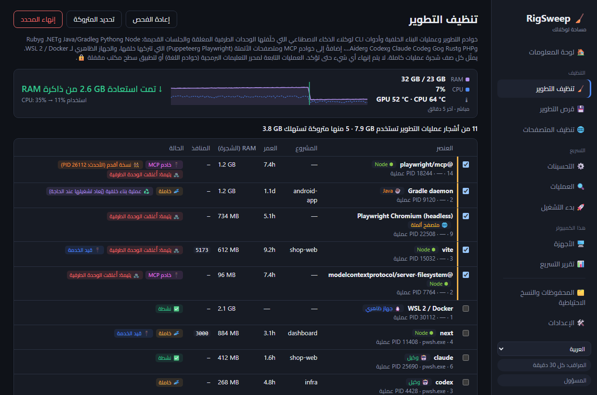
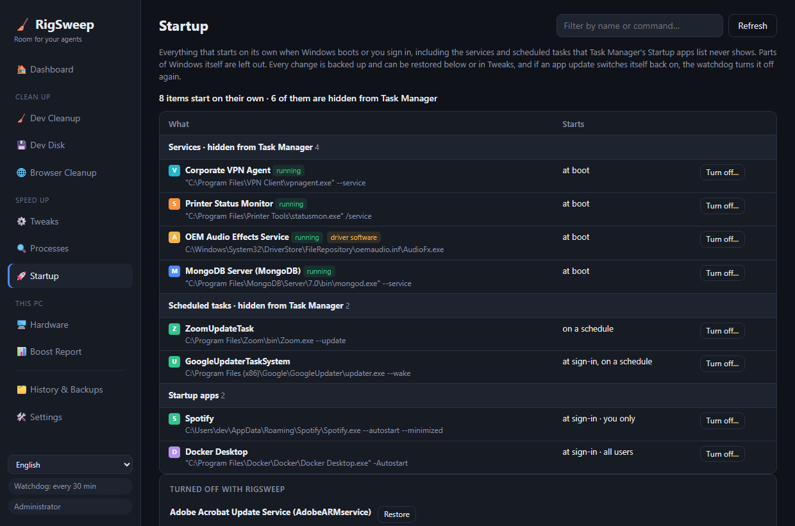

<div align="center">

# 🧹 RigSweep

**مساحة لوكلائك.** حرّر ذاكرة RAM وموارد CPU ومساحة القرص على أجهزة التطوير العاملة بنظام Windows التي تزدحم بجلسات وكلاء الذكاء الاصطناعي.

**[🌐 الصفحة الرئيسية](https://rigsweep.com)** · **[⬇️ التنزيل](https://github.com/yobotn/rigsweep/releases/latest)** · **[📖 أسئلة مكافحة الفيروسات](#%EF%B8%8F-%D8%A7%D9%84%D8%A5%D9%86%D8%B0%D8%A7%D8%B1%D8%A7%D8%AA-%D8%A7%D9%84%D9%83%D8%A7%D8%B0%D8%A8%D8%A9-%D9%85%D9%86-%D8%A8%D8%B1%D8%A7%D9%85%D8%AC-%D9%85%D9%83%D8%A7%D9%81%D8%AD%D8%A9-%D8%A7%D9%84%D9%81%D9%8A%D8%B1%D9%88%D8%B3%D8%A7%D8%AA)**

[🇬🇧 English](README.md) · [🇩🇪 Deutsch](README.de.md) · [🇪🇸 Español](README.es.md) · [🇫🇷 Français](README.fr.md) · [🇮🇹 Italiano](README.it.md) · [🇧🇷 Português](README.pt-BR.md) · [🇷🇺 Русский](README.ru.md) · [🇯🇵 日本語](README.ja.md) · [🇰🇷 한국어](README.ko.md) · [🇨🇳 简体中文](README.zh-CN.md) · [🇮🇱 עברית](README.he.md) · 🇸🇦 العربية




</div>

<div dir="rtl">

---

## 📖 لماذا أنشأت هذه الأداة

في عصر الذكاء الاصطناعي، لم يعد كمبيوتري المحمول يشغّل شيئًا *واحدًا* فقط. في اليوم العادي تكون لديّ عدة جلسات **Claude Code** في وحدات طرفية مختلفة، وخادم تطوير لكل مشروع، ومراقبو بناء، ومتصفح مليء بالوثائق والمعاينات ولوحات المعلومات. كل جلسة جديدة تُنشئ مزيدًا من عمليات Node، وعندما أغلق وحدة طرفية **يستمر بعضها ببساطة في العمل في الخلفية**.

بدأ الأمر يبدو *مزدحمًا*: المراوح تدور، وذاكرة RAM شبه ممتلئة دائمًا، ولا صورة واضحة لما يستهلكها فعلاً. لم تكن «إدارة المهام» تعرض لي سوى جدار من `node.exe` و`chrome.exe` دون أن تخبرني بالجلسة أو المشروع الذي تنتمي إليه، أو ما إذا كان أي منها لا يزال مطلوبًا.

لذلك قست جهازي (ذاكرة RAM بسعة 32 غيغابايت) في منتصف يوم عمل:

| 🔎 ما وجدته | العدد | RAM |
|---|---:|---:|
| 🌐 عمليات Chrome | 37 | **6.5 GB** |
| ⬢ عمليات Node وClaude (أدوات CLI للوكلاء، وخوادم التطوير، وتطبيق سطح المكتب) | 14 | **2.5 GB** |
| 🧩 خدمات Windows قيد التشغيل (القياس عن بُعد، وXbox، وفهرسة البحث…) | ~150 | — |

لم يكن أي من ذلك «فيروسًا» أو «ملفات غير مرغوب فيها». بل كانت **البقايا المعتادة للعمل مع وكلاء الذكاء الاصطناعي**، إضافةً إلى عمليات Windows الخلفية التي لا يحتاجها جهاز المطور. أما تطبيقات «تسريع الكمبيوتر» الموجودة، فإما أنها تفعل أشياء مخيفة لا يمكن التراجع عنها، وإما أنها لا تعرف شيئًا عن سير عمل المطورين. لذلك أنشأت الأداة التي كنت أريدها:

> **اعرف ما الذي يستخدم جهازك فعلاً، واكنس ما أصبح متروكًا، واجعل كل تغيير قابلاً للتراجع.**

---

## ✨ الميزات

### 🧹 تنظيف التطوير: عمليات التطوير المتروكة في أي بيئة
يعثر على **خوادم التطوير وعمليات البناء الخلفية وأدوات CLI لوكلاء الذكاء الاصطناعي**، ويجمع كلاً منها مع **شجرة عملياته الكاملة** ومجلد المشروع والعمر وذاكرة RAM والمنافذ التي يستمع عليها.

| البيئة | ما الذي يعثر عليه |
|---|---|
| ⬢ Node · Bun · Deno | خوادم التطوير (Vite وAstro وNext…)، والمراقبون، وesbuild |
| 🐍 Python | uvicorn وFlask وDjango وJupyter وStreamlit وCelery، وعمليات venv، وخوادم MCP المكتوبة بـ Python |
| ☕ Java | عمليات Gradle وKotlin الخلفية، وMaven، وSpring Boot، وQuarkus |
| 🟣 .NET | `dotnet watch/run`، وخادم مترجم Roslyn، وعُقد MSBuild المتبقية |
| 💎 Ruby · 🐘 PHP · 🦀 Rust · 🐹 Go | `rails`/`ruby`، و`php -S`/artisan، و`cargo watch/run`، و`go run` |
| 🤖 أدوات CLI للوكلاء | Claude Code وCodex وGemini CLI وopencode وAider وGoose |
| 🔌 خوادم MCP | الخوادم التي شغّلها وكيلك (`@modelcontextprotocol/*` و`@playwright/mcp` و`mcp-server-*` وFastMCP…) وتركها تعمل بعد خروجه، حتى لو كانت خلف مُشغّل `cmd /c npx` |
| 🌐 متصفحات الأتمتة | Playwright / Puppeteer / Chrome وEdge بوضع `--headless` مع شجرة العرض الكاملة. لا يُدرج متصفحك الخاص أبدًا |
| 🐧 WSL 2 / Docker | الجهاز الظاهري لـ Linux (`vmmemWSL`)، ويُوقف تشغيله بشكل سليم عبر `wsl --shutdown`، ولا يُحدَّد مسبقًا أبدًا |

تُشغّل Python وJava أيضًا تطبيقات سطح مكتب عادية، لذا لا تُدرج منها إلا العمليات التي تحمل بصمة تطوير واضحة.

- 🧟 **يتيمة**: أُغلقت وحدتها الطرفية لكنها استمرت في العمل. تُحدَّد مسبقًا حتى لو كانت لا تزال تحجز منفذًا (مثل `localhost:3000` الزومبي الشهير).
- 🔌 **خادم MCP**: يُوسَم كل صف يمثّل خادمًا كهذا، لتميّز خادم الأدوات الذي خلّفه وكيل عن خادم التطوير الخاص بك.
- 👯 **نسخة أقدم**: يُعلَّم خادم MCP الذي يعمل أيضًا كنسخة أحدث (مثلاً ضمن جلسة الوكيل الحالية)، فيسهل اكتشاف النسخة المتروكة.
- 📈 **مقياس مباشر**: تُؤخذ عينات من RAM وCPU كل ثانيتين ما دام RigSweep يعمل (في النافذة أو منطقة الإعلام). وبعد التنظيف مباشرةً، يدويًا كان أو تلقائيًا، يعرض **مقدار ذاكرة RAM التي استُعيدت فعلاً** واستخدام CPU قبل وبعد، بقياس حقيقي لا بتقدير.
- 🌡️ **تتبع درجة الحرارة**: تظهر درجات حرارة CPU وGPU مباشرةً في لوحة المعلومات مع اتجاه لآخر 5 دقائق والذروة، وتحذير عندما يظل الجهاز فوق 90 °C. تأتي قيمة GPU من العدّاد نفسه الذي تستخدمه «إدارة المهام»، وقيمة CPU من المنطقة الحرارية ACPI (دون تثبيت برنامج تشغيل ودون صلاحيات المسؤول، وهي تقريبية في كثير من أجهزة سطح المكتب). انقر فوق المربع للتبديل بين °C و°F.
- 💤 **خاملة**: لا نشاط على CPU لفترة طويلة. تُحدَّد مسبقًا بيئات التشغيل التي لا تفتح أي منفذ. أما **جلسة الوكيل الخاملة في وحدة طرفية مفتوحة فلا تُحدَّد مسبقًا أبدًا**، لأنها تنتظرك فحسب (ويعيدها `claude --resume` على أي حال).
  تُحدَّد مدة الخمول في **الإعدادات** (بالدقائق، والقيمة الافتراضية 120؛ مثلاً 5).
- 🧹 **التنظيف التلقائي** (معطّل افتراضيًا، في الإعدادات): كل دقيقة يُنهي RigSweep بيئات تشغيل التطوير المتروكة التي راقبها دون أي نشاط على CPU طوال مدة الخمول. لا تُنهى تلقائيًا أبدًا أدوات CLI للوكلاء أو الجهاز الظاهري لـ WSL/Docker أو العمليات التابعة للمحررات، وتُسجَّل كل شجرة منتهية في المحفوظات.
- 🟠🔴 **مؤشر منطقة الإعلام**: تظهر على أيقونة منطقة الإعلام (وعلى زر شريط المهام ما دامت النافذة مفتوحة) نقطة برتقالية عندما تستهلك عمليات التطوير المتروكة 1 GB أو أكثر، ونقطة حمراء عند 2 GB أو أكثر. مرّر المؤشر فوق أيقونة منطقة الإعلام لمعرفة المقدار. تُضبط الحدود في الإعدادات، ويمكن إيقاف النقطة من هناك أيضًا.
- ♻️ **عملية بناء خلفية**: صُممت خوادم Gradle وKotlin وRoslyn لتبقى قيد التشغيل. إنهاؤها لا يضر، فهي تبدأ من جديد مع البناء التالي.
- 🔒 **مقفلة**: العمليات التابعة لـ **VS Code وCursor وJetBrains وVisual Studio…** (خوادم اللغة لديك) أو لتطبيق سطح مكتب لا يمكن إنهاؤها من هنا أبدًا.
- ✅ لا يتم إنهاء أي شيء دون تأكيدك، ويُتحقق قبل كل إنهاء من أن معرّف العملية (PID) لم يُعَد استخدامه.

### 💾 قرص التطوير: مجلدات node_modules وذاكرات التخزين المؤقت للحزم
تحتفظ المشاريع القديمة بغيغابايتات من `node_modules` و`.next` و`target` و`bin/obj` و`.venv` لفترة طويلة بعد توقفك عن العمل عليها، وذاكرات التخزين المؤقت للحزم لا تتوقف عن النمو. يعثر RigSweep على كليهما ويحذف ما تختاره.

- 🗂️ **المشاريع**: مجلدات مخرجات البناء والتبعيات من Node وRust و&lrm;.NET وJava/Gradle/Maven وPython. لا يُحتسب المجلد إلا إذا كان ملف مشروعه بجانبه (`package.json` و`Cargo.toml` و`*.csproj` و`pyvenv.cfg`…)، لذا لا يُمس أبدًا مجلد `build` عشوائي. لا تُحدَّد مسبقًا إلا المشاريع التي لم يعدّلها أحد منذ 30 يومًا (قابلة للتعديل)، والمشاريع التي تستخدمها عملية قيد التشغيل مقفلة 🔒.
- 📦 **ذاكرات التخزين المؤقت للحزم**: npm وnpx وpnpm وYarn وBun وpip وuv وCargo وGo وNuGet وGradle وMaven وPlaywright وPuppeteer وHugging Face. تُنظَّف pnpm وuv وGo بأوامرها الخاصة (`pnpm store prune`…)، أما في Playwright وPuppeteer فلا تُحذف إلا إصدارات المتصفح الأقدم ويبقى الأحدث.
- 🎯 **التحديد التلقائي**: مباشرةً في علامة التبويب «قرص التطوير»، اختر المدة التي يجب أن يبقى فيها المشروع دون تعديل (من 3 إلى 365 يومًا)، والمجلدات التي تُحدَّد (مخرجات البناء، والتبعيات، وذاكرات التخزين المؤقت للحزم)، والحد الأدنى للحجم.
- 🚫 **عدم التنظيف أبدًا**: أوقف أي ذاكرة تخزين مؤقت. تبدأ متوقفةً تلك التي يعني حذفها تنزيلاً كبيرًا من جديد (Playwright وPuppeteer وHugging Face وGradle وMaven وحزم NuGet ووحدات Go).
- 🙈 **الاستثناءات**: يتم دائمًا تخطي AppData ومجلدات الأدوات في ملف تعريفك (`.cargo` و`.nvm` و`.vscode`…) و`.git` وWindows. أضف مساراتك أو أسماء مجلداتك الخاصة (`vendor` و`old-*`) في الإعدادات، أو انقر فوق **استثناء** بجانب أي مشروع.
- ⏸️ **إيقاف مؤقت أو استئناف أو إيقاف** لعملية تنظيف طويلة، مع شريط تقدّم. وإذا قطعتها إعادة تشغيل، تُستأنف من حيث توقفت.
- ✅ يفحص ملف تعريف المستخدم (سطح المكتب، والمستندات، والتنزيلات، وOneDrive…) افتراضيًا. لا يُحذف أي شيء دون تأكيدك، ويُتحقق من كل مجلد مرة أخرى قبل حذفه مباشرةً.

### 🖥️ الأجهزة: علامة تبويب واحدة بدلاً من أربع أدوات
المعلومات الأساسية التي كنت ستفتح من أجلها CPU-Z وGPU-Z وCrystalDiskInfo وCrystalDiskMark، مقروءةً من Windows نفسه. لا يتم تثبيت أي برنامج تشغيل.

- 💽 **سلامة الأقراص**: سليم / بدأ يتآكل / مشكلة لكل قرص، مع العمر المتبقي ودرجة الحرارة وساعات التشغيل والأخطاء غير المصححة. ويؤدي القرص المعطوب إلى ظهور تحذير في لوحة المعلومات.
- ⚡ **اختبار السرعة**: القراءة والكتابة التسلسلية إضافةً إلى القراءة العشوائية 4K، لكل محرك أقراص. يكتب ملفًا مؤقتًا بحجم 512 ميغابايت ثم يحذفه.
- 🧮 **CPU وGPU والذاكرة**: الطراز، والأنوية ومؤشرات الترابط، وذاكرة التخزين المؤقت، والظاهرية (التي يحتاجها WSL 2 وDocker)، وذاكرة الفيديو وبرنامج التشغيل، ونوع RAM وسرعتها والفتحات الشاغرة.
- 🔋 **النظام والبطارية**: اللوحة الأم، وBIOS، وإصدار Windows، ووقت التشغيل، وتآكل البطارية في أجهزة الكمبيوتر المحمولة.

### 📊 تقرير التسريع: قبل وبعد بقياسات حقيقية
لا أرقام زائفة مثل «أصبح جهازك أسرع بنسبة 87%». **يقيس** RigSweep جهازك ويقارن لقطتين: ذاكرة RAM المستخدمة/المتاحة، ومتوسط CPU، وعدد العمليات، والخدمات قيد التشغيل، وذاكرة RAM لـ Chrome، وذاكرة RAM لـ Node والوكلاء.

- 📸 يُلتقط **خط أساس** تلقائيًا قبل أول تحسين.
- 🔁 يُلتقط زوج **قبل/بعد** حول كل عملية تنظيف للتطوير.
- 📋 **انسخ بتنسيق Markdown** لمشاركة نتيجتك في بلاغ (issue) أو منشور أو في ملف README هذا.

### 🌐 مساعد علامات التبويب في Chrome
**لا يمكن** لتطبيق سطح المكتب إغلاق علامات التبويب في Chrome، لذلك يأتي RigSweep مع إضافة صغيرة ([`chrome-extension/`](chrome-extension/)) بلا وصول إلى الشبكة، وبأذونات `tabs` / `storage` / `alarms` فقط:
- 💤 **تنويم علامات التبويب الخاملة**: يحرّر ذاكرتها، مع بقاء العلامة في شريط علامات التبويب
- 🧹 **إغلاق علامات التبويب المكررة**
- 🎯 **إغلاق علامات التبويب حسب نمط**، مثل `localhost:*` أو `*.vercel.app`
- ⏰ **التنويم التلقائي** كل 10 دقائق (اختياري)

### ⚙️ تحسينات Windows قابلة للتراجع
كتالوج منسّق ([`catalog/tweaks.json`](src-tauri/catalog/tweaks.json)) يشمل القياس عن بُعد وXbox وفهرسة البحث وتطبيقات الخلفية واستثناءات Defender لمجلدات التطوير وخطة الطاقة وغيرها، ولكل منها مستوى خطورة:

| المستوى | المعنى |
|---|---|
| 🟢 `safe` | بلا آثار جانبية ملحوظة (محدد مسبقًا) |
| 🟡 `moderate` | مقايضة بسيطة، مع شرح |
| 🔴 `caution` | يعطّل ميزة، ويجب أن تؤكد |


- 💾 **تُنسخ كل قيمة أصلية احتياطيًا** في SQLite قبل أول تغيير. استعد تحسينًا واحدًا، أو فئة، أو كل شيء.
- 🛟 تُنشأ **نقطة استعادة النظام** قبل أول تطبيق.
- 🔁 يعيد **المراقب** تطبيق التحسينات التي أعادها Windows Update بصمت، ويحصي عدد مرات حدوث ذلك.
- 🧭 **لا عودة لـ Edge**: أزِل Edge من الإعدادات، ثم يمنع تحسين واحد Edge Update وWindows Update من تثبيته مرة أخرى. لا يُمَس وقت تشغيل WebView2 الذي تحتاجه التطبيقات الأخرى.
- 🚫 لا يُمس أبدًا: Windows Update، ومحرك Defender، وRPC/DCOM/LSA، ونحو 60 خدمة أساسية أخرى ([`PROTECTED_SERVICES`](src-tauri/src/catalog.rs)).

### 🔍 محلل العمليات
استخدام CPU / RAM / القرص لكل عملية، و**الخدمات الموجودة داخل كل `svchost.exe`**. عطّل خدمة أو أنهِ عملية مباشرةً من القائمة (العناصر الأساسية مقفلة 🔒). يظهر كل تطبيق بأيقونته الخاصة.

### 🚀 بدء التشغيل: ما لا تعرضه إدارة المهام
تتجاهل قائمة تطبيقات بدء التشغيل في إدارة المهام معظم ما يبدأ مع Windows. يعرض RigSweep كل ذلك، باستثناء مكوّنات Windows نفسه:

- 🧩 **الخدمات التي تبدأ تلقائيًا** من التطبيقات والتعريفات (عملاء VPN وأدوات الشركة المصنّعة وبرامج التحديث). تُحوَّل إلى «يدوي»، فلا تبدأ عند الإقلاع بعد الآن، لكن التطبيق يستطيع تشغيلها عندما تفتحه.
- ⏰ **المهام المجدولة** التي تعمل عند تسجيل الدخول أو عند الإقلاع أو حسب جدول.
- 🚀 **تطبيقات بدء التشغيل** من السجل ومن مجلد بدء التشغيل، وتُوقَف بالمفتاح نفسه الذي تستخدمه إدارة المهام.
- 💾 يُحفظ كل تغيير احتياطيًا ويمكن استعادته، وإذا أعاد تحديثٌ تشغيل تطبيق ما، يوقفه المراقب مجددًا.



### 🔄 التحديثات باختيارك
في **🛠️ الإعدادات ← 🔄 التحديثات** يوجد زر **التحقق الآن** وخيار اختياري هو *التحقق من وجود تحديثات تلقائيًا* (عند بدء التشغيل، ثم مرة يوميًا)، وهو **معطّل افتراضيًا**. عند صدور إصدار جديد، يظهر زر في الشريط الجانبي مع ملاحظات الإصدار. لا يُثبَّت أي شيء حتى تنقر فوق **التثبيت وإعادة التشغيل**، وبشرط أن يكون التنزيل موقّعًا بمفتاح RigSweep. يتم الاحتفاظ بتحسيناتك ونسخك الاحتياطية وإعداداتك. راجع [سياسة الخصوصية](#-%D8%B3%D9%8A%D8%A7%D8%B3%D8%A9-%D8%A7%D9%84%D8%AE%D8%B5%D9%88%D8%B5%D9%8A%D8%A9) لمعرفة ما يفعله التحقق بالضبط.

### 🌍 12 لغة
تتوفر الواجهة بـ **English وDeutsch وEspañol وFrançais وItaliano وPortuguês (Brasil) وРусский و日本語 و한국어 و简体中文 وעברית والعربية** (بدّل اللغة من الشريط الجانبي)، وكذلك برنامج التثبيت وإضافة Chrome. وقد تمت ترجمة كل لغة بمصطلحات Windows الرسمية الخاصة بها («إدارة المهام» و«الخدمات» و«برنامج جدولة المهام»…)، لا ترجمة حرفية. هل لاحظت صياغة غير موفقة؟ افتح بلاغًا (issue) أو طلب سحب (PR) على `ui/locales/<code>.js` (التطبيق) أو `docs/locales/<code>.js` (الصفحة الرئيسية) أو `README.<code>.md`.

---

## 🏁 قبل وبعد على جهازك

ثبّت الأداة، وافتح **📊 تقرير التسريع ← 📸 القياس الآن**، ونفّذ «تنظيف التطوير» وطبّق التحسينات الآمنة، وأعد التشغيل، ثم قِس مرة أخرى، وانقر بعدها فوق **📋 نسخ بتنسيق Markdown**. نرحب بنتائجك في [Discussions](../../discussions)!

<!-- TODO(maintainer): paste your own "Copy as Markdown" result here once you've run it on your machine. -->

> ℹ️ لا يكتمل تأثير تحسينات الخدمات إلا بعد إعادة التشغيل. أما «تنظيف التطوير» وتنويم علامات التبويب في Chrome فيظهر أثرهما فورًا.

---

## 📦 التثبيت

1. نزّل `RigSweep_x.y.z_x64-setup.exe` من [**Releases**](../../releases).
2. شغّله. سيطلب صلاحيات المسؤول، لأن RigSweep يدير الخدمات والنُهج.
3. يسألك برنامج التثبيت ما إذا كنت تريد السماح بـ RigSweep في Microsoft Defender (انظر أدناه). القرار لك.
4. يمكن تثبيت الإصدارات اللاحقة من **🛠️ الإعدادات ← 🔄 التحديثات** (بدءًا من الإصدار 0.5.0).

🌐 **مساعد Chrome:** في RigSweep انتقل إلى **🛠️ الإعدادات ← 🌐 مساعد علامات التبويب في Chrome ← فتح مجلد الإضافة**، ثم في Chrome: `chrome://extensions` ← **وضع مطوّر البرامج** ← **تحميل الإضافة غير المضغوطة** ← اختر ذلك المجلد.

## 🛡️ الإنذارات الكاذبة من برامج مكافحة الفيروسات

إن RigSweep مفتوح المصدر لكنه **غير موقّع رقميًا بعد**. والأدوات التي تغيّر الخدمات وإعدادات Defender تشبه البرامج الضارة كثيرًا في نظر خوارزميات التعلم الآلي، لذا **قد يحذف Microsoft Defender الملف التنفيذي عن طريق الخطأ**. وقد حدث ذلك أثناء التطوير باسم `Trojan:Win32/Bearfoos.B!ml`، حيث تعني `!ml` تخمينًا استدلاليًا لا توقيعًا لبرنامج ضار معروف.

ما نفعله حيال ذلك:
- ❓ **سؤال في برنامج التثبيت (اختياري):** «هل تريد السماح بـ RigSweep في Microsoft Defender؟» يؤدي اختيار «نعم» إلى استثناء **مجلد التثبيت وحده**، ويزيل برنامج إلغاء التثبيت هذا الاستثناء لاحقًا. ولا تضيف عمليات التثبيت الصامتة أي استثناء أبدًا.
- 🛠️ **الإعدادات ← 🛡️ الثقة في برنامج مكافحة الفيروسات:** اعرض الحالة، وأضف الاستثناء أو أزله في أي وقت.
- ✍️ **من المخطط توقيع التعليمات البرمجية** عبر [SignPath Foundation](https://signpath.org) (مجاني للمشاريع مفتوحة المصدر). وهذا هو الحل الحقيقي. راجع [سياسة توقيع التعليمات البرمجية](#-%D8%B3%D9%8A%D8%A7%D8%B3%D8%A9-%D8%AA%D9%88%D9%82%D9%8A%D8%B9-%D8%A7%D9%84%D8%AA%D8%B9%D9%84%D9%8A%D9%85%D8%A7%D8%AA-%D8%A7%D9%84%D8%A8%D8%B1%D9%85%D8%AC%D9%8A%D8%A9).

إذا كان قد حُذف بالفعل: **أمن Windows ← الحماية من الفيروسات والمخاطر ← محفوظات الحماية ←** اختر إدخال RigSweep ← **الإجراءات ← استعادة**. لا تفعل ذلك إلا لملف نزّلته من صفحة Releases في هذا المستودع، أو لنسخة أنشأتها بنفسك. ويمكنك أيضًا [إبلاغ Microsoft بالإنذار الكاذب](https://www.microsoft.com/wdsi/filesubmission) بنفسك.

---

## 🛠️ البناء من التعليمات البرمجية المصدر

<div dir="ltr">

```powershell
winget install Rustlang.Rustup        # + VS 2022 Build Tools (C++ workload)
npm install
npm run build                         # -> src-tauri/target/release/rigsweep.exe + bundle/nsis/*-setup.exe
```

</div>

التشغيل للتطوير: `npm run dev` (وافق على طلب UAC؛ إذ يعيد التطبيق تشغيل نفسه بصلاحيات مرتفعة).

> 💡 قد يعزل Defender أيضًا النسخ المحلية التي أنشأتها للتو. أضف مجلد النسخة المستنسخة إلى قائمة *مجلدات التطوير* في RigSweep (الإعدادات) وطبّق التحسين **Defender exclusions for dev folders**، أو استثنِ `src-tauri\target` يدويًا.

### ⌨️ سطر الأوامر (CLI)
| الأمر | التأثير |
|---|---|
| `rigsweep.exe` | الواجهة الرسومية + منطقة الإعلام |
| `rigsweep.exe --apply` | دون واجهة: التحقق من ملف التعريف، وإعادة تطبيق التحسينات التي أُعيدت، ثم الخروج (تستخدمه مهمة بدء التشغيل) |
| `rigsweep.exe --apply --tray` | مثل السابق، ثم البقاء في منطقة الإعلام مع المراقب |
| `rigsweep.exe --restore-all` | إعادة كل شيء إلى القيم الأصلية المنسوخة احتياطيًا |

### 🧪 الاختبارات

<div dir="ltr">

```powershell
cd src-tauri
cargo test                                          # catalog validity, backups, snapshots, command parsing
cargo test live_status   -- --ignored --nocapture   # read-only: detected status of every tweak
cargo test live_dev_scan -- --ignored --nocapture   # read-only: what Dev Cleanup sees right now
```

</div>

### ➕ إضافة تحسينات
أضف إدخالاً إلى [`catalog/tweaks.json`](src-tauri/catalog/tweaks.json). أنواع الإجراءات هي `service` (start: disabled|manual) و`task` (path) و`registry` (HKLM|HKCU, dword|string) و`defender_exclusion` و`power_plan`. ويجب أن تتضمن عناصر `caution` حقل `warning`. ويرفض `cargo test` الخدمات المحمية والإدخالات غير الصالحة.

## 🐳 docker-optimize (أداة منفصلة)
ليست جزءًا من التطبيق. [`docker-optimize/`](docker-optimize/) برنامج نصي مستقل قابل للتراجع يُشغَّل مرة واحدة، يحدّ من موارد الجهاز الظاهري WSL2 الخاص بـ Docker Desktop (الذاكرة، وCPU، واستعادة RAM، والقرص المتناثر) ويوقف الإضافات غير الضرورية في Docker Desktop. ولا يحذف أبدًا الحاويات أو الصور أو وحدات التخزين. راجع ملف [README](docker-optimize/README.md) الخاص به.

## 🗂️ أين تُخزَّن البيانات
| العنصر | الموقع |
|---|---|
| قاعدة البيانات (النسخ الاحتياطية، والمحفوظات، واللقطات) | `%ProgramData%\RigSweep\rigsweep.db` (+ `.bak.1`–`.bak.5`) |
| مهمة بدء التشغيل | برنامج جدولة المهام ← `RigSweep-Reapply` |
| ملفات التعريف المُصدَّرة | `Documents\RigSweep-profile-*.json` |

هل انتقلت من **aiBoost** (الاسم القديم)؟ تُرحَّل قاعدة بياناتك تلقائيًا عند أول تشغيل، وتُستبدل مهمة بدء التشغيل القديمة.

## 🔏 سياسة توقيع التعليمات البرمجية

توقيع التعليمات البرمجية مجاني مقدّم من [SignPath.io](https://about.signpath.io/)، والشهادة من [SignPath Foundation](https://signpath.org/).
*(الطلب قيد المعالجة: الإصدارات حتى v0.3.0 **غير موقّعة** بعد.)*

- **عمليات البناء:** تُنشأ برامج تثبيت الإصدارات من المصدر الموسوم بواسطة [GitHub Actions](.github/workflows/release.yml) على أجهزة تشغيل تستضيفها GitHub. ولن تُقدَّم للتوقيع إلا هذه النسخ.
- **المساهمون بالتعليمات البرمجية والمراجعون:** [@yobotn](https://github.com/yobotn)
- **المعتمِدون:** [@yobotn](https://github.com/yobotn)

### 🔒 سياسة الخصوصية
لن ينقل هذا البرنامج أي معلومات إلى أنظمة أخرى متصلة بالشبكة ما لم يطلب ذلك صراحةً المستخدم أو الشخص الذي يثبّته أو يشغّله. لا يحتوي RigSweep على أي قياس عن بُعد أو تحليلات، ولا تُرسل إضافة Chrome أي طلبات عبر الشبكة. طلب الشبكة الوحيد الذي يمكن أن يرسله RigSweep هو **التحقق من وجود تحديثات**، وذلك فقط عندما تطلبه: بالنقر فوق *التحقق الآن* في الإعدادات، أو بتشغيل *التحقق من وجود تحديثات تلقائيًا* (معطّل افتراضيًا). وهو ينزّل `latest.json` من GitHub Releases الخاصة بهذا المستودع ولا يرسل أي شيء عن جهازك، ولا يُثبَّت التحديث إلا بعد أن تنقر فوق *التثبيت*، وبشرط أن يطابق توقيعه مفتاح توقيع RigSweep. وكل ما يخزّنه (النسخ الاحتياطية، والمحفوظات، والقياسات) يبقى في `%ProgramData%\RigSweep` على جهازك.

## ⚠️ إخلاء المسؤولية

يُجري RigSweep تغييرات على خدمات Windows والمهام المجدولة ونُهج السجل وإعدادات Microsoft Defender، ويمكنه إنهاء العمليات قيد التشغيل. يُنسخ كل تحسين احتياطيًا ويمكن استعادته، ولا يحدث أي شيء دون تأكيدك، لكن **استخدامه يكون على مسؤوليتك الخاصة**. يتم توفيره **«كما هو» دون أي ضمان من أي نوع** (راجع [ترخيص MIT](LICENSE)). راجع كل تغيير قبل تطبيقه، واحتفظ بنسخك الاحتياطية الخاصة، ولا تستخدمه على أجهزة تديرها جهة عملك أو مدرستك دون موافقة فريق تكنولوجيا المعلومات.

إن RigSweep مشروع مستقل **لا يتبع** Microsoft أو Google أو Anthropic أو OpenAI أو أي أداة أخرى يذكرها. وجميع العلامات التجارية مملوكة لأصحابها.

## 🤝 المساهمة
نرحب بالبلاغات وطلبات السحب، خاصةً التحسينات الجديدة (مع مستوى خطورة واضح)، والمزيد من بيئات التطوير وأدوات CLI للوكلاء في «تنظيف التطوير»، والترجمات.

## 📄 الترخيص
[MIT](LICENSE): مجاني للأبد، افعل به ما تشاء، دون أي ضمان.

</div>
