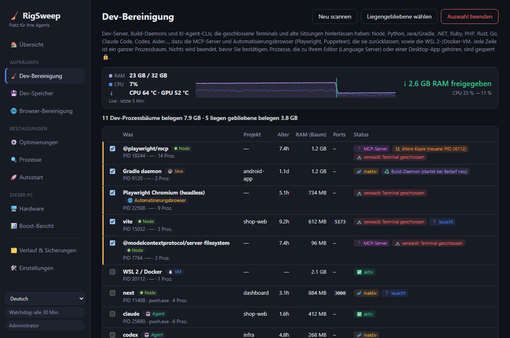
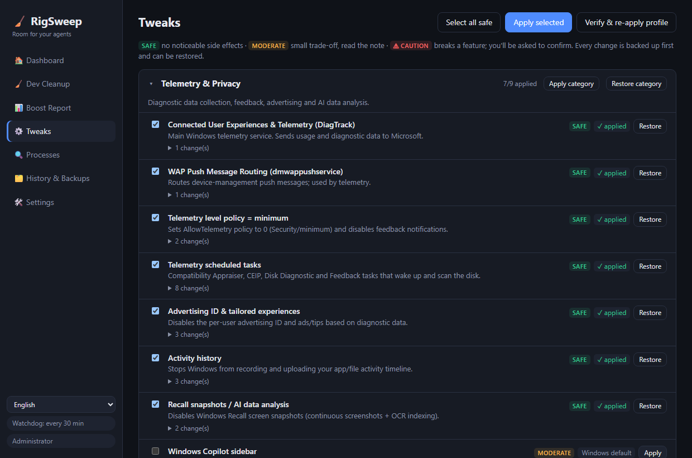

<div align="center">

# 🧹 RigSweep

**Platz für Ihre Agents.** Geben Sie RAM, CPU und Speicherplatz auf Windows-Entwicklerrechnern frei, die von KI-Agent-Sitzungen überladen sind.

**[🌐 Website](https://rigsweep.com)** · **[⬇️ Herunterladen](https://github.com/yobotn/rigsweep/releases/latest)** · **[📖 Antivirus-FAQ](#%EF%B8%8F-antivirus-fehlalarme)**

[🇬🇧 English](README.md) · 🇩🇪 Deutsch · [🇪🇸 Español](README.es.md) · [🇫🇷 Français](README.fr.md) · [🇮🇹 Italiano](README.it.md) · [🇧🇷 Português](README.pt-BR.md) · [🇷🇺 Русский](README.ru.md) · [🇯🇵 日本語](README.ja.md) · [🇰🇷 한국어](README.ko.md) · [🇨🇳 简体中文](README.zh-CN.md)




</div>

---

## 📖 Warum ich RigSweep entwickelt habe

Im KI-Zeitalter läuft auf meinem Laptop nicht mehr nur *eine* Sache. An einem normalen Tag habe ich mehrere **Claude Code**-Sitzungen in verschiedenen Terminals, einen Dev-Server pro Projekt, Build-Watcher und einen Browser voller Dokumentation, Vorschauen und Dashboards. Jede neue Sitzung startet weitere Node-Prozesse, und wenn ich ein Terminal schließe, **laufen einige davon einfach im Hintergrund weiter**.

Das Ganze fühlte sich zunehmend *überladen* an: Lüfter drehen hoch, der RAM ist ständig fast voll, und es gibt keinen klaren Überblick, was ihn eigentlich belegt. Der Task-Manager zeigte mir nur eine Wand aus `node.exe` und `chrome.exe`, ohne zu verraten, zu welcher Sitzung oder welchem Projekt sie gehören oder ob sie überhaupt noch gebraucht werden.

Also habe ich meinen eigenen Rechner (32 GB RAM) mitten an einem Arbeitstag gemessen:

| 🔎 Was ich gefunden habe | Anzahl | RAM |
|---|---:|---:|
| 🌐 Chrome-Prozesse | 37 | **6,5 GB** |
| ⬢ Node- + Claude-Prozesse (Agent-CLIs, Dev-Server, die Desktop-App) | 14 | **2,5 GB** |
| 🧩 Laufende Windows-Dienste (Telemetrie, Xbox, Suchindizierung…) | ~150 | — |

Nichts davon war „ein Virus“ oder „Datenmüll“. Es waren die **normalen Überbleibsel der Arbeit mit KI-Agents**, dazu Windows-Hintergrundkram, den ein Entwicklerrechner nicht braucht. Bestehende „PC-Booster“-Apps machen entweder beängstigende, nicht umkehrbare Dinge oder wissen nichts über Entwicklungsabläufe. Also habe ich das Tool gebaut, das ich mir gewünscht habe:

> **Sehen, was den Rechner wirklich belastet, Liegengebliebenes aufräumen und jede Änderung umkehrbar halten.**

---

## ✨ Funktionen

### 🧹 Dev-Bereinigung: liegen gebliebene Dev-Prozesse in jedem Stack
Findet **Dev-Server, Build-Daemons und KI-Agent-CLIs** und gruppiert jeden davon mit seinem **gesamten Prozessbaum**, Projektordner, Alter, RAM und den Ports, an denen er lauscht.

| Stack | Was gefunden wird |
|---|---|
| ⬢ Node · Bun · Deno | Dev-Server (Vite, Astro, Next…), Watcher, esbuild |
| 🐍 Python | uvicorn, Flask, Django, Jupyter, Streamlit, Celery, venv-Prozesse, Python-MCP-Server |
| ☕ Java | Gradle- & Kotlin-Daemons, Maven, Spring Boot, Quarkus |
| 🟣 .NET | `dotnet watch/run`, Roslyn-Compilerserver, liegen gebliebene MSBuild-Knoten |
| 💎 Ruby · 🐘 PHP · 🦀 Rust · 🐹 Go | `rails`/`ruby`, `php -S`/artisan, `cargo watch/run`, `go run` |
| 🤖 Agent-CLIs | Claude Code, Codex, Gemini CLI, opencode, Aider, Goose |
| 🔌 MCP-Server | Server, die Ihr Agent gestartet hat (`@modelcontextprotocol/*`, `@playwright/mcp`, `mcp-server-*`, FastMCP…) und die nach seinem Beenden weiterlaufen, selbst hinter einem `cmd /c npx`-Starter |
| 🌐 Automatisierungsbrowser | Playwright / Puppeteer / `--headless` Chrome & Edge mit ihrem gesamten Renderer-Baum. Ihr eigener Browser wird nie aufgeführt |
| 🐧 WSL 2 / Docker | die Linux-VM (`vmmemWSL`), sauber heruntergefahren mit `wsl --shutdown`, nie vorausgewählt |

Mit Python und Java laufen auch gewöhnliche Desktop-Apps, daher werden dort nur Prozesse mit eindeutigem Entwicklungsmerkmal aufgeführt.

- 🧟 **Verwaist**: Das Terminal wurde geschlossen, der Prozess läuft aber weiter. Vorausgewählt, selbst wenn er noch einen Port belegt (der klassische Zombie `localhost:3000`).
- 🔌 **MCP-Server**: Jede Zeile, die einer ist, wird gekennzeichnet, damit Sie den liegen gebliebenen Toolserver eines Agents von Ihrem eigenen Dev-Server unterscheiden können.
- 👯 **Ältere Kopie**: Ein MCP-Server, der zusätzlich als neuere Kopie läuft (z. B. unter Ihrer aktuellen Agent-Sitzung), wird markiert, sodass der liegen gebliebene leicht zu erkennen ist.
- 📈 **Live-Anzeige**: RAM und CPU werden alle 2 Sekunden erfasst, solange RigSweep läuft (Fenster oder Infobereich). Direkt nach einer manuellen oder automatischen Bereinigung zeigt sie, **wie viel RAM tatsächlich freigegeben wurde**, und die CPU vorher → nachher, gemessen, nicht geschätzt.
- 🌡️ **Temperaturüberwachung**: CPU- und GPU-Temperaturen erscheinen live in der Übersicht mit 5-Minuten-Verlauf und Spitzenwert sowie einer Warnung, wenn der Rechner dauerhaft über 90 °C liegt. Der GPU-Wert stammt aus demselben Leistungsindikator wie im Task-Manager, der CPU-Wert aus der ACPI-Thermalzone (kein Treiber installiert, keine Administratorrechte nötig; bei vielen Desktop-PCs nur ein Näherungswert). Klicken Sie auf die Kachel, um zwischen °C und °F zu wechseln.
- 💤 **Inaktiv**: Lange Zeit keine CPU-Aktivität. Runtimes ohne offenen Port werden vorausgewählt. Eine **inaktive Agent-Sitzung in einem offenen Terminal wird nie vorausgewählt**, denn sie wartet nur auf Sie (und `claude --resume` holt sie ohnehin zurück).
  Ab wann ein Prozess als inaktiv gilt, legen Sie in den **Einstellungen** fest (in Minuten, Standard 120; z. B. 5).
- 🧹 **Auto-Bereinigung** (standardmäßig aus, in den Einstellungen): RigSweep beendet jede Minute liegen gebliebene Dev-Runtimes, die es während des gesamten Inaktivitätszeitraums ohne CPU-Aktivität beobachtet hat. Agent-CLIs, die WSL-/Docker-VM und Prozesse von Editoren werden nie automatisch beendet, und jeder beendete Prozessbaum wird im Verlauf protokolliert.
- 🟠🔴 **Anzeige im Infobereich**: Das Symbol im Infobereich (und die Taskleistenschaltfläche, solange das Fenster geöffnet ist) erhält einen orangefarbenen Punkt, wenn liegen gebliebene Dev-Prozesse ≥ 1 GB belegen, und einen roten Punkt ab ≥ 2 GB. Zeigen Sie mit der Maus auf das Symbol im Infobereich, um die Menge zu sehen. Die Schwellenwerte legen Sie in den Einstellungen fest, wo sich der Punkt auch ausschalten lässt.
- ♻️ **Build-Daemon**: Gradle-, Kotlin- und Roslyn-Server sollen im Hintergrund bleiben. Sie zu beenden ist unbedenklich; beim nächsten Build starten sie neu.
- 🔒 **Gesperrt**: Prozesse, die zu **VS Code, Cursor, JetBrains, Visual Studio…** (Ihren Language Servern) oder zu einer Desktop-App gehören, können hier nie beendet werden.
- ✅ Nichts wird ohne Ihre Bestätigung beendet, und vor jedem Beenden wird geprüft, ob die PID inzwischen wiederverwendet wurde.

### 💾 Dev-Speicher: node_modules und Paket-Caches
Alte Projekte behalten gigabyteweise `node_modules`, `.next`, `target`, `bin/obj` und `.venv`, lange nachdem Sie nicht mehr daran arbeiten, und Paket-Caches wachsen nur. RigSweep findet beides und löscht, was Sie auswählen.

- 🗂️ **Projekte**: Build-Ausgaben und Abhängigkeitsordner von Node, Rust, .NET, Java/Gradle/Maven und Python. Ein Ordner zählt nur, wenn seine Projektdatei daneben liegt (`package.json`, `Cargo.toml`, `*.csproj`, `pyvenv.cfg`…), ein beliebiger `build`-Ordner bleibt also unangetastet. Vorausgewählt werden nur Projekte, die 30 Tage (einstellbar) niemand bearbeitet hat, und Projekte, die ein laufender Prozess verwendet, sind gesperrt 🔒.
- 📦 **Paket-Caches**: npm, npx, pnpm, Yarn, Bun, pip, uv, Cargo, Go, NuGet, Gradle, Maven, Playwright, Puppeteer, Hugging Face. pnpm, uv und Go werden mit ihren eigenen Befehlen bereinigt (`pnpm store prune`…); bei Playwright und Puppeteer werden nur ältere Browserversionen entfernt, die neueste bleibt.
- 🚫 **Nie bereinigen**: Jeder Cache lässt sich ausschalten. Die mit großem erneutem Download (Playwright, Puppeteer, Hugging Face, Gradle, Maven, NuGet-Pakete, Go-Module) sind anfangs ausgeschaltet.
- 🙈 **Ausnahmen**: AppData, Tool-Ordner in Ihrem Profil (`.cargo`, `.nvm`, `.vscode`…), `.git` und Windows werden immer übersprungen. Eigene Pfade oder Ordnernamen (`vendor`, `old-*`) fügen Sie in den Einstellungen hinzu, oder Sie klicken bei einem Projekt auf **Ausschließen**.
- ✅ Durchsucht standardmäßig Ihr Benutzerprofil (Desktop, Dokumente, Downloads, OneDrive…). Ohne Ihre Bestätigung wird nichts gelöscht, und jeder Ordner wird direkt vor dem Löschen noch einmal geprüft.

### 📊 Boost-Bericht: echtes Vorher und Nachher
Keine erfundenen Angaben wie „Ihr PC ist 87 % schneller“. RigSweep **misst** Ihren Rechner und vergleicht zwei Momentaufnahmen: belegter/freier RAM, durchschnittliche CPU-Last, Anzahl der Prozesse, laufende Dienste, Chrome-RAM, Node-/Agent-RAM.

- 📸 Vor Ihrer ersten Optimierung wird automatisch ein **Referenzwert** erfasst.
- 🔁 Um jede Dev-Bereinigung herum wird ein **Vorher/Nachher**-Paar erfasst.
- 📋 Mit **Als Markdown kopieren** teilen Sie Ihr Ergebnis in einem Issue, einem Post oder dieser README.

### 🌐 Chrome-Tab-Helfer
Eine Desktop-App **kann keine** Chrome-Tabs schließen. Deshalb liefert RigSweep eine winzige Erweiterung mit ([`chrome-extension/`](chrome-extension/)), ohne Netzwerkzugriff und nur mit den Berechtigungen `tabs` / `storage` / `alarms`:
- 💤 **Inaktive Tabs in den Ruhezustand versetzen**: gibt deren Arbeitsspeicher frei, der Tab bleibt aber in Ihrer Tableiste
- 🧹 **Doppelte Tabs schließen**
- 🎯 **Tabs nach Muster schließen**, etwa `localhost:*` oder `*.vercel.app`
- ⏰ **Automatischer Ruhezustand** alle 10 Minuten (optional)

### ⚙️ Umkehrbare Windows-Optimierungen
Ein kuratierter Katalog ([`catalog/tweaks.json`](src-tauri/catalog/tweaks.json)) mit Telemetrie, Xbox, Suchindizierung, Hintergrund-Apps, Defender-Ausschlüssen für Dev-Ordner, Energiesparplan und mehr, jeweils mit Risikostufe:

| Stufe | Bedeutung |
|---|---|
| 🟢 `safe` | Keine spürbaren Nebenwirkungen (vorausgewählt) |
| 🟡 `moderate` | Kleiner Kompromiss, wird erklärt |
| 🔴 `caution` | Deaktiviert eine Funktion; Sie müssen bestätigen |



- 💾 **Jeder Originalwert wird** vor der ersten Änderung in SQLite **gesichert**. Stellen Sie eine einzelne Optimierung, eine Kategorie oder alles wieder her.
- 🛟 Vor dem ersten Anwenden wird ein **Wiederherstellungspunkt** erstellt.
- 🔁 Ein **Watchdog** wendet Optimierungen erneut an, die ein Windows Update unbemerkt zurückgesetzt hat, und zählt, wie oft das passiert.
- 🚫 Bleibt immer unberührt: Windows Update, das Defender-Modul, RPC/DCOM/LSA und ~60 weitere wichtige Dienste ([`PROTECTED_SERVICES`](src-tauri/src/catalog.rs)).

### 🔍 Prozessanalyse
CPU / RAM / Datenträger pro Prozess und **welche Dienste in jeder `svchost.exe` laufen**. Deaktivieren Sie einen Dienst oder beenden Sie einen Prozess direkt aus der Liste (wichtige Elemente sind gesperrt 🔒).

### 🔄 Updates nach Ihrer Wahl
Unter **🛠️ Einstellungen → 🔄 Updates** gibt es die Schaltfläche **Jetzt suchen** und die optionale Einstellung *Automatisch nach Updates suchen* (beim Start, danach einmal täglich), die **standardmäßig deaktiviert** ist. Sobald eine neue Version erscheint, wird in der Seitenleiste eine Schaltfläche mit den Neuerungen angezeigt. Nichts wird installiert, bevor Sie auf **Installieren und neu starten** klicken, und nur, wenn der Download mit dem Schlüssel von RigSweep signiert ist. Ihre Optimierungen, Sicherungen und Einstellungen bleiben erhalten. Was genau bei einer Suche geschieht, steht in der [Datenschutzerklärung](#-datenschutzerkl%C3%A4rung).

### 🌍 10 Sprachen
Die Benutzeroberfläche gibt es auf **English, Deutsch, Español, Français, Italiano, Português (Brasil), Русский, 日本語, 한국어 und 简体中文** (Umschalten in der Seitenleiste), ebenso das Installationsprogramm und die Chrome-Erweiterung. Jede Sprache ist mit den offiziellen Windows-Begriffen dieser Sprache lokalisiert (Task-Manager, Dienste, Aufgabenplanung…), nicht Wort für Wort übersetzt. Etwas klingt holprig? Eröffnen Sie ein Issue oder einen PR zu `ui/locales/<code>.js` (App), `docs/locales/<code>.js` (Website) oder `README.<code>.md`.

---

## 🏁 Vorher und nachher auf Ihrem Rechner

Installieren Sie RigSweep, öffnen Sie **📊 Boost-Bericht → 📸 Jetzt messen**, führen Sie eine Dev-Bereinigung durch und wenden Sie die sicheren Optimierungen an, starten Sie neu, messen Sie erneut und klicken Sie dann auf **📋 Als Markdown kopieren**. Ergebnisse sind in den [Discussions](../../discussions) willkommen!

<!-- TODO(maintainer): paste your own "Copy as Markdown" result here once you've run it on your machine. -->

> ℹ️ Optimierungen an Diensten wirken sich erst nach einem Neustart vollständig aus. Dev-Bereinigung und Tab-Ruhezustand in Chrome wirken sofort.

---

## 📦 Installation

1. Laden Sie `RigSweep_x.y.z_x64-setup.exe` unter [**Releases**](../../releases) herunter.
2. Führen Sie die Datei aus. Sie fragt nach Administratorrechten, da RigSweep Dienste und Richtlinien verwaltet.
3. Das Installationsprogramm fragt, ob RigSweep in Microsoft Defender zugelassen werden soll (siehe unten). Das entscheiden Sie.
4. Neuere Versionen lassen sich unter **🛠️ Einstellungen → 🔄 Updates** installieren (ab 0.5.0).

🌐 **Chrome-Helfer:** Gehen Sie in RigSweep zu **🛠️ Einstellungen → 🌐 Chrome-Tab-Helfer → Erweiterungsordner öffnen**, dann in Chrome: `chrome://extensions` → **Entwicklermodus** → **Entpackte Erweiterung laden** → diesen Ordner auswählen.

## 🛡️ Antivirus-Fehlalarme

RigSweep ist Open Source, aber **noch nicht codesigniert**. Tools, die Dienste und Defender-Einstellungen ändern, sehen für Machine-Learning-Heuristiken Schadsoftware sehr ähnlich, daher **kann Microsoft Defender die EXE-Datei fälschlicherweise löschen**. Während der Entwicklung geschah das als `Trojan:Win32/Bearfoos.B!ml`, wobei `!ml` für eine heuristische Vermutung steht, nicht für die Signatur einer bekannten Schadsoftware.

Was wir dagegen tun:
- ❓ **Abfrage im Installationsprogramm (optional):** „RigSweep in Microsoft Defender zulassen?“ Mit „Ja“ wird **nur der Installationsordner** ausgeschlossen, und das Deinstallationsprogramm entfernt diesen Ausschluss wieder. Bei einer unbeaufsichtigten Installation wird nie ein Ausschluss hinzugefügt.
- 🛠️ **Einstellungen → 🛡️ Antivirus-Vertrauen:** Status ansehen und den Ausschluss jederzeit hinzufügen oder entfernen.
- ✍️ **Eine Codesignierung ist geplant**, über die [SignPath Foundation](https://signpath.org) (kostenlos für Open-Source-Projekte). Das ist die eigentliche Lösung. Siehe [Richtlinie zur Codesignierung](#-richtlinie-zur-codesignierung).

Falls die Datei bereits gelöscht wurde: **Windows-Sicherheit → Viren- & Bedrohungsschutz → Schutzverlauf →** Eintrag zu RigSweep auswählen → **Aktionen → Wiederherstellen**. Tun Sie das nur für einen Download von der Releases-Seite dieses Repositorys oder für einen Build, den Sie selbst erstellt haben. Sie können den Fehlalarm auch selbst [an Microsoft melden](https://www.microsoft.com/wdsi/filesubmission).

---

## 🛠️ Aus dem Quellcode kompilieren

```powershell
winget install Rustlang.Rustup        # + VS 2022 Build Tools (Workload „Desktopentwicklung mit C++“)
npm install
npm run build                         # -> src-tauri/target/release/rigsweep.exe + bundle/nsis/*-setup.exe
```
Entwicklungsmodus: `npm run dev` (UAC bestätigen; die App startet sich selbst mit erhöhten Rechten neu).

> 💡 Defender stellt womöglich auch Ihre frischen lokalen Builds unter Quarantäne. Fügen Sie Ihren Klon-Ordner der Liste *Dev-Ordner* von RigSweep hinzu (Einstellungen) und wenden Sie die Optimierung **Defender exclusions for dev folders** an, oder schließen Sie `src-tauri\target` manuell aus.

### ⌨️ CLI
| Befehl | Wirkung |
|---|---|
| `rigsweep.exe` | GUI + Infobereich |
| `rigsweep.exe --apply` | Ohne Oberfläche: Profil prüfen, zurückgesetzte Optimierungen erneut anwenden, beenden (von der Autostart-Aufgabe verwendet) |
| `rigsweep.exe --apply --tray` | Ebenso, dann mit dem Watchdog im Infobereich bleiben |
| `rigsweep.exe --restore-all` | Alles auf die gesicherten Originalwerte zurücksetzen |

### 🧪 Tests
```powershell
cd src-tauri
cargo test                                          # Katalog-Gültigkeit, Sicherungen, Momentaufnahmen, Befehlsanalyse
cargo test live_status   -- --ignored --nocapture   # schreibgeschützt: erkannter Status jeder Optimierung
cargo test live_dev_scan -- --ignored --nocapture   # schreibgeschützt: was die Dev-Bereinigung gerade sieht
```

### ➕ Optimierungen hinzufügen
Fügen Sie [`catalog/tweaks.json`](src-tauri/catalog/tweaks.json) einen Eintrag hinzu. Die Aktionstypen sind `service` (start: disabled|manual), `task` (path), `registry` (HKLM|HKCU, dword|string), `defender_exclusion` und `power_plan`. Einträge mit `caution` müssen eine `warning` enthalten. `cargo test` lehnt geschützte Dienste und fehlerhafte Einträge ab.

## 🐳 docker-optimize (separates Tool)
Nicht Teil der App. [`docker-optimize/`](docker-optimize/) ist ein eigenständiges, umkehrbares Skript zur einmaligen Ausführung, das die WSL2-VM von Docker Desktop begrenzt (Arbeitsspeicher, CPU, RAM-Rückgewinnung, Sparse-Datenträger) und nicht benötigte Zusatzfunktionen von Docker Desktop abschaltet. Es löscht nie Container, Images oder Volumes. Siehe die zugehörige [README](docker-optimize/README.md).

## 🗂️ Wo was gespeichert wird
| Was | Wo |
|---|---|
| Datenbank (Sicherungen, Verlauf, Momentaufnahmen) | `%ProgramData%\RigSweep\rigsweep.db` (+ `.bak.1`–`.bak.5`) |
| Autostart-Aufgabe | Aufgabenplanung → `RigSweep-Reapply` |
| Exportierte Profile | `Documents\RigSweep-profile-*.json` |

Sie kommen von **aiBoost** (dem alten Namen)? Ihre Datenbank wird beim ersten Start automatisch migriert, und die alte Autostart-Aufgabe wird ersetzt.

## 🔏 Richtlinie zur Codesignierung

Kostenlose Codesignierung bereitgestellt von [SignPath.io](https://about.signpath.io/), Zertifikat von der [SignPath Foundation](https://signpath.org/).
*(Antrag läuft: Releases bis einschließlich v0.3.0 sind noch **nicht signiert**.)*

- **Builds:** Die Release-Installationsprogramme werden von [GitHub Actions](.github/workflows/release.yml) auf von GitHub gehosteten Runnern aus dem getaggten Quellcode erstellt. Nur diese Builds werden zur Signierung eingereicht.
- **Committer und Reviewer:** [@yobotn](https://github.com/yobotn)
- **Genehmiger:** [@yobotn](https://github.com/yobotn)

### 🔒 Datenschutzerklärung
Dieses Programm überträgt keine Informationen an andere vernetzte Systeme, es sei denn, dies wird ausdrücklich vom Benutzer oder von der Person angefordert, die es installiert oder betreibt. RigSweep hat keine Telemetrie und keine Analysen, und die Chrome-Erweiterung stellt keine Netzwerkanfragen. Die einzige Netzwerkanfrage, die RigSweep stellen kann, ist die **Suche nach Updates**, und nur, wenn Sie sie anfordern: per Klick auf *Jetzt suchen* in den Einstellungen oder durch Aktivieren von *Automatisch nach Updates suchen* (standardmäßig deaktiviert). Dabei wird `latest.json` aus den GitHub-Releases dieses Repositorys heruntergeladen und nichts über Ihren PC gesendet; ein Update wird erst installiert, nachdem Sie auf *Installieren und neu starten* geklickt haben, und nur, wenn seine Signatur mit dem Signaturschlüssel von RigSweep übereinstimmt. Alles, was RigSweep speichert (Sicherungen, Verlauf, Messwerte), bleibt in `%ProgramData%\RigSweep` auf Ihrem PC.

## ⚠️ Haftungsausschluss

RigSweep ändert Windows-Dienste, geplante Aufgaben, Registrierungsrichtlinien und Einstellungen von Microsoft Defender und kann laufende Prozesse beenden. Jede Optimierung wird gesichert und lässt sich wiederherstellen, und nichts geschieht ohne Ihre Bestätigung, **die Nutzung erfolgt jedoch auf eigenes Risiko**. Die Software wird **„wie besehen“ und ohne jegliche Gewährleistung** bereitgestellt (siehe [MIT-Lizenz](LICENSE)). Prüfen Sie jede Änderung, bevor Sie sie übernehmen, erstellen Sie eigene Sicherungen, und verwenden Sie RigSweep nicht auf Geräten, die von Ihrem Arbeitgeber oder Ihrer Schule verwaltet werden, ohne Zustimmung Ihrer IT-Abteilung.

RigSweep ist ein unabhängiges Projekt und **steht in keiner Verbindung zu** Microsoft, Google, Anthropic, OpenAI oder anderen erwähnten Tools. Alle Marken gehören ihren jeweiligen Inhabern.

## 🤝 Mitwirken
Issues und PRs sind willkommen, insbesondere neue Optimierungen (mit klarer Risikostufe), weitere Dev-Stacks und Agent-CLIs für die Dev-Bereinigung sowie Übersetzungen.

## 📄 Lizenz
[MIT](LICENSE): für immer kostenlos, machen Sie damit, was Sie möchten, ohne Gewährleistung.
