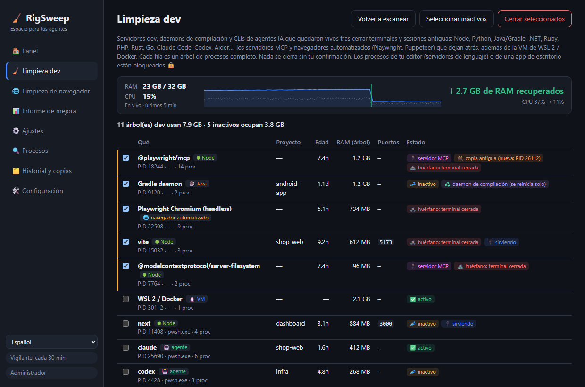

<div align="center">

# 🧹 RigSweep

**Espacio para tus agentes.** Libera RAM, CPU y disco en equipos Windows de desarrollo saturados por sesiones de agentes IA.

**[🌐 Sitio web](https://yobotn.github.io/rigsweep/)** · **[⬇️ Descargar](https://github.com/yobotn/rigsweep/releases/latest)** · **[📖 FAQ antivirus](#%EF%B8%8F-falsos-positivos-del-antivirus)**

[🇬🇧 English](README.md) · 🇪🇸 Español · [🇫🇷 Français](README.fr.md)




</div>

---

## 📖 Por qué lo creé

En la era de la IA mi portátil ya no ejecuta *una* sola cosa. En un día normal tengo varias sesiones de **Claude Code** en distintas terminales, un servidor dev por proyecto, watchers de compilación y un navegador lleno de documentación, previsualizaciones y paneles. Cada sesión nueva lanza más procesos de Node, y al cerrar una terminal algunos **siguen vivos en segundo plano**.

Empezó a sentirse *saturado*: ventiladores a tope, la RAM siempre al límite y ninguna idea clara de qué la estaba consumiendo. El Administrador de tareas solo me mostraba una pared de `node.exe` y `chrome.exe`, sin decirme de qué sesión o proyecto venían ni si algo los seguía necesitando.

Así que medí mi propio equipo (32 GB de RAM) en mitad de una jornada de trabajo:

| 🔎 Lo que encontré | Cantidad | RAM |
|---|---:|---:|
| 🌐 Procesos de Chrome | 37 | **6,5 GB** |
| ⬢ Procesos de Node + Claude (CLIs de agentes, servidores dev, la app de escritorio) | 14 | **2,5 GB** |
| 🧩 Servicios de Windows activos (telemetría, Xbox, indexador…) | ~150 | — |

Nada de eso era "un virus" ni "basura": eran los **restos normales de trabajar con agentes IA**, más procesos de fondo de Windows que un equipo de desarrollo no necesita. Las apps "aceleradoras" existentes o hacen cosas irreversibles y peligrosas o no saben nada de flujos de desarrollo. Así que hice la herramienta que yo quería:

> **Ver qué está usando realmente tu equipo, barrer lo que sobra y que cada cambio sea reversible.**

---

## ✨ Funciones

### 🧹 Limpieza dev: procesos dev olvidados en cualquier stack
Encuentra **servidores dev, daemons de compilación y CLIs de agentes IA** y agrupa cada uno con **todo su árbol de procesos**, carpeta del proyecto, antigüedad, RAM y puertos en escucha.

| Stack | Qué encuentra |
|---|---|
| ⬢ Node · Bun · Deno | servidores dev (Vite, Astro, Next…), watchers, esbuild |
| 🐍 Python | uvicorn, Flask, Django, Jupyter, Streamlit, Celery, procesos de venv, servidores MCP en Python |
| ☕ Java | daemons de Gradle y Kotlin, Maven, Spring Boot, Quarkus |
| 🟣 .NET | `dotnet watch/run`, servidor de compilación Roslyn, nodos MSBuild sobrantes |
| 💎 Ruby · 🐘 PHP · 🦀 Rust · 🐹 Go | `rails`/`ruby`, `php -S`/artisan, `cargo watch/run`, `go run` |
| 🤖 CLIs de agentes | Claude Code, Codex, Gemini CLI, opencode, Aider, Goose |
| 🔌 Servidores MCP | servidores que tu agente arrancó (`@modelcontextprotocol/*`, `@playwright/mcp`, `mcp-server-*`, FastMCP…) y siguieron vivos tras cerrarse, incluso detrás de un lanzador `cmd /c npx` |
| 🌐 Navegadores automatizados | Chrome y Edge de Playwright / Puppeteer / `--headless` con todo su árbol de procesos. Tu propio navegador nunca aparece |
| 🐧 WSL 2 / Docker | la VM de Linux (`vmmemWSL`), se apaga limpiamente con `wsl --shutdown` y nunca se preselecciona |

Python y Java también ejecutan apps de escritorio normales, así que solo se listan sus procesos con una firma clara de desarrollo.

- 🧟 **Huérfano**: su terminal se cerró pero el proceso siguió vivo. Se preselecciona aunque ocupe un puerto (el clásico `localhost:3000` zombi).
- 🔌 **Servidor MCP**: se marca en cada fila que lo es, para distinguir el servidor de herramientas que dejó un agente de tu propio servidor dev.
- 👯 **Copia antigua**: un servidor MCP del que también corre una copia más nueva (por ejemplo, en tu sesión de agente actual) queda marcado, para que el sobrante sea fácil de identificar.
- 📈 **Medidor en vivo**: la RAM y la CPU se miden cada 2 segundos mientras RigSweep está abierto (ventana o bandeja). Justo después de una limpieza, manual o automática, muestra **cuánta RAM se recuperó de verdad** y la CPU antes → después, medida y no estimada.
- 💤 **Inactivo**: sin actividad de CPU durante mucho tiempo. Los runtimes sin puerto abierto se preseleccionan. Una **sesión de agente inactiva en una terminal abierta nunca se preselecciona**, porque solo te está esperando (y `claude --resume` la recupera de todos modos).
- ♻️ **Daemon de compilación**: los servidores de Gradle, Kotlin y Roslyn están hechos para quedarse en segundo plano. Cerrarlos no hace daño; se reinician en la siguiente compilación.
- 🔒 **Bloqueado**: los procesos de **VS Code, Cursor, JetBrains, Visual Studio…** (tus servidores de lenguaje) o de una app de escritorio nunca se pueden cerrar desde aquí.
- ✅ Nada se cierra sin tu confirmación, y se verifica la reutilización de PID antes de cada cierre.

### 📊 Informe de mejora: antes y después reales
Nada de "tu PC es un 87 % más rápido". RigSweep **mide** tu equipo y compara dos capturas: RAM usada/libre, CPU media, número de procesos, servicios activos, RAM de Chrome y RAM de Node/agentes.

- 📸 Se toma una **línea base** automáticamente antes del primer ajuste.
- 🔁 Se toma un par **antes/después** en cada Limpieza dev.
- 📋 **Copiar como Markdown** para compartir tu resultado.

### 🌐 Asistente de pestañas para Chrome
Una app de escritorio **no puede** cerrar pestañas de Chrome, así que RigSweep incluye una pequeña extensión ([`chrome-extension/`](chrome-extension/)) sin acceso a red y solo con los permisos `tabs` / `storage` / `alarms`:
- 💤 **Dormir pestañas inactivas**: libera su memoria y la pestaña se queda en la barra
- 🧹 **Cerrar pestañas duplicadas**
- 🎯 **Cerrar pestañas por patrón**, como `localhost:*` o `*.vercel.app`
- ⏰ **Dormir automáticamente** cada 10 minutos (opcional)

### ⚙️ Ajustes de Windows reversibles
Un catálogo curado ([`catalog/tweaks.json`](src-tauri/catalog/tweaks.json)) de telemetría, Xbox, indexador de búsqueda, apps en segundo plano, exclusiones de Defender para carpetas dev, plan de energía y más, cada uno con un nivel de riesgo:

| Nivel | Significado |
|---|---|
| 🟢 `safe` | Sin efectos visibles (preseleccionado) |
| 🟡 `moderate` | Pequeña contrapartida, explicada |
| 🔴 `caution` | Desactiva una función; debes confirmar |

- 💾 **Cada valor original se respalda** en SQLite antes del primer cambio. Puedes restaurar un ajuste, una categoría o todo.
- 🛟 Se crea un **punto de restauración del sistema** antes de la primera aplicación.
- 🔁 Un **vigilante** reaplica los ajustes que una actualización de Windows revirtió sin avisar.
- 🚫 Nunca se tocan Windows Update, el motor de Defender, RPC/DCOM/LSA ni otros ~60 servicios esenciales.

### 🔍 Analizador de procesos
CPU / RAM / disco por proceso, y **qué servicios viven dentro de cada `svchost.exe`**.

### 🌍 3 idiomas
La interfaz está en **English, Español y Français**, y también el instalador y la extensión de Chrome.

---

## 🏁 Antes y después en tu equipo

Instala, abre **📊 Informe de mejora → 📸 Medir ahora**, haz una Limpieza dev y aplica los ajustes seguros. Después reinicia, vuelve a medir y pulsa **📋 Copiar como Markdown**. ¡Comparte tus resultados en [Discussions](../../discussions)!

> ℹ️ Los ajustes de servicios surten todo su efecto tras reiniciar. La Limpieza dev y dormir pestañas se notan al instante.

---

## 📦 Instalación

1. Descarga `RigSweep_x.y.z_x64-setup.exe` desde [**Releases**](../../releases).
2. Ejecútalo. Pide permisos de administrador porque RigSweep gestiona servicios y directivas.
3. El instalador te pregunta si quieres permitir RigSweep en Microsoft Defender (ver abajo). Tú decides.

🌐 **Asistente de Chrome:** en RigSweep ve a **🛠️ Configuración → 🌐 Asistente de pestañas → Abrir carpeta de la extensión**, y en Chrome: `chrome://extensions` → **Modo de desarrollador** → **Cargar descomprimida** → elige esa carpeta.

## 🛡️ Falsos positivos del antivirus

RigSweep es de código abierto pero **aún no está firmado**. Las herramientas que cambian servicios y la configuración de Defender se parecen mucho al malware para la heurística de aprendizaje automático, así que **Microsoft Defender puede borrar el exe por error**. Nos pasó durante el desarrollo como `Trojan:Win32/Bearfoos.B!ml`, donde `!ml` indica una suposición heurística y no una firma de malware conocida.

Qué hacemos al respecto:
- ❓ **Pregunta en el instalador (opcional):** "¿Permitir RigSweep en Microsoft Defender?" Si respondes Sí, se excluye **solo la carpeta de instalación**, y el desinstalador quita esa exclusión. Las instalaciones silenciosas nunca la añaden.
- 🛠️ **Configuración → 🛡️ Confianza del antivirus:** puedes ver el estado y añadir o quitar la exclusión cuando quieras.
- ✍️ **Firma de código prevista** con [SignPath Foundation](https://signpath.org), gratis para proyectos de código abierto. Es la solución definitiva.

Si ya se borró: **Seguridad de Windows → Protección antivirus y contra amenazas → Historial de protección →** elige la entrada de RigSweep → **Acciones → Restaurar**. Hazlo solo si lo descargaste de las Releases de este repositorio o lo compilaste tú. También puedes [notificar el falso positivo a Microsoft](https://www.microsoft.com/wdsi/filesubmission).

---

## 🛠️ Compilar

```powershell
winget install Rustlang.Rustup        # + VS 2022 Build Tools (carga de trabajo C++)
npm install
npm run build                         # -> src-tauri/target/release/rigsweep.exe + bundle/nsis/*-setup.exe
```

Consulta el [README en inglés](README.md#-build-from-source) para la CLI, las pruebas y cómo añadir ajustes.

¿Vienes de **aiBoost** (el nombre anterior)? Tu base de datos se migra automáticamente en el primer inicio.

## 🐳 docker-optimize (herramienta aparte)
No forma parte de la app. [`docker-optimize/`](docker-optimize/) es un script independiente, reversible y de una sola vez que limita la VM WSL2 de Docker Desktop (memoria, CPU, devolución de RAM, disco disperso) y desactiva extras de Docker Desktop que no necesitas. Nunca borra contenedores, imágenes ni volúmenes. Consulta su [README](docker-optimize/README.md) (en inglés).

## 🔏 Política de firma de código

Firma de código gratuita proporcionada por [SignPath.io](https://about.signpath.io/), certificado de [SignPath Foundation](https://signpath.org/).
*(Solicitud en curso: las versiones hasta la v0.3.0 aún **no están firmadas**.)*

- **Compilaciones:** los instaladores se compilan desde el código etiquetado con [GitHub Actions](.github/workflows/release.yml) en servidores de GitHub. Solo esas compilaciones se enviarán a firmar.
- **Committers y revisores:** [@yobotn](https://github.com/yobotn)
- **Aprobadores:** [@yobotn](https://github.com/yobotn)

### 🔒 Política de privacidad
Este programa no transfiere ninguna información a otros sistemas en red salvo que lo solicite expresamente el usuario o la persona que lo instala o lo utiliza. RigSweep no tiene telemetría, analíticas ni comprobación de actualizaciones, y la extensión de Chrome no hace peticiones de red. Todo lo que guarda (copias, historial, mediciones) se queda en `%ProgramData%\RigSweep` en tu PC.

## ⚠️ Aviso legal

RigSweep modifica servicios de Windows, tareas programadas, directivas del registro y la configuración de Microsoft Defender, y puede cerrar procesos en ejecución. Cada ajuste se respalda y se puede restaurar, y nada ocurre sin tu confirmación, pero **lo usas bajo tu propia responsabilidad**. Se proporciona **"tal cual", sin garantía de ningún tipo** (ver la [licencia MIT](LICENSE)). Revisa cada cambio antes de aplicarlo, guarda tus propias copias de seguridad y no lo uses en equipos gestionados por tu empresa o centro educativo sin la aprobación de su equipo de TI.

RigSweep es un proyecto independiente, **sin relación con** Microsoft, Google, Anthropic, OpenAI ni ninguna otra herramienta que mencione. Todas las marcas pertenecen a sus dueños.

## 📄 Licencia
[MIT](LICENSE): gratis para siempre, sin garantía.
