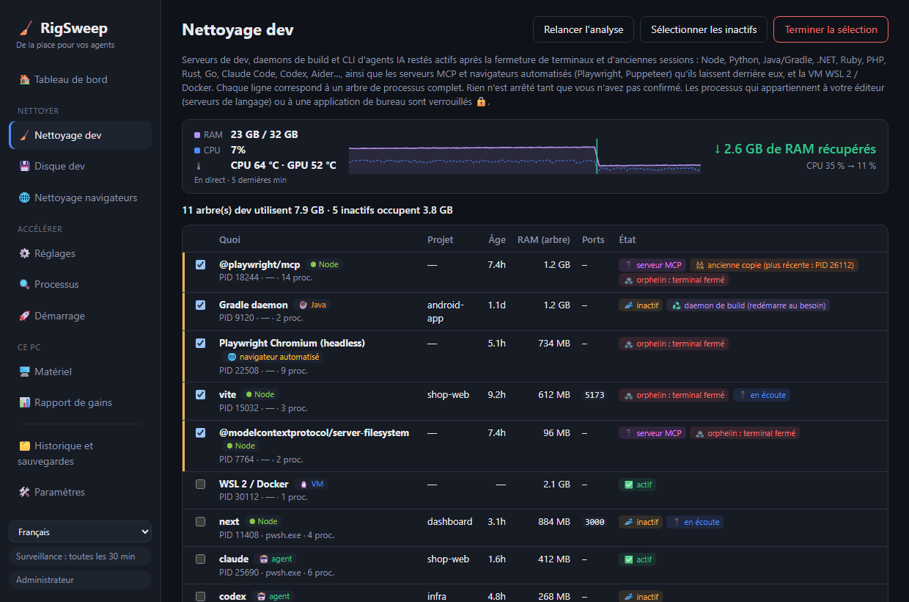
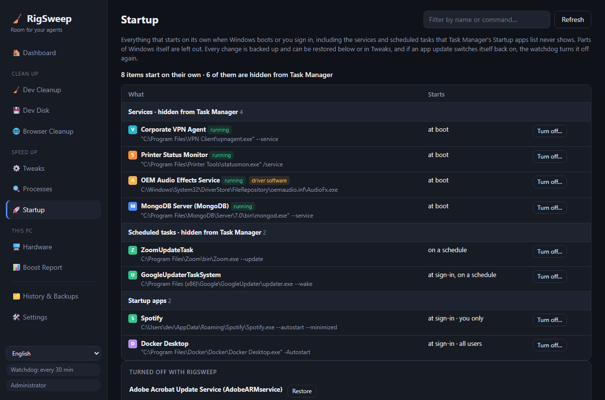

<div align="center">

# 🧹 RigSweep

**De la place pour vos agents.** Libérez RAM, CPU et disque sur les machines de dev Windows encombrées par les sessions d'agents IA.

**[🌐 Site web](https://rigsweep.com)** · **[⬇️ Télécharger](https://github.com/yobotn/rigsweep/releases/latest)** · **[📖 FAQ antivirus](#%EF%B8%8F-faux-positifs-antivirus)**

[🇬🇧 English](README.md) · [🇩🇪 Deutsch](README.de.md) · [🇪🇸 Español](README.es.md) · 🇫🇷 Français · [🇮🇹 Italiano](README.it.md) · [🇧🇷 Português](README.pt-BR.md) · [🇷🇺 Русский](README.ru.md) · [🇯🇵 日本語](README.ja.md) · [🇰🇷 한국어](README.ko.md) · [🇨🇳 简体中文](README.zh-CN.md) · [🇮🇱 עברית](README.he.md) · [🇸🇦 العربية](README.ar.md)




</div>

---

## 📖 Pourquoi je l'ai créé

À l'ère de l'IA, mon portable ne fait plus tourner *une seule* chose. Une journée normale, j'ai plusieurs sessions **Claude Code** dans différents terminaux, un serveur de dev par projet, des watchers de build et un navigateur rempli de docs, de previews et de tableaux de bord. Chaque nouvelle session lance de nouveaux processus Node, et quand je ferme un terminal, certains **continuent tout simplement de tourner en arrière-plan**.

Tout a commencé à paraître *encombré* : ventilateurs à fond, RAM toujours presque pleine, et aucune vision claire de ce qui la consommait. Le Gestionnaire des tâches ne me montrait qu'un mur de `node.exe` et `chrome.exe`, sans me dire de quelle session ou de quel projet ils venaient, ni si quelque chose en avait encore besoin.

Alors j'ai mesuré ma propre machine (32 Go de RAM) en pleine journée de travail :

| 🔎 Ce que j'ai trouvé | Nombre | RAM |
|---|---:|---:|
| 🌐 Processus Chrome | 37 | **6,5 Go** |
| ⬢ Processus Node + Claude (CLI d'agents, serveurs de dev, l'app de bureau) | 14 | **2,5 Go** |
| 🧩 Services Windows en cours d'exécution (télémétrie, Xbox, indexeur de recherche…) | ~150 | — |

Rien de tout cela n'était « un virus » ni des « fichiers inutiles ». C'étaient les **restes normaux du travail avec des agents IA**, plus des tâches de fond Windows dont une machine de dev n'a pas besoin. Les « boosters de PC » existants font soit des choses irréversibles et inquiétantes, soit ne connaissent rien aux workflows de dev. Alors j'ai construit l'outil que je voulais :

> **Voir ce qui utilise vraiment votre machine, balayer ce qui traîne, et garder chaque changement réversible.**

---

## ✨ Fonctionnalités

### 🧹 Nettoyage dev : processus de dev oubliés, quel que soit le stack
Trouve les **serveurs de dev, daemons de build et CLI d'agents IA** et regroupe chacun avec **tout son arbre de processus**, son dossier de projet, son âge, sa RAM et ses ports en écoute.

| Stack | Ce qu'il trouve |
|---|---|
| ⬢ Node · Bun · Deno | serveurs de dev (Vite, Astro, Next…), watchers, esbuild |
| 🐍 Python | uvicorn, Flask, Django, Jupyter, Streamlit, Celery, processus de venv, serveurs MCP en Python |
| ☕ Java | daemons Gradle et Kotlin, Maven, Spring Boot, Quarkus |
| 🟣 .NET | `dotnet watch/run`, serveur de compilation Roslyn, nœuds MSBuild restants |
| 💎 Ruby · 🐘 PHP · 🦀 Rust · 🐹 Go | `rails`/`ruby`, `php -S`/artisan, `cargo watch/run`, `go run` |
| 🤖 CLI d'agents | Claude Code, Codex, Gemini CLI, opencode, Aider, Goose |
| 🔌 Serveurs MCP | serveurs lancés par votre agent (`@modelcontextprotocol/*`, `@playwright/mcp`, `mcp-server-*`, FastMCP…) et restés actifs après sa fermeture, même derrière un lanceur `cmd /c npx` |
| 🌐 Navigateurs automatisés | Chrome et Edge de Playwright / Puppeteer / `--headless` avec tout leur arbre de processus de rendu. Votre propre navigateur n'est jamais listé |
| 🐧 WSL 2 / Docker | la VM Linux (`vmmemWSL`), arrêtée proprement avec `wsl --shutdown`, jamais présélectionnée |

Python et Java font aussi tourner des applications de bureau ordinaires : pour eux, seuls les processus avec une signature de dev claire sont listés.

- 🧟 **Orphelin** : son terminal a été fermé mais le processus tourne encore. Il est présélectionné, même s'il occupe encore un port (le classique `localhost:3000` zombie).
- 🔌 **Serveur MCP** : signalé sur chaque ligne concernée, pour distinguer le serveur d'outils laissé par un agent de votre propre serveur de dev.
- 👯 **Ancienne copie** : un serveur MCP dont une copie plus récente tourne aussi (par exemple dans votre session d'agent actuelle) est signalé, pour repérer facilement celui qui reste.
- 📈 **Mesure en direct** : la RAM et le CPU sont mesurés toutes les 2 secondes tant que RigSweep tourne (fenêtre ou zone de notification). Juste après un nettoyage, manuel ou automatique, il affiche **la RAM réellement récupérée** et le CPU avant → après, mesurés et non estimés.
- 🌡️ **Suivi des températures** : les températures du CPU et du GPU s'affichent en direct sur le Tableau de bord avec la tendance et le pic des 5 dernières minutes, et une alerte si la machine reste au-dessus de 90 °C. Le GPU utilise le même compteur que le Gestionnaire des tâches ; le CPU, la zone thermique ACPI (aucun pilote installé, pas besoin des droits d'administrateur ; approximatif sur beaucoup d'ordinateurs de bureau). Cliquez sur la vignette pour basculer entre °C et °F.
- 💤 **Inactif** : aucune activité CPU depuis longtemps. Les runtimes sans port ouvert sont présélectionnés. Une **session d'agent inactive dans un terminal ouvert n'est jamais présélectionnée**, car elle vous attend simplement (et `claude --resume` la ramène de toute façon).
  La durée qui compte comme inactivité se règle dans les **Paramètres** (en minutes, 120 par défaut ; par ex. 5).
- 🧹 **Nettoyage automatique** (désactivé par défaut, dans les Paramètres) : chaque minute, RigSweep arrête les runtimes de dev inactifs qu'il a vus sans activité CPU pendant toute la durée d'inactivité. Les CLI d'agents, la VM WSL/Docker et les processus appartenant à l'éditeur ne sont jamais arrêtés automatiquement, et chaque arbre arrêté est consigné dans l'Historique.
- 🟠🔴 **Indicateur dans la zone de notification** : l'icône de la zone de notification (et le bouton de la barre des tâches tant que la fenêtre est ouverte) affiche un point orange quand les processus de dev inactifs occupent ≥ 1 Go et un point rouge à partir de ≥ 2 Go. Survolez l'icône pour voir combien. Les seuils se règlent dans les Paramètres, où le point peut aussi être désactivé.
- ♻️ **Daemon de build** : les serveurs Gradle, Kotlin et Roslyn sont faits pour rester en arrière-plan. Les arrêter est sans danger ; ils redémarrent au prochain build.
- 🔒 **Verrouillé** : les processus appartenant à **VS Code, Cursor, JetBrains, Visual Studio…** (vos serveurs de langage) ou à une app de bureau ne peuvent jamais être terminés d'ici.
- ✅ Rien n'est terminé sans votre confirmation, et la réutilisation de PID est vérifiée avant chaque arrêt.

### 💾 Disque dev : node_modules et caches de paquets
Les vieux projets gardent des gigaoctets de `node_modules`, `.next`, `target`, `bin/obj` et `.venv` bien après que vous ayez arrêté d'y travailler, et les caches de paquets ne font que grossir. RigSweep repère les deux et supprime ce que vous choisissez.

- 🗂️ **Projets** : dossiers de build et de dépendances de Node, Rust, .NET, Java/Gradle/Maven et Python. Un dossier ne compte que si son fichier de projet est juste à côté (`package.json`, `Cargo.toml`, `*.csproj`, `pyvenv.cfg`…), un dossier `build` quelconque n'est donc jamais touché. Seuls les projets que personne n'a modifiés depuis 30 jours (réglable) sont présélectionnés, et ceux qu'un processus utilise sont verrouillés 🔒.
- 📦 **Caches de paquets** : npm, npx, pnpm, Yarn, Bun, pip, uv, Cargo, Go, NuGet, Gradle, Maven, Playwright, Puppeteer, Hugging Face. pnpm, uv et Go sont nettoyés avec leurs propres commandes (`pnpm store prune`…) ; pour Playwright et Puppeteer, seules les anciennes versions des navigateurs partent, la plus récente reste.
- 🎯 **Sélection auto** : directement dans l'onglet Disque dev, choisissez depuis combien de temps un projet doit être inactif (3 à 365 jours), quels dossiers sont cochés (fichiers de build, dépendances, caches de paquets) et une taille minimale.
- 🚫 **Ne jamais nettoyer** : chaque cache peut être désactivé. Ceux qui impliquent un gros retéléchargement (Playwright, Puppeteer, Hugging Face, Gradle, Maven, paquets NuGet, modules Go) sont désactivés au départ.
- 🙈 **Exclusions** : AppData, les dossiers d'outils de votre profil (`.cargo`, `.nvm`, `.vscode`…), `.git` et Windows sont toujours ignorés. Ajoutez vos propres chemins ou noms de dossier (`vendor`, `old-*`) dans les Paramètres, ou cliquez sur **Exclure** sur un projet.
- ⏸️ **Pause, reprise ou arrêt** d'un long nettoyage, avec une barre de progression. Un nettoyage interrompu par un redémarrage peut reprendre là où il s'était arrêté.
- ✅ Analyse par défaut votre profil utilisateur (Bureau, Documents, Téléchargements, OneDrive…). Rien n'est supprimé sans votre confirmation, et chaque dossier est revérifié juste avant la suppression.

### 🖥️ Matériel : un onglet au lieu de quatre outils
L'essentiel de ce pour quoi vous ouvririez CPU-Z, GPU-Z, CrystalDiskInfo et CrystalDiskMark, lu directement dans Windows. Aucun pilote n'est installé.

- 💽 **État des disques** : En bon état / Usé / Problème pour chaque disque, avec durée de vie restante, température, heures de fonctionnement et erreurs non corrigées. Un disque défaillant déclenche un avertissement sur le tableau de bord.
- ⚡ **Test de vitesse** : lecture et écriture séquentielles, plus lectures aléatoires 4K, pour chaque lecteur. Il écrit un fichier temporaire de 512 Mo puis le supprime.
- 🧮 **Processeur, carte graphique, mémoire** : modèle, cœurs et threads, cache, virtualisation (requise par WSL 2 et Docker), mémoire vidéo et pilote, type de RAM, vitesse et emplacements libres.
- 🔋 **Système et batterie** : carte mère, BIOS, build de Windows, durée depuis le démarrage et usure de la batterie sur les portables.

### 📊 Rapport de gains : un vrai avant/après
Pas de faux chiffres du genre « votre PC est 87 % plus rapide ». RigSweep **mesure** votre machine et compare deux relevés : RAM utilisée/libre, CPU moyen, nombre de processus, services en cours d'exécution, RAM de Chrome et RAM Node/agents.

- 📸 Une **mesure de référence** est prise automatiquement avant votre premier réglage.
- 🔁 Une paire **avant/après** est prise autour de chaque Nettoyage dev.
- 📋 **Copier en Markdown** pour partager votre résultat dans une issue, un post ou ce README.

### 🌐 Assistant d'onglets Chrome
Une app de bureau **ne peut pas** fermer les onglets Chrome, donc RigSweep fournit une petite extension ([`chrome-extension/`](chrome-extension/)) sans accès réseau, avec seulement les autorisations `tabs` / `storage` / `alarms` :
- 💤 **Mettre en veille les onglets inactifs** : leur mémoire est libérée, mais l'onglet reste dans la barre d'onglets
- 🧹 **Fermer les onglets en double**
- 🎯 **Fermer les onglets par motif**, comme `localhost:*` ou `*.vercel.app`
- ⏰ **Veille automatique** toutes les 10 minutes (facultative)

### ⚙️ Réglages Windows réversibles
Un catalogue soigné ([`catalog/tweaks.json`](src-tauri/catalog/tweaks.json)) : télémétrie, Xbox, indexeur de recherche, apps en arrière-plan, exclusions Defender pour les dossiers de dev, mode de gestion de l'alimentation, etc., chacun avec un niveau de risque :

| Niveau | Signification |
|---|---|
| 🟢 `safe` | Aucun effet secondaire notable (présélectionné) |
| 🟡 `moderate` | Léger compromis, expliqué |
| 🔴 `caution` | Désactive une fonctionnalité ; confirmation requise |


- 💾 **Chaque valeur d'origine est sauvegardée** dans SQLite avant le premier changement. Vous pouvez restaurer un réglage, une catégorie ou tout.
- 🛟 Un **point de restauration système** est créé avant la première application.
- 🔁 Une **surveillance** réapplique les réglages qu'une mise à jour Windows a annulés en silence, et compte combien de fois cela arrive.
- 🧭 **Edge ne revient pas** : désinstallez Edge depuis les Paramètres, puis un réglage empêche Edge Update et Windows Update de le réinstaller. Le runtime WebView2 dont d'autres applications ont besoin n'est pas touché.
- 🚫 Jamais touchés : Windows Update, le moteur Defender, RPC/DCOM/LSA et ~60 autres services essentiels ([`PROTECTED_SERVICES`](src-tauri/src/catalog.rs)).

### 🔍 Analyseur de processus
CPU / RAM / disque par processus, et **quels services tournent dans chaque `svchost.exe`**. Désactivez un service ou terminez un processus directement depuis la liste (les éléments essentiels sont verrouillés 🔒). Chaque application s'affiche avec sa propre icône.

### 🚀 Démarrage : ce que le Gestionnaire des tâches ne montre pas
La liste « Applications de démarrage » du Gestionnaire des tâches omet presque tout ce qui démarre avec Windows. RigSweep affiche tout, hors composants de Windows lui-même :

- 🧩 **Services à démarrage automatique** des applications et pilotes (clients VPN, utilitaires constructeur, programmes de mise à jour). Ils passent en Manuel : ils ne démarrent plus avec Windows, mais l'application peut toujours les lancer quand vous l'ouvrez.
- ⏰ **Tâches planifiées** exécutées à l'ouverture de session, au démarrage ou selon une planification.
- 🚀 **Applications de démarrage** du registre et du dossier Démarrage, désactivées avec le même interrupteur que le Gestionnaire des tâches.
- 💾 Chaque modification est sauvegardée et restaurable, et si une mise à jour réactive une application, la surveillance la désactive à nouveau.



### 🔄 Mises à jour, à vous de choisir
**🛠️ Paramètres → 🔄 Mises à jour** propose un bouton **Rechercher maintenant** et l'option *Rechercher automatiquement les mises à jour* (au démarrage, puis une fois par jour), **désactivée par défaut**. Quand une nouvelle version sort, un bouton apparaît dans la barre latérale avec les nouveautés. Rien n'est installé tant que vous n'avez pas cliqué sur **Installer et redémarrer**, et seulement si le téléchargement est signé avec la clé de RigSweep. Vos réglages, sauvegardes et paramètres sont conservés. Consultez la [politique de confidentialité](#-politique-de-confidentialit%C3%A9) pour savoir exactement ce que fait une recherche.

### 🌍 12 langues
L'interface est en **English, Deutsch, Español, Français, Italiano, Português (Brasil), Русский, 日本語, 한국어, 简体中文, עברית et العربية** (à changer dans la barre latérale), tout comme le programme d'installation et l'extension Chrome. Chaque langue reprend les termes officiels de Windows (Gestionnaire des tâches, Services, Planificateur de tâches…) plutôt qu'une traduction mot à mot. Une formulation vous gêne ? Ouvrez une issue ou une PR sur `ui/locales/<code>.js` (app), `docs/locales/<code>.js` (site web) ou `README.<code>.md`.

---

## 🏁 Avant/après sur votre machine

Installez, ouvrez **📊 Rapport de gains → 📸 Mesurer maintenant**, faites un Nettoyage dev et appliquez les réglages sûrs, redémarrez, mesurez à nouveau, puis cliquez sur **📋 Copier en Markdown**. Vos résultats sont les bienvenus dans [Discussions](../../discussions) !

<!-- TODO(maintainer): paste your own "Copy as Markdown" result here once you've run it on your machine. -->

> ℹ️ Les réglages de services prennent tout leur effet après un redémarrage. Le Nettoyage dev et la mise en veille des onglets Chrome se voient immédiatement.

---

## 📦 Installation

1. Téléchargez `RigSweep_x.y.z_x64-setup.exe` depuis les [**Releases**](../../releases).
2. Lancez-le. Il demande les droits d'administrateur, car RigSweep gère des services et des stratégies.
3. Le programme d'installation vous demande si vous voulez autoriser RigSweep dans Microsoft Defender (voir plus bas). C'est votre choix.
4. Les versions suivantes peuvent être installées depuis **🛠️ Paramètres → 🔄 Mises à jour** (à partir de la 0.5.0).

🌐 **Assistant Chrome :** dans RigSweep, allez dans **🛠️ Paramètres → 🌐 Assistant d'onglets Chrome → Ouvrir le dossier de l'extension**, puis dans Chrome : `chrome://extensions` → **Mode développeur** → **Charger l'extension non empaquetée** → choisissez ce dossier.

## 🛡️ Faux positifs antivirus

RigSweep est open source mais **pas encore signé**. Les outils qui modifient des services et la configuration de Defender ressemblent beaucoup à des malwares pour l'heuristique d'apprentissage automatique, donc **Microsoft Defender peut supprimer l'exe par erreur**. C'est arrivé pendant le développement sous le nom `Trojan:Win32/Bearfoos.B!ml`, où `!ml` désigne une supposition heuristique et non une signature de malware connu.

Ce que nous faisons :
- ❓ **Question dans le programme d'installation (facultative) :** « Autoriser RigSweep dans Microsoft Defender ? » Oui exclut **uniquement le dossier d'installation**, et le programme de désinstallation retire ensuite cette exclusion. Les installations silencieuses n'en ajoutent jamais.
- 🛠️ **Paramètres → 🛡️ Antivirus et faux positifs :** consultez l'état, et ajoutez ou retirez l'exclusion à tout moment.
- ✍️ **La signature de code est prévue** via [SignPath Foundation](https://signpath.org) (gratuite pour les projets open source). C'est la vraie solution. Voir la [politique de signature de code](#-politique-de-signature-de-code).

S'il a déjà été supprimé : **Sécurité Windows → Protection contre les virus et menaces → Historique de protection →** choisissez l'entrée RigSweep → **Actions → Restaurer**. Faites-le uniquement pour un téléchargement depuis la page Releases de ce dépôt, ou pour un build que vous avez compilé vous-même. Vous pouvez aussi [signaler vous-même le faux positif à Microsoft](https://www.microsoft.com/wdsi/filesubmission).

---

## 🛠️ Compiler depuis les sources

```powershell
winget install Rustlang.Rustup        # + VS 2022 Build Tools (charge de travail C++)
npm install
npm run build                         # -> src-tauri/target/release/rigsweep.exe + bundle/nsis/*-setup.exe
```
Exécution en dev : `npm run dev` (acceptez l'UAC ; l'app se relance elle-même avec des privilèges élevés).

> 💡 Defender peut aussi mettre en quarantaine vos builds locaux tout juste compilés. Ajoutez le dossier de votre clone à la liste *Dossiers dev* de RigSweep (Paramètres) et appliquez le réglage **Defender exclusions for dev folders**, ou excluez `src-tauri\target` manuellement.

### ⌨️ CLI
| Commande | Effet |
|---|---|
| `rigsweep.exe` | Interface graphique + zone de notification |
| `rigsweep.exe --apply` | Sans interface : vérifie le profil, réapplique les réglages annulés, puis quitte (utilisé par la tâche de démarrage) |
| `rigsweep.exe --apply --tray` | Idem, puis reste dans la zone de notification avec la surveillance |
| `rigsweep.exe --restore-all` | Rétablit tout aux valeurs d'origine sauvegardées |

### 🧪 Tests
```powershell
cd src-tauri
cargo test                                          # validité du catalogue, sauvegardes, relevés, analyse des commandes
cargo test live_status   -- --ignored --nocapture   # lecture seule : état détecté de chaque réglage
cargo test live_dev_scan -- --ignored --nocapture   # lecture seule : ce que voit le Nettoyage dev en ce moment
```

### ➕ Ajouter des réglages
Ajoutez une entrée à [`catalog/tweaks.json`](src-tauri/catalog/tweaks.json). Les types d'action sont `service` (start: disabled|manual), `task` (path), `registry` (HKLM|HKCU, dword|string), `defender_exclusion` et `power_plan`. Les éléments `caution` doivent inclure un `warning`. `cargo test` rejette les services protégés et les entrées mal formées.

## 🐳 docker-optimize (outil séparé)
Ne fait pas partie de l'app. [`docker-optimize/`](docker-optimize/) est un script autonome, réversible et ponctuel qui plafonne la VM WSL2 de Docker Desktop (mémoire, CPU, restitution de RAM, disque fragmenté) et désactive les extras de Docker Desktop dont vous n'avez pas besoin. Il ne supprime jamais de conteneurs, d'images ni de volumes. Voir son [README](docker-optimize/README.md) (en anglais).

## 🗂️ Où sont stockées les données
| Quoi | Où |
|---|---|
| Base de données (sauvegardes, historique, relevés) | `%ProgramData%\RigSweep\rigsweep.db` (+ `.bak.1`–`.bak.5`) |
| Tâche de démarrage | Planificateur de tâches → `RigSweep-Reapply` |
| Profils exportés | `Documents\RigSweep-profile-*.json` |

Vous venez d'**aiBoost** (l'ancien nom) ? Votre base de données est migrée automatiquement au premier démarrage, et l'ancienne tâche de démarrage est remplacée.

## 🔏 Politique de signature de code

Signature de code gratuite fournie par [SignPath.io](https://about.signpath.io/), certificat de [SignPath Foundation](https://signpath.org/).
*(Demande en cours : les versions jusqu'à la v0.3.0 ne sont **pas encore signées**.)*

- **Builds :** les programmes d'installation des versions sont compilés à partir du code tagué par [GitHub Actions](.github/workflows/release.yml) sur des runners hébergés par GitHub. Seuls ces builds seront soumis à la signature.
- **Committers et relecteurs :** [@yobotn](https://github.com/yobotn)
- **Approbateurs :** [@yobotn](https://github.com/yobotn)

### 🔒 Politique de confidentialité
Ce programme ne transférera aucune information vers d'autres systèmes en réseau, sauf demande expresse de l'utilisateur ou de la personne qui l'installe ou l'utilise. RigSweep n'a ni télémétrie ni analytique, et l'extension Chrome ne fait aucune requête réseau. La seule requête réseau que RigSweep peut faire est la **recherche de mises à jour**, et uniquement à votre demande : en cliquant sur *Rechercher maintenant* dans les Paramètres, ou en activant *Rechercher automatiquement les mises à jour* (désactivé par défaut). Elle télécharge `latest.json` depuis les Releases GitHub de ce dépôt et n'envoie aucune information sur votre PC ; une mise à jour n'est installée qu'après un clic sur *Installer*, et seulement si sa signature correspond à la clé de signature de RigSweep. Tout ce qu'il enregistre (sauvegardes, historique, mesures) reste dans `%ProgramData%\RigSweep` sur votre PC.

## ⚠️ Avertissement

RigSweep modifie des services Windows, des tâches planifiées, des stratégies du registre et la configuration de Microsoft Defender, et peut terminer des processus en cours d'exécution. Chaque réglage est sauvegardé et peut être restauré, et rien ne se passe sans votre confirmation, mais **vous l'utilisez à vos propres risques**. Il est fourni **« tel quel », sans aucune garantie d'aucune sorte** (voir la [licence MIT](LICENSE)). Vérifiez chaque changement avant de l'appliquer, gardez vos propres sauvegardes et ne l'utilisez pas sur un appareil géré par votre employeur ou votre établissement scolaire sans l'accord de leur service informatique.

RigSweep est un projet indépendant, **sans aucun lien avec** Microsoft, Google, Anthropic, OpenAI ni aucun autre outil mentionné. Toutes les marques appartiennent à leurs propriétaires respectifs.

## 🤝 Contribuer
Les issues et PR sont les bienvenues, en particulier les nouveaux réglages (avec un niveau de risque clair), d'autres stacks de dev et CLI d'agents pour le Nettoyage dev, et les traductions.

## 📄 Licence
[MIT](LICENSE) : gratuit pour toujours, faites-en ce que vous voulez, sans garantie.
