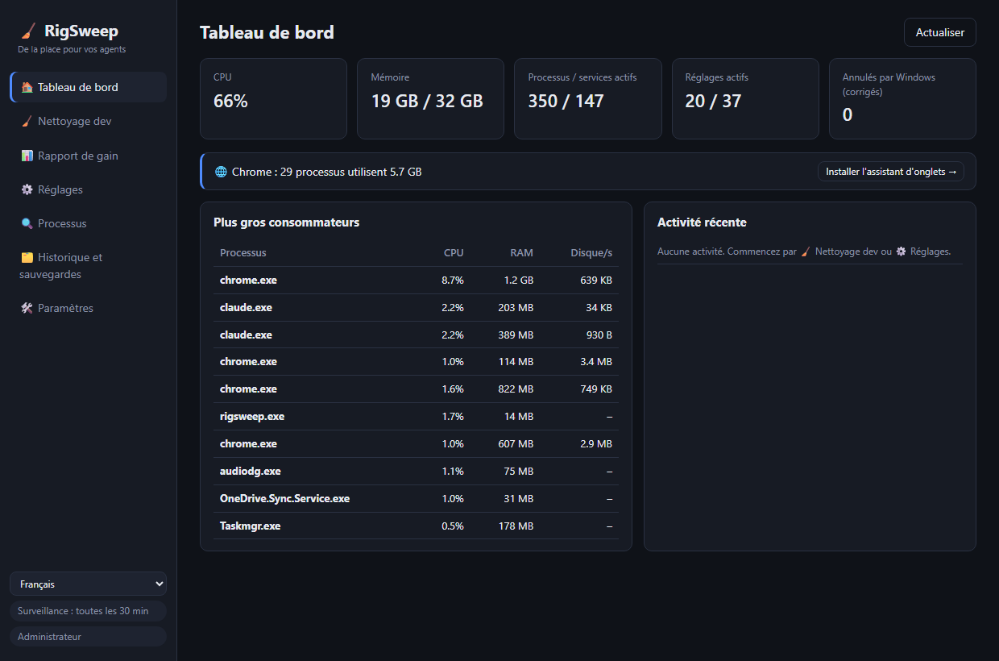

<div align="center">

# 🧹 RigSweep

**De la place pour vos agents.** Libérez RAM, CPU et disque sur les machines de dev Windows encombrées par les sessions d'agents IA.

[🇬🇧 English](README.md) · [🇪🇸 Español](README.es.md) · 🇫🇷 Français




</div>

---

## 📖 Pourquoi je l'ai créé

À l'ère de l'IA, mon portable ne fait plus tourner *une seule* chose. Une journée normale, j'ai plusieurs sessions **Claude Code** dans différents terminaux, un serveur de dev par projet, des watchers de build et un navigateur rempli de docs, de previews et de tableaux de bord. Chaque nouvelle session lance de nouveaux processus Node, et quand je ferme un terminal, certains **continuent de tourner en arrière-plan**.

Tout a commencé à paraître *encombré* : ventilateurs à fond, RAM toujours au maximum, et aucune vision claire de ce qui la consommait. Le Gestionnaire des tâches ne me montrait qu'un mur de `node.exe` et `chrome.exe`, sans me dire de quelle session ou de quel projet ils venaient, ni si quelque chose en avait encore besoin.

Alors j'ai mesuré ma propre machine (32 Go de RAM) en pleine journée de travail :

| 🔎 Ce que j'ai trouvé | Nombre | RAM |
|---|---:|---:|
| 🌐 Processus Chrome | 37 | **6,5 Go** |
| ⬢ Processus Node + Claude (CLI d'agents, serveurs de dev, l'app de bureau) | 14 | **2,5 Go** |
| 🧩 Services Windows actifs (télémétrie, Xbox, indexeur…) | ~150 | — |

Rien de tout cela n'était « un virus » ni des « déchets » : c'étaient les **restes normaux du travail avec des agents IA**, plus des tâches de fond Windows inutiles sur une machine de dev. Les « boosters » existants font des choses irréversibles et risquées, ou ne connaissent rien aux workflows de dev. Alors j'ai construit l'outil que je voulais :

> **Voir ce qui utilise vraiment votre machine, balayer ce qui traîne, et garder chaque changement réversible.**

---

## ✨ Fonctionnalités

### 🧹 Nettoyage dev : sessions Node et agents inactives
Trouve les **serveurs Node, watchers de build et CLI d'agents IA** (Claude Code, Codex, Gemini CLI, opencode…) et regroupe chacun avec **tout son arbre de processus**, son dossier de projet, son âge, sa RAM et ses ports en écoute.


- 🧟 **Orphelin** : son terminal a été fermé mais le processus tourne encore. Il est présélectionné même s'il occupe un port (le classique `localhost:3000` zombie).
- 💤 **Inactif** : aucune activité CPU depuis longtemps. Les runtimes sans port ouvert sont présélectionnés. Une **session d'agent inactive dans un terminal ouvert n'est jamais présélectionnée**, car elle vous attend (et `claude --resume` la ramène de toute façon).
- 🔒 **Verrouillé** : les processus Node de **VS Code, Cursor, JetBrains…** (vos serveurs de langage) ou d'une app de bureau ne peuvent jamais être fermés d'ici.
- ✅ Rien n'est fermé sans votre confirmation, et la réutilisation de PID est vérifiée avant chaque fermeture.

### 📊 Rapport de gain : un vrai avant/après
Pas de faux « votre PC est 87 % plus rapide ». RigSweep **mesure** votre machine et compare deux relevés : RAM utilisée/libre, CPU moyen, nombre de processus, services actifs, RAM de Chrome et RAM Node/agents.

- 📸 Une **référence** est prise automatiquement avant le premier réglage.
- 🔁 Une paire **avant/après** est prise autour de chaque Nettoyage dev.
- 📋 **Copier en Markdown** pour partager votre résultat.

### 🌐 Assistant d'onglets Chrome
Une app de bureau **ne peut pas** fermer les onglets Chrome, donc RigSweep fournit une petite extension ([`chrome-extension/`](chrome-extension/)) sans accès réseau, avec seulement les permissions `tabs` / `storage` / `alarms` :
- 💤 **Mettre en veille les onglets inactifs** : leur mémoire est libérée et l'onglet reste dans la barre
- 🧹 **Fermer les onglets en double**
- 🎯 **Fermer les onglets par motif**, comme `localhost:*` ou `*.vercel.app`
- ⏰ **Veille automatique** toutes les 10 minutes (optionnelle)

### ⚙️ Réglages Windows réversibles
Un catalogue soigné ([`catalog/tweaks.json`](src-tauri/catalog/tweaks.json)) : télémétrie, Xbox, indexeur de recherche, apps en arrière-plan, exclusions Defender pour les dossiers de dev, mode d'alimentation, etc., chacun avec un niveau de risque :

| Niveau | Signification |
|---|---|
| 🟢 `safe` | Aucun effet visible (présélectionné) |
| 🟡 `moderate` | Léger compromis, expliqué |
| 🔴 `caution` | Désactive une fonction ; confirmation requise |

- 💾 **Chaque valeur d'origine est sauvegardée** dans SQLite avant le premier changement. Vous pouvez restaurer un réglage, une catégorie ou tout.
- 🛟 Un **point de restauration système** est créé avant la première application.
- 🔁 Une **surveillance** réapplique les réglages qu'une mise à jour Windows a annulés en silence.
- 🚫 Jamais touchés : Windows Update, le moteur Defender, RPC/DCOM/LSA et ~60 autres services essentiels.

### 🔍 Analyseur de processus
CPU / RAM / disque par processus, et **quels services vivent dans chaque `svchost.exe`**.

### 🌍 3 langues
L'interface est en **English, Español et Français**, tout comme l'installateur et l'extension Chrome.

---

## 🏁 Avant/après sur votre machine

Installez, ouvrez **📊 Rapport de gain → 📸 Mesurer maintenant**, faites un Nettoyage dev et appliquez les réglages sûrs. Ensuite redémarrez, mesurez à nouveau et cliquez sur **📋 Copier en Markdown**. Partagez vos résultats dans [Discussions](../../discussions) !

> ℹ️ Les réglages de services prennent tout leur effet après un redémarrage. Le Nettoyage dev et la veille des onglets se voient immédiatement.

---

## 📦 Installation

1. Téléchargez `RigSweep_x.y.z_x64-setup.exe` depuis les [**Releases**](../../releases).
2. Lancez-le. Il demande les droits administrateur, car RigSweep gère des services et des stratégies.
3. L'installateur vous demande si vous voulez autoriser RigSweep dans Microsoft Defender (voir plus bas). C'est votre choix.

🌐 **Assistant Chrome :** dans RigSweep, allez dans **🛠️ Paramètres → 🌐 Assistant d'onglets → Ouvrir le dossier de l'extension**, puis dans Chrome : `chrome://extensions` → **Mode développeur** → **Charger l'extension non empaquetée** → choisissez ce dossier.

## 🛡️ Faux positifs antivirus

RigSweep est open source mais **pas encore signé**. Les outils qui modifient des services et la configuration de Defender ressemblent beaucoup à des malwares pour l'heuristique d'apprentissage automatique, donc **Microsoft Defender peut supprimer l'exe par erreur**. C'est arrivé pendant le développement sous le nom `Trojan:Win32/Bearfoos.B!ml`, où `!ml` désigne une supposition heuristique et non une signature de malware connu.

Ce que nous faisons :
- ❓ **Question dans l'installateur (optionnelle) :** « Autoriser RigSweep dans Microsoft Defender ? » Oui exclut **uniquement le dossier d'installation**, et le désinstallateur retire cette exclusion. Les installations silencieuses n'en ajoutent jamais.
- 🛠️ **Paramètres → 🛡️ Confiance antivirus :** vous voyez l'état et pouvez ajouter ou retirer l'exclusion à tout moment.
- ✍️ **Signature de code prévue** via [SignPath Foundation](https://signpath.org), gratuite pour les projets open source. C'est la vraie solution.

S'il a déjà été supprimé : **Sécurité Windows → Protection contre les virus et menaces → Historique de protection →** choisissez l'entrée RigSweep → **Actions → Restaurer**. Faites-le seulement s'il vient des Releases de ce dépôt ou si vous l'avez compilé vous-même. Vous pouvez aussi [signaler le faux positif à Microsoft](https://www.microsoft.com/wdsi/filesubmission).

---

## 🛠️ Compiler

```powershell
winget install Rustlang.Rustup        # + VS 2022 Build Tools (charge de travail C++)
npm install
npm run build                         # -> src-tauri/target/release/rigsweep.exe + bundle/nsis/*-setup.exe
```

Voir le [README anglais](README.md#-build-from-source) pour la CLI, les tests et l'ajout de réglages.

Vous venez d'**aiBoost** (l'ancien nom) ? Votre base de données est migrée automatiquement au premier démarrage.

## 📄 Licence
[MIT](LICENSE) : gratuit pour toujours, sans garantie.
