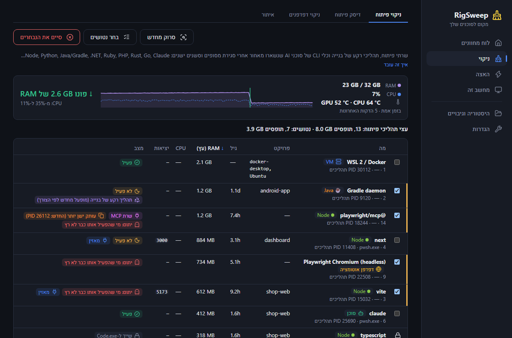
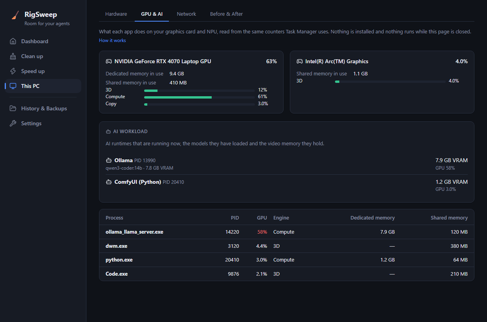

<div align="center">

# 🧹 RigSweep

**מקום לסוכנים שלך.** פינוי RAM, CPU ומקום בדיסק במחשבי פיתוח עם Windows שעמוסים בסשנים של סוכני AI.

**[🌐 אתר הבית](https://rigsweep.com)** · **[⬇️ הורדה](https://github.com/yobotn/rigsweep/releases/latest)** · **[📖 שאלות נפוצות על אנטי-וירוס](#%EF%B8%8F-%D7%94%D7%AA%D7%A8%D7%90%D7%95%D7%AA-%D7%A9%D7%95%D7%95%D7%90-%D7%A9%D7%9C-%D7%90%D7%A0%D7%98%D7%99-%D7%95%D7%99%D7%A8%D7%95%D7%A1)**

[🇬🇧 English](README.md) · [🇩🇪 Deutsch](README.de.md) · [🇪🇸 Español](README.es.md) · [🇫🇷 Français](README.fr.md) · [🇮🇹 Italiano](README.it.md) · [🇧🇷 Português](README.pt-BR.md) · [🇷🇺 Русский](README.ru.md) · [🇯🇵 日本語](README.ja.md) · [🇰🇷 한국어](README.ko.md) · [🇨🇳 简体中文](README.zh-CN.md) · 🇮🇱 עברית · [🇸🇦 العربية](README.ar.md)




</div>

<div dir="rtl">

---

## 📖 למה בניתי את זה

בעידן ה-AI, המחשב הנייד שלי כבר לא מריץ דבר *אחד*. ביום רגיל פתוחים אצלי כמה סשנים של **Claude Code** במסופים שונים, שרת פיתוח לכל פרויקט, תהליכי watch של בנייה ודפדפן מלא בתיעוד, בתצוגות מקדימות ובלוחות מחוונים. כל סשן חדש מפעיל עוד תהליכי Node, וכשאני סוגר מסוף, חלק מהם **פשוט ממשיכים לפעול ברקע**.

זה התחיל להרגיש *עמוס*: המאווררים מסתובבים, ה-RAM כמעט תמיד מלא, ואין תמונה ברורה של מה באמת תופס אותו. מנהל המשימות הציג לי רק קיר של `node.exe` ו-`chrome.exe`, בלי לומר לאיזה סשן או פרויקט הם שייכים, או אם מישהו עדיין צריך אותם.

אז מדדתי את המחשב שלי (32 GB RAM) באמצע יום עבודה:

| 🔎 מה מצאתי | כמות | RAM |
|---|---:|---:|
| 🌐 תהליכי Chrome | 37 | **6.5 GB** |
| ⬢ תהליכי Node + Claude (כלי CLI של סוכנים, שרתי פיתוח, אפליקציית שולחן העבודה) | 14 | **2.5 GB** |
| 🧩 שירותי Windows פועלים (טלמטריה, Xbox, מפתוח החיפוש…) | ~150 | — |

אחר כך הסתכלתי על הדיסק. פיתחתי במקביל שלוש אפליקציות Rust: את RigSweep עצמה, את [KeepRun](https://github.com/yobotn/keeprun) (מריצה אפליקציות Node, ‏.NET ו-Python כשירותי Windows) ואת [Focuside](https://github.com/yobotn/focuside) (סביבת פיתוח ממוקדת לסוכני קוד מבוססי AI). תיקיית ה-`target` של כל פרויקט תפחה לכ-**40 GB**, כלומר **כ-120 GB** בסך הכול, והכול תוצרי בנייה ש-Cargo אף פעם לא מנקה בעצמו. הכרטיסייה **דיסק פיתוח** מצאה את שלושתן בסריקה אחת.

שום דבר מזה לא היה "וירוס" או "זבל". אלה היו **השאריות הרגילות של עבודה עם סוכני AI**, יחד עם תהליכי רקע של Windows שמחשב פיתוח לא צריך. אפליקציות "האצת מחשב" קיימות עושות דברים מפחידים ובלתי הפיכים, או שאין להן מושג בתהליכי עבודה של פיתוח. אז בניתי את הכלי שרציתי:

> **לראות מה באמת משתמש במחשב, לנקות את מה שנטוש, ולשמור כל שינוי הפיך.**

---

## ✨ תכונות

### 🧹 ניקוי פיתוח: תהליכי פיתוח נטושים בכל סביבה
מוצא **שרתי פיתוח, תהליכי רקע של בנייה וכלי CLI של סוכני AI**, ומקבץ כל אחד מהם עם **עץ התהליכים המלא** שלו, תיקיית הפרויקט, הגיל, ה-RAM והיציאות שהוא מאזין להן.

| סביבה | מה נמצא |
|---|---|
| ⬢ Node · Bun · Deno | שרתי פיתוח (Vite, Astro, Next…), תהליכי watch, esbuild |
| 🐍 Python | uvicorn, Flask, Django, Jupyter, Streamlit, Celery, תהליכי venv, שרתי MCP של Python |
| ☕ Java | תהליכי הרקע של Gradle ו-Kotlin, Maven, Spring Boot, Quarkus |
| 🟣 .NET | `dotnet watch/run`, שרת המהדר Roslyn, צומתי MSBuild שנשארו |
| 💎 Ruby · 🐘 PHP · 🦀 Rust · 🐹 Go | `rails`/`ruby`, `php -S`/artisan, `cargo watch/run`, `go run` |
| 🤖 כלי CLI של סוכנים | Claude Code, Codex, Gemini CLI, opencode, Aider, Goose |
| 🔌 שרתי MCP | שרתים שהסוכן הפעיל (`@modelcontextprotocol/*`, `@playwright/mcp`, `mcp-server-*`, FastMCP…) ונשארו פועלים אחרי שהוא יצא, גם מאחורי מפעיל `cmd /c npx` |
| 🌐 דפדפני אוטומציה | Playwright / Puppeteer / Chrome ו-Edge במצב `--headless` עם כל עץ תהליכי הרינדור שלהם. הדפדפן שלך לעולם לא מופיע ברשימה |
| 🐧 WSL 2 / Docker | ה-VM של Linux (`vmmemWSL`), נכבה בצורה מסודרת עם `wsl --shutdown`, לעולם לא נבחר מראש |

גם Python ו-Java מריצים אפליקציות שולחן עבודה רגילות, ולכן עבורם מוצגים רק תהליכים עם סימן פיתוח ברור.

- 🧟 **יתום**: המסוף שלו נסגר אבל הוא המשיך לפעול. נבחר מראש, גם אם הוא עדיין תופס יציאה (ה-`localhost:3000` הזומבי הקלאסי).
- 🔌 **שרת MCP**: מסומן בכל שורה שהיא כזו, כדי שאפשר יהיה להבדיל בין שרת כלים שסוכן השאיר לבין שרת הפיתוח שלך.
- 👯 **עותק ישן יותר**: שרת MCP שפועל גם כעותק חדש יותר (למשל תחת סשן הסוכן הנוכחי) מסומן, כך שקל לזהות את זה שנשאר.
- 📈 **מד חי**: RAM ו-CPU נדגמים כל 2 שניות כל עוד RigSweep פועל (בחלון או באזור ההודעות). מיד אחרי ניקוי, ידני או אוטומטי, הוא מראה **כמה RAM באמת חזר** ואת ה-CPU לפני ← אחרי, מדוד ולא מוערך.
- 🌡️ **מעקב טמפרטורה**: טמפרטורות ה-CPU וה-GPU מוצגות בזמן אמת בלוח המחוונים עם מגמה ושיא של 5 דקות, ואזהרה כשהמחשב נשאר מעל 90°C. ערך ה-GPU מגיע מאותו מונה שמנהל המשימות משתמש בו; ערך ה-CPU מהאזור התרמי ACPI (בלי התקנת מנהל התקן, בלי הרשאות מנהל; משוער בהרבה מחשבים שולחניים). לחיצה על האריח מחליפה בין °C ל-°F.
- 💤 **לא פעיל**: אין פעילות CPU במשך זמן רב. סביבות ריצה בלי יציאה פתוחה נבחרות מראש. **סשן סוכן לא פעיל במסוף פתוח לעולם לא נבחר מראש**, כי הוא פשוט מחכה לך (וממילא `claude --resume` מחזיר אותו).
  משך הזמן שנחשב לחוסר פעילות נקבע ב**הגדרות** (בדקות, ברירת מחדל 120; למשל 5).
- 🧹 **ניקוי אוטומטי** (כבוי כברירת מחדל, בהגדרות): בכל דקה RigSweep מסיים סביבות ריצה נטושות של פיתוח שהוא ראה ללא CPU לאורך כל תקופת חוסר הפעילות. כלי CLI של סוכנים, ה-VM של WSL/Docker ותהליכים של עורכי קוד לעולם לא מסתיימים אוטומטית, וכל עץ שהסתיים נרשם בהיסטוריה.
- 🟠🔴 **מחוון באזור ההודעות**: הסמל באזור ההודעות (וגם הלחצן בשורת המשימות כשהחלון פתוח) מקבל נקודה כתומה כשתהליכי פיתוח נטושים תופסים ≥ 1 GB, ונקודה אדומה מ-≥ 2 GB. ריחוף מעל הסמל מראה כמה. הספים נקבעים בהגדרות, ושם אפשר גם לכבות את הנקודה.
- ♻️ **תהליך רקע של בנייה**: שרתי Gradle, Kotlin ו-Roslyn אמורים להישאר ברקע. סיום שלהם לא מזיק; הם יופעלו מחדש בבנייה הבאה.
- 🔒 **נעול**: תהליכים השייכים ל-**VS Code, Cursor, JetBrains, Visual Studio…** (שרתי השפה שלך) או לאפליקציית שולחן עבודה לעולם אינם ניתנים לסיום מכאן.
- 🎯 **שורה אחת או כמה**: מסמנים שורות ולוחצים על **סיים את הנבחרים**, או משתמשים בלחצן **סיים** של שורה בודדת. בשני המקרים מופיע אותו אישור, עם מה שיתפנה.
- ✅ שום דבר לא מסתיים ללא אישור, ולפני כל סיום נבדק שה-PID לא נוצל מחדש.

### 💾 דיסק פיתוח: node_modules, מטמונים ו-worktrees
פרויקטים ישנים מחזיקים ג׳יגה-בייטים של `node_modules`, `.next`, `target`, `bin/obj` ו-`.venv` הרבה אחרי שהפסקת לעבוד עליהם, מטמוני חבילות רק גדלים, וכלי AI וסוכנים משאירים אחריהם מטמונים ו-worktrees. RigSweep מוצא את כל זה ומוחק את מה שבוחרים.

- 🗂️ **פרויקטים**: תיקיות פלט בנייה ותלויות של Node, Rust, .NET, Java/Gradle/Maven ו-Python. תיקייה נספרת רק אם קובץ הפרויקט שלה נמצא לידה (`package.json`, `Cargo.toml`, `*.csproj`, `pyvenv.cfg`…), כך שתיקיית `build` אקראית לעולם לא נפגעת. רק פרויקטים שאיש לא ערך במשך 30 יום (ניתן לשינוי) נבחרים מראש, ופרויקטים שתהליך פועל משתמש בהם נעולים 🔒.
- 📦 **מטמוני חבילות**: npm, npx, pnpm, Yarn, Bun, pip, uv, Cargo, Go, NuGet, Gradle, Maven, Playwright, Puppeteer, Hugging Face. uv ו-Go מנוקים בפקודות שלהם (`uv cache prune`, `go clean`); ב-Playwright וב-Puppeteer נמחקות רק גרסאות דפדפן ישנות, והחדשה ביותר נשארת.
- 🎮 **GPU ולמידת מכונה**: מטמוני shaders של NVIDIA, AMD, Intel ו-DirectX, מטמון החישוב של CUDA, מודלים של PyTorch Hub והרחבות מהודרות, מטמון ה-kernels של Triton וחבילות conda שאינן בשימוש (באמצעות `conda clean --all`). מודלים של Ollama ו-LM Studio מוצגים עם הגודל שלהם, ולעולם לא נמחקים.
- 🤖 **כלי AI ועורכים**: מטמוני האפליקציה של Cursor, VS Code, Windsurf, אפליקציית Claude לשולחן העבודה, Codex ו-ChatGPT, ומדלגים עליהם כל עוד האפליקציה פתוחה. אפשר למחוק גם את גיבוי המצב ונקודות ביקורת ישנות של Cursor (לעולם לא נבחרים מראש). היסטוריית צ׳אטים (מסד הצ׳אטים של Cursor, שיחות Claude Code, סשנים של Codex) מוצגת רק עם הגודל שלה, כדי שיהיה ברור לאן הלך המקום.
- 🌿 **Git worktrees**: worktrees ש-Claude Code, Cursor, Codex או אתם יצרתם, עם הענף, המאגר וכמה זמן לא נגעו בהם. ההסרה נעשית עם `git worktree remove`, שמסרב להסיר worktree עם עבודה שלא נשמרה ב-commit או קבצים שלא במעקב; הענף וה-commits שלו נשארים. קבצים ש-git מתעלם מהם ושיימחקו גם הם (כמו `.env`) מוצגים מראש, ו-worktrees לעולם לא נבחרים מראש.
- 🖥️ **שאריות של Windows**: הקבצים הזמניים שלך וקבצים זמניים של Windows שלא נגעו בהם 7 ימים, הורדות של Windows Update, קבצי Delivery Optimization, קובצי dump של קריסות ודוחות שגיאה, מטמון התמונות הממוזערות וסל המיחזור (שאף פעם לא מסומן בשבילך). Windows.old מוצג רק עם הגודל שלו.
- 🐳 **דיסקים וירטואליים של Docker ו-WSL**: קובץ ה-`.vhdx` של Docker Desktop ושל כל הפצת WSL רק גדל, ואף פעם לא מתכווץ מעצמו. **כווץ** מקטין אותו לגודל ש-Linux באמת משתמש בו. קודם Docker Desktop נסגר ו-WSL מכובה, ושום דבר בתוך הדיסק לא נמחק.
- 🎯 **בחירה אוטומטית**: ישירות בכרטיסייה "דיסק פיתוח" בוחרים כמה זמן פרויקט צריך להישאר ללא שינוי (3 עד 365 ימים), אילו תיקיות יסומנו (פלט בנייה, תלויות, מטמוני חבילות) וגודל מינימלי.
- 🚫 **אל תנקה אף פעם**: אפשר לכבות כל מטמון. אלה שמשמעותם הורדה מחדש גדולה (Playwright, Puppeteer, Hugging Face, Gradle, Maven, חבילות NuGet, מודולי Go) כבויים מלכתחילה.
- 🙈 **החרגות**: AppData, תיקיות כלים בפרופיל שלך (`.cargo`, `.nvm`, `.vscode`…), `.git` ו-Windows תמיד מדולגים. אפשר להוסיף נתיבים או שמות תיקיות משלך (`vendor`, `old-*`) בהגדרות, או ללחוץ על **החרג** ליד פרויקט.
- 💽 **מד הכונן**: דיסק פיתוח, ניקוי דפדפנים ולוח המחוונים נפתחים עם המקום הפנוי בכונן עכשיו ואחרי הניקוי ("58 GB פנויים ← 81 GB פנויים") ועם לחצן גדול אחד: **פנו X GB**. לוח המחוונים מסכם את כל מה שהסריקות מצאו.
- 🔁 **ניקוי אוטומטי** (הגדרות ← דיסק פיתוח, כבוי כברירת מחדל): פעם בשבוע, ואם רוצים גם כשהמקום הפנוי ב-C: יורד מתחת לגודל שבוחרים, RigSweep מרוקן רק מטמונים שנבנים מחדש מעצמם. הוא לעולם לא נוגע בפרויקטים, בסל המיחזור או במה שלוקח זמן רב להוריד מחדש.
- ⏸️ **השהיה, המשך או עצירה** של ניקוי ארוך, עם סרגל התקדמות. ניקוי שנקטע בגלל הפעלה מחדש ממשיך מהמקום שבו נעצר.
- ✅ סורק כברירת מחדל את פרופיל המשתמש שלך (שולחן העבודה, מסמכים, הורדות, OneDrive…). שום דבר לא נמחק ללא אישור, וכל תיקייה נבדקת שוב רגע לפני המחיקה.

### 🖥️ חומרה: כרטיסייה אחת במקום ארבעה כלים
הבסיס שבשבילו בדרך כלל פותחים CPU-Z, GPU-Z, CrystalDiskInfo ו-CrystalDiskMark, כפי ש-Windows עצמה מדווחת. לא מותקן שום מנהל התקן.

- 💽 **תקינות דיסקים**: תקין / נשחק / בעיה לכל דיסק, עם אורך החיים שנותר, טמפרטורה, שעות פעולה ושגיאות שלא תוקנו. דיסק שכושל מציג אזהרה בלוח המחוונים.
- ⚡ **בדיקת מהירות**: קריאה וכתיבה רציפות וקריאות אקראיות של 4K, לכל כונן. נכתב קובץ זמני של 512 MB, שנמחק בסוף.
- 🧮 **CPU, GPU, זיכרון**: דגם, ליבות והליכי משנה, מטמון, וירטואליזציה (נדרשת ל-WSL 2 ול-Docker), זיכרון וידאו ומנהל התקן, סוג ה-RAM, מהירות וחריצים פנויים.
- 🔋 **מערכת וסוללה**: לוח אם, BIOS, גרסת ה-build של Windows, זמן פעולה ושחיקת הסוללה במחשבים ניידים.


### 🎮 GPU ו-AI: מה רץ על כרטיס המסך וה-NPU
מה כל אפליקציה עושה ב-GPU וב-NPU, לפי אותם מוני ביצועים שמנהל המשימות משתמש בהם. שום דבר לא מותקן, ושום דבר לא נדגם כשהדף סגור.

- 🎮 **לכל מתאם**: עומס, זיכרון ייעודי ומשותף בשימוש, ובמצב מקצועי גם מד לכל מנוע פעיל (3D, Compute, Copy, Video…).
- 📋 **לכל אפליקציה**: שימוש ב-GPU, מנוע וזיכרון וידאו ייעודי של כל אפליקציה שמשתמשת ב-GPU, ובמצב מקצועי גם זיכרון משותף.
- 🧠 **NPU**: יחידת העיבוד העצבי מופיעה לצד ה-GPU, והשימוש של כל אפליקציה ב-NPU מוצג ליד השימוש שלה ב-GPU.
- 🤖 **עומס AI**: סביבות AI מקומיות שרצות עכשיו (Ollama, LM Studio, llama.cpp, Jan, LocalAI, KoboldCpp, ComfyUI, vLLM, Python עם PyTorch או Transformers…) וזיכרון הווידאו שהן תופסות. ב-Ollama מוצגים גם המודלים הטעונים וכמה VRAM כל אחד תופס.



### 📊 דוח האצה: לפני ואחרי אמיתיים
בלי מספרים מומצאים כמו "המחשב שלך מהיר יותר ב-87%". RigSweep **מודד** את המחשב ומשווה שתי תמונות מצב: RAM בשימוש/פנוי, CPU ממוצע, מספר תהליכים, שירותים פועלים, RAM של Chrome, RAM של Node/סוכנים.

- 📸 **נקודת בסיס** נשמרת אוטומטית לפני הכוונון הראשון.
- 🔁 זוג מדידות **לפני/אחרי** נשמר סביב כל ניקוי פיתוח.
- 📋 **העתק כ-Markdown** כדי לשתף את התוצאה ב-issue, בפוסט או ב-README הזה.

### 🌐 עוזר הכרטיסיות של Chrome
אפליקציית שולחן עבודה **לא יכולה** לסגור כרטיסיות של Chrome, ולכן RigSweep מגיע עם הרחבה זעירה ([`chrome-extension/`](chrome-extension/)) ללא גישה לרשת, ורק עם ההרשאות `tabs` / `storage` / `alarms`:
- 💤 **מצב שינה לכרטיסיות לא פעילות**: משחרר את הזיכרון שלהן, אבל הכרטיסייה נשארת בשורת הכרטיסיות
- 🧹 **סגירת כרטיסיות כפולות**
- 🎯 **סגירת כרטיסיות לפי תבנית**, כמו `localhost:*` או `*.vercel.app`
- ⏰ **מצב שינה אוטומטי** כל 10 דקות (אופציונלי)

### ⚙️ כוונוני Windows הפיכים
קטלוג נבחר ([`catalog/tweaks.json`](src-tauri/catalog/tweaks.json)) של טלמטריה, Xbox, מפתוח החיפוש, אפליקציות רקע, אי הכללות של Defender לתיקיות פיתוח, תוכנית צריכת חשמל ועוד, כל אחד עם רמת סיכון:

| רמה | משמעות |
|---|---|
| 🟢 `safe` | ללא תופעות לוואי מורגשות (נבחר מראש) |
| 🟡 `moderate` | פשרה קטנה, עם הסבר |
| 🔴 `caution` | משבית תכונה; נדרש אישור |


- 💾 **כל ערך מקורי מגובה** ב-SQLite לפני השינוי הראשון. אפשר לשחזר כוונון אחד, קטגוריה, או הכול.
- 🛟 **נקודת שחזור מערכת** נוצרת לפני ההחלה הראשונה.
- 🔁 **מנגנון ניטור** מחיל מחדש כוונונים ש-Windows Update ביטל בשקט, וסופר כמה פעמים זה קורה.
- 🧭 **Edge לא חוזר**: מסירים את Edge מההגדרות, וכוונון אחד מונע מ-Edge Update ומ-Windows Update להתקין אותו שוב. סביבת WebView2 שאפליקציות אחרות צריכות לא נפגעת.
- 🚫 לעולם לא נוגעים ב: Windows Update, במנוע של Defender, ב-RPC/DCOM/LSA ובכ-60 שירותי ליבה נוספים ([`PROTECTED_SERVICES`](src-tauri/src/catalog.rs)).

### 🔍 מנתח תהליכים
CPU / RAM / דיסק לכל תהליך, ו**אילו שירותים פועלים בתוך כל `svchost.exe`**. אפשר להשבית שירות או לסיים תהליך ישירות מהרשימה (פריטי ליבה נעולים 🔒). כל אפליקציה מוצגת עם הסמל שלה.

- ❓ **למה?**: לחיצה על תהליך מראה מה הוא: CPU, זיכרון, דיסק, הליכי משנה, יצרן, קובץ ושורת פקודה, איזו תוכנית הפעילה אותו ואילו תוכניות הוא הפעיל. לתהליכים מוכרים של Windows (Defender, Windows Search, Windows Update, svchost, WMI…) מצורף הסבר פשוט למה הם עסוקים.
- 🛡️ **מה Defender סורק**: לוח המחוונים מציג **למה?** ליד תהליך שצורך הרבה CPU, וליד Microsoft Defender עוד קודם. ב-Defender, **הקלטת מה שנסרק** עוקבת אחריו 20 שניות ומציגה את התיקיות, סוגי הקבצים והתהליכים שגרמו לסריקות. אם רובן מגיעות מעבודת הפיתוח שלך, מוצג קישור לכוונון שמחריג את תיקיות הפיתוח מ-Defender.


### 🚀 הפעלה אוטומטית: מה שמנהל המשימות לא מראה
רשימת אפליקציות ההפעלה במנהל המשימות מדלגת על רוב מה שעולה עם Windows. RigSweep מציג הכול, חוץ מהרכיבים של Windows עצמו:

- 🧩 **שירותים שעולים אוטומטית** של אפליקציות ומנהלי התקנים (לקוחות VPN, כלים של היצרן, תוכנות עדכון). הם עוברים למצב ידני, כך שהם לא עולים יותר באתחול, אבל האפליקציה עדיין יכולה להפעיל אותם כשהיא נפתחת.
- ⏰ **משימות מתוזמנות** שרצות בכניסה לחשבון, באתחול או לפי לוח זמנים.
- 🚀 **אפליקציות הפעלה** מהרישום ומתיקיית ההפעלה, שמכובות עם אותו מתג שמנהל המשימות משתמש בו.
- 💾 כל שינוי מגובה וניתן לשחזור, ואם עדכון של אפליקציה מפעיל אותה מחדש, הניטור מכבה אותה שוב.


### 🪟 חלונות קונסולה: מה היה החלון הזה?
חלון של שורת הפקודה או של PowerShell קופץ, נסגר רגע אחר כך, ואף פעם לא מתברר מה רץ בו. **האצה ← 🪟 חלונות קונסולה** מתעד כל אחד מהם:

- 🪟 כל חלון קונסולה שנפתח ונסגר מעצמו תוך דקה מופיע ברשימה עם **הפקודה המדויקת שהוא הריץ**, גם אם היה פתוח אלפיות שנייה בלבד.
- 🔎 **מי הפעיל אותו**: המשימה המתוזמנת (לפי השם שלה), השירות, האפליקציה או סייר הקבצים, ובנוסף שרשרת תהליכי האב המלאה תחת "פרטים".
- 📜 **מה רץ בתוכו**: התוכניות שהוא הפעיל (למשל קובץ `.bat` שקורא ל-`curl` ול-`reg`) וקוד היציאה שלו.
- 🔁 אותה פקודה מאותו מקור מופיעה כשורה אחת עם מונה (×12), כך שקל לזהות משימה שרצה כל שעה.
- ⏹ **כבה…** משבית את המשימה המתוזמנת של צד שלישי שעומדת מאחוריו, עם גיבוי ואפשרות ביטול מ"הפעלה אוטומטית" או מ"כוונונים", כמו כל שינוי אחר בהפעלה האוטומטית.
- 🙈 פקודות שרצות באופן מוסתר לא מופיעות, רק חלונות שבאמת אפשר היה לראות. RigSweep קורא את הפעלות התהליכים מזרם האירועים של ליבת Windows עצמה (ETW), והמעקב לא משנה שום דבר. אפשר לכבות את התכונה ב"הגדרות ← מראה ותכונות".

### 📡 רשת: איזו אפליקציה תופסת איזו יציאה
- 📶 **לכל מתאם**: מהירות הורדה והעלאה, מהירות קישור ותעבורה מאז ההפעלה. Windows נותן ספירת בתים לכל אפליקציה רק לכלים שמבצעים מעקב כמנהל מערכת, ולכן התעבורה מוצגת לכל מתאם ולא לכל אפליקציה.
- 🔌 **לכל אפליקציה**: יציאות מאזינות (TCP ו-UDP), מספר החיבורים הפתוחים והכתובות המרוחקות שכל אפליקציה מדברת איתן.
- 🔍 **מי משתמש בזה?**: מקלידים מספר יציאה כדי לראות איזה תהליך תופס אותה, כולל שורת הפקודה, או קובץ או תיקייה כדי לראות אילו אפליקציות פתחו אותם או עובדות בתוכם. רק מסתכלים: שום דבר לא מסתיים מכאן.


### 🔎 איתור: שאריות וקבצים ששווה להסתכל עליהם שוב
לאן הלך המקום, ושלוש רשימות לבדיקה. שום דבר לא מוסר בלי שבחרת בו.

- 📊 **מה תופס מקום**: התיקיות הגדולות ביותר בכל כונן, רמה אחת בכל פעם. לוחצים על תיקייה כדי להעמיק; *הצג* פותח אותה בסייר הקבצים. הכלי רק קורא ולא משנה דבר.
- 🚚 **העברת מטמונים מכונן המערכת**: המטמונים של npm, pip, uv, Yarn, Bun, NuGet, Go, Gradle, Playwright, Hugging Face ו-PyTorch עוברים לכונן אחר או ל-Dev Drive בלחיצה אחת. RigSweep מגדיר עבור החשבון שלך את משתנה הסביבה של הכלי עצמו.
- 📦 **תוכניות בלי מסיר התקנה**: רשומות באפליקציות מותקנות שמסיר ההתקנה שלהן נעלם, ותיקיות ב-Program Files ששום תוכנית מותקנת, שירות, קיצור דרך או משימה לא משתמשים בהן. כל רשומה נשמרת בקובץ גיבוי לפני שהיא מוסרת, ותיקיות עוברות לסל המיחזור.
- 🕒 **קבצים ישנים**: קבצים מעל 50 MB בהורדות, בשולחן העבודה ובמסמכים שלא השתנו כבר שנה, ותוכניות התקנה בהורדות שגילן מעל 90 יום. הם עוברים לסל המיחזור, וקובץ שמסונכרן עם OneDrive מסומן, כי מחיקה שלו מוחקת אותו בכל המכשירים.
- 🛡️ **שווה להציץ**: תוכניות לא חתומות שעולות עם Windows או רצות מ-AppData או מ-Temp, שמות שמסתירים את הסוג האמיתי של הקובץ (`invoice.pdf.exe`, תו מוסתר של כתיבה מימין לשמאל) והורדות לא חתומות. הופעה ברשימה היא לא פסק דין: **סריקה עם Defender** שואלת את Microsoft Defender על הקובץ הזה בלבד.


### 🎨 פשוט או מקצועי, נקי או בסגנון AI
ב-**🛠️ הגדרות ← מראה ותכונות**:

- 🧭 **מצב**: **פשוט** מציג את לוח המחוונים, את הניקויים ומילים פשוטות, ומסתיר את דפי המומחים (תהליכים, רשת). **מקצועי** מציג הכול, כולל מנועי ה-GPU, החיבורים והמספרים הגולמיים. התקנות חדשות מתחילות במצב פשוט.
- 🖌️ **סגנון**: **נקי** שטוח, עם סמלי קו; **בסגנון AI** מוסיף אימוג'י, מעברי צבע וזוהר עדין.
- 📡 **ניטור**: אפשר לכבות את GPU ו-VRAM לפי תהליך, עומס AI, רשת, טמפרטורות או התראות על תקינות הכוננים. ניטור כבוי אף פעם לא נדגם, כך שהוא לא עולה CPU.

### 🤖 לסוכני AI ולסקריפטים
- ⌨️ **פקודות ללא ממשק** ש**לא דורשות הרשאות מנהל**: `rigsweep --disk-report --json`, `rigsweep --disk-clean --safe [--dry-run] --json` ו-`rigsweep --port 3000 --json`.
- 🔌 **שרת MCP**: `rigsweep --mcp` נותן ל-Claude Code, ל-Cursor או ל-Codex את הכלים `drive_space`, `disk_report`, `free_disk_space` (הרצת ניסיון, אלא אם מבקשים אחרת) ו-`port_owner`. ב-Claude Code: `claude mcp add rigsweep -- "C:\Program Files\RigSweep\rigsweep.exe" --mcp`.
- 📖 התיעוד המלא: [rigsweep.com/cli](https://rigsweep.com/cli/).

### 🔄 עדכונים, לפי בחירתך
ב-**🛠️ הגדרות ← 🔄 עדכונים** יש לחצן **בדוק עכשיו** ואפשרות *בדוק אם יש עדכונים באופן אוטומטי* (בהפעלה, ולאחר מכן פעם ביום), ש**כבויה כברירת מחדל**. כשיוצאת גרסה חדשה, מופיע בסרגל הצד לחצן עם הערות הגרסה. שום דבר לא מותקן עד שלוחצים על **התקן והפעל מחדש**, ורק אם ההורדה חתומה במפתח של RigSweep. הכוונונים, הגיבויים וההגדרות נשמרים. ב[מדיניות הפרטיות](#-%D7%9E%D7%93%D7%99%D7%A0%D7%99%D7%95%D7%AA-%D7%A4%D7%A8%D7%98%D7%99%D7%95%D7%AA) מפורט בדיוק מה בדיקה עושה.

### 🌍 12 שפות
הממשק זמין ב-**English, Deutsch, Español, Français, Italiano, Português (Brasil), Русский, 日本語, 한국어, 简体中文, עברית ו-العربية** (מחליפים בסרגל הצד), וכך גם תוכנית ההתקנה והרחבת Chrome. כל שפה עברה התאמה עם המונחים הרשמיים של Windows באותה שפה (מנהל המשימות, שירותים, מתזמן המשימות…), ולא תורגמה מילה במילה. משהו נשמע עקום? אפשר לפתוח issue או PR על `ui/locales/<code>.js` (האפליקציה), `docs/locales/<code>.js` (אתר הבית) או `README.<code>.md`.

---

## 🏁 לפני ואחרי במחשב שלך

מתקינים, פותחים את **📊 דוח האצה ← 📸 מדוד עכשיו**, מריצים ניקוי פיתוח ומחילים את הכוונונים הבטוחים, מפעילים מחדש, מודדים שוב, ואז לוחצים על **📋 העתק כ-Markdown**. נשמח לראות תוצאות ב-[Discussions](../../discussions)!

<!-- TODO(maintainer): paste your own "Copy as Markdown" result here once you've run it on your machine. -->

> ℹ️ כוונוני שירותים משפיעים במלואם רק לאחר הפעלה מחדש. ניקוי פיתוח ומצב שינה לכרטיסיות Chrome משפיעים מיד.

---

## 📦 התקנה

1. מורידים את `RigSweep_x.y.z_x64-setup.exe` מ-[**Releases**](../../releases).
2. מריצים אותו. הוא מבקש הרשאות מנהל, כי RigSweep מנהל שירותים ומדיניות.
3. תוכנית ההתקנה שואלת אם לאפשר את RigSweep ב-Microsoft Defender (ראו בהמשך). ההחלטה שלך.
4. גרסאות מאוחרות יותר אפשר להתקין מ-**🛠️ הגדרות ← 🔄 עדכונים** (החל מגרסה 0.5.0).

🌐 **עוזר Chrome:** ב-RigSweep עוברים אל **🛠️ הגדרות ← 🌐 עוזר הכרטיסיות של Chrome ← פתח את תיקיית ההרחבה**, ואז ב-Chrome: `chrome://extensions` ← **מצב מפתח** ← **טעינת פריט לא ארוז** ← בוחרים את התיקייה הזו.

## 🛡️ התראות שווא של אנטי-וירוס

RigSweep הוא קוד פתוח, אבל **עדיין אינו חתום דיגיטלית**. כלים שמשנים שירותים והגדרות של Defender נראים מאוד כמו תוכנה זדונית בעיני היוריסטיקות של למידת מכונה, ולכן **Microsoft Defender עלול למחוק את קובץ ה-exe בטעות**. זה קרה במהלך הפיתוח בתור `Trojan:Win32/Bearfoos.B!ml`, כאשר `!ml` פירושו ניחוש היוריסטי ולא חתימה של תוכנה זדונית ידועה.

מה אנחנו עושים בנידון:
- ❓ **שאלה בתוכנית ההתקנה (לפי בחירה):** "לאפשר את RigSweep ב-Microsoft Defender?" "כן" מחריג **רק את תיקיית ההתקנה**, ותוכנית ההסרה מסירה את אי ההכללה הזו שוב. התקנה שקטה לעולם לא מוסיפה אי הכללה.
- 🛠️ **הגדרות ← 🛡️ אמון באנטי-וירוס:** אפשר לראות את המצב, ולהוסיף או להסיר את אי ההכללה בכל עת.
- ✍️ **חתימת קוד מתוכננת** באמצעות [SignPath Foundation](https://signpath.org) (חינמי לפרויקטים בקוד פתוח). זה הפתרון האמיתי. ראו [מדיניות חתימת קוד](#-%D7%9E%D7%93%D7%99%D7%A0%D7%99%D7%95%D7%AA-%D7%97%D7%AA%D7%99%D7%9E%D7%AA-%D7%A7%D7%95%D7%93).

אם הקובץ כבר נמחק: **אבטחת Windows ← הגנה מפני וירוסים ואיומים ← היסטוריית הגנה ←** בוחרים את הרשומה של RigSweep ← **פעולות ← שחזר**. יש לעשות זאת רק עבור הורדה מדף ה-Releases של מאגר זה, או עבור build שבנית בעצמך. אפשר גם [לדווח ל-Microsoft על הזיהוי השגוי](https://www.microsoft.com/wdsi/filesubmission) באופן עצמאי.

---

## 🛠️ בנייה מקוד המקור

<div dir="ltr">

```powershell
winget install Rustlang.Rustup        # + VS 2022 Build Tools (C++ workload)
npm install
npm run build                         # -> src-tauri/target/release/rigsweep.exe + bundle/nsis/*-setup.exe
```

</div>

הרצת פיתוח: `npm run dev` (יש לאשר את UAC; האפליקציה מפעילה את עצמה מחדש עם הרשאות מוגברות).

> 💡 ייתכן ש-Defender יעביר להסגר גם builds מקומיים טריים. אפשר להוסיף את תיקיית השכפול לרשימת *תיקיות הפיתוח* של RigSweep (בהגדרות) ולהחיל את הכוונון **Defender exclusions for dev folders**, או להחריג את `src-tauri\target` ידנית.

### ⌨️ CLI
| פקודה | השפעה |
|---|---|
| `rigsweep.exe` | ממשק גרפי + אזור ההודעות |
| `rigsweep.exe --apply` | ללא ממשק: מאמת את הפרופיל, מחיל מחדש כוונונים שבוטלו ויוצא (בשימוש משימת האתחול) |
| `rigsweep.exe --apply --tray` | כנ״ל, ואז נשאר באזור ההודעות עם מנגנון הניטור |
| `rigsweep.exe --restore-all` | מחזיר הכול לערכים המקוריים שגובו |

### 🧪 בדיקות

<div dir="ltr">

```powershell
cd src-tauri
cargo test                                          # catalog validity, backups, snapshots, command parsing
cargo test live_status   -- --ignored --nocapture   # read-only: detected status of every tweak
cargo test live_dev_scan -- --ignored --nocapture   # read-only: what Dev Cleanup sees right now
```

</div>

### ➕ הוספת כוונונים
מוסיפים רשומה ל-[`catalog/tweaks.json`](src-tauri/catalog/tweaks.json). סוגי הפעולות הם `service` (start: disabled|manual), `task` (path), `registry` (HKLM|HKCU, dword|string), `defender_exclusion` ו-`power_plan`. פריטי `caution` חייבים לכלול `warning`. `cargo test` דוחה שירותים מוגנים ורשומות פגומות.

## 🐳 docker-optimize (כלי נפרד)
לא חלק מהאפליקציה. [`docker-optimize/`](docker-optimize/) הוא סקריפט עצמאי והפיך להרצה חד-פעמית, שמגביל את ה-VM של WSL2 ב-Docker Desktop (זיכרון, CPU, החזרת RAM, דיסק דליל) ומכבה תוספות של Docker Desktop שאין בהן צורך. הוא לעולם לא מוחק מכולות, תמונות או אמצעי אחסון. פרטים ב-[README](docker-optimize/README.md) שלו.

## 🗂️ איפה הדברים נשמרים
| מה | איפה |
|---|---|
| מסד נתונים (גיבויים, היסטוריה, תמונות מצב) | `%ProgramData%\RigSweep\rigsweep.db` (+ `.bak.1`–`.bak.5`) |
| משימת אתחול | מתזמן המשימות ← `RigSweep-Reapply` |
| פרופילים מיוצאים | `Documents\RigSweep-profile-*.json` |

מגיעים מ-**aiBoost** (השם הקודם)? מסד הנתונים מועבר אוטומטית בהפעלה הראשונה, ומשימת האתחול הישנה מוחלפת.

## 🔏 מדיניות חתימת קוד

חתימת קוד חינמית באדיבות [SignPath.io](https://about.signpath.io/), תעודה מאת [SignPath Foundation](https://signpath.org/).
*(הבקשה בתהליך: גרסאות עד v0.3.0 עדיין **אינן חתומות**.)*

- **Builds:** תוכניות ההתקנה של הגרסאות נבנות מקוד המקור המתויג על ידי [GitHub Actions](.github/workflows/release.yml) על runners שמתארחים ב-GitHub. רק builds אלה יוגשו לחתימה.
- **מבצעי commit וסוקרים:** [@yobotn](https://github.com/yobotn)
- **מאשרים:** [@yobotn](https://github.com/yobotn)

### 🔒 מדיניות פרטיות
תוכנית זו לא תעביר מידע כלשהו למערכות מחוברות אחרות, אלא אם המשתמש או מי שמתקין או מפעיל אותה ביקשו זאת במפורש. RigSweep יכולה לשלוח שני סוגים של בקשות רשת, כל אחד רק אחרי שבחרתם בו. **בדיקת עדכונים**: כשלוחצים על *בדוק עכשיו* בהגדרות, או מפעילים *בדיקת עדכונים אוטומטית* (כבויה כברירת מחדל). היא מורידה את `latest.json` מ-GitHub Releases של המאגר הזה ולא שולחת שום דבר על המחשב; עדכון מותקן רק אחרי לחיצה על *התקן*, ורק אם החתימה שלו תואמת למפתח החתימה של RigSweep. **סטטיסטיקת שימוש אנונימית**: בפעם הראשונה שפותחים את RigSweep, חלון מסביר עליה ושואל; שום דבר לא נשלח לפני שעונים, ובכל זמן אפשר לכבות אותה ב*הגדרות → סטטיסטיקה אנונימית*, ואז גם נמחק מה שהמחשב הזה שלח. בערך פעם בשעה נשלח דוח שכולל רק את מה שנוקה מאז הדוח הקודם (זמן, סוג וכמות שפונתה, רשומה אחת לכל סוג), האפליקציות המוכרות הכבדות ביותר (כמו Chrome או VS Code), פעם ביום את תוכנות החומרה והדרייברים מתוך רשימה קבועה של יצרנים ([discovery.json](server/discovery.json): ASUS, Dell, HP, NVIDIA, Logitech…) כולל האם הן פועלות וכמה הן צורכות, נפח ה-RAM ומספר הליבות, גרסת RigSweep ומספר ה-build של Windows, ומזהה התקנה אקראי. הוא אף פעם לא כולל נתיבי קבצים, שמות של תיקיות או פרויקטים, שמות תהליכים מחוץ לשתי הרשימות האלה, שם המשתמש או המחשב, או מזהי חומרה; כתובת ה-IP משמשת רק כדי לזהות את המדינה ולא נשמרת. *הצגת מה שנשלח* מציג את הדוח המדויק. הרחבת Chrome שואלת את אותה שאלה בחלון שלה, ואם מסכימים היא שולחת רק ספירות שעתיות (כרטיסיות שהורדמו ונסגרו, כרטיסיות וחלונות פתוחים), אף פעם לא כתובות, כותרות או אתרים. כל השאר ש-RigSweep שומרת (גיבויים, היסטוריה, מדידות) נשאר ב-`%ProgramData%\RigSweep` במחשב שלכם. המדיניות המלאה: [rigsweep.com/privacy](https://rigsweep.com/privacy/).

## ⚠️ כתב ויתור

התוכנה RigSweep משנה שירותי Windows, משימות מתוזמנות, מדיניות ברישום והגדרות של Microsoft Defender, והיא יכולה לסיים תהליכים פועלים. כל כוונון מגובה וניתן לשחזור, ושום דבר לא קורה ללא אישור, אך **השימוש הוא על אחריותך בלבד**. התוכנה מסופקת **"כמות שהיא", ללא אחריות מכל סוג שהוא** (ראו [רישיון MIT](LICENSE)). יש לבדוק כל שינוי לפני החלתו, לשמור גיבויים משלך, ולא להשתמש בה במכשירים המנוהלים על ידי מקום העבודה או מוסד הלימודים ללא אישור צוות ה-IT.

RigSweep הוא פרויקט עצמאי, **שאינו קשור ל**-Microsoft, Google, Anthropic, OpenAI או לכל כלי אחר שמוזכר בו. כל הסימנים המסחריים שייכים לבעליהם.

## 🤝 תרומה לפרויקט
נשמח ל-issues ול-PRs, במיוחד כוונונים חדשים (עם רמת סיכון ברורה), סביבות פיתוח וכלי CLI של סוכנים נוספים לניקוי הפיתוח, ותרגומים.

## 📄 רישיון
[MIT](LICENSE): חינמי לתמיד, אפשר לעשות בו מה שרוצים, ללא אחריות.

</div>
