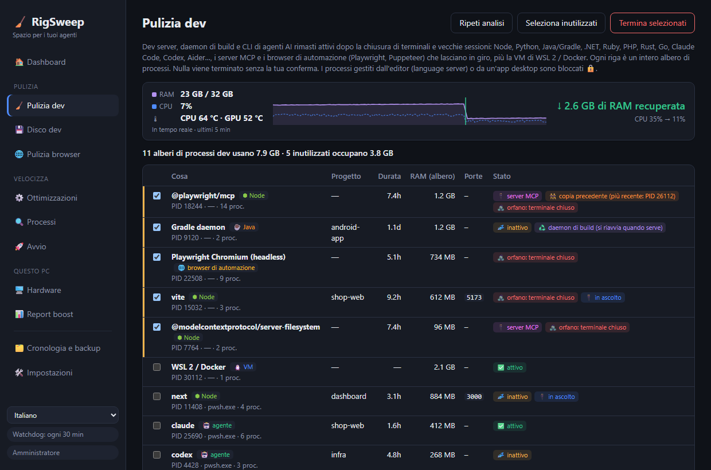

<div align="center">

# 🧹 RigSweep

**Spazio per i tuoi agenti.** Libera RAM, CPU e disco sui PC Windows di sviluppo intasati da sessioni di agenti AI.

**[🌐 Sito web](https://rigsweep.com)** · **[⬇️ Scarica](https://github.com/yobotn/rigsweep/releases/latest)** · **[📖 FAQ antivirus](#%EF%B8%8F-falsi-positivi-antivirus)**

[🇬🇧 English](README.md) · [🇩🇪 Deutsch](README.de.md) · [🇪🇸 Español](README.es.md) · [🇫🇷 Français](README.fr.md) · 🇮🇹 Italiano · [🇧🇷 Português](README.pt-BR.md) · [🇷🇺 Русский](README.ru.md) · [🇯🇵 日本語](README.ja.md) · [🇰🇷 한국어](README.ko.md) · [🇨🇳 简体中文](README.zh-CN.md)




</div>

---

## 📖 Perché l'ho creato

Nell'era dell'AI il mio portatile non esegue più *una sola* cosa. In una giornata normale ho diverse sessioni di **Claude Code** in terminali diversi, un dev server per progetto, watcher di build e un browser pieno di documentazione, anteprime e dashboard. Ogni nuova sessione avvia altri processi Node, e quando chiudo un terminale alcuni **restano semplicemente in esecuzione in background**.

Il PC cominciava a sembrare *intasato*: ventole sempre accese, RAM quasi sempre al limite e nessuna idea chiara di cosa la stesse davvero consumando. Gestione attività mi mostrava solo un muro di `node.exe` e `chrome.exe`, senza dirmi a quale sessione o progetto appartenessero, né se servissero ancora.

Così ho misurato il mio PC (32 GB di RAM) nel mezzo di una giornata di lavoro:

| 🔎 Cosa ho trovato | Numero | RAM |
|---|---:|---:|
| 🌐 Processi di Chrome | 37 | **6,5 GB** |
| ⬢ Processi Node + Claude (CLI di agenti, dev server, l'app desktop) | 14 | **2,5 GB** |
| 🧩 Servizi di Windows in esecuzione (telemetria, Xbox, indicizzazione della ricerca…) | ~150 | — |

Niente di tutto questo era "un virus" o "spazzatura". Erano i **normali residui del lavoro con gli agenti AI**, più roba di Windows in background che a un PC di sviluppo non serve. Le app "PC booster" esistenti o fanno cose irreversibili che spaventano, o non sanno nulla dei flussi di lavoro di sviluppo. Così ho creato lo strumento che volevo:

> **Vedi cosa sta davvero usando il tuo PC, fai pulizia di ciò che non serve più e rendi ogni modifica reversibile.**

---

## ✨ Funzionalità

### 🧹 Pulizia dev: processi dev inutilizzati in qualsiasi stack
Trova **dev server, daemon di build e CLI di agenti AI** e raggruppa ognuno con il suo **intero albero di processi**, cartella del progetto, durata, RAM e porte in ascolto.

| Stack | Cosa trova |
|---|---|
| ⬢ Node · Bun · Deno | dev server (Vite, Astro, Next…), watcher, esbuild |
| 🐍 Python | uvicorn, Flask, Django, Jupyter, Streamlit, Celery, processi di venv, server MCP in Python |
| ☕ Java | daemon di Gradle e Kotlin, Maven, Spring Boot, Quarkus |
| 🟣 .NET | `dotnet watch/run`, server del compilatore Roslyn, nodi MSBuild rimasti attivi |
| 💎 Ruby · 🐘 PHP · 🦀 Rust · 🐹 Go | `rails`/`ruby`, `php -S`/artisan, `cargo watch/run`, `go run` |
| 🤖 CLI di agenti | Claude Code, Codex, Gemini CLI, opencode, Aider, Goose |
| 🔌 Server MCP | server avviati dal tuo agente (`@modelcontextprotocol/*`, `@playwright/mcp`, `mcp-server-*`, FastMCP…) e rimasti in esecuzione dopo la sua chiusura, anche dietro un launcher `cmd /c npx` |
| 🌐 Browser di automazione | Chrome ed Edge con Playwright / Puppeteer / `--headless`, con l'intero albero dei renderer. Il tuo browser non viene mai elencato |
| 🐧 WSL 2 / Docker | la VM Linux (`vmmemWSL`), arrestata in modo pulito con `wsl --shutdown`, mai preselezionata |

Python e Java eseguono anche normali app desktop, quindi per questi vengono elencati solo i processi con una chiara impronta di sviluppo.

- 🧟 **Orfano**: il suo terminale è stato chiuso ma è rimasto in esecuzione. Preselezionato, anche se occupa ancora una porta (il classico zombie `localhost:3000`).
- 🔌 **Server MCP**: etichetta su ogni riga che lo è, così distingui un tool server lasciato da un agente dal tuo dev server.
- 👯 **Copia precedente**: un server MCP in esecuzione anche come copia più recente (ad es. nella sessione attuale del tuo agente) viene contrassegnato, così il residuo è facile da individuare.
- 📈 **Indicatore in tempo reale**: RAM e CPU vengono campionate ogni 2 secondi mentre RigSweep è in esecuzione (finestra o area di notifica). Subito dopo una pulizia, manuale o automatica, mostra **quanta RAM è stata davvero recuperata** e la CPU prima → dopo, misurate, non stimate.
- 🌡️ **Monitoraggio della temperatura**: le temperature di CPU e GPU in tempo reale nella Dashboard, con l'andamento e il picco degli ultimi 5 minuti, e un avviso quando il computer resta sopra i 90 °C. Il valore della GPU proviene dallo stesso contatore di Gestione attività; quello della CPU dalla zona termica ACPI (nessun driver installato, nessun privilegio di amministratore; approssimativo su molti desktop). Fai clic sul riquadro per passare da °C a °F.
- 💤 **Inattivo**: nessuna attività della CPU per molto tempo. I runtime senza porte aperte vengono preselezionati. Una **sessione di agente inattiva in un terminale aperto non viene mai preselezionata**, perché sta solo aspettando te (e comunque `claude --resume` la riprende).
  Dopo quanto tempo un processo è inattivo si imposta in **Impostazioni** (in minuti, predefinito 120; ad es. 5).
- 🧹 **Pulizia automatica** (disattivata per impostazione predefinita, in Impostazioni): ogni minuto RigSweep termina i runtime dev inutilizzati che ha visto restare senza CPU per l'intero periodo di inattività. CLI di agenti, VM di WSL/Docker e processi gestiti dall'editor non vengono mai terminati automaticamente, e ogni albero terminato viene registrato in Cronologia.
- 🟠🔴 **Indicatore nell'area di notifica**: l'icona nell'area di notifica (e il pulsante sulla barra delle applicazioni quando la finestra è aperta) mostra un punto arancione quando i processi dev inutilizzati occupano ≥ 1 GB e un punto rosso da ≥ 2 GB. Passa il mouse sull'icona per vedere quanto. Le soglie si impostano in Impostazioni, dove puoi anche disattivare il punto.
- ♻️ **Daemon di build**: i server di Gradle, Kotlin e Roslyn sono fatti per restare attivi. Terminarli non fa danni; si riavviano alla build successiva.
- 🔒 **Bloccato**: i processi gestiti da **VS Code, Cursor, JetBrains, Visual Studio…** (i tuoi language server) o da un'app desktop non possono mai essere terminati da qui.
- ✅ Nulla viene terminato senza la tua conferma, e prima di ogni terminazione viene controllato il riutilizzo del PID.

### 💾 Disco dev: node_modules e cache dei pacchetti
I vecchi progetti si tengono gigabyte di `node_modules`, `.next`, `target`, `bin/obj` e `.venv` molto dopo che hai smesso di lavorarci, e le cache dei pacchetti continuano solo a crescere. RigSweep trova entrambi ed elimina ciò che scegli.

- 🗂️ **Progetti**: cartelle di build e delle dipendenze di Node, Rust, .NET, Java/Gradle/Maven e Python. Una cartella conta solo se accanto c'è il suo file di progetto (`package.json`, `Cargo.toml`, `*.csproj`, `pyvenv.cfg`…), quindi una cartella `build` qualsiasi non viene mai toccata. Sono preselezionati solo i progetti che nessuno modifica da 30 giorni (regolabile), e quelli usati da un processo in esecuzione sono bloccati 🔒.
- 📦 **Cache dei pacchetti**: npm, npx, pnpm, Yarn, Bun, pip, uv, Cargo, Go, NuGet, Gradle, Maven, Playwright, Puppeteer, Hugging Face. pnpm, uv e Go vengono puliti con i loro comandi (`pnpm store prune`…); per Playwright e Puppeteer se ne vanno solo le versioni vecchie dei browser, la più recente resta.
- 🎯 **Selezione automatica**: direttamente nella scheda Disco dev scegli da quanto tempo un progetto deve essere fermo (da 3 a 365 giorni), quali cartelle selezionare (output di build, dipendenze, cache dei pacchetti) e una dimensione minima.
- 🚫 **Non pulire mai**: puoi disattivare qualsiasi cache. Quelle che comportano un download pesante (Playwright, Puppeteer, Hugging Face, Gradle, Maven, pacchetti NuGet, moduli Go) partono disattivate.
- 🙈 **Esclusioni**: AppData, le cartelle degli strumenti nel tuo profilo (`.cargo`, `.nvm`, `.vscode`…), `.git` e Windows vengono sempre ignorati. Aggiungi percorsi o nomi di cartella tuoi (`vendor`, `old-*`) nelle Impostazioni, oppure fai clic su **Escludi** su un progetto.
- ✅ Di default analizza il tuo profilo utente (Desktop, Documenti, Download, OneDrive…). Niente viene eliminato senza la tua conferma, e ogni cartella viene ricontrollata subito prima dell'eliminazione.

### 🖥️ Hardware: una scheda al posto di quattro strumenti
Le informazioni di base per cui apriresti CPU-Z, GPU-Z, CrystalDiskInfo e CrystalDiskMark, lette direttamente da Windows. Non viene installato alcun driver.

- 💽 **Salute dei dischi**: In salute / Usurato / Problema per ogni disco, con vita residua, temperatura, ore di accensione ed errori non corretti. Un disco che si sta guastando fa comparire un avviso nella dashboard.
- ⚡ **Test di velocità**: lettura e scrittura sequenziali più letture casuali 4K, per ogni unità. Scrive un file temporaneo da 512 MB e poi lo elimina.
- 🧮 **CPU, GPU, memoria**: modello, core e thread, cache, virtualizzazione (necessaria per WSL 2 e Docker), memoria video e driver, tipo di RAM, velocità e slot liberi.
- 🔋 **Sistema e batteria**: scheda madre, BIOS, build di Windows, tempo di accensione e usura della batteria sui portatili.

### 📊 Report boost: prima e dopo reali
Niente numeri finti del tipo "il tuo PC è più veloce dell'87%". RigSweep **misura** il tuo PC e confronta due istantanee: RAM in uso/libera, CPU media, numero di processi, servizi in esecuzione, RAM di Chrome, RAM di Node/agenti.

- 📸 Una **baseline** viene acquisita automaticamente prima della tua prima ottimizzazione.
- 🔁 Una coppia **prima/dopo** viene acquisita attorno a ogni Pulizia dev.
- 📋 **Copia come Markdown** per condividere il tuo risultato in una issue, in un post o in questo README.

### 🌐 Helper schede per Chrome
Un'app desktop **non può** chiudere le schede di Chrome, quindi RigSweep include una piccola estensione ([`chrome-extension/`](chrome-extension/)) senza accesso alla rete e con le sole autorizzazioni `tabs` / `storage` / `alarms`:
- 💤 **Sospendi le schede inattive**: libera la loro memoria, ma la scheda resta nella barra delle schede
- 🧹 **Chiudi le schede duplicate**
- 🎯 **Chiudi le schede in base a un pattern**, come `localhost:*` o `*.vercel.app`
- ⏰ **Sospensione automatica** ogni 10 minuti (facoltativa)

### ⚙️ Ottimizzazioni reversibili di Windows
Un catalogo curato ([`catalog/tweaks.json`](src-tauri/catalog/tweaks.json)) con telemetria, Xbox, indicizzazione della ricerca, app in background, esclusioni di Defender per le cartelle dev, combinazione per il risparmio di energia e altro, ognuna con un livello di rischio:

| Livello | Significato |
|---|---|
| 🟢 `safe` | Nessun effetto collaterale evidente (preselezionata) |
| 🟡 `moderate` | Piccolo compromesso, spiegato |
| 🔴 `caution` | Disattiva una funzionalità; devi confermare |


- 💾 **Ogni valore originale viene salvato in un backup** in SQLite prima della prima modifica. Ripristina una singola ottimizzazione, una categoria o tutto.
- 🛟 Prima della prima applicazione viene creato un **punto di ripristino del sistema**.
- 🔁 Un **watchdog** riapplica le ottimizzazioni che un aggiornamento di Windows Update ha annullato senza dirtelo, e conta quante volte succede.
- 🚫 Mai toccati: Windows Update, il motore di Defender, RPC/DCOM/LSA e altri ~60 servizi di sistema essenziali ([`PROTECTED_SERVICES`](src-tauri/src/catalog.rs)).

### 🔍 Analisi dei processi
CPU / RAM / disco per processo, e **quali servizi vivono dentro ogni `svchost.exe`**. Disattiva un servizio o termina un processo direttamente dall'elenco (gli elementi di sistema sono bloccati 🔒).

### 🔄 Aggiornamenti, decidi tu
**🛠️ Impostazioni → 🔄 Aggiornamenti** ha un pulsante **Cerca ora** e un'opzione facoltativa *Cerca aggiornamenti automaticamente* (all'avvio, poi una volta al giorno), **disattivata per impostazione predefinita**. Quando esce una nuova versione, nella barra laterale compare un pulsante con le note sulla versione. Nulla viene installato finché non fai clic su **Installa e riavvia**, e solo se il download è firmato con la chiave di RigSweep. Ottimizzazioni, backup e impostazioni vengono mantenuti. Vedi l'[informativa sulla privacy](#-informativa-sulla-privacy) per sapere esattamente cosa fa un controllo.

### 🌍 10 lingue
L'interfaccia è disponibile in **English, Deutsch, Español, Français, Italiano, Português (Brasil), Русский, 日本語, 한국어 e 简体中文** (si cambia dalla barra laterale), così come il programma di installazione e l'estensione per Chrome. Ogni lingua è localizzata con i termini ufficiali di Windows di quella lingua (Gestione attività, Servizi, Utilità di pianificazione…), non tradotta parola per parola. Hai notato qualcosa che suona strano? Apri una issue o una PR su `ui/locales/<code>.js` (app), `docs/locales/<code>.js` (sito web) o `README.<code>.md`.

---

## 🏁 Prima e dopo sul tuo PC

Installa, apri **📊 Report boost → 📸 Misura ora**, esegui una Pulizia dev e applica le ottimizzazioni sicure, riavvia, misura di nuovo, poi fai clic su **📋 Copia come Markdown**. I risultati sono benvenuti nelle [Discussions](../../discussions)!

<!-- TODO(maintainer): paste your own "Copy as Markdown" result here once you've run it on your machine. -->

> ℹ️ Le ottimizzazioni dei servizi hanno pieno effetto dopo un riavvio. Pulizia dev e sospensione delle schede di Chrome hanno effetto immediato.

---

## 📦 Installazione

1. Scarica `RigSweep_x.y.z_x64-setup.exe` dalle [**Releases**](../../releases).
2. Eseguilo. Richiede i privilegi di amministratore, perché RigSweep gestisce servizi e criteri.
3. Il programma di installazione chiede se consentire RigSweep in Microsoft Defender (vedi sotto). Sta a te decidere.
4. Le versioni successive si possono installare da **🛠️ Impostazioni → 🔄 Aggiornamenti** (a partire dalla 0.5.0).

🌐 **Helper per Chrome:** in RigSweep vai su **🛠️ Impostazioni → 🌐 Helper schede per Chrome → Apri cartella estensione**, poi in Chrome: `chrome://extensions` → **Modalità sviluppatore** → **Carica estensione non pacchettizzata** → scegli quella cartella.

## 🛡️ Falsi positivi antivirus

RigSweep è open source ma **non ha ancora la firma del codice**. Gli strumenti che modificano servizi e impostazioni di Defender somigliano molto a malware per l'euristica basata su machine learning, quindi **Microsoft Defender può eliminare l'exe per errore**. È successo durante lo sviluppo come `Trojan:Win32/Bearfoos.B!ml`, dove `!ml` indica un'ipotesi euristica e non la firma di un malware noto.

Cosa facciamo al riguardo:
- ❓ **Richiesta del programma di installazione (facoltativa):** "Consentire RigSweep in Microsoft Defender?" Sì esclude **solo la cartella di installazione**, e il programma di disinstallazione rimuove di nuovo l'esclusione. Le installazioni invisibili non la aggiungono mai.
- 🛠️ **Impostazioni → 🛡️ Attendibilità antivirus:** visualizza lo stato e aggiungi o rimuovi l'esclusione in qualsiasi momento.
- ✍️ **La firma del codice è prevista** tramite [SignPath Foundation](https://signpath.org) (gratuita per i progetti open source). È questa la vera soluzione. Vedi i [criteri di firma del codice](#-criteri-di-firma-del-codice).

Se è già stato eliminato: **Sicurezza di Windows → Protezione da virus e minacce → Cronologia protezione →** scegli la voce di RigSweep → **Azioni → Ripristina**. Fallo solo per un download dalla pagina Releases di questo repository o per una build che hai compilato tu. Puoi anche [segnalare tu stesso il falso positivo a Microsoft](https://www.microsoft.com/wdsi/filesubmission).

---

## 🛠️ Compilare dal sorgente

```powershell
winget install Rustlang.Rustup        # + VS 2022 Build Tools (carico di lavoro C++)
npm install
npm run build                         # -> src-tauri/target/release/rigsweep.exe + bundle/nsis/*-setup.exe
```
Esecuzione in sviluppo: `npm run dev` (accetta il prompt UAC; l'app si riavvia da sola con privilegi elevati).

> 💡 Defender può mettere in quarantena anche le tue build locali appena compilate. Aggiungi la cartella del tuo clone all'elenco *Cartelle dev* di RigSweep (Impostazioni) e applica l'ottimizzazione **Defender exclusions for dev folders**, oppure escludi `src-tauri\target` manualmente.

### ⌨️ CLI
| Comando | Effetto |
|---|---|
| `rigsweep.exe` | Interfaccia grafica + area di notifica |
| `rigsweep.exe --apply` | Senza interfaccia: verifica il profilo, riapplica le ottimizzazioni annullate, esce (usato dall'attività di avvio) |
| `rigsweep.exe --apply --tray` | Come sopra, poi resta nell'area di notifica con il watchdog |
| `rigsweep.exe --restore-all` | Ripristina tutto ai valori originali salvati nel backup |

### 🧪 Test
```powershell
cd src-tauri
cargo test                                          # validità del catalogo, backup, istantanee, parsing dei comandi
cargo test live_status   -- --ignored --nocapture   # sola lettura: stato rilevato di ogni ottimizzazione
cargo test live_dev_scan -- --ignored --nocapture   # sola lettura: cosa vede Pulizia dev in questo momento
```

### ➕ Aggiungere ottimizzazioni
Aggiungi una voce a [`catalog/tweaks.json`](src-tauri/catalog/tweaks.json). I tipi di azione sono `service` (start: disabled|manual), `task` (path), `registry` (HKLM|HKCU, dword|string), `defender_exclusion` e `power_plan`. Gli elementi `caution` devono includere un `warning`. `cargo test` rifiuta i servizi protetti e le voci non valide.

## 🐳 docker-optimize (strumento separato)
Non fa parte dell'app. [`docker-optimize/`](docker-optimize/) è uno script autonomo e reversibile da eseguire una volta sola, che limita la VM WSL2 di Docker Desktop (memoria, CPU, recupero della RAM, disco sparse) e disattiva gli extra di Docker Desktop che non ti servono. Non elimina mai container, immagini o volumi. Vedi il suo [README](docker-optimize/README.md).

## 🗂️ Dove si trovano i dati
| Cosa | Dove |
|---|---|
| Database (backup, cronologia, istantanee) | `%ProgramData%\RigSweep\rigsweep.db` (+ `.bak.1`–`.bak.5`) |
| Attività di avvio | Utilità di pianificazione → `RigSweep-Reapply` |
| Profili esportati | `Documents\RigSweep-profile-*.json` |

Arrivi da **aiBoost** (il vecchio nome)? Il tuo database viene migrato automaticamente al primo avvio e la vecchia attività di avvio viene sostituita.

## 🔏 Criteri di firma del codice

Firma del codice gratuita fornita da [SignPath.io](https://about.signpath.io/), certificato di [SignPath Foundation](https://signpath.org/).
*(Richiesta in corso: le release fino alla v0.3.0 **non sono ancora firmate**.)*

- **Build:** i programmi di installazione delle release vengono compilati a partire dal sorgente con tag da [GitHub Actions](.github/workflows/release.yml) su runner ospitati da GitHub. Solo queste build verranno inviate per la firma.
- **Committer e revisori:** [@yobotn](https://github.com/yobotn)
- **Approvatori:** [@yobotn](https://github.com/yobotn)

### 🔒 Informativa sulla privacy
Questo programma non trasferirà alcuna informazione ad altri sistemi in rete, a meno che non sia espressamente richiesto dall'utente o dalla persona che lo installa o lo utilizza. RigSweep non ha telemetria né strumenti di analisi, e l'estensione per Chrome non effettua richieste di rete. L'unica richiesta di rete che RigSweep può effettuare è la **ricerca di aggiornamenti**, e solo quando sei tu a chiederla: facendo clic su *Cerca ora* in Impostazioni, oppure attivando *Cerca aggiornamenti automaticamente* (disattivata per impostazione predefinita). Scarica `latest.json` dalle GitHub Releases di questo repository e non invia nulla sul tuo PC; un aggiornamento viene installato solo dopo che fai clic su *Installa*, e solo se la sua firma corrisponde alla chiave di firma di RigSweep. Tutto ciò che salva (backup, cronologia, misurazioni) resta in `%ProgramData%\RigSweep` sul tuo PC.

## ⚠️ Avviso legale

RigSweep modifica servizi di Windows, attività pianificate, criteri del Registro di sistema e impostazioni di Microsoft Defender, e può terminare processi in esecuzione. Ogni ottimizzazione viene salvata in un backup e può essere ripristinata, e nulla avviene senza la tua conferma, ma **lo usi a tuo rischio**. Il software è fornito **"così com'è", senza garanzie di alcun tipo** (vedi la [licenza MIT](LICENSE)). Controlla ogni modifica prima di applicarla, conserva i tuoi backup e non usarlo su dispositivi gestiti dal lavoro o dalla scuola senza l'approvazione del reparto IT.

RigSweep è un progetto indipendente, **non affiliato a** Microsoft, Google, Anthropic, OpenAI o ad altri strumenti citati. Tutti i marchi appartengono ai rispettivi proprietari.

## 🤝 Contribuire
Issue e PR sono benvenute, soprattutto nuove ottimizzazioni (con un livello di rischio chiaro), altri stack di sviluppo e CLI di agenti per Pulizia dev, e traduzioni.

## 📄 Licenza
[MIT](LICENSE): gratis per sempre, fai quello che vuoi, nessuna garanzia.
