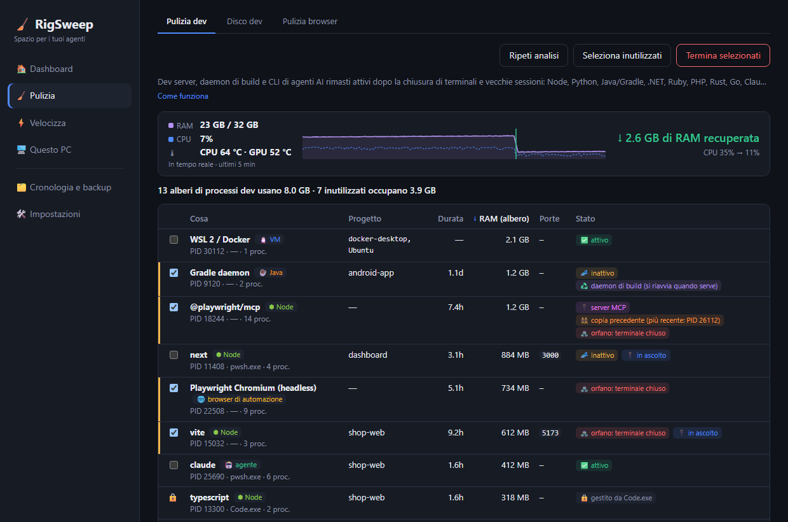
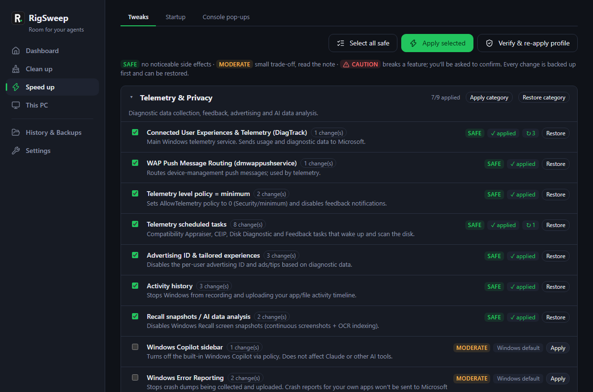
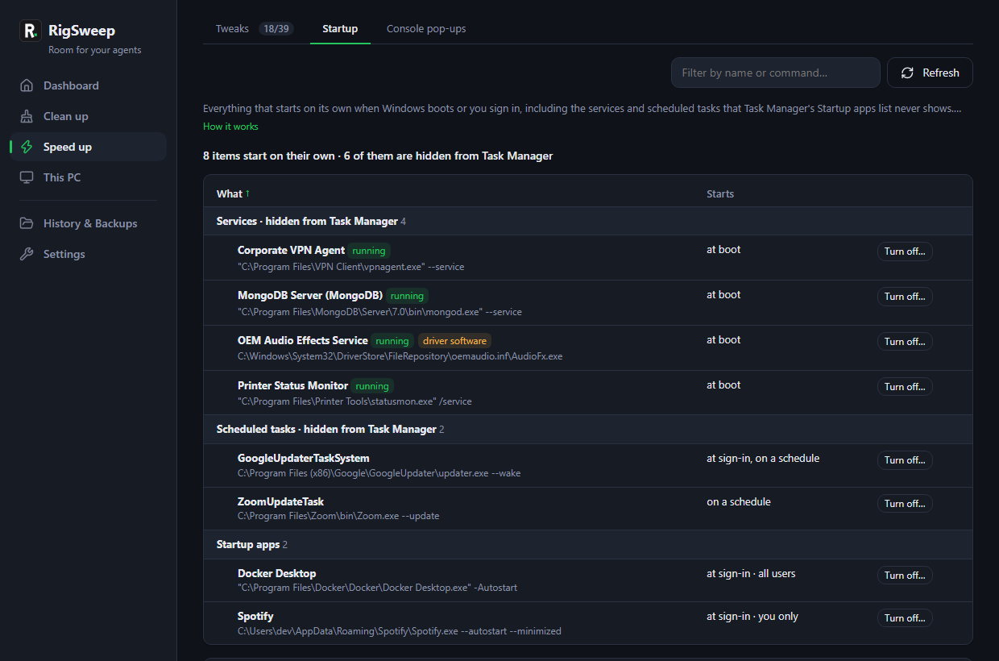

<div align="center">


# RigSweep

**Spazio per i tuoi agenti.** Libera RAM, CPU e disco sui PC Windows di sviluppo intasati da sessioni di agenti AI.

**[🌐 Sito web](https://rigsweep.com)** · **[⬇️ Scarica](https://github.com/yobotn/rigsweep/releases/latest)** · **[📖 FAQ antivirus](#falsi-positivi-antivirus)**

[🇬🇧 English](README.md) · [🇩🇪 Deutsch](README.de.md) · [🇪🇸 Español](README.es.md) · [🇫🇷 Français](README.fr.md) · 🇮🇹 Italiano · [🇧🇷 Português](README.pt-BR.md) · [🇷🇺 Русский](README.ru.md) · [🇯🇵 日本語](README.ja.md) · [🇰🇷 한국어](README.ko.md) · [🇨🇳 简体中文](README.zh-CN.md) · [🇸🇦 العربية](README.ar.md)




</div>

---

## Perché l'ho creato

<!-- Generated from docs/locales (story.*, stat.*) by scripts/prerender-site.js. Edit it there. -->

Nell'era dell'AI un portatile da sviluppatore non esegue più una sola cosa. Una giornata normale significa diverse sessioni di Claude Code in terminali diversi, un dev server per progetto, watcher di build e un browser pieno di documentazione e anteprime.

Ogni sessione avvia altri processi, e molti restano in esecuzione anche dopo aver chiuso il terminale. Gestione attività mostra solo un muro di node.exe, python.exe e chrome.exe, senza dirti a quale sessione o progetto appartengono.

- 🌐 Chrome (37 processi): **6.5 GB**
- ⬢ Node + Claude (14 processi): **2.5 GB**
- 🧩 Servizi di Windows in esecuzione: **~150**
- 💾 Cartelle target di Rust (3 progetti): **~120 GB**

*Misurato sul portatile da 32 GB dell'autore, nel mezzo di una giornata di lavoro.*

Poi ho guardato il disco. Stavo sviluppando tre app Rust in parallelo: RigSweep stesso, [KeepRun](https://github.com/yobotn/keeprun) (mantiene in esecuzione app Node, .NET e Python come servizi di Windows) e [Focuside](https://github.com/yobotn/focuside) (un IDE essenziale per agenti di coding IA). La cartella `target` di ogni progetto era arrivata a circa **40 GB**, quindi **~120 GB** in totale, tutto output di build che Cargo non pulisce mai da solo. La scheda **Disco dev** le ha trovate tutte e tre con una sola scansione.

Niente di tutto questo era un virus o spazzatura. Erano i normali avanzi del lavoro con gli agenti IA, più roba di Windows in background che a un PC da sviluppo non serve. Le app “PC booster” esistenti o fanno cose spaventose e irreversibili, o non sanno niente dei flussi di lavoro di sviluppo, così ho costruito lo strumento che volevo.

> **RigSweep mostra cosa sta davvero usando il tuo PC, fa pulizia di ciò che non serve più e rende ogni modifica reversibile.**

---

## Funzionalità

### Pulizia dev: processi dev inutilizzati in qualsiasi stack
Trova **dev server, daemon di build e CLI di agenti AI** e raggruppa ognuno con il suo **intero albero di processi**, cartella del progetto, durata, RAM e porte in ascolto.

| Stack | Cosa trova |
|---|---|
| ⬢ Node · Bun · Deno | dev server (Vite, Astro, Next…), watcher, esbuild |
| 🐍 Python | uvicorn, Flask, Django, Jupyter, Streamlit, Celery, processi di venv, server MCP in Python |
| ☕ Java | daemon di Gradle e Kotlin, Maven, Spring Boot, Quarkus |
| 🟣 .NET | `dotnet watch/run`, server del compilatore Roslyn, nodi MSBuild rimasti attivi |
| 💎 Ruby · 🐘 PHP · 🦀 Rust · 🐹 Go | `rails`/`ruby`, `php -S`/artisan, `cargo watch/run`, `go run` |
| 🤖 CLI di agenti | Claude Code, Codex, Gemini CLI, opencode, Aider, Goose |
| 🔌 Server MCP | server avviati dal tuo agente (`@modelcontextprotocol/*`, `@playwright/mcp`, `mcp-server-*`, FastMCP…) e rimasti in esecuzione dopo la sua chiusura, anche dietro un launcher `cmd /c npx` |
| 🌐 Browser di automazione | Chrome ed Edge con Playwright / Puppeteer / `--headless`, con l'intero albero dei renderer. Il tuo browser non viene mai elencato |
| 🐧 WSL 2 / Docker | la VM Linux (`vmmemWSL`), arrestata in modo pulito con `wsl --shutdown`, mai preselezionata |

Python e Java eseguono anche normali app desktop, quindi per questi vengono elencati solo i processi con una chiara impronta di sviluppo.

- 🧟 **Orfano**: il suo terminale è stato chiuso ma è rimasto in esecuzione. Preselezionato, anche se occupa ancora una porta (il classico zombie `localhost:3000`).
- 🔌 **Server MCP**: etichetta su ogni riga che lo è, così distingui un tool server lasciato da un agente dal tuo dev server.
- 👯 **Copia precedente**: un server MCP in esecuzione anche come copia più recente (ad es. nella sessione attuale del tuo agente) viene contrassegnato, così il residuo è facile da individuare.
- 📈 **Indicatore in tempo reale**: RAM e CPU vengono campionate ogni 2 secondi mentre RigSweep è in esecuzione (finestra o area di notifica). Subito dopo una pulizia, manuale o automatica, mostra **quanta RAM è stata davvero recuperata** e la CPU prima → dopo, misurate, non stimate.
- 🌡️ **Monitoraggio della temperatura**: le temperature di CPU e GPU in tempo reale nella Dashboard, con l'andamento e il picco degli ultimi 5 minuti, e un avviso quando il computer resta sopra i 90 °C. Il valore della GPU proviene dallo stesso contatore di Gestione attività; quello della CPU dalla zona termica ACPI (nessun driver installato, nessun privilegio di amministratore; approssimativo su molti desktop). Fai clic sul riquadro per passare da °C a °F.
- 💤 **Inattivo**: nessuna attività della CPU per molto tempo. I runtime senza porte aperte vengono preselezionati. Una **sessione di agente inattiva in un terminale aperto non viene mai preselezionata**, perché sta solo aspettando te (e comunque `claude --resume` la riprende).
  Dopo quanto tempo un processo è inattivo si imposta in **Impostazioni** (in minuti, predefinito 120; ad es. 5).
- 🧹 **Pulizia automatica** (disattivata per impostazione predefinita, in Impostazioni): ogni minuto RigSweep termina i runtime dev inutilizzati che ha visto restare senza CPU per l'intero periodo di inattività. CLI di agenti, VM di WSL/Docker e processi gestiti dall'editor non vengono mai terminati automaticamente, e ogni albero terminato viene registrato in Cronologia.
- 🟠🔴 **Indicatore nell'area di notifica**: l'icona nell'area di notifica (e il pulsante sulla barra delle applicazioni quando la finestra è aperta) mostra un punto arancione quando i processi dev inutilizzati occupano ≥ 1 GB e un punto rosso da ≥ 2 GB. Passa il mouse sull'icona per vedere quanto. Le soglie si impostano in Impostazioni, dove puoi anche disattivare il punto.
- ♻️ **Daemon di build**: i server di Gradle, Kotlin e Roslyn sono fatti per restare attivi. Terminarli non fa danni; si riavviano alla build successiva.
- 🔒 **Bloccato**: i processi gestiti da **VS Code, Cursor, JetBrains, Visual Studio…** (i tuoi language server) o da un'app desktop non possono mai essere terminati da qui.
- 🎯 **Una riga o tante**: seleziona le righe e fai clic su **Termina selezionati**, oppure usa il pulsante **Termina** di una singola riga. In entrambi i casi compare la stessa conferma, con quanto verrà liberato.
- ✅ Nulla viene terminato senza la tua conferma, e prima di ogni terminazione viene controllato il riutilizzo del PID.

### Disco dev: node_modules, cache e worktree
I vecchi progetti si tengono gigabyte di `node_modules`, `.next`, `target`, `bin/obj` e `.venv` molto dopo che hai smesso di lavorarci, le cache dei pacchetti continuano solo a crescere, e strumenti e agenti di IA si lasciano dietro cache e worktree. RigSweep trova tutto ed elimina ciò che scegli.

- 🗂️ **Progetti**: cartelle di build e delle dipendenze di Node, Rust, .NET, Java/Gradle/Maven e Python. Una cartella conta solo se accanto c'è il suo file di progetto (`package.json`, `Cargo.toml`, `*.csproj`, `pyvenv.cfg`…), quindi una cartella `build` qualsiasi non viene mai toccata. Sono preselezionati solo i progetti che nessuno modifica da 30 giorni (regolabile), e quelli usati da un processo in esecuzione sono bloccati 🔒.
- 📦 **Cache dei pacchetti**: npm, npx, pnpm, Yarn, Bun, pip, uv, Cargo, Go, NuGet, Gradle, Maven, Playwright, Puppeteer, Hugging Face. uv e Go vengono puliti con i loro comandi (`uv cache prune`, `go clean`); per Playwright e Puppeteer se ne vanno solo le versioni vecchie dei browser, la più recente resta.
- 🎮 **GPU e machine learning**: cache degli shader di NVIDIA, AMD, Intel e DirectX, la cache di calcolo CUDA, i modelli di PyTorch Hub e le estensioni compilate, la cache dei kernel di Triton e i pacchetti conda inutilizzati (tramite `conda clean --all`). I modelli di Ollama e LM Studio vengono mostrati con la loro dimensione, mai eliminati.
- 🤖 **Strumenti di IA ed editor**: le cache di Cursor, VS Code, Windsurf, dell'app desktop di Claude, di Codex e di ChatGPT, saltate finché l'app è aperta. Possono andarsene anche il backup dello stato e i vecchi checkpoint di Cursor (mai preselezionati). La cronologia delle chat (il database delle chat di Cursor, le chat di Claude Code, le sessioni di Codex) viene solo mostrata con la sua dimensione, così vedi dove è finito lo spazio.
- 🌿 **Worktree git**: i worktree creati da Claude Code, Cursor, Codex o da te, con il loro branch, il repository e da quanto tempo sono inattivi. Vengono rimossi con `git worktree remove`, che si rifiuta se ci sono modifiche non committate o file non tracciati; il branch e i suoi commit restano. I file ignorati da git che se ne andrebbero insieme (come `.env`) vengono elencati prima, e i worktree non sono mai preselezionati. Non sei sicuro? **Chiedi alla tua IA** copia un prompt pronto con cui il tuo agente IA cerca commit non pushati, stash e file non ricostruibili prima dell’eliminazione.
- 🖥️ **Avanzi di Windows**: i tuoi file temporanei e quelli di Windows non toccati da 7 giorni, i download di Windows Update, i file di Ottimizzazione recapito, i dump di arresto anomalo e le segnalazioni errori, la cache delle miniature e il Cestino (mai selezionato al posto tuo). Windows.old viene mostrato solo con la sua dimensione.
- 🐳 **Dischi virtuali di Docker e WSL**: il `.vhdx` di Docker Desktop e di ogni distribuzione WSL cresce e non si riduce mai da solo. **Compatta** lo riporta a quanto Linux usa davvero. Prima Docker Desktop viene chiuso e WSL arrestato, e dentro il disco non viene eliminato nulla.
- 🎯 **Selezione automatica**: direttamente nella scheda Disco dev scegli da quanto tempo un progetto deve essere fermo (da 3 a 365 giorni), quali cartelle selezionare (output di build, dipendenze, cache dei pacchetti) e una dimensione minima.
- 🚫 **Non pulire mai**: puoi disattivare qualsiasi cache. Quelle che comportano un download pesante (Playwright, Puppeteer, Hugging Face, Gradle, Maven, pacchetti NuGet, moduli Go) partono disattivate.
- 🙈 **Esclusioni**: AppData, le cartelle degli strumenti nel tuo profilo (`.cargo`, `.nvm`, `.vscode`…), `.git` e Windows vengono sempre ignorati. Aggiungi percorsi o nomi di cartella tuoi (`vendor`, `old-*`) nelle Impostazioni, oppure fai clic su **Escludi** su un progetto.
- 💽 **Indicatore dell'unità**: Disco dev, Pulizia browser e la Dashboard si aprono con lo spazio libero dell'unità adesso e dopo la pulizia (“58 GB liberi → 81 GB liberi”) e un grande pulsante **Libera X GB**. La Dashboard somma tutto quello che hanno trovato le scansioni.
- 🔁 **Pulizia automatica** (Impostazioni → Disco dev, disattivata per impostazione predefinita): una volta a settimana e, se vuoi, quando C: scende sotto una soglia che scegli tu, RigSweep svuota solo le cache che si ricostruiscono da sole. Mai i progetti, il Cestino o ciò che è lento da riscaricare.
- ⏸️ **Metti in pausa, riprendi o interrompi** una pulizia lunga e seguila con una barra di avanzamento. Se un riavvio la interrompe, può riprendere da dove si era fermata.
- ✅ Di default analizza il tuo profilo utente (Desktop, Documenti, Download, OneDrive…). Niente viene eliminato senza la tua conferma, e ogni cartella viene ricontrollata subito prima dell'eliminazione.

### Hardware: una scheda al posto di quattro strumenti
Le informazioni di base per cui apriresti CPU-Z, GPU-Z, CrystalDiskInfo e CrystalDiskMark, lette direttamente da Windows. Non viene installato alcun driver.

- 💽 **Salute dei dischi**: In salute / Usurato / Problema per ogni disco, con vita residua, temperatura, ore di accensione ed errori non corretti. Un disco che si sta guastando fa comparire un avviso nella dashboard.
- ⚡ **Test di velocità**: lettura e scrittura sequenziali più letture casuali 4K, per ogni unità. Scrive un file temporaneo da 512 MB e poi lo elimina.
- 🧮 **CPU, GPU, memoria**: modello, core e thread, cache, virtualizzazione (necessaria per WSL 2 e Docker), memoria video e driver, tipo di RAM, velocità e slot liberi.
- 🔋 **Sistema e batteria**: scheda madre, BIOS, build di Windows, tempo di accensione e usura della batteria sui portatili.


### GPU e IA: cosa gira sulla scheda video e sulla NPU
Cosa fa ogni app su GPU e NPU, letto dagli stessi contatori usati da Gestione attività. Non viene installato nulla, e finché la pagina è chiusa non viene letto nulla.

- 🎮 **Per scheda**: utilizzo, memoria dedicata e condivisa in uso e, in modalità Pro, un indicatore per ogni motore attivo (3D, Compute, Copy, Video…).
- 📋 **Per app**: utilizzo GPU, motore e memoria video dedicata di ogni app che usa la GPU, più la memoria condivisa in modalità Pro.
- 🧠 **NPU**: l'unità di elaborazione neurale compare accanto alle GPU, e l'utilizzo NPU di ogni app è mostrato insieme al suo utilizzo GPU.
- 🤖 **Carico IA**: i runtime di IA locali in esecuzione (Ollama, LM Studio, llama.cpp, Jan, LocalAI, KoboldCpp, ComfyUI, vLLM, Python con PyTorch o Transformers…) e la memoria video che occupano. Per Ollama sono elencati anche i modelli caricati e la VRAM di ciascuno.


### Report boost: prima e dopo reali
Niente numeri finti del tipo "il tuo PC è più veloce dell'87%". RigSweep **misura** il tuo PC e confronta due istantanee: RAM in uso/libera, CPU media, numero di processi, servizi in esecuzione, RAM di Chrome, RAM di Node/agenti.

- 📸 Una **baseline** viene acquisita automaticamente prima della tua prima ottimizzazione.
- 🔁 Una coppia **prima/dopo** viene acquisita attorno a ogni Pulizia dev.
- 📋 **Copia come Markdown** per condividere il tuo risultato in una issue, in un post o in questo README.

### Helper schede per Chrome
Un'app desktop **non può** chiudere le schede di Chrome, quindi RigSweep include una piccola estensione ([`chrome-extension/`](chrome-extension/)) senza accesso alla rete e con le sole autorizzazioni `tabs` / `storage` / `alarms`:
- 💤 **Sospendi le schede inattive**: libera la loro memoria, ma la scheda resta nella barra delle schede
- 🧹 **Chiudi le schede duplicate**
- 🎯 **Chiudi le schede in base a un pattern**, come `localhost:*` o `*.vercel.app`
- ⏰ **Sospensione automatica** ogni 10 minuti (facoltativa)

### Ottimizzazioni reversibili di Windows
Un catalogo curato ([`catalog/tweaks.json`](src-tauri/catalog/tweaks.json)) con telemetria, Xbox, indicizzazione della ricerca, app in background, esclusioni di Defender per le cartelle dev, combinazione per il risparmio di energia e altro, ognuna con un livello di rischio:

| Livello | Significato |
|---|---|
| 🟢 `safe` | Nessun effetto collaterale evidente (preselezionata) |
| 🟡 `moderate` | Piccolo compromesso, spiegato |
| 🔴 `caution` | Disattiva una funzionalità; devi confermare |



- 💾 **Ogni valore originale viene salvato in un backup** in SQLite prima della prima modifica. Ripristina una singola ottimizzazione, una categoria o tutto.
- 🛟 Prima della prima applicazione viene creato un **punto di ripristino del sistema**.
- 🔁 Un **watchdog** riapplica le ottimizzazioni che un aggiornamento di Windows Update ha annullato senza dirtelo, e conta quante volte succede.
- 🧭 **Edge non torna**: disinstalla Edge da Impostazioni e un'ottimizzazione impedisce a Edge Update e Windows Update di reinstallarlo. Il runtime WebView2 che serve ad altre app non viene toccato.
- 🚫 Mai toccati: Windows Update, il motore di Defender, RPC/DCOM/LSA e altri ~60 servizi di sistema essenziali ([`PROTECTED_SERVICES`](src-tauri/src/catalog.rs)).

### Analisi dei processi
CPU / RAM / disco per processo, e **quali servizi vivono dentro ogni `svchost.exe`**. Disattiva un servizio o termina un processo direttamente dall'elenco (gli elementi di sistema sono bloccati 🔒). Ogni app è mostrata con la sua icona.

- ❓ **Perché?**: fai clic su un processo per vedere cos'è: CPU, memoria, disco, thread, produttore, file e riga di comando, quale programma l'ha avviato e quali programmi ha avviato lui. I processi noti di Windows (Defender, Windows Search, Windows Update, svchost, WMI…) hanno una spiegazione chiara del perché sono impegnati.
- 🛡️ **Cosa sta analizzando Defender**: la Dashboard mostra **Scopri perché** accanto a un processo che usa molta CPU, e prima ancora accanto a Microsoft Defender. Per Defender, **Registra cosa analizza** lo osserva per 20 secondi ed elenca le cartelle, i tipi di file e i processi che hanno causato le analisi. Se gran parte viene dal tuo lavoro di sviluppo, ti indirizza all'ottimizzazione con le esclusioni di Defender per le cartelle dev.


### Avvio: ciò che Gestione attività non mostra
L'elenco App di avvio di Gestione attività tralascia quasi tutto ciò che parte con Windows. RigSweep mostra tutto, esclusi i componenti di Windows stesso:

- 🧩 **Servizi ad avvio automatico** di app e driver (client VPN, utility del produttore, programmi di aggiornamento). Passano a Manuale: non partono più all'avvio, ma l'app può ancora avviarli quando la apri.
- ⏰ **Attività pianificate** eseguite all'accesso, all'avvio o secondo una pianificazione.
- 🚀 **App di avvio** dal Registro di sistema e dalla cartella Esecuzione automatica, disattivate con lo stesso interruttore di Gestione attività.
- 💾 Ogni modifica viene salvata e si può ripristinare, e se un aggiornamento riattiva un'app, il watchdog la disattiva di nuovo.



### Finestre console: cos'era quella finestra?
Una finestra del Prompt dei comandi o di PowerShell compare, si chiude un attimo dopo e non scopri mai cosa è stato eseguito. **Velocizza → 🪟 Finestre console** le registra tutte:

- 🪟 Ogni finestra console che si apre e si chiude da sola entro un minuto viene elencata con il **comando esatto che ha eseguito**, anche se è rimasta aperta solo pochi millisecondi.
- 🔎 **Chi l'ha avviata**: l'attività pianificata (con il nome), il servizio, l'app o Esplora file, più l'intera catena dei processi padre in Dettagli.
- 📜 **Cosa è girato al suo interno**: i programmi che ha avviato (ad es. un file `.bat` che chiama `curl` e `reg`) e il suo codice di uscita.
- 🔁 Lo stesso comando dalla stessa origine è una sola riga con un contatore (×12), così un'attività che scatta ogni ora salta subito all'occhio.
- ⏹ **Disattiva…** disattiva l'attività pianificata di terze parti che c'è dietro, con backup e annullabile da Avvio o Ottimizzazioni come qualsiasi altra modifica all'avvio.
- 🙈 I comandi eseguiti in modo nascosto non vengono elencati, solo le finestre che potevi vedere davvero. RigSweep legge gli avvii dei processi dal flusso di eventi del kernel di Windows (ETW) e osservando non modifica nulla. Puoi disattivarlo in Impostazioni → Aspetto e funzioni.

### Rete: quale app occupa quale porta
- 📶 **Per scheda di rete**: velocità di download e upload, velocità di collegamento e traffico dall'avvio. Windows fornisce il conteggio dei byte per app solo agli strumenti che avviano una traccia come amministratore, quindi il traffico è mostrato per scheda, non per app.
- 🔌 **Per app**: porte in ascolto (TCP e UDP), numero di connessioni aperte e indirizzi remoti con cui ogni app comunica.
- 🔍 **Chi lo sta usando?**: inserisci una porta per vedere quale processo la occupa, con la sua riga di comando, oppure un file o una cartella per vedere quali app lo tengono aperto o ci lavorano dentro. Si limita a guardare: da qui non viene terminato nulla.


### Trova: avanzi e file che meritano un secondo sguardo
Dove è finito il tuo spazio, e tre elenchi da controllare. Non viene rimosso nulla che tu non abbia scelto.

- 📊 **Cosa occupa spazio**: le cartelle più grandi su qualsiasi unità, un livello alla volta. Fai clic su una per scendere; *Mostra* la apre in Esplora file. Si limita a leggere.
- 🚚 **Sposta le cache fuori dall'unità di sistema**: le cache di npm, pip, uv, Yarn, Bun, NuGet, Go, Gradle, Playwright, Hugging Face e PyTorch passano su un'altra unità o un Dev Drive con un clic. RigSweep imposta per il tuo account la variabile d'ambiente propria di ogni strumento.
- 📦 **Programmi senza disinstallatore**: voci di App installate il cui programma di disinstallazione non c'è più, e cartelle in Program Files che nessun programma installato, servizio, collegamento o attività usa. Ogni voce viene salvata in un file di backup prima di essere rimossa, e le cartelle finiscono nel Cestino.
- 🕒 **File vecchi**: file oltre 50 MB in Download, Desktop e Documenti non modificati da un anno, e programmi di installazione in Download più vecchi di 90 giorni. Finiscono nel Cestino, e i file sincronizzati con OneDrive vengono segnalati, perché eliminarli li rimuove da tutti i dispositivi.
- 🛡️ **Da controllare**: programmi non firmati che si avviano con Windows o girano da AppData o Temp, nomi che nascondono il vero tipo (`fattura.pdf.exe`, un carattere nascosto da destra a sinistra) e download non firmati. Essere in elenco non è un verdetto: **Analizza con Defender** chiede a Microsoft Defender di quel singolo file.


### Semplice o Pro
In **🛠️ Impostazioni → Aspetto e funzioni**:

- 🧭 **Modalità**: **Semplice** mostra la Dashboard, le pulizie e parole chiare, e nasconde le pagine per esperti (Processi, Rete). **Pro** mostra tutto, compresi i motori della GPU, le connessioni e i valori grezzi. Le nuove installazioni partono in Semplice.
- 📡 **Monitor**: disattiva GPU e VRAM per processo, Carico IA, Rete, Temperature o Avvisi sullo stato dei dischi. Un monitor disattivato non viene mai letto, quindi non consuma CPU.

### Per agenti IA e script
- ⌨️ **Comandi headless** che **non richiedono diritti di amministratore**: `rigsweep --disk-report --json`, `rigsweep --disk-clean --safe [--dry-run] --json` e `rigsweep --port 3000 --json`.
- 🔌 **Server MCP**: `rigsweep --mcp` mette a disposizione di Claude Code, Cursor o Codex gli strumenti `drive_space`, `disk_report`, `free_disk_space` (una simulazione, salvo indicazione contraria) e `port_owner`. Per Claude Code: `claude mcp add rigsweep -- "C:\Program Files\RigSweep\rigsweep.exe" --mcp`. Claude Desktop: installa `rigsweep-<versione>.mcpb` dall'[ultima release](https://github.com/yobotn/rigsweep/releases/latest). È anche nel [MCP Registry](https://registry.modelcontextprotocol.io/) come `io.github.yobotn/rigsweep`.
- 📖 Riferimento completo: [rigsweep.com/cli](https://rigsweep.com/cli/).

### Aggiornamenti, decidi tu
**🛠️ Impostazioni → 🔄 Aggiornamenti** ha un pulsante **Cerca ora** e un'opzione facoltativa *Cerca aggiornamenti automaticamente* (all'avvio, poi una volta al giorno), **disattivata per impostazione predefinita**. Quando esce una nuova versione, nella barra laterale compare un pulsante con le note sulla versione. Nulla viene installato finché non fai clic su **Installa e riavvia**, e solo se il download è firmato con la chiave di RigSweep. Ottimizzazioni, backup e impostazioni vengono mantenuti. Vedi l'[informativa sulla privacy](#informativa-sulla-privacy) per sapere esattamente cosa fa un controllo.

### 11 lingue
L'interfaccia è disponibile in **English, Deutsch, Español, Français, Italiano, Português (Brasil), Русский, 日本語, 한국어, 简体中文 e العربية** (si cambia dalla barra laterale), così come il programma di installazione e l'estensione per Chrome. Ogni lingua è localizzata con i termini ufficiali di Windows di quella lingua (Gestione attività, Servizi, Utilità di pianificazione…), non tradotta parola per parola. Hai notato qualcosa che suona strano? Apri una issue o una PR su `ui/locales/<code>.js` (app), `docs/locales/<code>.js` (sito web) o `README.<code>.md`.

---

## Prima e dopo sul tuo PC

Installa, apri **📊 Report boost → 📸 Misura ora**, esegui una Pulizia dev e applica le ottimizzazioni sicure, riavvia, misura di nuovo, poi fai clic su **📋 Copia come Markdown**. I risultati sono benvenuti nelle [Discussions](../../discussions)!

<!-- TODO(maintainer): paste your own "Copy as Markdown" result here once you've run it on your machine. -->

> ℹ️ Le ottimizzazioni dei servizi hanno pieno effetto dopo un riavvio. Pulizia dev e sospensione delle schede di Chrome hanno effetto immediato.

---

## Installazione

1. Scarica `RigSweep_x.y.z_x64-setup.exe` dalle [**Releases**](../../releases).
2. Eseguilo. Richiede i privilegi di amministratore, perché RigSweep gestisce servizi e criteri.
3. Il programma di installazione chiede se consentire RigSweep in Microsoft Defender (vedi sotto). Sta a te decidere.
4. Le versioni successive si possono installare da **🛠️ Impostazioni → 🔄 Aggiornamenti** (a partire dalla 0.5.0).

Oppure con [Scoop](https://scoop.sh):

```powershell
scoop bucket add yobotn https://github.com/yobotn/scoop-bucket
scoop install yobotn/rigsweep
```

🌐 **Helper per Chrome:** in RigSweep vai su **🛠️ Impostazioni → 🌐 Helper schede per Chrome → Apri cartella estensione**, poi in Chrome: `chrome://extensions` → **Modalità sviluppatore** → **Carica estensione non pacchettizzata** → scegli quella cartella.

## Falsi positivi antivirus

RigSweep è open source ma **non ha ancora la firma del codice**. Gli strumenti che modificano servizi e impostazioni di Defender somigliano molto a malware per l'euristica basata su machine learning, quindi **Microsoft Defender può eliminare l'exe per errore**. È successo durante lo sviluppo come `Trojan:Win32/Bearfoos.B!ml`, dove `!ml` indica un'ipotesi euristica e non la firma di un malware noto.

Cosa facciamo al riguardo:
- ❓ **Richiesta del programma di installazione (facoltativa):** "Consentire RigSweep in Microsoft Defender?" Sì esclude **solo la cartella di installazione**, e il programma di disinstallazione rimuove di nuovo l'esclusione. Le installazioni invisibili non la aggiungono mai.
- 🛠️ **Impostazioni → 🛡️ Attendibilità antivirus:** visualizza lo stato e aggiungi o rimuovi l'esclusione in qualsiasi momento.
- ✍️ **La firma del codice è prevista** tramite [SignPath Foundation](https://signpath.org) (gratuita per i progetti open source). È questa la vera soluzione. Vedi i [criteri di firma del codice](#criteri-di-firma-del-codice).

Se è già stato eliminato: **Sicurezza di Windows → Protezione da virus e minacce → Cronologia protezione →** scegli la voce di RigSweep → **Azioni → Ripristina**. Fallo solo per un download dalla pagina Releases di questo repository o per una build che hai compilato tu. Puoi anche [segnalare tu stesso il falso positivo a Microsoft](https://www.microsoft.com/wdsi/filesubmission).

---

## Compilare dal sorgente

```powershell
winget install Rustlang.Rustup        # + VS 2022 Build Tools (carico di lavoro C++)
npm install
npm run build                         # -> src-tauri/target/release/rigsweep.exe + bundle/nsis/*-setup.exe
```
Esecuzione in sviluppo: `npm run dev` (accetta il prompt UAC; l'app si riavvia da sola con privilegi elevati).

> 💡 Defender può mettere in quarantena anche le tue build locali appena compilate. Aggiungi la cartella del tuo clone all'elenco *Cartelle dev* di RigSweep (Impostazioni) e applica l'ottimizzazione **Defender exclusions for dev folders**, oppure escludi `src-tauri\target` manualmente.

### CLI
| Comando | Effetto |
|---|---|
| `rigsweep.exe` | Interfaccia grafica + area di notifica |
| `rigsweep.exe --apply` | Senza interfaccia: verifica il profilo, riapplica le ottimizzazioni annullate, esce (usato dall'attività di avvio) |
| `rigsweep.exe --apply --tray` | Come sopra, poi resta nell'area di notifica con il watchdog |
| `rigsweep.exe --restore-all` | Ripristina tutto ai valori originali salvati nel backup |

### Test
```powershell
npm run check                                       # tutto ciò che controlla la CI; con -- --fast, senza i test Rust
cd src-tauri
cargo test                                          # validità del catalogo, backup, istantanee, parsing dei comandi
cargo test live_status   -- --ignored --nocapture   # sola lettura: stato rilevato di ogni ottimizzazione
cargo test live_dev_scan -- --ignored --nocapture   # sola lettura: cosa vede Pulizia dev in questo momento
```

### Aggiungere ottimizzazioni
Aggiungi una voce a [`catalog/tweaks.json`](src-tauri/catalog/tweaks.json). I tipi di azione sono `service` (start: disabled|manual), `task` (path), `registry` (HKLM|HKCU, dword|string), `defender_exclusion` e `power_plan`. Gli elementi `caution` devono includere un `warning`. `cargo test` rifiuta i servizi protetti e le voci non valide.

## docker-optimize (strumento separato)
Non fa parte dell'app. [`docker-optimize/`](docker-optimize/) è uno script autonomo e reversibile da eseguire una volta sola, che limita la VM WSL2 di Docker Desktop (memoria, CPU, recupero della RAM, disco sparse) e disattiva gli extra di Docker Desktop che non ti servono. Non elimina mai container, immagini o volumi. Vedi il suo [README](docker-optimize/README.md).

## Dove si trovano i dati
| Cosa | Dove |
|---|---|
| Database (backup, cronologia, istantanee) | `%ProgramData%\RigSweep\rigsweep.db` (+ `.bak.1`–`.bak.5`) |
| Attività di avvio | Utilità di pianificazione → `RigSweep-Reapply` |
| Profili esportati | `Documents\RigSweep-profile-*.json` |

Arrivi da **aiBoost** (il vecchio nome)? Il tuo database viene migrato automaticamente al primo avvio e la vecchia attività di avvio viene sostituita.

## Criteri di firma del codice

Firma del codice gratuita fornita da [SignPath.io](https://about.signpath.io/), certificato di [SignPath Foundation](https://signpath.org/).
*(Richiesta in corso: le release fino alla v0.3.0 **non sono ancora firmate**.)*

- **Build:** i programmi di installazione delle release vengono compilati a partire dal sorgente con tag da [GitHub Actions](.github/workflows/release.yml) su runner ospitati da GitHub. Solo queste build verranno inviate per la firma.
- **Committer e revisori:** [@yobotn](https://github.com/yobotn)
- **Approvatori:** [@yobotn](https://github.com/yobotn)

### Informativa sulla privacy
Questo programma non trasferirà alcuna informazione ad altri sistemi in rete, a meno che non sia espressamente richiesto dall'utente o dalla persona che lo installa o lo utilizza. RigSweep può fare due tipi di richieste di rete, ciascuna solo dopo che l'hai scelta. **Controllo aggiornamenti**: quando fai clic su *Controlla ora* nelle Impostazioni o attivi *Controlla automaticamente gli aggiornamenti* (disattivato per impostazione predefinita). Scarica `latest.json` dai GitHub Releases di questo repository e non invia nulla sul tuo PC; un aggiornamento viene installato solo dopo che fai clic su *Installa*, e solo se la sua firma corrisponde alla chiave di firma di RigSweep. **Statistiche d'uso anonime**: la prima volta che apri RigSweep, una finestra le spiega e ti chiede cosa preferisci; non viene inviato nulla finché non rispondi, e *Impostazioni → Statistiche anonime* le disattiva in qualsiasi momento, eliminando anche ciò che questo PC ha inviato. Circa una volta all'ora, un report contiene solo ciò che è stato pulito dal precedente (ora, tipo e spazio liberato, una voce per tipo), le app note più esigenti (come Chrome o VS Code), una volta al giorno il software hardware e dei driver di un elenco fisso di produttori ([discovery.json](server/discovery.json): ASUS, Dell, HP, NVIDIA, Logitech…) con l'indicazione se è in esecuzione e quanto consuma, RAM e core, la versione di RigSweep e la build di Windows, e un ID di installazione casuale. Non contiene mai percorsi di file, nomi di cartelle o progetti, nomi di processi al di fuori di questi due elenchi, nomi utente o del PC, né ID hardware; il tuo indirizzo IP serve solo a ricavare il paese e non viene mai salvato. *Mostra cosa viene inviato* mostra il report esatto. L'estensione per Chrome pone la stessa domanda nel suo popup e, se accetti, invia solo conteggi orari (schede sospese e chiuse, schede e finestre aperte), mai URL, titoli o siti. Tutto il resto che RigSweep salva (backup, cronologia, misurazioni) resta in `%ProgramData%\RigSweep` sul tuo PC. Informativa completa: [rigsweep.com/privacy](https://rigsweep.com/privacy/).

## Avviso legale

RigSweep modifica servizi di Windows, attività pianificate, criteri del Registro di sistema e impostazioni di Microsoft Defender, e può terminare processi in esecuzione. Ogni ottimizzazione viene salvata in un backup e può essere ripristinata, e nulla avviene senza la tua conferma, ma **lo usi a tuo rischio**. Il software è fornito **"così com'è", senza garanzie di alcun tipo** (vedi la [licenza MIT](LICENSE)). Controlla ogni modifica prima di applicarla, conserva i tuoi backup e non usarlo su dispositivi gestiti dal lavoro o dalla scuola senza l'approvazione del reparto IT.

RigSweep è un progetto indipendente, **non affiliato a** Microsoft, Google, Anthropic, OpenAI o ad altri strumenti citati. Tutti i marchi appartengono ai rispettivi proprietari.

## Contribuire
Issue e PR sono benvenute, soprattutto nuove ottimizzazioni (con un livello di rischio chiaro), altri stack di sviluppo e CLI di agenti per Pulizia dev, e traduzioni.

## Licenza
[MIT](LICENSE): gratis per sempre, fai quello che vuoi, nessuna garanzia.
