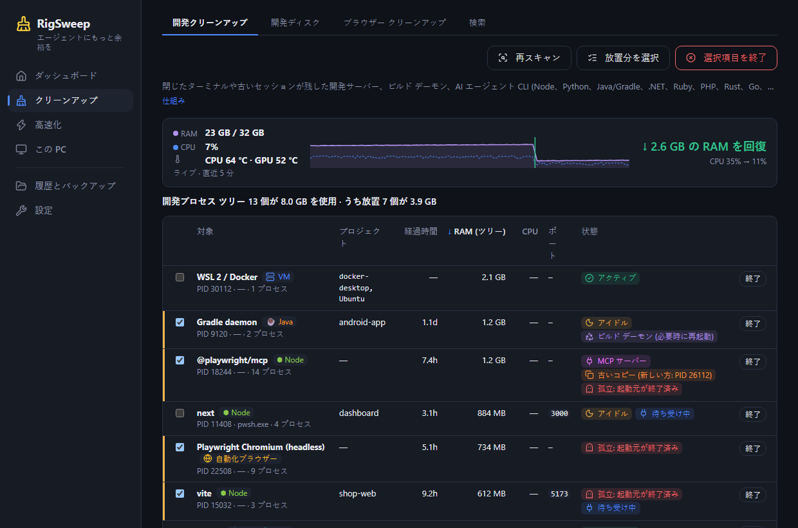

<div align="center">


# RigSweep

**エージェントにもっと余裕を。** AI エージェントのセッションで埋まった Windows 開発マシンの RAM、CPU、ディスクを解放します。

**[🌐 ホームページ](https://rigsweep.com)** · **[⬇️ ダウンロード](https://github.com/yobotn/rigsweep/releases/latest)** · **[📖 ウイルス対策 FAQ](#ウイルス対策ソフトの誤検知)**

[🇬🇧 English](README.md) · [🇩🇪 Deutsch](README.de.md) · [🇪🇸 Español](README.es.md) · [🇫🇷 Français](README.fr.md) · [🇮🇹 Italiano](README.it.md) · [🇧🇷 Português](README.pt-BR.md) · [🇷🇺 Русский](README.ru.md) · 🇯🇵 日本語 · [🇰🇷 한국어](README.ko.md) · [🇨🇳 简体中文](README.zh-CN.md) · [🇸🇦 العربية](README.ar.md)




</div>

---

## これを作った理由

<!-- Generated from docs/locales (story.*, stat.*) by scripts/prerender-site.js. Edit it there. -->

AI の時代、開発用ノート PC で動いているのはもう 1 つのものだけではありません。いつもの 1 日でも、複数のターミナルで Claude Code のセッションをいくつも開き、プロジェクトごとに開発サーバーを立て、ビルドのウォッチャーを動かし、ブラウザーはドキュメントやプレビューでいっぱいです。

セッションのたびにプロセスが増え、その多くはターミナルを閉じた後も動き続けます。タスク マネージャーに並ぶのは node.exe、python.exe、chrome.exe の羅列だけで、どのセッションやプロジェクトのものかはわかりません。

- 🌐 Chrome (37 プロセス): **6.5 GB**
- ⬢ Node + Claude (14 プロセス): **2.5 GB**
- 🧩 実行中の Windows サービス: **~150**
- 💾 Rust の target フォルダー (3 プロジェクト): **~120 GB**
- 🌿 git worktree (1 プロジェクト): **~30 GB**

*作者の 32 GB ノート PC で、作業日の途中に測定した値です。*

次にディスクを確認しました。私は 3 つの Rust アプリを並行して開発していました。RigSweep 自体と、[KeepRun](https://github.com/yobotn/keeprun) (Node、.NET、Python のアプリを Windows サービスとして動かし続けるツール)、[Focuside](https://github.com/yobotn/focuside) (AI コーディング エージェントのための集中型 IDE) です。各プロジェクトの `target` フォルダーはそれぞれ約 **40 GB** にまで膨らみ、合計で **約 120 GB**。すべて Cargo が自動では片付けないビルド成果物です。さらに、1 つのプロジェクトだけで git worktree が約 **30 GB** ありました。エージェントが並行作業のために作った追加のチェックアウトで、それぞれに独自のビルド成果物があり、作業をマージしたずっと後も残っていたものです。[**開発ディスク**] タブは 1 回のスキャンでそのすべてを見つけました。

どれもウイルスやゴミではありません。AI エージェントと仕事をすれば当たり前に残るものと、開発マシンには要らない Windows のバックグラウンド処理です。既存の「PC 高速化」アプリは、怖くて元に戻せないことをするか、開発の流れをまったく知らないかのどちらかでした。だから、自分が欲しかったツールを作りました。

> **RigSweep は、マシンを実際に使っているものを可視化し、古いものを一掃し、すべての変更を元に戻せる状態に保ちます。**

---

## 機能

### 開発クリーンアップ: あらゆるスタックの放置された開発プロセス
**開発サーバー、ビルド デーモン、AI エージェント CLI** を検出し、それぞれを**プロセス ツリー全体**、プロジェクト フォルダー、経過時間、RAM、待ち受けポートとともにまとめます。

| スタック | 検出対象 |
|---|---|
| ⬢ Node · Bun · Deno | 開発サーバー (Vite、Astro、Next など)、ウォッチャー、esbuild |
| 🐍 Python | uvicorn、Flask、Django、Jupyter、Streamlit、Celery、venv のプロセス、Python の MCP サーバー |
| ☕ Java | Gradle と Kotlin のデーモン、Maven、Spring Boot、Quarkus |
| 🟣 .NET | `dotnet watch/run`、Roslyn コンパイラ サーバー、残ったままの MSBuild ノード |
| 💎 Ruby · 🐘 PHP · 🦀 Rust · 🐹 Go | `rails`/`ruby`、`php -S`/artisan、`cargo watch/run`、`go run` |
| 🤖 エージェント CLI | Claude Code、Codex、Gemini CLI、opencode、Aider、Goose |
| 🔌 MCP サーバー | エージェントが起動し、エージェントの終了後も動き続けているサーバー (`@modelcontextprotocol/*`、`@playwright/mcp`、`mcp-server-*`、FastMCP など)。`cmd /c npx` ランチャー経由で起動されたものも検出します |
| 🌐 自動化ブラウザー | Playwright / Puppeteer / `--headless` の Chrome と Edge を、レンダラー ツリー全体とともに検出します。普段使いのブラウザーが一覧に表示されることはありません |
| 🐧 WSL 2 / Docker | Linux の VM (`vmmemWSL`)。`wsl --shutdown` で正常にシャットダウンします。事前に選択されることはありません |

Python と Java は一般的なデスクトップ アプリでも使われるため、これらは開発用であることが明確なプロセスのみを一覧に表示します。

- 🧟 **孤立**: ターミナルは閉じられたのに動き続けているプロセスです。ポートを使用したままでも事前に選択されます (おなじみのゾンビ `localhost:3000`)。
- 🔌 **MCP サーバー**: 該当するすべての行にタグが付くので、エージェントが残したツール サーバーと自分の開発サーバーを区別できます。
- 👯 **古いコピー**: 新しいコピーも (たとえば現在のエージェント セッションの下で) 実行されている MCP サーバーにはマークが付くので、残ったほうをすぐに見分けられます。
- 📈 **ライブ メーター**: RigSweep の実行中 (ウィンドウ表示中または通知領域に常駐中) は、RAM と CPU を 2 秒ごとに計測します。手動でも自動でもクリーンアップの直後に、**実際に回復した RAM の量**と CPU の前後の値を表示します。推定値ではなく実測値です。
- 🌡️ **温度の追跡**: CPU と GPU の温度がダッシュボードにリアルタイムで表示され、5 分間の推移とピークも確認できます。マシンが 90 °C を超えたままの場合は警告が出ます。GPU の値はタスク マネージャーと同じカウンター、CPU の値は ACPI の温度ゾーンから取得します (ドライバーのインストールも管理者権限も不要ですが、多くのデスクトップ PC では概算値です)。タイルをクリックすると °C / °F を切り替えられます。
- 💤 **アイドル**: 長時間 CPU アクティビティがないプロセスです。開いているポートがないランタイムは事前に選択されます。**開いているターミナルのアイドル状態のエージェント セッションは事前に選択されません**。ユーザーの入力を待っているだけだからです (それに `claude --resume` で再開できます)。
  アイドルと見なすまでの時間は **[設定]** で指定します (分単位、既定値は 120。例: 5)。
- 🧹 **自動クリーンアップ** (既定ではオフ、[設定] で変更): RigSweep は 1 分ごとに、アイドル期間中ずっと CPU を使わずに放置されていることを確認した開発ランタイムを終了します。エージェント CLI、WSL/Docker の VM、エディターが所有するプロセスが自動で終了されることはなく、終了した各ツリーは履歴に記録されます。
- 🟠🔴 **通知領域のインジケーター**: 放置された開発プロセスが 1 GB 以上を使用していると通知領域のアイコン (およびウィンドウを開いている間はタスク バーのボタン) にオレンジのドットが、2 GB 以上で赤のドットが表示されます。通知領域のアイコンにポインターを合わせると使用量を確認できます。しきい値は [設定] で指定でき、ドットをオフにすることもできます。
- ♻️ **ビルド デーモン**: Gradle、Kotlin、Roslyn のサーバーは、残り続けるように作られています。終了しても害はなく、次のビルドで再起動します。
- 🔒 **ロック**: **VS Code、Cursor、JetBrains、Visual Studio など** (言語サーバー) やデスクトップ アプリが所有するプロセスは、ここから終了することはできません。
- 🎯 **1 行ずつでもまとめてでも**: 行にチェックを入れて **[選択項目を終了]** をクリックするか、行ごとの **[終了]** ボタンを使います。どちらも同じ確認画面が表示され、解放される量も確認できます。
- ✅ 確認なしに終了されることはなく、終了の前には毎回 PID の再利用をチェックします。

### 開発ディスク: node_modules、キャッシュ、worktree
古いプロジェクトには、作業をやめたあとも何 GB もの `node_modules`、`.next`、`target`、`bin/obj`、`.venv` が残り続け、パッケージキャッシュは増える一方です。さらに AI ツールやエージェントはキャッシュや worktree を置きっぱなしにします。RigSweep はそのすべてを見つけて、選んだものを削除します。

- 🗂️ **プロジェクト**: Node、Rust、.NET、Java/Gradle/Maven、Python のビルド出力と依存関係のフォルダー。隣にプロジェクトファイル (`package.json`、`Cargo.toml`、`*.csproj`、`pyvenv.cfg` など) があるフォルダーだけが対象なので、無関係な `build` フォルダーに触れることはありません。あらかじめ選択されるのは 30 日間 (変更可) 誰も編集していないプロジェクトだけで、実行中のプロセスが使っているプロジェクトはロックされます 🔒。
- 📦 **パッケージキャッシュ**: npm、npx、pnpm、Yarn、Bun、pip、uv、Cargo、Go、NuGet、Gradle、Maven、Playwright、Puppeteer、Hugging Face。uv と Go はそれぞれのコマンド (`uv cache prune`、`go clean`) でクリーンアップし、Playwright と Puppeteer は古いブラウザーのバージョンだけを削除して最新版を残します。
- 🎮 **GPU と機械学習**: NVIDIA、AMD、Intel、DirectX のシェーダーキャッシュ、CUDA の計算キャッシュ、PyTorch Hub のモデルとコンパイル済み拡張、Triton のカーネルキャッシュ、使われていない conda パッケージ (`conda clean --all` で削除)。Ollama と LM Studio のモデルはサイズを表示するだけで、削除はしません。
- 🤖 **AI ツールとエディター**: Cursor、VS Code、Windsurf、Claude デスクトップアプリ、Codex、ChatGPT のアプリキャッシュ。アプリが開いている間はスキップします。Cursor の状態バックアップと古いチェックポイントも削除できます (あらかじめ選択されることはありません)。チャット履歴 (Cursor のチャットデータベース、Claude Code のチャット、Codex のセッション) はサイズを表示するだけなので、どこに容量が使われているかがわかります。Cursor をアンインストールした後は、そのチャット データベースとチェックポイントをごみ箱に移せます。
- 🌿 **Git worktree**: Claude Code、Cursor、Codex、またはあなた自身が作った worktree を、ブランチ、リポジトリ、使われていない期間とともに表示します。削除には `git worktree remove` を使うため、未コミットの変更や追跡されていないファイルがある worktree は削除されません。ブランチとそのコミットは残ります。一緒に消える git の無視対象ファイル (`.env` など) は事前に一覧表示され、worktree があらかじめ選択されることはありません。 消して大丈夫か不安なら、**AI で確認** で、普段使っている AI コーディング CLI (Claude Code、Codex、Gemini CLI、Grok) を読み取り専用で実行できます。RigSweep が git の情報 (変更、無視されたファイル、未プッシュのコミット、stash) を渡し、AI はファイルを読むだけで、SAFE / NOT SAFE の判定が行に表示されます。CLI がなければ、代わりにエージェント用のプロンプトをコピーします。
- 🖥️ **Windows の残りもの**: 7 日間触れられていないユーザーと Windows の一時ファイル、Windows Update のダウンロード、配信の最適化のファイル、クラッシュ ダンプとエラー レポート、縮小版キャッシュ、ごみ箱 (自動でチェックが入ることはありません)。Windows.old はサイズを表示するだけです。
- 🐳 **Docker と WSL の仮想ディスク**: Docker Desktop と各 WSL ディストリビューションの `.vhdx` は大きくなる一方で、自然に小さくなることはありません。**縮小** を使うと、Linux が実際に使っている分まで縮めます。先に Docker Desktop を終了し WSL をシャットダウンしてから行い、ディスクの中身は何も削除しません。
- 🎯 **自動選択**: 開発ディスク タブ上で、プロジェクトが何日更新されていなければ対象にするか (3～365 日)、どのフォルダーにチェックを入れるか (ビルド出力、依存関係、パッケージ キャッシュ)、最小サイズを選べます。
- 🚫 **クリーンアップしない**: どのキャッシュもオフにできます。再ダウンロードが大きいもの (Playwright、Puppeteer、Hugging Face、Gradle、Maven、NuGet パッケージ、Go モジュール) は最初からオフです。
- 🙈 **除外**: AppData、プロファイル内のツール用フォルダー (`.cargo`、`.nvm`、`.vscode` など)、`.git`、Windows は常にスキップします。独自のパスやフォルダー名 (`vendor`、`old-*`) は設定で追加するか、プロジェクトの **除外** をクリックします。
- 💽 **ドライブ メーター**: 開発ディスク、ブラウザー クリーンアップ、ダッシュボードを開くと、ドライブの今の空き容量とクリーンアップ後の空き容量 (「空き 58 GB → 空き 81 GB」) と、大きな **X GB を解放** ボタンが表示されます。ダッシュボードには、すべてのスキャンで見つかった分の合計が出ます。
- 🔁 **自動でクリーンアップ** (設定 → 開発ディスク、既定ではオフ): 週に 1 回、さらに必要なら C: の空きが指定したサイズを下回ったときに、RigSweep は自動で作り直されるキャッシュだけを空にします。プロジェクト、ごみ箱、再ダウンロードに時間のかかるものには触れません。
- 🖱️ **フォルダーを右クリック** (設定 → 開発ディスク、既定ではオフ): エクスプローラーのメニューの「RigSweep で空き領域を増やす」で、そのフォルダーだけをスキャンした開発ディスクが開きます (node_modules、target、ビルド出力、worktree)。Windows 11 では [その他のオプションを確認] の中にあります。
- ⏸️ 時間のかかるクリーンアップを**一時停止、再開、中止**でき、進行状況バーで確認できます。再起動で中断されたクリーンアップも、続きから再開できます。
- ✅ 既定ではユーザープロファイル (デスクトップ、ドキュメント、ダウンロード、OneDrive など) をスキャンします。確認なしに削除されることはなく、各フォルダーは削除の直前にもう一度チェックされます。

### ハードウェア: 4 つのツールの代わりに 1 つのタブ
CPU-Z、GPU-Z、CrystalDiskInfo、CrystalDiskMark を開いて確認していた基本情報を、Windows から直接読み取って表示します。ドライバーはインストールしません。

- 💽 **ディスクの健康状態**: ディスクごとに「正常 / 劣化中 / 問題あり」を、残り寿命、温度、使用時間、訂正不能エラーとともに表示します。故障しかけているディスクがあると、ダッシュボードに警告が出ます。
- ⚡ **速度テスト**: ドライブごとにシーケンシャルの読み込みと書き込み、4K ランダム読み込みを測定します。512 MB の一時ファイルを書き込み、終わったら削除します。
- 🧮 **CPU、GPU、メモリ**: モデル、コアとスレッド、キャッシュ、仮想化 (WSL 2 と Docker に必要)、ビデオメモリとドライバー、RAM の種類、速度、空きスロット。
- 🔋 **システムとバッテリー**: マザーボード、BIOS、Windows のビルド、起動からの経過時間、ノート PC のバッテリー劣化。


### GPU と AI: グラフィックス カードと NPU で動いているもの
各アプリが GPU と NPU で何をしているかを、タスク マネージャーと同じパフォーマンス カウンターから読み取ります。何もインストールせず、ページを閉じている間は何も取得しません。

- 🎮 **アダプターごと**: 使用率、使用中の専用メモリと共有メモリ。プロ モードでは、動作中のエンジン (3D、Compute、Copy、Video など) ごとのメーターも表示します。
- 📋 **アプリごと**: GPU を使っている各アプリの GPU 使用率、エンジン、専用ビデオ メモリ。プロ モードでは共有メモリも表示します。
- 🧠 **NPU**: NPU (ニューラル プロセッシング ユニット) が GPU と並んで表示され、各アプリの NPU 使用率も GPU 使用率と一緒に表示されます。
- 🤖 **AI ワークロード**: 実行中のローカル AI ランタイム (Ollama、LM Studio、llama.cpp、Jan、LocalAI、KoboldCpp、ComfyUI、vLLM、PyTorch や Transformers を使う Python など) と、それぞれが使っているビデオ メモリ。Ollama では、読み込まれているモデルとモデルごとの VRAM も一覧表示します。


### ブースト レポート: 実際の前後比較
「PC が 87% 高速になりました」のような見せかけの数値はありません。RigSweep はマシンを**測定**し、2 つのスナップショットを比較します: 使用中/空きの RAM、平均 CPU、プロセス数、実行中のサービス、Chrome の RAM、Node/エージェントの RAM。

- 📸 最初の最適化の前に、**ベースライン**が自動的に記録されます。
- 🔁 各開発クリーンアップの前後で、**前後**のペアが記録されます。
- 📋 **Markdown でコピー**して、Issue や投稿、この README で結果を共有できます。

### Chrome タブ ヘルパー
デスクトップ アプリからは Chrome のタブを閉じることが**できない**ため、RigSweep には小さな拡張機能 ([`chrome-extension/`](chrome-extension/)) が付属しています。ネットワーク アクセスはなく、権限は `tabs` / `storage` / `alarms` のみです。
- 💤 **アイドル状態のタブをスリープ**: メモリを解放しますが、タブはタブ バーに残ります
- 🧹 **重複タブを閉じる**
- 🎯 `localhost:*` や `*.vercel.app` などの**パターンに一致するタブを閉じる**
- ⏰ 10 分ごとの**自動スリープ** (オプション)

### 元に戻せる Windows の最適化
テレメトリ、Xbox、検索インデクサー、バックグラウンド アプリ、開発フォルダーの Defender 除外、電源プランなどを集めた厳選カタログ ([`catalog/tweaks.json`](src-tauri/catalog/tweaks.json)) で、各項目にリスク レベルがあります。

| レベル | 意味 |
|---|---|
| 🟢 `safe` | 目立った副作用なし (事前に選択) |
| 🟡 `moderate` | 小さなトレードオフあり (説明付き) |
| 🔴 `caution` | 機能が使えなくなるため、確認が必要 |


- 💾 最初の変更の前に、**元の値をすべて** SQLite に**バックアップ**します。1 つの最適化、1 つのカテゴリ、またはすべてを元に戻せます。
- 🛟 最初の適用の前に、**システムの復元ポイント**を作成します。
- 🔁 **監視**機能が、Windows Update によって黙って元に戻された最適化を再適用し、その回数を記録します。
- 🧭 **Edge を戻さない**: 設定から Edge をアンインストールしたあと、1 つの最適化で Edge Update と Windows Update による再インストールを防ぎます。他のアプリが必要とする WebView2 ランタイムには触れません。
- 🚫 Windows Update、Defender のエンジン、RPC/DCOM/LSA、その他約 60 の中核サービス ([`PROTECTED_SERVICES`](src-tauri/src/catalog.rs)) には一切触れません。

### プロセス アナライザー
プロセスごとの CPU / RAM / ディスク使用量と、**各 `svchost.exe` の中で動いているサービス**を表示します。一覧から直接サービスを無効にしたり、プロセスを終了したりできます (中核の項目はロックされています 🔒)。各アプリはそれぞれのアイコン付きで表示されます。

- ❓ **[理由]**: プロセスをクリックすると、その正体がわかります。CPU、メモリ、ディスク、スレッド、発行元、ファイルとコマンド ライン、どのプログラムが起動したか、そのプロセスが何を起動したか。よく知られた Windows のプロセス (Defender、Windows Search、Windows Update、svchost、WMI など) には、なぜ忙しくなるのかをわかりやすく説明します。
- 🛡️ **Defender がスキャンしているもの**: CPU を多く使っているプロセスの横には、ダッシュボードに **[理由を見る]** が表示されます。Microsoft Defender の場合はもっと早い段階で表示されます。Defender では **[スキャン対象を記録]** で 20 秒間記録し、スキャンの原因になったフォルダー、ファイルの種類、プロセスを一覧にします。大半が開発作業によるものなら、開発フォルダーを Defender の除外に追加する最適化を案内します。


### スタートアップ: タスク マネージャーに出てこないもの
タスク マネージャーの「スタートアップ アプリ」には、Windows と一緒に起動するものの大半が表示されません。RigSweep は Windows 自体の構成要素を除くすべてを表示します。

- 🧩 アプリやドライバーの**自動起動サービス** (VPN クライアント、メーカー製ユーティリティ、アップデーター)。「手動」に切り替えるので起動時には始まりませんが、アプリを開けばアプリ側から起動できます。
- ⏰ サインイン時、起動時、またはスケジュールで実行される**タスク スケジューラのタスク**。
- 🚀 レジストリとスタートアップ フォルダーの**スタートアップ アプリ**。タスク マネージャーと同じ設定でオフにします。
- 💾 変更はすべてバックアップされて元に戻せます。更新でアプリが再び有効になっても、監視機能がもう一度オフにします。


### コンソール ウィンドウ: 今のウィンドウは何だったのか
コマンド プロンプトや PowerShell のウィンドウが一瞬開いてすぐ閉じ、何が実行されたのか結局わからない。**高速化 → 🪟 コンソール ウィンドウ** は、そうしたウィンドウを 1 つ残らず記録します。

- 🪟 勝手に開いて 1 分以内に閉じたコンソール ウィンドウを、**実行された正確なコマンド**とともに一覧表示します。開いていたのが数ミリ秒だけでも記録されます。
- 🔎 **起動元**: タスク スケジューラのタスク (名前付き)、サービス、アプリ、エクスプローラー。[詳細] には親プロセスのつながりがすべて表示されます。
- 📜 **中で実行されたもの**: そのウィンドウが起動したプログラム (たとえば `.bat` ファイルが呼び出した `curl` や `reg`) と終了コード。
- 🔁 同じ起動元からの同じコマンドは、回数付き (×12) の 1 行にまとめられるので、1 時間ごとに動くタスクもすぐ見つかります。
- ⏹ **オフにする…** で、その背後にあるサードパーティ製のタスク スケジューラのタスクを無効にします。ほかのスタートアップの変更と同じくバックアップされ、スタートアップか最適化から元に戻せます。
- 🙈 非表示で実行されるコマンドは載りません。実際に画面に出たウィンドウだけです。RigSweep はプロセスの起動を Windows 自身のカーネル イベント ストリーム (ETW) から読み取るだけで、監視によって何かを変更することはありません。設定 → 外観と機能 でオフにできます。

### ネットワーク: どのアプリがどのポートを使っているか
- 📶 **アダプターごと**: ダウンロードとアップロードの速度、リンク速度、起動してからの通信量。Windows がアプリごとのバイト数を渡すのは管理者としてトレースするツールだけなので、通信量はアプリごとではなくアダプターごとに表示します。
- 🔌 **アプリごと**: 待ち受けポート (TCP と UDP)、開いている接続の数、各アプリの通信先のリモート アドレス。
- 🔍 **何が使用中?**: ポート番号を入力すると、それを使っているプロセスがコマンド ライン付きでわかります。ファイルやフォルダーを入力すると、それを開いている、またはその中で作業しているアプリがわかります。見るだけなので、ここから何かが終了されることはありません。


### 検索: 残りものと、もう一度見ておきたいファイル
容量がどこに使われているかと、確認用の 3 つの一覧です。選んだもの以外は削除されません。

- 📊 **容量を使っているもの**: どのドライブでも、大きなフォルダーを 1 階層ずつ表示します。クリックするとさらに奥へ進み、*表示* でエクスプローラーで開きます。読み取るだけです。
- 🚚 **キャッシュをシステムドライブの外へ移動**: npm、pip、uv、Yarn、Bun、NuGet、Go、Gradle、Playwright、Hugging Face、PyTorch のキャッシュを、ワンクリックで別のドライブや Dev Drive に移動します。RigSweep がツール自身の環境変数をあなたのアカウントに設定します。
- 📦 **アンインストーラーのないプログラム**: [インストールされているアプリ] にあるのにアンインストーラーがなくなったか何もしない項目 (すでに削除されたブラウザーの Web アプリ) と、インストール済みのプログラム、サービス、ショートカット、タスクのどれにも使われていない Program Files 内のフォルダー。項目は削除前にバックアップ ファイルへ保存され、フォルダーはごみ箱に移動します。
- 🕒 **古いファイル**: ダウンロード、デスクトップ、ドキュメントにある 50 MB を超えるファイルのうち 1 年間変更されていないものと、ダウンロードにある 90 日以上前のインストーラー。ごみ箱に移動します。OneDrive と同期しているファイルは、削除するとすべてのデバイスから消えるため、印が付きます。
- 🛡️ **確認をおすすめ**: Windows と一緒に起動する、または AppData や Temp から実行される署名のないプログラム、本当の種類を隠した名前 (`invoice.pdf.exe` や、隠れた右から左への文字)、署名のないダウンロード。一覧に載っても危険という判定ではありません。**[Defender でスキャン]** で、そのファイルについて Microsoft Defender に確認できます。


### シンプルかプロか
**🛠️ 設定 → 外観と機能** で選べます。

- 🧭 **モード**: **シンプル** はダッシュボード、各クリーンアップ、わかりやすい言葉だけを表示し、上級者向けのページ (プロセス、ネットワーク) を隠します。**プロ** は GPU エンジン、接続、生の数値も含めてすべて表示します。新しくインストールした場合はシンプルで始まります。
- 📡 **モニター**: プロセスごとの GPU と VRAM、AI ワークロード、ネットワーク、温度、ディスクの状態アラートを個別にオフにできます。オフにしたモニターは一切取得しないので、CPU を使いません。

### AI エージェントとスクリプト向け
- ⌨️ **管理者権限が不要な**ヘッドレス コマンド: `rigsweep --disk-report --json`、`rigsweep --disk-clean --safe [--dry-run] --json`、`rigsweep --port 3000 --json`。
- 🔌 **MCP サーバー**: `rigsweep --mcp` で、Claude Code、Cursor、Codex に `drive_space`、`disk_report`、`free_disk_space` (指定しない限りドライ ラン) と `port_owner`、さらに `report_cleanup` (RigSweep が確認を頼んだフォルダーをエージェントが削除したら、そのパスを伝えます。RigSweep は消えたことを確かめ、自分で測ったサイズを記録します) のツールを提供します。Claude Code の場合: `claude mcp add rigsweep -- "C:\Program Files\RigSweep\rigsweep.exe" --mcp`。 Claude Desktop では [最新リリース](https://github.com/yobotn/rigsweep/releases/latest) の `rigsweep-<バージョン>.mcpb` をインストールします。[MCP Registry](https://registry.modelcontextprotocol.io/) にも `io.github.yobotn/rigsweep` として登録されています。
- 📖 詳しいリファレンス: [rigsweep.com/cli](https://rigsweep.com/cli/)。

### 更新は自分で選択
**🛠️ 設定 → 🔄 更新** には **[今すぐ確認]** ボタンと、オプションの *[更新プログラムを自動的に確認する]* (起動時と、その後 1 日 1 回) があり、後者は**既定ではオフ**です。新しいバージョンが公開されると、サイドバーにリリース ノート付きのボタンが表示されます。**[インストールして再起動]** をクリックするまで何もインストールされず、ダウンロードが RigSweep の鍵で署名されている場合に限りインストールされます。最適化、バックアップ、設定はそのまま保持されます。確認時に何が行われるかの詳細は、[プライバシー ポリシー](#-プライバシー-ポリシー)をご覧ください。

### 11 言語対応
UI は **English、Deutsch、Español、Français、Italiano、Português (Brasil)、Русский、日本語、한국어、简体中文、العربية** に対応し (サイドバーで切り替え)、インストーラーと Chrome 拡張機能も同様です。各言語は、単語ごとの直訳ではなく、その言語の Windows の公式用語 (タスク マネージャー、サービス、タスク スケジューラなど) に合わせてローカライズしています。不自然な表現を見つけたら、`ui/locales/<code>.js` (アプリ)、`docs/locales/<code>.js` (ホームページ)、または `README.<code>.md` について Issue か PR を作成してください。

---

## 自分のマシンで前後を比較

インストールしたら **📊 ブースト レポート → 📸 今すぐ測定** を開き、開発クリーンアップを実行して安全な最適化を適用し、再起動してからもう一度測定して、**📋 Markdown でコピー** をクリックします。結果は [Discussions](../../discussions) でぜひ共有してください。

<!-- TODO(maintainer): paste your own "Copy as Markdown" result here once you've run it on your machine. -->

> ℹ️ サービスの最適化は、再起動後に効果が完全に反映されます。開発クリーンアップと Chrome のタブのスリープは、すぐに効果が表れます。

---

## インストール

1. [**Releases**](../../releases) から `RigSweep_x.y.z_x64-setup.exe` をダウンロードします。
2. 実行します。RigSweep はサービスとポリシーを管理するため、管理者権限が求められます。
3. インストーラーで、Microsoft Defender で RigSweep を許可するかどうかを尋ねられます (下記参照)。どうするかはユーザーが選択できます。
4. 以降のバージョンは **🛠️ 設定 → 🔄 更新** からインストールできます (0.5.0 以降)。

[Scoop](https://scoop.sh) を使う場合:

```powershell
scoop bucket add yobotn https://github.com/yobotn/scoop-bucket
scoop install yobotn/rigsweep
```

🌐 **Chrome ヘルパー:** RigSweep で **🛠️ 設定 → 🌐 Chrome タブ ヘルパー → 拡張機能のフォルダーを開く** に移動し、Chrome で `chrome://extensions` → **デベロッパー モード** → **パッケージ化されていない拡張機能を読み込む** → そのフォルダーを選択します。

## ウイルス対策ソフトの誤検知

RigSweep はオープンソースですが、**まだコード署名されていません**。サービスや Defender の設定を変更するツールは、機械学習ヒューリスティックからはマルウェアによく似て見えるため、**Microsoft Defender が誤って exe を削除することがあります**。開発中にも `Trojan:Win32/Bearfoos.B!ml` として検出されました。`!ml` は、既知のマルウェアのシグネチャではなく、ヒューリスティックによる推測を意味します。

対策:
- ❓ **インストーラーでの確認 (オプトイン):** 「Microsoft Defender で RigSweep を許可しますか?」に [はい] と答えると、**インストール フォルダーだけ**が除外され、アンインストーラーはその除外を削除します。サイレント インストールで除外が追加されることはありません。
- 🛠️ **設定 → 🛡️ ウイルス対策の信頼:** 状態を確認し、いつでも除外を追加または削除できます。
- ✍️ [SignPath Foundation](https://signpath.org) (オープンソース プロジェクトは無料) による**コード署名を予定しています**。これが本当の解決策です。[コード署名ポリシー](#-コード署名ポリシー)をご覧ください。

すでに削除されてしまった場合: **Windows セキュリティ → ウイルスと脅威の防止 → 保護の履歴 →** RigSweep の項目を選択 → **操作 → 復元**。これは、このリポジトリの Releases ページからダウンロードしたものか、ご自身でビルドしたものの場合にのみ行ってください。[誤検知を Microsoft に報告する](https://www.microsoft.com/wdsi/filesubmission)こともできます。

---

## ソースからビルド

```powershell
winget install Rustlang.Rustup        # + VS 2022 Build Tools (C++ ワークロード)
npm install
npm run build                         # -> src-tauri/target/release/rigsweep.exe + bundle/nsis/*-setup.exe
```
開発用の実行: `npm run dev` (UAC を承認してください。アプリは管理者権限で自動的に再起動します)。

> 💡 ローカルでビルドしたばかりのファイルも、Defender に検疫されることがあります。クローンしたフォルダーを RigSweep の *開発フォルダー* の一覧 ([設定]) に追加して **Defender exclusions for dev folders** 最適化を適用するか、`src-tauri\target` を手動で除外してください。

### CLI
| コマンド | 効果 |
|---|---|
| `rigsweep.exe` | GUI + 通知領域 |
| `rigsweep.exe --apply` | ヘッドレス: プロファイルを確認し、元に戻された最適化を再適用して終了 (スタートアップ タスクで使用) |
| `rigsweep.exe --apply --tray` | 同上の後、監視を続けながら通知領域に常駐 |
| `rigsweep.exe --restore-all` | すべてをバックアップした元の値に戻す |

### テスト
```powershell
npm run check                                       # CI と同じチェック一式。-- --fast で Rust のテストを省略
cd src-tauri
cargo test                                          # カタログの妥当性、バックアップ、スナップショット、コマンドの解析
cargo test live_status   -- --ignored --nocapture   # 読み取り専用: すべての最適化の検出された状態
cargo test live_dev_scan -- --ignored --nocapture   # 読み取り専用: 開発クリーンアップが現在検出しているもの
```

### 最適化の追加
[`catalog/tweaks.json`](src-tauri/catalog/tweaks.json) に項目を追加します。操作の種類は `service` (start: disabled|manual)、`task` (path)、`registry` (HKLM|HKCU、dword|string)、`defender_exclusion`、`power_plan` です。`caution` の項目には `warning` を含める必要があります。`cargo test` は、保護されたサービスや不正な形式の項目を拒否します。

## docker-optimize (別ツール)
アプリには含まれません。[`docker-optimize/`](docker-optimize/) は、元に戻せる単独の 1 回限りのスクリプトで、Docker Desktop の WSL2 VM に上限 (メモリ、CPU、RAM の回収、スパース ディスク) を設定し、不要な Docker Desktop の追加機能をオフにします。コンテナー、イメージ、ボリュームを削除することはありません。詳しくは [README](docker-optimize/README.md) をご覧ください。

## データの保存場所
| 対象 | 場所 |
|---|---|
| データベース (バックアップ、履歴、スナップショット) | `%ProgramData%\RigSweep\rigsweep.db` (+ `.bak.1`–`.bak.5`) |
| スタートアップ タスク | タスク スケジューラ → `RigSweep-Reapply` |
| エクスポートしたプロファイル | `Documents\RigSweep-profile-*.json` |

**aiBoost** (旧名) からの移行ですか? データベースは初回起動時に自動的に移行され、古いスタートアップ タスクは置き換えられます。

## コード署名ポリシー

無料のコード署名は [SignPath.io](https://about.signpath.io/) が提供し、証明書は [SignPath Foundation](https://signpath.org/) が発行します。
*(申請中: v0.3.0 までのリリースは、まだ**署名されていません**。)*

- **ビルド:** リリース用のインストーラーは、タグ付けされたソースから、GitHub がホストするランナー上の [GitHub Actions](.github/workflows/release.yml) でビルドされます。署名の申請対象となるのは、これらのビルドのみです。
- **コミッターとレビュアー:** [@yobotn](https://github.com/yobotn)
- **承認者:** [@yobotn](https://github.com/yobotn)

### プライバシー ポリシー
このプログラムは、ユーザーまたはプログラムをインストール・操作する人が明示的に要求しない限り、ネットワークに接続された他のシステムに情報を転送しません。RigSweep が行うネットワーク通信は 2 種類だけで、どちらもあなたが選んだ後にのみ行われます。**更新の確認**: 設定で *今すぐ確認* をクリックしたとき、または *更新を自動で確認する*（既定はオフ）をオンにしたとき。この repo の GitHub Releases から `latest.json` をダウンロードするだけで、PC に関する情報は何も送信しません。更新は *インストール* をクリックした後にだけ、署名が RigSweep の署名鍵と一致する場合にのみインストールされます。**匿名の利用統計**: RigSweep を初めて開いたときにダイアログで説明して確認します。回答するまで何も送信されません。*設定 → 匿名の統計* でいつでもオフにでき、その際この PC が送信したデータも削除されます。レポートはおよそ 1 時間に 1 回で、含まれるのは次の内容だけです: 前回以降にクリーンアップした内容（日時、種類、解放した量。種類ごとに 1 件）、負荷の高い有名アプリ（Chrome や VS Code など）、1 日 1 回、固定のメーカーリスト（[discovery.json](server/discovery.json): ASUS、Dell、HP、NVIDIA、Logitech…）にあるハードウェア・ドライバー関連ソフトウェアとその実行状況・使用量、RAM 容量とコア数、RigSweep のバージョンと Windows のビルド、ランダムなインストール ID。ファイルパス、フォルダーやプロジェクトの名前、この 2 つのリスト以外のプロセス名、ユーザー名や PC 名、ハードウェア ID は決して含まれません。IP アドレスは国の判定にだけ使い、保存しません。*送信内容を表示* で実際のレポートを確認できます。Chrome 拡張機能もポップアップで同じ確認を行い、同意した場合のみ1 時間ごとの件数（スリープ・クローズしたタブ、開いているタブとウィンドウの数）を送信します。URL、タイトル、サイトは送信しません。RigSweep が保存するそのほかのデータ（バックアップ、履歴、測定値）は PC 上の `%ProgramData%\RigSweep` に保存されます。ポリシー全文: [rigsweep.com/privacy](https://rigsweep.com/privacy/)。

## 免責事項

RigSweep は Windows のサービス、スケジュールされたタスク、レジストリのポリシー、Microsoft Defender の設定を変更し、実行中のプロセスを終了することがあります。すべての最適化はバックアップされ元に戻せます。また、確認なしに実行されることはありませんが、**ご利用は自己責任でお願いします**。本ソフトウェアは**「現状のまま」提供され、いかなる保証もありません** ([MIT ライセンス](LICENSE)を参照)。各変更は適用前に内容を確認し、ご自身でもバックアップを取ってください。職場や学校が管理するデバイスでは、IT 部門の承認なしに使用しないでください。

RigSweep は独立したプロジェクトであり、Microsoft、Google、Anthropic、OpenAI など、言及しているいずれのツールとも**提携していません**。すべての商標はそれぞれの所有者に帰属します。

## 貢献
Issue や PR を歓迎します。特に、新しい最適化 (リスク レベルを明記したもの)、開発クリーンアップが対応する開発スタックやエージェント CLI の追加、翻訳を歓迎します。

## ライセンス
[MIT](LICENSE): ずっと無料で、自由に使え、保証はありません。
