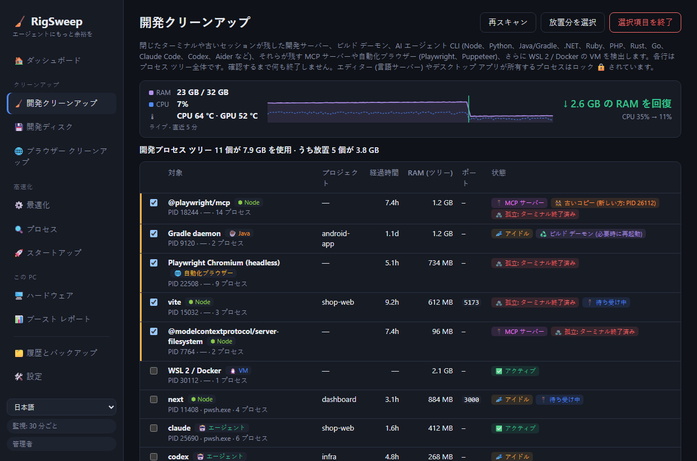

<div align="center">

# 🧹 RigSweep

**エージェントにもっと余裕を。** AI エージェントのセッションで埋まった Windows 開発マシンの RAM、CPU、ディスクを解放します。

**[🌐 ホームページ](https://rigsweep.com)** · **[⬇️ ダウンロード](https://github.com/yobotn/rigsweep/releases/latest)** · **[📖 ウイルス対策 FAQ](#%EF%B8%8F-ウイルス対策ソフトの誤検知)**

[🇬🇧 English](README.md) · [🇩🇪 Deutsch](README.de.md) · [🇪🇸 Español](README.es.md) · [🇫🇷 Français](README.fr.md) · [🇮🇹 Italiano](README.it.md) · [🇧🇷 Português](README.pt-BR.md) · [🇷🇺 Русский](README.ru.md) · 🇯🇵 日本語 · [🇰🇷 한국어](README.ko.md) · [🇨🇳 简体中文](README.zh-CN.md) · [🇮🇱 עברית](README.he.md) · [🇸🇦 العربية](README.ar.md)




</div>

---

## 📖 これを作った理由

AI の時代、私のノート PC で動いているのは、もう *1 つ* のものだけではありません。いつもの 1 日でも、複数のターミナルで **Claude Code** のセッションをいくつも開き、プロジェクトごとに開発サーバーを立て、ビルドのウォッチャーを動かし、ブラウザーはドキュメント、プレビュー、ダッシュボードでいっぱいです。新しいセッションのたびに Node のプロセスが増え、ターミナルを閉じても、その一部は**バックグラウンドで動き続けます**。

だんだん*ごちゃごちゃ*してきました。ファンは回りっぱなし、RAM は常に上限近く、それなのに実際に何が消費しているのかがはっきりしません。タスク マネージャーには `node.exe` と `chrome.exe` がずらりと並ぶだけで、どのセッションのものか、どのプロジェクトのものか、まだ必要なのかはわかりませんでした。

そこで、作業日の途中に自分のマシン (RAM 32 GB) を測定してみました。

| 🔎 見つかったもの | 数 | RAM |
|---|---:|---:|
| 🌐 Chrome のプロセス | 37 | **6.5 GB** |
| ⬢ Node + Claude のプロセス (エージェント CLI、開発サーバー、デスクトップ アプリ) | 14 | **2.5 GB** |
| 🧩 実行中の Windows サービス (テレメトリ、Xbox、検索インデクサーなど) | 約 150 | — |

どれも「ウイルス」でも「ジャンク」でもありません。**AI エージェントを使った作業で普通に残るもの**と、開発マシンには不要な Windows のバックグラウンド処理でした。既存の「PC 高速化」アプリは、元に戻せない怖い操作をするか、開発のワークフローについて何も知らないかのどちらかです。そこで、自分が欲しかったツールを作りました。

> **マシンを実際に使っているものを可視化し、古いものを一掃し、すべての変更を元に戻せる状態に保つ。**

---

## ✨ 機能

### 🧹 開発クリーンアップ: あらゆるスタックの放置された開発プロセス
**開発サーバー、ビルド デーモン、AI エージェント CLI** を検出し、それぞれを**プロセス ツリー全体**、プロジェクト フォルダー、経過時間、RAM、待ち受けポートとともにまとめます。

| スタック | 検出対象 |
|---|---|
| ⬢ Node · Bun · Deno | 開発サーバー (Vite、Astro、Next など)、ウォッチャー、esbuild |
| 🐍 Python | uvicorn、Flask、Django、Jupyter、Streamlit、Celery、venv のプロセス、Python の MCP サーバー |
| ☕ Java | Gradle と Kotlin のデーモン、Maven、Spring Boot、Quarkus |
| 🟣 .NET | `dotnet watch/run`、Roslyn コンパイラ サーバー、残ったままの MSBuild ノード |
| 💎 Ruby · 🐘 PHP · 🦀 Rust · 🐹 Go | `rails`/`ruby`、`php -S`/artisan、`cargo watch/run`、`go run` |
| 🤖 エージェント CLI | Claude Code、Codex、Gemini CLI、opencode、Aider、Goose |
| 🔌 MCP サーバー | エージェントが起動し、エージェントの終了後も動き続けているサーバー (`@modelcontextprotocol/*`、`@playwright/mcp`、`mcp-server-*`、FastMCP など)。`cmd /c npx` ランチャー経由で起動されたものも検出します |
| 🌐 自動化ブラウザー | Playwright / Puppeteer / `--headless` の Chrome と Edge を、レンダラー ツリー全体とともに検出します。普段使いのブラウザーが一覧に表示されることはありません |
| 🐧 WSL 2 / Docker | Linux の VM (`vmmemWSL`)。`wsl --shutdown` で正常にシャットダウンします。事前に選択されることはありません |

Python と Java は一般的なデスクトップ アプリでも使われるため、これらは開発用であることが明確なプロセスのみを一覧に表示します。

- 🧟 **孤立**: ターミナルは閉じられたのに動き続けているプロセスです。ポートを使用したままでも事前に選択されます (おなじみのゾンビ `localhost:3000`)。
- 🔌 **MCP サーバー**: 該当するすべての行にタグが付くので、エージェントが残したツール サーバーと自分の開発サーバーを区別できます。
- 👯 **古いコピー**: 新しいコピーも (たとえば現在のエージェント セッションの下で) 実行されている MCP サーバーにはマークが付くので、残ったほうをすぐに見分けられます。
- 📈 **ライブ メーター**: RigSweep の実行中 (ウィンドウ表示中または通知領域に常駐中) は、RAM と CPU を 2 秒ごとに計測します。手動でも自動でもクリーンアップの直後に、**実際に回復した RAM の量**と CPU の前後の値を表示します。推定値ではなく実測値です。
- 🌡️ **温度の追跡**: CPU と GPU の温度がダッシュボードにリアルタイムで表示され、5 分間の推移とピークも確認できます。マシンが 90 °C を超えたままの場合は警告が出ます。GPU の値はタスク マネージャーと同じカウンター、CPU の値は ACPI の温度ゾーンから取得します (ドライバーのインストールも管理者権限も不要ですが、多くのデスクトップ PC では概算値です)。タイルをクリックすると °C / °F を切り替えられます。
- 💤 **アイドル**: 長時間 CPU アクティビティがないプロセスです。開いているポートがないランタイムは事前に選択されます。**開いているターミナルのアイドル状態のエージェント セッションは事前に選択されません**。ユーザーの入力を待っているだけだからです (それに `claude --resume` で再開できます)。
  アイドルと見なすまでの時間は **[設定]** で指定します (分単位、既定値は 120。例: 5)。
- 🧹 **自動クリーンアップ** (既定ではオフ、[設定] で変更): RigSweep は 1 分ごとに、アイドル期間中ずっと CPU を使わずに放置されていることを確認した開発ランタイムを終了します。エージェント CLI、WSL/Docker の VM、エディターが所有するプロセスが自動で終了されることはなく、終了した各ツリーは履歴に記録されます。
- 🟠🔴 **通知領域のインジケーター**: 放置された開発プロセスが 1 GB 以上を使用していると通知領域のアイコン (およびウィンドウを開いている間はタスク バーのボタン) にオレンジのドットが、2 GB 以上で赤のドットが表示されます。通知領域のアイコンにポインターを合わせると使用量を確認できます。しきい値は [設定] で指定でき、ドットをオフにすることもできます。
- ♻️ **ビルド デーモン**: Gradle、Kotlin、Roslyn のサーバーは、残り続けるように作られています。終了しても害はなく、次のビルドで再起動します。
- 🔒 **ロック**: **VS Code、Cursor、JetBrains、Visual Studio など** (言語サーバー) やデスクトップ アプリが所有するプロセスは、ここから終了することはできません。
- ✅ 確認なしに終了されることはなく、終了の前には毎回 PID の再利用をチェックします。

### 💾 開発ディスク: node_modules とパッケージキャッシュ
古いプロジェクトには、作業をやめたあとも何 GB もの `node_modules`、`.next`、`target`、`bin/obj`、`.venv` が残り続け、パッケージキャッシュは増える一方です。RigSweep はその両方を見つけて、選んだものを削除します。

- 🗂️ **プロジェクト**: Node、Rust、.NET、Java/Gradle/Maven、Python のビルド出力と依存関係のフォルダー。隣にプロジェクトファイル (`package.json`、`Cargo.toml`、`*.csproj`、`pyvenv.cfg` など) があるフォルダーだけが対象なので、無関係な `build` フォルダーに触れることはありません。あらかじめ選択されるのは 30 日間 (変更可) 誰も編集していないプロジェクトだけで、実行中のプロセスが使っているプロジェクトはロックされます 🔒。
- 📦 **パッケージキャッシュ**: npm、npx、pnpm、Yarn、Bun、pip、uv、Cargo、Go、NuGet、Gradle、Maven、Playwright、Puppeteer、Hugging Face。pnpm、uv、Go はそれぞれのコマンド (`pnpm store prune` など) でクリーンアップし、Playwright と Puppeteer は古いブラウザーのバージョンだけを削除して最新版を残します。
- 🎯 **自動選択**: 開発ディスク タブ上で、プロジェクトが何日更新されていなければ対象にするか (3～365 日)、どのフォルダーにチェックを入れるか (ビルド出力、依存関係、パッケージ キャッシュ)、最小サイズを選べます。
- 🚫 **クリーンアップしない**: どのキャッシュもオフにできます。再ダウンロードが大きいもの (Playwright、Puppeteer、Hugging Face、Gradle、Maven、NuGet パッケージ、Go モジュール) は最初からオフです。
- 🙈 **除外**: AppData、プロファイル内のツール用フォルダー (`.cargo`、`.nvm`、`.vscode` など)、`.git`、Windows は常にスキップします。独自のパスやフォルダー名 (`vendor`、`old-*`) は設定で追加するか、プロジェクトの **除外** をクリックします。
- ✅ 既定ではユーザープロファイル (デスクトップ、ドキュメント、ダウンロード、OneDrive など) をスキャンします。確認なしに削除されることはなく、各フォルダーは削除の直前にもう一度チェックされます。

### 🖥️ ハードウェア: 4 つのツールの代わりに 1 つのタブ
CPU-Z、GPU-Z、CrystalDiskInfo、CrystalDiskMark を開いて確認していた基本情報を、Windows から直接読み取って表示します。ドライバーはインストールしません。

- 💽 **ディスクの健康状態**: ディスクごとに「正常 / 劣化中 / 問題あり」を、残り寿命、温度、使用時間、訂正不能エラーとともに表示します。故障しかけているディスクがあると、ダッシュボードに警告が出ます。
- ⚡ **速度テスト**: ドライブごとにシーケンシャルの読み込みと書き込み、4K ランダム読み込みを測定します。512 MB の一時ファイルを書き込み、終わったら削除します。
- 🧮 **CPU、GPU、メモリ**: モデル、コアとスレッド、キャッシュ、仮想化 (WSL 2 と Docker に必要)、ビデオメモリとドライバー、RAM の種類、速度、空きスロット。
- 🔋 **システムとバッテリー**: マザーボード、BIOS、Windows のビルド、起動からの経過時間、ノート PC のバッテリー劣化。

### 📊 ブースト レポート: 実際の前後比較
「PC が 87% 高速になりました」のような見せかけの数値はありません。RigSweep はマシンを**測定**し、2 つのスナップショットを比較します: 使用中/空きの RAM、平均 CPU、プロセス数、実行中のサービス、Chrome の RAM、Node/エージェントの RAM。

- 📸 最初の最適化の前に、**ベースライン**が自動的に記録されます。
- 🔁 各開発クリーンアップの前後で、**前後**のペアが記録されます。
- 📋 **Markdown でコピー**して、Issue や投稿、この README で結果を共有できます。

### 🌐 Chrome タブ ヘルパー
デスクトップ アプリからは Chrome のタブを閉じることが**できない**ため、RigSweep には小さな拡張機能 ([`chrome-extension/`](chrome-extension/)) が付属しています。ネットワーク アクセスはなく、権限は `tabs` / `storage` / `alarms` のみです。
- 💤 **アイドル状態のタブをスリープ**: メモリを解放しますが、タブはタブ バーに残ります
- 🧹 **重複タブを閉じる**
- 🎯 `localhost:*` や `*.vercel.app` などの**パターンに一致するタブを閉じる**
- ⏰ 10 分ごとの**自動スリープ** (オプション)

### ⚙️ 元に戻せる Windows の最適化
テレメトリ、Xbox、検索インデクサー、バックグラウンド アプリ、開発フォルダーの Defender 除外、電源プランなどを集めた厳選カタログ ([`catalog/tweaks.json`](src-tauri/catalog/tweaks.json)) で、各項目にリスク レベルがあります。

| レベル | 意味 |
|---|---|
| 🟢 `safe` | 目立った副作用なし (事前に選択) |
| 🟡 `moderate` | 小さなトレードオフあり (説明付き) |
| 🔴 `caution` | 機能が使えなくなるため、確認が必要 |


- 💾 最初の変更の前に、**元の値をすべて** SQLite に**バックアップ**します。1 つの最適化、1 つのカテゴリ、またはすべてを元に戻せます。
- 🛟 最初の適用の前に、**システムの復元ポイント**を作成します。
- 🔁 **監視**機能が、Windows Update によって黙って元に戻された最適化を再適用し、その回数を記録します。
- 🚫 Windows Update、Defender のエンジン、RPC/DCOM/LSA、その他約 60 の中核サービス ([`PROTECTED_SERVICES`](src-tauri/src/catalog.rs)) には一切触れません。

### 🔍 プロセス アナライザー
プロセスごとの CPU / RAM / ディスク使用量と、**各 `svchost.exe` の中で動いているサービス**を表示します。一覧から直接サービスを無効にしたり、プロセスを終了したりできます (中核の項目はロックされています 🔒)。

### 🔄 更新は自分で選択
**🛠️ 設定 → 🔄 更新** には **[今すぐ確認]** ボタンと、オプションの *[更新プログラムを自動的に確認する]* (起動時と、その後 1 日 1 回) があり、後者は**既定ではオフ**です。新しいバージョンが公開されると、サイドバーにリリース ノート付きのボタンが表示されます。**[インストールして再起動]** をクリックするまで何もインストールされず、ダウンロードが RigSweep の鍵で署名されている場合に限りインストールされます。最適化、バックアップ、設定はそのまま保持されます。確認時に何が行われるかの詳細は、[プライバシー ポリシー](#-プライバシー-ポリシー)をご覧ください。

### 🌍 12 言語対応
UI は **English、Deutsch、Español、Français、Italiano、Português (Brasil)、Русский、日本語、한국어、简体中文、עברית、العربية** に対応し (サイドバーで切り替え)、インストーラーと Chrome 拡張機能も同様です。各言語は、単語ごとの直訳ではなく、その言語の Windows の公式用語 (タスク マネージャー、サービス、タスク スケジューラなど) に合わせてローカライズしています。不自然な表現を見つけたら、`ui/locales/<code>.js` (アプリ)、`docs/locales/<code>.js` (ホームページ)、または `README.<code>.md` について Issue か PR を作成してください。

---

## 🏁 自分のマシンで前後を比較

インストールしたら **📊 ブースト レポート → 📸 今すぐ測定** を開き、開発クリーンアップを実行して安全な最適化を適用し、再起動してからもう一度測定して、**📋 Markdown でコピー** をクリックします。結果は [Discussions](../../discussions) でぜひ共有してください。

<!-- TODO(maintainer): paste your own "Copy as Markdown" result here once you've run it on your machine. -->

> ℹ️ サービスの最適化は、再起動後に効果が完全に反映されます。開発クリーンアップと Chrome のタブのスリープは、すぐに効果が表れます。

---

## 📦 インストール

1. [**Releases**](../../releases) から `RigSweep_x.y.z_x64-setup.exe` をダウンロードします。
2. 実行します。RigSweep はサービスとポリシーを管理するため、管理者権限が求められます。
3. インストーラーで、Microsoft Defender で RigSweep を許可するかどうかを尋ねられます (下記参照)。どうするかはユーザーが選択できます。
4. 以降のバージョンは **🛠️ 設定 → 🔄 更新** からインストールできます (0.5.0 以降)。

🌐 **Chrome ヘルパー:** RigSweep で **🛠️ 設定 → 🌐 Chrome タブ ヘルパー → 拡張機能のフォルダーを開く** に移動し、Chrome で `chrome://extensions` → **デベロッパー モード** → **パッケージ化されていない拡張機能を読み込む** → そのフォルダーを選択します。

## 🛡️ ウイルス対策ソフトの誤検知

RigSweep はオープンソースですが、**まだコード署名されていません**。サービスや Defender の設定を変更するツールは、機械学習ヒューリスティックからはマルウェアによく似て見えるため、**Microsoft Defender が誤って exe を削除することがあります**。開発中にも `Trojan:Win32/Bearfoos.B!ml` として検出されました。`!ml` は、既知のマルウェアのシグネチャではなく、ヒューリスティックによる推測を意味します。

対策:
- ❓ **インストーラーでの確認 (オプトイン):** 「Microsoft Defender で RigSweep を許可しますか?」に [はい] と答えると、**インストール フォルダーだけ**が除外され、アンインストーラーはその除外を削除します。サイレント インストールで除外が追加されることはありません。
- 🛠️ **設定 → 🛡️ ウイルス対策の信頼:** 状態を確認し、いつでも除外を追加または削除できます。
- ✍️ [SignPath Foundation](https://signpath.org) (オープンソース プロジェクトは無料) による**コード署名を予定しています**。これが本当の解決策です。[コード署名ポリシー](#-コード署名ポリシー)をご覧ください。

すでに削除されてしまった場合: **Windows セキュリティ → ウイルスと脅威の防止 → 保護の履歴 →** RigSweep の項目を選択 → **操作 → 復元**。これは、このリポジトリの Releases ページからダウンロードしたものか、ご自身でビルドしたものの場合にのみ行ってください。[誤検知を Microsoft に報告する](https://www.microsoft.com/wdsi/filesubmission)こともできます。

---

## 🛠️ ソースからビルド

```powershell
winget install Rustlang.Rustup        # + VS 2022 Build Tools (C++ ワークロード)
npm install
npm run build                         # -> src-tauri/target/release/rigsweep.exe + bundle/nsis/*-setup.exe
```
開発用の実行: `npm run dev` (UAC を承認してください。アプリは管理者権限で自動的に再起動します)。

> 💡 ローカルでビルドしたばかりのファイルも、Defender に検疫されることがあります。クローンしたフォルダーを RigSweep の *開発フォルダー* の一覧 ([設定]) に追加して **Defender exclusions for dev folders** 最適化を適用するか、`src-tauri\target` を手動で除外してください。

### ⌨️ CLI
| コマンド | 効果 |
|---|---|
| `rigsweep.exe` | GUI + 通知領域 |
| `rigsweep.exe --apply` | ヘッドレス: プロファイルを確認し、元に戻された最適化を再適用して終了 (スタートアップ タスクで使用) |
| `rigsweep.exe --apply --tray` | 同上の後、監視を続けながら通知領域に常駐 |
| `rigsweep.exe --restore-all` | すべてをバックアップした元の値に戻す |

### 🧪 テスト
```powershell
cd src-tauri
cargo test                                          # カタログの妥当性、バックアップ、スナップショット、コマンドの解析
cargo test live_status   -- --ignored --nocapture   # 読み取り専用: すべての最適化の検出された状態
cargo test live_dev_scan -- --ignored --nocapture   # 読み取り専用: 開発クリーンアップが現在検出しているもの
```

### ➕ 最適化の追加
[`catalog/tweaks.json`](src-tauri/catalog/tweaks.json) に項目を追加します。操作の種類は `service` (start: disabled|manual)、`task` (path)、`registry` (HKLM|HKCU、dword|string)、`defender_exclusion`、`power_plan` です。`caution` の項目には `warning` を含める必要があります。`cargo test` は、保護されたサービスや不正な形式の項目を拒否します。

## 🐳 docker-optimize (別ツール)
アプリには含まれません。[`docker-optimize/`](docker-optimize/) は、元に戻せる単独の 1 回限りのスクリプトで、Docker Desktop の WSL2 VM に上限 (メモリ、CPU、RAM の回収、スパース ディスク) を設定し、不要な Docker Desktop の追加機能をオフにします。コンテナー、イメージ、ボリュームを削除することはありません。詳しくは [README](docker-optimize/README.md) をご覧ください。

## 🗂️ データの保存場所
| 対象 | 場所 |
|---|---|
| データベース (バックアップ、履歴、スナップショット) | `%ProgramData%\RigSweep\rigsweep.db` (+ `.bak.1`–`.bak.5`) |
| スタートアップ タスク | タスク スケジューラ → `RigSweep-Reapply` |
| エクスポートしたプロファイル | `Documents\RigSweep-profile-*.json` |

**aiBoost** (旧名) からの移行ですか? データベースは初回起動時に自動的に移行され、古いスタートアップ タスクは置き換えられます。

## 🔏 コード署名ポリシー

無料のコード署名は [SignPath.io](https://about.signpath.io/) が提供し、証明書は [SignPath Foundation](https://signpath.org/) が発行します。
*(申請中: v0.3.0 までのリリースは、まだ**署名されていません**。)*

- **ビルド:** リリース用のインストーラーは、タグ付けされたソースから、GitHub がホストするランナー上の [GitHub Actions](.github/workflows/release.yml) でビルドされます。署名の申請対象となるのは、これらのビルドのみです。
- **コミッターとレビュアー:** [@yobotn](https://github.com/yobotn)
- **承認者:** [@yobotn](https://github.com/yobotn)

### 🔒 プライバシー ポリシー
このプログラムは、ユーザーまたはプログラムをインストール・操作する人が明示的に要求しない限り、ネットワークに接続された他のシステムに情報を転送しません。RigSweep にはテレメトリも分析もなく、Chrome 拡張機能はネットワーク要求を一切行いません。RigSweep が行う可能性のある唯一のネットワーク要求は**更新プログラムの確認**で、それもユーザーが求めた場合に限られます: [設定] で *[今すぐ確認]* をクリックした場合、または *[更新プログラムを自動的に確認する]* (既定ではオフ) をオンにした場合です。確認時は、このリポジトリの GitHub Releases から `latest.json` をダウンロードするだけで、PC に関する情報は一切送信しません。更新プログラムは、ユーザーが *[インストールして再起動]* をクリックした後に限り、その署名が RigSweep の署名鍵と一致する場合にのみインストールされます。RigSweep が保存するデータ (バックアップ、履歴、測定結果) はすべて、PC 上の `%ProgramData%\RigSweep` に保持されます。

## ⚠️ 免責事項

RigSweep は Windows のサービス、スケジュールされたタスク、レジストリのポリシー、Microsoft Defender の設定を変更し、実行中のプロセスを終了することがあります。すべての最適化はバックアップされ元に戻せます。また、確認なしに実行されることはありませんが、**ご利用は自己責任でお願いします**。本ソフトウェアは**「現状のまま」提供され、いかなる保証もありません** ([MIT ライセンス](LICENSE)を参照)。各変更は適用前に内容を確認し、ご自身でもバックアップを取ってください。職場や学校が管理するデバイスでは、IT 部門の承認なしに使用しないでください。

RigSweep は独立したプロジェクトであり、Microsoft、Google、Anthropic、OpenAI など、言及しているいずれのツールとも**提携していません**。すべての商標はそれぞれの所有者に帰属します。

## 🤝 貢献
Issue や PR を歓迎します。特に、新しい最適化 (リスク レベルを明記したもの)、開発クリーンアップが対応する開発スタックやエージェント CLI の追加、翻訳を歓迎します。

## 📄 ライセンス
[MIT](LICENSE): ずっと無料で、自由に使え、保証はありません。
