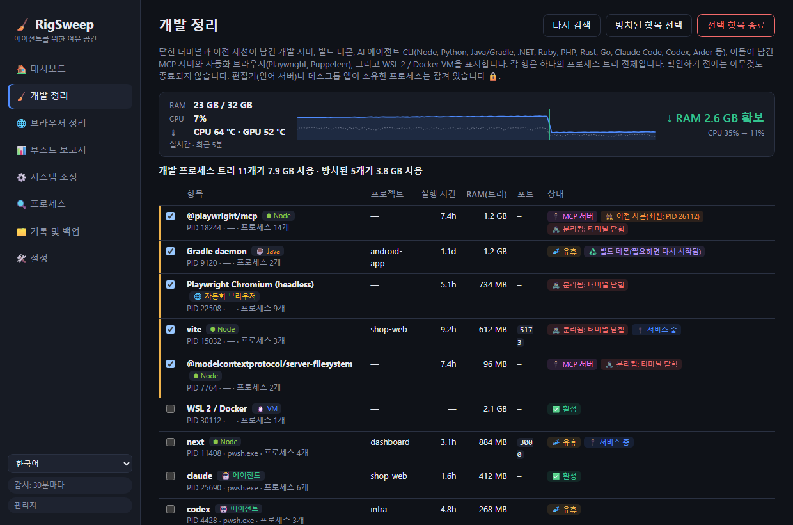

<div align="center">

# 🧹 RigSweep

**에이전트를 위한 여유 공간.** AI 에이전트 세션으로 가득 찬 Windows 개발 PC의 RAM, CPU, 디스크를 확보하세요.

**[🌐 홈페이지](https://rigsweep.com)** · **[⬇️ 다운로드](https://github.com/yobotn/rigsweep/releases/latest)** · **[📖 바이러스 백신 FAQ](#%EF%B8%8F-바이러스-백신-오탐지)**

[🇬🇧 English](README.md) · [🇩🇪 Deutsch](README.de.md) · [🇪🇸 Español](README.es.md) · [🇫🇷 Français](README.fr.md) · [🇮🇹 Italiano](README.it.md) · [🇧🇷 Português](README.pt-BR.md) · [🇷🇺 Русский](README.ru.md) · [🇯🇵 日本語](README.ja.md) · 🇰🇷 한국어 · [🇨🇳 简体中文](README.zh-CN.md)




</div>

---

## 📖 만든 이유

AI 시대가 되면서 제 노트북은 더 이상 *한 가지*만 실행하지 않습니다. 평범한 하루에도 여러 터미널에서 **Claude Code** 세션 몇 개, 프로젝트마다 개발 서버, 빌드 감시 프로세스, 그리고 문서, 미리 보기, 대시보드로 가득 찬 브라우저가 돌아갑니다. 새 세션을 열 때마다 Node 프로세스가 늘어나고, 터미널을 닫아도 그중 일부는 **백그라운드에서 계속 실행됩니다**.

점점 *답답해지기* 시작했습니다. 팬은 돌고, RAM은 늘 한계에 가깝고, 실제로 무엇이 메모리를 잡아먹는지는 알 수 없었습니다. 작업 관리자에는 `node.exe`와 `chrome.exe`만 잔뜩 표시될 뿐, 어느 세션이나 프로젝트의 것인지, 아직 필요한 것인지는 알려 주지 않았습니다.

그래서 작업일 한낮에 제 PC(RAM 32GB)를 직접 측정해 봤습니다.

| 🔎 측정 결과 | 개수 | RAM |
|---|---:|---:|
| 🌐 Chrome 프로세스 | 37 | **6.5GB** |
| ⬢ Node + Claude 프로세스(에이전트 CLI, 개발 서버, 데스크톱 앱) | 14 | **2.5GB** |
| 🧩 실행 중인 Windows 서비스(원격 분석, Xbox, 검색 인덱서…) | 약 150 | — |

어느 것도 "바이러스"나 "정크"가 아니었습니다. **AI 에이전트로 일하면서 자연스럽게 남는 찌꺼기**에, 개발용 PC에는 필요 없는 Windows 백그라운드 작업이 더해진 것이었습니다. 기존의 "PC 최적화" 앱은 되돌릴 수 없는 위험한 작업을 하거나 개발 워크플로를 전혀 모릅니다. 그래서 제가 원하던 도구를 직접 만들었습니다.

> **PC를 실제로 무엇이 사용하고 있는지 확인하고, 방치된 항목을 정리하며, 모든 변경 사항을 되돌릴 수 있게 유지합니다.**

---

## ✨ 기능

### 🧹 개발 정리: 모든 스택의 방치된 개발 프로세스
**개발 서버, 빌드 데몬, AI 에이전트 CLI**를 찾아 각각을 **프로세스 트리 전체**, 프로젝트 폴더, 실행 시간, RAM, 수신 대기 포트와 함께 묶어 보여 줍니다.

| 스택 | 찾는 항목 |
|---|---|
| ⬢ Node · Bun · Deno | 개발 서버(Vite, Astro, Next…), 감시 프로세스, esbuild |
| 🐍 Python | uvicorn, Flask, Django, Jupyter, Streamlit, Celery, venv 프로세스, Python MCP 서버 |
| ☕ Java | Gradle 및 Kotlin 데몬, Maven, Spring Boot, Quarkus |
| 🟣 .NET | `dotnet watch/run`, Roslyn 컴파일러 서버, 남아 있는 MSBuild 노드 |
| 💎 Ruby · 🐘 PHP · 🦀 Rust · 🐹 Go | `rails`/`ruby`, `php -S`/artisan, `cargo watch/run`, `go run` |
| 🤖 에이전트 CLI | Claude Code, Codex, Gemini CLI, opencode, Aider, Goose |
| 🔌 MCP 서버 | 에이전트가 시작한 후 종료되면서 실행 상태로 남겨 둔 서버(`@modelcontextprotocol/*`, `@playwright/mcp`, `mcp-server-*`, FastMCP…). `cmd /c npx` 실행기 뒤에 있어도 찾아냅니다 |
| 🌐 자동화 브라우저 | Playwright / Puppeteer / `--headless` Chrome 및 Edge와 그 렌더러 트리 전체. 사용자가 직접 쓰는 브라우저는 표시되지 않습니다 |
| 🐧 WSL 2 / Docker | Linux VM(`vmmemWSL`). `wsl --shutdown`으로 깔끔하게 종료하며, 미리 선택되지 않습니다 |

Python과 Java로는 일반 데스크톱 앱도 실행되므로, 이 두 언어는 개발용임이 분명한 프로세스만 표시합니다.

- 🧟 **분리됨**: 터미널은 닫혔지만 계속 실행 중인 프로세스입니다. 포트를 계속 사용 중이더라도 미리 선택됩니다(전형적인 좀비 `localhost:3000`).
- 🔌 **MCP 서버**: 해당하는 모든 행에 태그가 붙으므로, 에이전트가 남긴 도구 서버와 직접 실행한 개발 서버를 구별할 수 있습니다.
- 👯 **이전 사본**: 더 새로운 사본이 함께 실행 중인 MCP 서버(예: 현재 에이전트 세션 아래)는 표시되므로, 남아 있는 쪽을 쉽게 찾을 수 있습니다.
- 📈 **실시간 측정기**: RigSweep이 실행되는 동안(창 또는 알림 영역) RAM과 CPU를 2초마다 측정합니다. 수동이든 자동이든 정리 직후에 **실제로 확보된 RAM**과 정리 전 → 후 CPU를 보여 줍니다. 추정치가 아니라 측정값입니다.
- 🌡️ **온도 추적**: 대시보드에 CPU와 GPU 온도를 5분 추세 및 최고값과 함께 실시간으로 표시하고, PC가 계속 90 °C를 넘으면 경고합니다. GPU 값은 작업 관리자와 같은 카운터에서, CPU 값은 ACPI 열 영역에서 가져옵니다(드라이버 설치 불필요, 관리자 권한 불필요, 많은 데스크톱에서는 근삿값). 타일을 클릭하면 °C / °F를 전환합니다.
- 💤 **유휴**: 오랫동안 CPU 활동이 없는 프로세스입니다. 열린 포트가 없는 런타임은 미리 선택됩니다. **열린 터미널의 유휴 에이전트 세션은 미리 선택되지 않습니다**. 사용자를 기다리는 중일 뿐이기 때문입니다(어차피 `claude --resume`으로 다시 불러올 수 있습니다).
  유휴로 간주하는 시간은 **설정**에서 정합니다(분 단위, 기본값 120, 예: 5).
- 🧹 **자동 정리**(기본적으로 꺼져 있으며 설정에서 켬): RigSweep이 1분마다, 유휴 시간 내내 CPU 사용 없이 머물러 있는 것을 확인한 방치된 개발 런타임을 종료합니다. 에이전트 CLI, WSL/Docker VM, 편집기 소유 프로세스는 자동으로 종료되지 않으며, 종료된 각 트리는 기록에 남습니다.
- 🟠🔴 **알림 영역 표시기**: 방치된 개발 프로세스가 1GB 이상을 사용하면 알림 영역 아이콘(창이 열려 있을 때는 작업 표시줄 단추도)에 주황색 점이, 2GB 이상이면 빨간색 점이 표시됩니다. 알림 영역 아이콘을 가리키면 사용량을 볼 수 있습니다. 기준값은 설정에서 정하며, 점 표시를 끌 수도 있습니다.
- ♻️ **빌드 데몬**: Gradle, Kotlin, Roslyn 서버는 원래 계속 남아 있도록 설계되었습니다. 종료해도 문제가 없으며 다음 빌드 때 다시 시작됩니다.
- 🔒 **잠김**: **VS Code, Cursor, JetBrains, Visual Studio…**(언어 서버)나 데스크톱 앱이 소유한 프로세스는 여기서 종료할 수 없습니다.
- ✅ 사용자가 확인하기 전에는 아무것도 종료되지 않으며, 종료할 때마다 PID 재사용 여부를 확인합니다.

### 💾 개발 디스크: node_modules와 패키지 캐시
오래된 프로젝트는 작업을 그만둔 뒤에도 수 GB의 `node_modules`, `.next`, `target`, `bin/obj`, `.venv`를 그대로 갖고 있고, 패키지 캐시는 계속 늘어나기만 합니다. RigSweep이 둘 다 찾아서 선택한 것을 삭제합니다.

- 🗂️ **프로젝트**: Node, Rust, .NET, Java/Gradle/Maven, Python의 빌드 출력과 의존성 폴더. 옆에 프로젝트 파일(`package.json`, `Cargo.toml`, `*.csproj`, `pyvenv.cfg` 등)이 있는 폴더만 대상이라, 아무 `build` 폴더나 건드리는 일은 없습니다. 30일(변경 가능) 동안 아무도 수정하지 않은 프로젝트만 미리 선택되며, 실행 중인 프로세스가 사용하는 프로젝트는 잠깁니다 🔒.
- 📦 **패키지 캐시**: npm, npx, pnpm, Yarn, Bun, pip, uv, Cargo, Go, NuGet, Gradle, Maven, Playwright, Puppeteer, Hugging Face. pnpm, uv, Go는 각자의 명령(`pnpm store prune` 등)으로 정리하고, Playwright와 Puppeteer는 이전 브라우저 버전만 지우고 최신 버전은 남깁니다.
- 🚫 **정리 안 함**: 어떤 캐시든 끌 수 있습니다. 다시 받으려면 다운로드가 큰 것(Playwright, Puppeteer, Hugging Face, Gradle, Maven, NuGet 패키지, Go 모듈)은 처음부터 꺼져 있습니다.
- 🙈 **제외**: AppData, 프로필 안의 도구 폴더(`.cargo`, `.nvm`, `.vscode` 등), `.git`, Windows는 항상 건너뜁니다. 직접 경로나 폴더 이름(`vendor`, `old-*`)을 설정에서 추가하거나, 프로젝트에서 **제외**를 클릭하세요.
- ✅ 기본적으로 사용자 프로필(바탕 화면, 문서, 다운로드, OneDrive 등)을 검색합니다. 확인 없이는 아무것도 삭제하지 않으며, 각 폴더는 삭제 직전에 한 번 더 확인합니다.

### 📊 부스트 보고서: 실제 전후 비교
"PC가 87% 빨라졌습니다" 같은 가짜 숫자는 없습니다. RigSweep은 PC를 **측정**하고 두 스냅샷을 비교합니다: 사용 중/사용 가능한 RAM, 평균 CPU, 프로세스 수, 실행 중인 서비스, Chrome RAM, Node/에이전트 RAM.

- 📸 첫 조정 전에 **기준값**이 자동으로 기록됩니다.
- 🔁 개발 정리를 할 때마다 **전후** 측정값이 기록됩니다.
- 📋 **Markdown으로 복사**해 이슈, 게시물 또는 이 README에 결과를 공유하세요.

### 🌐 Chrome 탭 도우미
데스크톱 앱은 Chrome 탭을 닫을 **수 없으므로**, RigSweep에는 네트워크 액세스 없이 `tabs` / `storage` / `alarms` 권한만 사용하는 작은 확장 프로그램([`chrome-extension/`](chrome-extension/))이 포함되어 있습니다.
- 💤 **유휴 탭 절전**: 메모리를 확보하지만 탭은 탭 표시줄에 그대로 남습니다
- 🧹 **중복 탭 닫기**
- 🎯 `localhost:*`나 `*.vercel.app` 같은 **패턴으로 탭 닫기**
- ⏰ 10분마다 **자동 절전**(선택 사항)

### ⚙️ 되돌릴 수 있는 Windows 시스템 조정
원격 분석, Xbox, 검색 인덱서, 백그라운드 앱, 개발 폴더용 Defender 제외, 전원 관리 옵션 등을 위험 수준과 함께 담은 엄선된 카탈로그([`catalog/tweaks.json`](src-tauri/catalog/tweaks.json))입니다.

| 수준 | 의미 |
|---|---|
| 🟢 `safe` | 눈에 띄는 부작용 없음(미리 선택됨) |
| 🟡 `moderate` | 약간의 절충이 있으며 설명이 제공됨 |
| 🔴 `caution` | 일부 기능이 동작하지 않으며 확인이 필요함 |


- 💾 첫 변경 전에 **모든 원래 값을 SQLite에 백업**합니다. 조정 하나, 범주 하나, 또는 전체를 복원할 수 있습니다.
- 🛟 처음 적용하기 전에 **시스템 복원 지점**을 만듭니다.
- 🔁 **감시 기능**이 Windows 업데이트가 몰래 되돌린 조정을 다시 적용하고, 그런 일이 얼마나 자주 일어나는지 집계합니다.
- 🚫 절대 건드리지 않는 항목: Windows 업데이트, Defender 엔진, RPC/DCOM/LSA 및 그 밖의 약 60개 핵심 서비스([`PROTECTED_SERVICES`](src-tauri/src/catalog.rs)).

### 🔍 프로세스 분석기
프로세스별 CPU / RAM / 디스크 사용량과 **각 `svchost.exe` 안에서 실행되는 서비스**를 보여 줍니다. 목록에서 바로 서비스를 사용 안 함으로 설정하거나 프로세스를 종료할 수 있습니다(핵심 항목은 잠겨 있음 🔒).

### 🔄 업데이트는 원할 때만
**🛠️ 설정 → 🔄 업데이트**에는 **지금 확인** 단추와, 선택 사항인 *자동으로 업데이트 확인*(시작할 때, 이후 하루에 한 번)이 있으며 이 옵션은 **기본적으로 꺼져 있습니다**. 새 버전이 나오면 사이드바에 릴리스 정보와 함께 단추가 나타납니다. **설치 후 다시 시작**을 클릭하기 전에는 아무것도 설치되지 않으며, 다운로드한 파일이 RigSweep의 키로 서명된 경우에만 설치됩니다. 시스템 조정, 백업, 설정은 그대로 유지됩니다. 확인할 때 정확히 무엇을 하는지는 [개인정보 처리방침](#-개인정보-처리방침)을 참조하세요.

### 🌍 10개 언어
UI는 **English, Deutsch, Español, Français, Italiano, Português (Brasil), Русский, 日本語, 한국어, 简体中文**을 지원하며(사이드바에서 전환), 설치 프로그램과 Chrome 확장 프로그램도 마찬가지입니다. 각 언어는 단어 그대로 번역하지 않고 해당 언어의 공식 Windows 용어(작업 관리자, 서비스, 작업 스케줄러…)로 현지화했습니다. 어색한 표현을 발견하셨나요? `ui/locales/<code>.js`(앱), `docs/locales/<code>.js`(홈페이지) 또는 `README.<code>.md`에 이슈나 PR을 올려 주세요.

---

## 🏁 내 PC에서 비교한 전후 결과

설치한 다음 **📊 부스트 보고서 → 📸 지금 측정**을 열고, 개발 정리를 실행하고 안전한 조정을 적용한 후 다시 시작하고, 다시 측정한 다음 **📋 Markdown으로 복사**를 클릭하세요. 결과는 [Discussions](../../discussions)에 언제든 공유해 주세요!

<!-- TODO(maintainer): paste your own "Copy as Markdown" result here once you've run it on your machine. -->

> ℹ️ 서비스 조정은 다시 시작한 후에 효과가 모두 나타납니다. 개발 정리와 Chrome 탭 절전은 즉시 효과가 나타납니다.

---

## 📦 설치

1. [**Releases**](../../releases)에서 `RigSweep_x.y.z_x64-setup.exe`를 다운로드합니다.
2. 실행합니다. RigSweep은 서비스와 정책을 관리하므로 관리자 권한을 요청합니다.
3. 설치 프로그램이 Microsoft Defender에서 RigSweep을 허용할지 묻습니다(아래 참조). 선택은 사용자의 몫입니다.
4. 이후 버전은 **🛠️ 설정 → 🔄 업데이트**에서 설치할 수 있습니다(0.5.0부터).

🌐 **Chrome 도우미:** RigSweep에서 **🛠️ 설정 → 🌐 Chrome 탭 도우미 → 확장 프로그램 폴더 열기**로 이동한 다음, Chrome에서 `chrome://extensions` → **개발자 모드** → **압축해제된 확장 프로그램을 로드합니다** → 해당 폴더를 선택합니다.

## 🛡️ 바이러스 백신 오탐지

RigSweep은 오픈 소스이지만 **아직 코드 서명이 되어 있지 않습니다**. 서비스와 Defender 설정을 변경하는 도구는 머신 러닝 휴리스틱에 맬웨어와 매우 비슷하게 보이므로, **Microsoft Defender가 실수로 exe를 삭제할 수 있습니다**. 실제로 개발 중에 `Trojan:Win32/Bearfoos.B!ml`로 감지된 적이 있으며, 여기서 `!ml`은 알려진 맬웨어 서명이 아니라 휴리스틱 추정을 뜻합니다.

대응 방법:
- ❓ **설치 프로그램 확인(옵트인):** "Microsoft Defender에서 RigSweep을 허용할까요?" 예를 선택하면 **설치 폴더만** 제외되며, 제거 프로그램이 그 제외 항목을 다시 제거합니다. 자동 설치에서는 제외 항목을 추가하지 않습니다.
- 🛠️ **설정 → 🛡️ 바이러스 백신 신뢰:** 상태를 확인하고 언제든지 제외 항목을 추가하거나 제거할 수 있습니다.
- ✍️ [SignPath Foundation](https://signpath.org)(오픈 소스 프로젝트에 무료)을 통한 **코드 서명이 예정되어 있습니다**. 이것이 근본적인 해결책입니다. [코드 서명 정책](#-코드-서명-정책)을 참조하세요.

이미 삭제되었다면: **Windows 보안 → 바이러스 및 위협 방지 → 보호 기록 →** RigSweep 항목 선택 → **작업 → 복원**. 이 저장소의 Releases 페이지에서 다운로드했거나 직접 빌드한 경우에만 이렇게 하세요. [Microsoft에 오탐지를 직접 신고](https://www.microsoft.com/wdsi/filesubmission)할 수도 있습니다.

---

## 🛠️ 소스에서 빌드

```powershell
winget install Rustlang.Rustup        # + VS 2022 Build Tools(C++ 워크로드)
npm install
npm run build                         # -> src-tauri/target/release/rigsweep.exe + bundle/nsis/*-setup.exe
```
개발 실행: `npm run dev`(UAC를 수락하면 앱이 관리자 권한으로 다시 시작됩니다).

> 💡 Defender가 새로 빌드한 로컬 빌드도 격리할 수 있습니다. 클론한 폴더를 RigSweep의 *개발 폴더* 목록(설정)에 추가하고 **Defender exclusions for dev folders** 조정을 적용하거나, `src-tauri\target`을 직접 제외하세요.

### ⌨️ CLI
| 명령 | 동작 |
|---|---|
| `rigsweep.exe` | GUI + 알림 영역 |
| `rigsweep.exe --apply` | 헤드리스: 프로필을 확인하고, 되돌려진 조정을 다시 적용한 다음 종료(시작 작업에서 사용) |
| `rigsweep.exe --apply --tray` | 위와 같으며, 이후 감시 기능과 함께 알림 영역에 유지 |
| `rigsweep.exe --restore-all` | 모든 항목을 백업된 원래 값으로 되돌림 |

### 🧪 테스트
```powershell
cd src-tauri
cargo test                                          # 카탈로그 유효성, 백업, 스냅샷, 명령 구문 분석
cargo test live_status   -- --ignored --nocapture   # 읽기 전용: 모든 조정의 감지된 상태
cargo test live_dev_scan -- --ignored --nocapture   # 읽기 전용: 현재 개발 정리에서 감지되는 항목
```

### ➕ 조정 추가
[`catalog/tweaks.json`](src-tauri/catalog/tweaks.json)에 항목을 추가하세요. 작업 유형은 `service`(start: disabled|manual), `task`(path), `registry`(HKLM|HKCU, dword|string), `defender_exclusion`, `power_plan`입니다. `caution` 항목에는 반드시 `warning`이 있어야 합니다. `cargo test`는 보호된 서비스와 잘못된 형식의 항목을 거부합니다.

## 🐳 docker-optimize(별도 도구)
앱의 일부가 아닙니다. [`docker-optimize/`](docker-optimize/)는 Docker Desktop의 WSL2 VM을 제한하고(메모리, CPU, RAM 회수, 스파스 디스크) 필요 없는 Docker Desktop 부가 기능을 끄는, 되돌릴 수 있는 독립 실행형 일회성 스크립트입니다. 컨테이너, 이미지, 볼륨은 절대 삭제하지 않습니다. 해당 [README](docker-optimize/README.md)를 참조하세요.

## 🗂️ 파일 위치
| 항목 | 위치 |
|---|---|
| 데이터베이스(백업, 기록, 스냅샷) | `%ProgramData%\RigSweep\rigsweep.db`(+ `.bak.1`–`.bak.5`) |
| 시작 작업 | 작업 스케줄러 → `RigSweep-Reapply` |
| 내보낸 프로필 | `Documents\RigSweep-profile-*.json` |

**aiBoost**(이전 이름)에서 업그레이드하셨나요? 처음 시작할 때 데이터베이스가 자동으로 마이그레이션되고, 이전 시작 작업은 교체됩니다.

## 🔏 코드 서명 정책

[SignPath.io](https://about.signpath.io/)에서 무료 코드 서명을 제공하며, 인증서는 [SignPath Foundation](https://signpath.org/)에서 발급합니다.
*(신청 진행 중: v0.3.0까지의 릴리스는 아직 **서명되지 않았습니다**.)*

- **빌드:** 릴리스 설치 프로그램은 GitHub 호스팅 러너에서 [GitHub Actions](.github/workflows/release.yml)가 태그된 소스로 빌드합니다. 이 빌드만 서명을 위해 제출됩니다.
- **커미터 및 검토자:** [@yobotn](https://github.com/yobotn)
- **승인자:** [@yobotn](https://github.com/yobotn)

### 🔒 개인정보 처리방침
이 프로그램은 사용자 또는 이 프로그램을 설치하거나 운영하는 사람이 명시적으로 요청하지 않는 한, 어떠한 정보도 네트워크로 연결된 다른 시스템에 전송하지 않습니다. RigSweep에는 원격 분석이나 사용 통계 수집 기능이 없으며, Chrome 확장 프로그램은 네트워크 요청을 하지 않습니다. RigSweep이 할 수 있는 유일한 네트워크 요청은 **업데이트 확인**이며, 사용자가 요청할 때만 발생합니다. 즉, 설정에서 *지금 확인*을 클릭하거나 *자동으로 업데이트 확인*(기본적으로 꺼져 있음)을 켠 경우입니다. 이때 이 저장소의 GitHub Releases에서 `latest.json`을 다운로드할 뿐, PC에 관한 정보는 전송하지 않습니다. 업데이트는 사용자가 *설치 후 다시 시작*을 클릭한 후에만, 그리고 서명이 RigSweep의 서명 키와 일치하는 경우에만 설치됩니다. 저장하는 모든 데이터(백업, 기록, 측정값)는 PC의 `%ProgramData%\RigSweep`에만 보관됩니다.

## ⚠️ 고지 사항

RigSweep은 Windows 서비스, 예약된 작업, 레지스트리 정책, Microsoft Defender 설정을 변경하며 실행 중인 프로세스를 종료할 수 있습니다. 모든 조정 항목은 백업되어 복원할 수 있고 사용자가 확인하기 전에는 아무것도 변경되지 않지만, **사용에 따른 책임은 사용자에게 있습니다**. 이 소프트웨어는 **어떠한 종류의 보증도 없이 "있는 그대로"** 제공됩니다([MIT 라이선스](LICENSE) 참조). 각 변경 사항을 적용하기 전에 검토하고, 별도로 백업을 유지하며, 회사나 학교에서 관리하는 장치에서는 IT 팀의 승인 없이 사용하지 마세요.

RigSweep은 독립 프로젝트로, Microsoft, Google, Anthropic, OpenAI 및 언급된 다른 어떤 도구와도 **관련이 없습니다**. 모든 상표는 해당 소유자의 자산입니다.

## 🤝 기여
이슈와 PR을 환영합니다. 특히 새로운 조정 항목(명확한 위험 수준 포함), 개발 정리에서 지원할 더 많은 개발 스택과 에이전트 CLI, 그리고 번역을 기다립니다.

## 📄 라이선스
[MIT](LICENSE): 영원히 무료이며, 자유롭게 사용할 수 있고, 보증은 없습니다.
