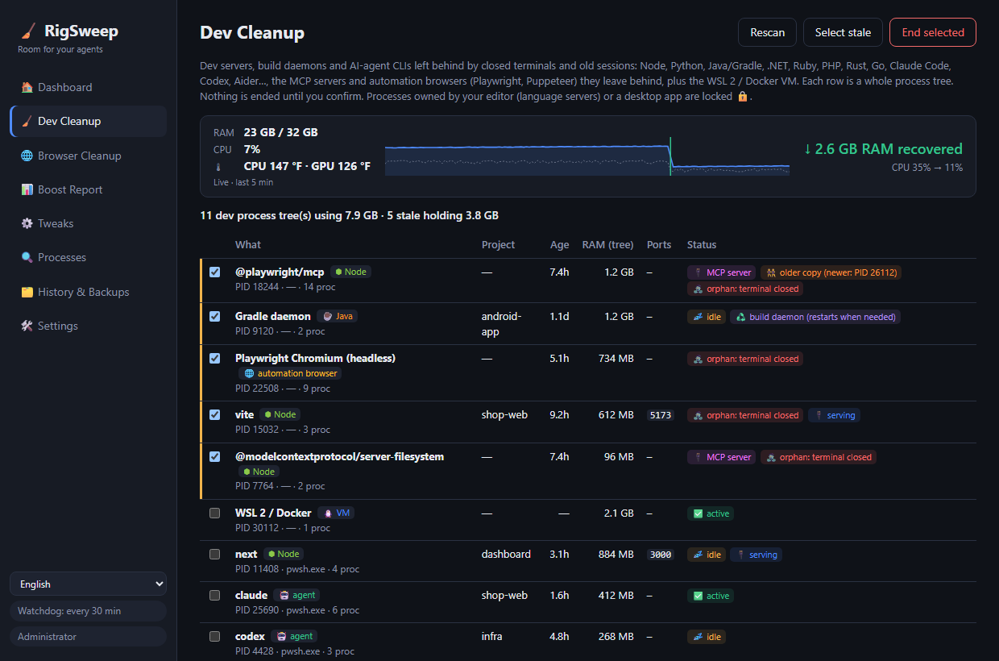
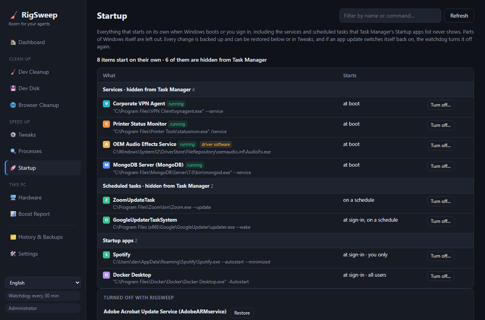

<div align="center">

# 🧹 RigSweep

**Room for your agents.** Free up RAM, CPU and disk on Windows dev machines cluttered by AI-agent sessions.

**[🌐 Homepage](https://rigsweep.com)** · **[⬇️ Download](https://github.com/yobotn/rigsweep/releases/latest)** · **[📖 Antivirus FAQ](#%EF%B8%8F-antivirus-false-positives)**

🇬🇧 English · [🇩🇪 Deutsch](README.de.md) · [🇪🇸 Español](README.es.md) · [🇫🇷 Français](README.fr.md) · [🇮🇹 Italiano](README.it.md) · [🇧🇷 Português](README.pt-BR.md) · [🇷🇺 Русский](README.ru.md) · [🇯🇵 日本語](README.ja.md) · [🇰🇷 한국어](README.ko.md) · [🇨🇳 简体中文](README.zh-CN.md) · [🇮🇱 עברית](README.he.md) · [🇸🇦 العربية](README.ar.md)




</div>

---

## 📖 Why I built this

In the AI era, my laptop isn't running *one* thing anymore. On a normal day I have several **Claude Code** sessions in different terminals, a dev server per project, build watchers, and a browser full of docs, previews and dashboards. Every new session spawns more Node processes, and when I close a terminal some of them **just keep running in the background**.

It started to feel *cluttered*: fans spinning, RAM always near the top, and no clear picture of what was actually eating it. Task Manager just showed me a wall of `node.exe` and `chrome.exe` without telling me which session, which project, or whether anything still needed it.

So I measured my own machine (32 GB RAM) in the middle of a working day:

| 🔎 What I found | Count | RAM |
|---|---:|---:|
| 🌐 Chrome processes | 37 | **6.5 GB** |
| ⬢ Node + Claude processes (agent CLIs, dev servers, the desktop app) | 14 | **2.5 GB** |
| 🧩 Windows services running (telemetry, Xbox, search indexer…) | ~150 | — |

None of it was "a virus" or "junk". It was the **normal leftovers of working with AI agents**, plus Windows background stuff a dev box doesn't need. Existing "PC booster" apps either do scary irreversible things or know nothing about dev workflows. So I built the tool I wanted:

> **See what's actually using your machine, sweep what's stale, and keep every change reversible.**

---

## ✨ Features

### 🧹 Dev Cleanup: stale dev processes in any stack
Finds **dev servers, build daemons and AI-agent CLIs** and groups each one with its **whole process tree**, project folder, age, RAM and listening ports.

| Stack | What it finds |
|---|---|
| ⬢ Node · Bun · Deno | dev servers (Vite, Astro, Next…), watchers, esbuild |
| 🐍 Python | uvicorn, Flask, Django, Jupyter, Streamlit, Celery, venv processes, Python MCP servers |
| ☕ Java | Gradle & Kotlin daemons, Maven, Spring Boot, Quarkus |
| 🟣 .NET | `dotnet watch/run`, Roslyn compiler server, leftover MSBuild nodes |
| 💎 Ruby · 🐘 PHP · 🦀 Rust · 🐹 Go | `rails`/`ruby`, `php -S`/artisan, `cargo watch/run`, `go run` |
| 🤖 Agent CLIs | Claude Code, Codex, Gemini CLI, opencode, Aider, Goose |
| 🔌 MCP servers | servers your agent started (`@modelcontextprotocol/*`, `@playwright/mcp`, `mcp-server-*`, FastMCP…) and left running after it exited, even behind a `cmd /c npx` launcher |
| 🌐 Automation browsers | Playwright / Puppeteer / `--headless` Chrome & Edge with their whole renderer tree. Your own browser is never listed |
| 🐧 WSL 2 / Docker | the Linux VM (`vmmemWSL`), shut down cleanly with `wsl --shutdown`, never pre-selected |

Python and Java also run ordinary desktop apps, so for those only processes with a clear dev signature are listed.

- 🧟 **Orphan**: its terminal was closed but it kept running. Pre-selected, even if it still holds a port (the classic zombie `localhost:3000`).
- 🔌 **MCP server**: tagged on every row that is one, so you can tell an agent's leftover tool server from your own dev server.
- 👯 **Older copy**: an MCP server that's also running as a newer copy (e.g. under your current agent session) is marked, so the leftover one is easy to spot.
- 📈 **Live meter**: RAM and CPU are sampled every 2 seconds while RigSweep runs (window or tray). Right after a cleanup, manual or automatic, it shows **how much RAM was actually recovered** and CPU before → after, measured, not estimated.
- 🌡️ **Temperature tracking**: CPU and GPU temperatures live on the Dashboard with a 5-minute trend and peak, and a warning when the machine stays above 90 °C. GPU comes from the same counter as Task Manager; CPU from the ACPI thermal zone (no driver installed, no admin needed; approximate on many desktops). Click the tile to switch °C / °F.
- 💤 **Idle**: no CPU activity for a long time. Runtimes with no open port get pre-selected. An **idle agent session in an open terminal is never pre-selected**, because it's just waiting for you (and `claude --resume` brings it back anyway).
  How long counts as idle is set in **Settings** (in minutes, default 120; e.g. 5).
- 🧹 **Auto-cleanup** (off by default, in Settings): every minute RigSweep ends stale dev runtimes it has watched sit with no CPU for the whole idle period. Agent CLIs, the WSL/Docker VM and editor-owned processes are never auto-ended, and each ended tree is logged in History.
- 🟠🔴 **Tray indicator**: the tray icon (and the taskbar button while the window is open) gets an orange dot when stale dev processes hold ≥ 1 GB and a red dot at ≥ 2 GB. Hover the tray icon to see how much. Thresholds are set in Settings, where the dot can also be turned off.
- ♻️ **Build daemon**: Gradle, Kotlin and Roslyn servers are meant to linger. Ending them is harmless; they restart on the next build.
- 🔒 **Locked**: processes owned by **VS Code, Cursor, JetBrains, Visual Studio…** (your language servers) or by a desktop app are never killable from here.
- ✅ Nothing is ended without your confirmation, and PID reuse is checked before every kill.

### 💾 Dev Disk: node_modules and package caches
Old projects keep gigabytes of `node_modules`, `.next`, `target`, `bin/obj` and `.venv` long after you stop working on them, and package caches only ever grow. RigSweep finds both and deletes what you pick.

- 🗂️ **Projects**: build output and dependency folders from Node, Rust, .NET, Java/Gradle/Maven and Python. A folder only counts if its project file sits next to it (`package.json`, `Cargo.toml`, `*.csproj`, `pyvenv.cfg`…), so a random `build` folder is never touched. Only projects nobody has edited for 30 days (adjustable) are pre-selected, and projects a running process is using are locked 🔒.
- 📦 **Package caches**: npm, npx, pnpm, Yarn, Bun, pip, uv, Cargo, Go, NuGet, Gradle, Maven, Playwright, Puppeteer, Hugging Face. uv and Go are cleaned with their own commands (`uv cache prune`, `go clean`); for Playwright and Puppeteer only older browser versions go, the newest stays.
- 🎯 **Auto-select**: right on the Dev Disk tab, choose how long a project must sit untouched (3 to 365 days), which folders get ticked (build output, dependencies, package caches) and a minimum size.
- 🚫 **Never clean**: switch off any cache. The ones that mean a big re-download (Playwright, Puppeteer, Hugging Face, Gradle, Maven, NuGet packages, Go modules) start switched off.
- 🙈 **Exclusions**: AppData, tool folders in your profile (`.cargo`, `.nvm`, `.vscode`…), `.git` and Windows are always skipped. Add your own paths or folder names (`vendor`, `old-*`) in Settings, or click **Exclude** on a project.
- ⏸️ **Pause, resume or stop** a long cleanup and follow it on a progress bar. A cleanup cut short by a restart can pick up where it left off.
- ✅ Scans your user profile (Desktop, Documents, Downloads, OneDrive…) by default. Nothing is deleted without your confirmation, and every folder is checked again right before deletion.

### 🖥️ Hardware: one tab instead of four tools
The basics you'd otherwise open CPU-Z, GPU-Z, CrystalDiskInfo and CrystalDiskMark for, read from Windows itself. No driver is installed.

- 💽 **Disk health**: Healthy / Wearing out / Problem for each disk, with life left, temperature, power-on hours and uncorrected errors. A failing disk raises a warning on the dashboard.
- ⚡ **Speed test**: sequential read and write plus 4K random reads, per drive. It writes a 512 MB temporary file and deletes it afterwards.
- 🧮 **CPU, GPU, memory**: model, cores and threads, cache, virtualization (needed by WSL 2 and Docker), video memory and driver, RAM type, speed and free slots.
- 🔋 **System and battery**: motherboard, BIOS, Windows build, uptime, and battery wear on laptops.

### 📊 Boost Report: real before and after
No fake "your PC is 87% faster" numbers. RigSweep **measures** your machine and compares two snapshots: RAM used/free, average CPU, process count, running services, Chrome RAM, Node/agent RAM.

- 📸 A **baseline** is captured automatically before your first tweak.
- 🔁 A **before/after** pair is captured around every Dev Cleanup.
- 📋 **Copy as Markdown** to share your result in an issue, a post, or this README.

### 🌐 Chrome tab helper
A desktop app **can't** close Chrome tabs, so RigSweep ships a tiny extension ([`chrome-extension/`](chrome-extension/)) with no network access and only the `tabs` / `storage` / `alarms` permissions:
- 💤 **Sleep idle tabs**: frees their memory, but the tab stays in your tab strip
- 🧹 **Close duplicate tabs**
- 🎯 **Close tabs by pattern**, like `localhost:*` or `*.vercel.app`
- ⏰ **Auto-sleep** every 10 minutes (optional)

### ⚙️ Reversible Windows tweaks
A curated catalog ([`catalog/tweaks.json`](src-tauri/catalog/tweaks.json)) of telemetry, Xbox, search indexer, background apps, Defender exclusions for dev folders, power plan and more, each with a risk level:

| Level | Meaning |
|---|---|
| 🟢 `safe` | No noticeable side effects (pre-selected) |
| 🟡 `moderate` | Small trade-off, explained |
| 🔴 `caution` | Disables a feature; you must confirm |


- 💾 **Every original value is backed up** in SQLite before the first change. Restore one tweak, a category, or everything.
- 🛟 A **System Restore point** is created before the first apply.
- 🔁 A **watchdog** re-applies tweaks that a Windows Update silently reverted, and counts how often it happens.
- 🧭 **Edge stays gone**: uninstall Edge from Settings, then one tweak stops Edge Update and Windows Update from installing it again. The WebView2 runtime other apps need isn't touched.
- 🚫 Never touched: Windows Update, the Defender engine, RPC/DCOM/LSA and ~60 other core services ([`PROTECTED_SERVICES`](src-tauri/src/catalog.rs)).

### 🔍 Process analyzer
CPU / RAM / disk per process, and **which services live inside each `svchost.exe`**. Disable a service or end a process right from the list (core items are locked 🔒). Every app is shown with its own icon.

### 🚀 Startup: what Task Manager doesn't show
Task Manager's Startup apps list skips most of what starts with Windows. RigSweep lists all of it, minus the parts of Windows itself:

- 🧩 **Auto-start services** from apps and drivers (VPN clients, OEM utilities, updaters). They're switched to Manual, so they no longer start at boot but the app can still start them when you open it.
- ⏰ **Scheduled tasks** that run at sign-in, at boot or on a schedule.
- 🚀 **Startup apps** from the registry and the Startup folder, turned off with the same switch Task Manager uses.
- 💾 Every change is backed up and can be restored, and the watchdog turns an item off again if an app update switches it back on.



### 🔄 Updates, your choice
**🛠️ Settings → 🔄 Updates** has a **Check now** button and an optional *Check for updates automatically* (at startup, then once a day), which is **off by default**. When a new version is out, a button appears in the sidebar with the release notes. Nothing is installed until you click **Install and restart**, and only if the download is signed with RigSweep's key. Your tweaks, backups and settings are kept. See the [privacy policy](#-privacy-policy) for exactly what a check does.

### 🌍 12 languages
The UI is in **English, Deutsch, Español, Français, Italiano, Português (Brasil), Русский, 日本語, 한국어, 简体中文, עברית and العربية** (switch in the sidebar), and so are the installer and the Chrome extension. Each one is localized with the official Windows terms of that language (Task Manager, Services, Task Scheduler…), not translated word for word. Spotted something awkward? Open an issue or a PR on `ui/locales/<code>.js` (app), `docs/locales/<code>.js` (homepage) or `README.<code>.md`.

---

## 🏁 Before vs after on your machine

Install, open **📊 Boost Report → 📸 Measure now**, do a Dev Cleanup and apply the safe tweaks, reboot, measure again, then click **📋 Copy as Markdown**. Results are welcome in [Discussions](../../discussions)!

<!-- TODO(maintainer): paste your own "Copy as Markdown" result here once you've run it on your machine. -->

> ℹ️ Service tweaks take full effect after a reboot. Dev Cleanup and Chrome tab sleeping show up immediately.

---

## 📦 Install

1. Download `RigSweep_x.y.z_x64-setup.exe` from [**Releases**](../../releases).
2. Run it. It asks for admin rights, because RigSweep manages services and policies.
3. The installer asks whether to allow RigSweep in Microsoft Defender (see below). This is your choice.
4. Later versions can be installed from **🛠️ Settings → 🔄 Updates** (from 0.5.0 on).

🌐 **Chrome helper:** in RigSweep go to **🛠️ Settings → 🌐 Chrome tab helper → Open extension folder**, then in Chrome: `chrome://extensions` → **Developer mode** → **Load unpacked** → pick that folder.

## 🛡️ Antivirus false positives

RigSweep is open source but **not code-signed yet**. Tools that change services and Defender settings look a lot like malware to machine-learning heuristics, so **Microsoft Defender may delete the exe by mistake**. This happened during development as `Trojan:Win32/Bearfoos.B!ml`, where `!ml` means a heuristic guess rather than a known-malware signature.

What we do about it:
- ❓ **Installer prompt (opt-in):** "Allow RigSweep in Microsoft Defender?" Yes excludes **only the install folder**, and the uninstaller removes that exclusion again. Silent installs never add one.
- 🛠️ **Settings → 🛡️ Antivirus trust:** see the status, and add or remove the exclusion at any time.
- ✍️ **Code signing is planned** through [SignPath Foundation](https://signpath.org) (free for open-source projects). That's the real fix. See the [code signing policy](#-code-signing-policy).

If it already got deleted: **Windows Security → Virus & threat protection → Protection history →** pick the RigSweep entry → **Actions → Restore**. Only do this for a download from this repo's Releases page, or for a build you made yourself. You can also [report the false positive to Microsoft](https://www.microsoft.com/wdsi/filesubmission) yourself.

---

## 🛠️ Build from source

```powershell
winget install Rustlang.Rustup        # + VS 2022 Build Tools (C++ workload)
npm install
npm run build                         # -> src-tauri/target/release/rigsweep.exe + bundle/nsis/*-setup.exe
```
Dev run: `npm run dev` (accept UAC; the app relaunches itself elevated).

> 💡 Defender may quarantine your fresh local builds too. Add your clone folder to RigSweep's *Dev folders* list (Settings) and apply the **Defender exclusions for dev folders** tweak, or exclude `src-tauri\target` manually.

### ⌨️ CLI
| Command | Effect |
|---|---|
| `rigsweep.exe` | GUI + tray |
| `rigsweep.exe --apply` | Headless: verify the profile, re-apply drifted tweaks, exit (used by the startup task) |
| `rigsweep.exe --apply --tray` | Same, then stay in the tray with the watchdog |
| `rigsweep.exe --restore-all` | Revert everything to the backed-up originals |

### 🧪 Tests
```powershell
cd src-tauri
cargo test                                          # catalog validity, backups, snapshots, command parsing
cargo test live_status   -- --ignored --nocapture   # read-only: detected status of every tweak
cargo test live_dev_scan -- --ignored --nocapture   # read-only: what Dev Cleanup sees right now
```

### ➕ Adding tweaks
Add an entry to [`catalog/tweaks.json`](src-tauri/catalog/tweaks.json). Action types are `service` (start: disabled|manual), `task` (path), `registry` (HKLM|HKCU, dword|string), `defender_exclusion` and `power_plan`. `caution` items must include a `warning`. `cargo test` rejects protected services and malformed entries.

## 🐳 docker-optimize (separate tool)
Not part of the app. [`docker-optimize/`](docker-optimize/) is a standalone, reversible one-time script that caps Docker Desktop's WSL2 VM (memory, CPU, RAM reclaim, sparse disk) and turns off Docker Desktop extras you don't need. It never deletes containers, images or volumes. See its [README](docker-optimize/README.md).

## 🗂️ Where things live
| What | Where |
|---|---|
| Database (backups, history, snapshots) | `%ProgramData%\RigSweep\rigsweep.db` (+ `.bak.1`–`.bak.5`) |
| Startup task | Task Scheduler → `RigSweep-Reapply` |
| Exported profiles | `Documents\RigSweep-profile-*.json` |

Coming from **aiBoost** (the old name)? Your database is migrated automatically on first start, and the old startup task is replaced.

## 🔏 Code signing policy

Free code signing provided by [SignPath.io](https://about.signpath.io/), certificate by [SignPath Foundation](https://signpath.org/).
*(Application in progress: releases up to v0.3.0 are **not signed** yet.)*

- **Builds:** release installers are built from the tagged source by [GitHub Actions](.github/workflows/release.yml) on GitHub-hosted runners. Only those builds will be submitted for signing.
- **Committers and reviewers:** [@yobotn](https://github.com/yobotn)
- **Approvers:** [@yobotn](https://github.com/yobotn)

### 🔒 Privacy policy
This program will not transfer any information to other networked systems unless specifically requested by the user or the person installing or operating it. RigSweep has no telemetry and no analytics, and the Chrome extension makes no network requests. The only network request RigSweep can make is the **update check**, and only when you ask for it: clicking *Check now* in Settings, or turning on *Check for updates automatically* (off by default). It downloads `latest.json` from this repo's GitHub Releases and sends nothing about your PC; an update is installed only after you click *Install*, and only if its signature matches RigSweep's signing key. Everything it stores (backups, history, measurements) stays in `%ProgramData%\RigSweep` on your PC.

## ⚠️ Disclaimer

RigSweep changes Windows services, scheduled tasks, registry policies and Microsoft Defender settings, and it can end running processes. Every tweak is backed up and can be restored, and nothing happens without your confirmation, but **you use it at your own risk**. It is provided **"as is", without warranty of any kind** (see the [MIT license](LICENSE)). Review each change before applying it, keep your own backups, and don't use it on work- or school-managed devices without your IT team's approval.

RigSweep is an independent project, **not affiliated with** Microsoft, Google, Anthropic, OpenAI or any other tool it mentions. All trademarks belong to their owners.

## 🤝 Contributing
Issues and PRs are welcome, especially new tweaks (with a clear risk level), more dev stacks and agent CLIs for Dev Cleanup, and translations.

## 📄 License
[MIT](LICENSE): free forever, do what you want, no warranty.
