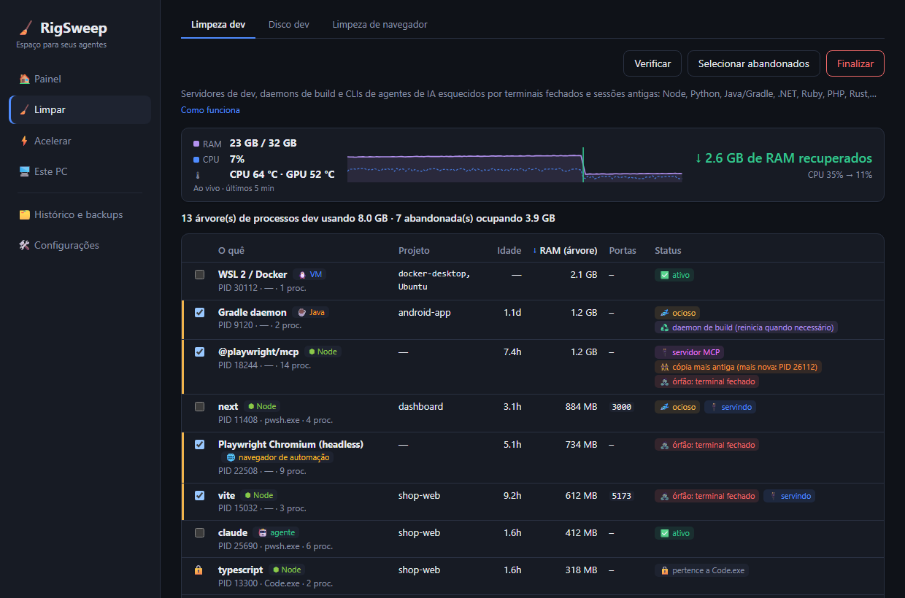
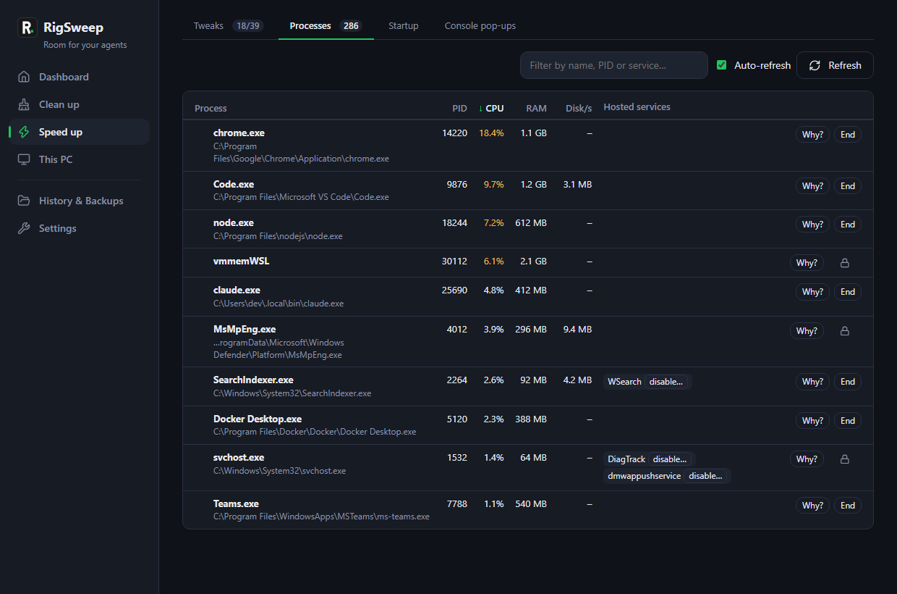

<div align="center">

# 🧹 RigSweep

**Espaço para seus agentes.** Libere RAM, CPU e disco em PCs Windows de desenvolvimento lotados de sessões de agentes de IA.

**[🌐 Site](https://rigsweep.com)** · **[⬇️ Baixar](https://github.com/yobotn/rigsweep/releases/latest)** · **[📖 FAQ do antivírus](#%EF%B8%8F-falsos-positivos-do-antiv%C3%ADrus)**

[🇬🇧 English](README.md) · [🇩🇪 Deutsch](README.de.md) · [🇪🇸 Español](README.es.md) · [🇫🇷 Français](README.fr.md) · [🇮🇹 Italiano](README.it.md) · 🇧🇷 Português · [🇷🇺 Русский](README.ru.md) · [🇯🇵 日本語](README.ja.md) · [🇰🇷 한국어](README.ko.md) · [🇨🇳 简体中文](README.zh-CN.md) · [🇮🇱 עברית](README.he.md) · [🇸🇦 العربية](README.ar.md)




</div>

---

## 📖 Por que eu criei isto

Na era da IA, meu notebook não roda mais *uma* coisa só. Em um dia normal eu tenho várias sessões do **Claude Code** em terminais diferentes, um servidor de dev por projeto, watchers de build e um navegador cheio de documentação, previews e dashboards. Cada nova sessão abre mais processos Node e, quando eu fecho um terminal, alguns deles **simplesmente continuam rodando em segundo plano**.

A máquina começou a parecer *entulhada*: ventoinhas girando, RAM sempre quase no limite e nenhuma ideia clara do que estava consumindo tudo. O Gerenciador de Tarefas só me mostrava uma parede de `node.exe` e `chrome.exe`, sem dizer qual sessão, qual projeto ou se algo ainda precisava daquilo.

Então medi minha própria máquina (32 GB de RAM) no meio de um dia de trabalho:

| 🔎 O que eu encontrei | Quantidade | RAM |
|---|---:|---:|
| 🌐 Processos do Chrome | 37 | **6,5 GB** |
| ⬢ Processos de Node + Claude (CLIs de agentes, servidores de dev, o app desktop) | 14 | **2,5 GB** |
| 🧩 Serviços do Windows em execução (telemetria, Xbox, indexador de pesquisa…) | ~150 | — |

Depois olhei o disco. Eu estava desenvolvendo três apps em Rust ao mesmo tempo: o próprio RigSweep, [KeepRun](https://github.com/yobotn/keeprun) (mantém apps Node, .NET e Python rodando como serviços do Windows) e [Focuside](https://github.com/yobotn/focuside) (um IDE focado para agentes de programação com IA). A pasta `target` de cada projeto tinha chegado a uns **40 GB**, ou seja, **~120 GB** no total, tudo saída de build que o Cargo nunca limpa sozinho. A aba **Disco dev** encontrou as três em uma única varredura.

Nada disso era "vírus" ou "lixo". Eram as **sobras normais de trabalhar com agentes de IA**, mais coisas do Windows em segundo plano de que uma máquina de desenvolvimento não precisa. Os apps de "acelerar o PC" que existem ou fazem coisas assustadoras e irreversíveis, ou não entendem nada de fluxos de desenvolvimento. Então criei a ferramenta que eu queria:

> **Ver o que realmente está usando sua máquina, limpar o que ficou abandonado e poder desfazer qualquer alteração.**

---

## ✨ Recursos

### 🧹 Limpeza dev: processos de dev abandonados em qualquer stack
Encontra **servidores de dev, daemons de build e CLIs de agentes de IA** e agrupa cada um com a sua **árvore de processos inteira**, pasta do projeto, idade, RAM e portas em escuta.

| Stack | O que encontra |
|---|---|
| ⬢ Node · Bun · Deno | servidores de dev (Vite, Astro, Next…), watchers, esbuild |
| 🐍 Python | uvicorn, Flask, Django, Jupyter, Streamlit, Celery, processos de venv, servidores MCP em Python |
| ☕ Java | daemons do Gradle e do Kotlin, Maven, Spring Boot, Quarkus |
| 🟣 .NET | `dotnet watch/run`, servidor do compilador Roslyn, nós do MSBuild que ficaram para trás |
| 💎 Ruby · 🐘 PHP · 🦀 Rust · 🐹 Go | `rails`/`ruby`, `php -S`/artisan, `cargo watch/run`, `go run` |
| 🤖 CLIs de agentes | Claude Code, Codex, Gemini CLI, opencode, Aider, Goose |
| 🔌 Servidores MCP | servidores iniciados pelo seu agente (`@modelcontextprotocol/*`, `@playwright/mcp`, `mcp-server-*`, FastMCP…) que continuaram rodando depois que ele saiu, mesmo atrás de um inicializador `cmd /c npx` |
| 🌐 Navegadores de automação | Chrome e Edge do Playwright / Puppeteer / `--headless` com toda a árvore de renderizadores. O seu próprio navegador nunca aparece na lista |
| 🐧 WSL 2 / Docker | a VM Linux (`vmmemWSL`), desligada de forma limpa com `wsl --shutdown`, nunca pré-selecionada |

Python e Java também executam aplicativos comuns da área de trabalho, por isso, nesses casos, só aparecem processos com uma assinatura clara de desenvolvimento.

- 🧟 **Órfão**: o terminal foi fechado, mas o processo continuou rodando. Vem pré-selecionado, mesmo que ainda ocupe uma porta (o clássico zumbi em `localhost:3000`).
- 🔌 **Servidor MCP**: marcado em cada linha que for um, para você distinguir o servidor de ferramentas que um agente deixou para trás do seu próprio servidor de dev.
- 👯 **Cópia mais antiga**: um servidor MCP que também está rodando como cópia mais nova (por exemplo, na sua sessão atual do agente) é marcado, para que a sobra seja fácil de identificar.
- 📈 **Medidor ao vivo**: RAM e CPU são amostradas a cada 2 segundos enquanto o RigSweep está em execução (janela ou área de notificação). Logo depois de uma limpeza, manual ou automática, ele mostra **quanta RAM foi realmente recuperada** e a CPU antes → depois, medidas, não estimadas.
- 🌡️ **Monitoramento de temperatura**: as temperaturas da CPU e da GPU aparecem ao vivo no Painel, com tendência e pico dos últimos 5 minutos, e um aviso quando a máquina continua acima de 90 °C. A da GPU vem do mesmo contador do Gerenciador de Tarefas; a da CPU vem da zona térmica ACPI (nenhum driver instalado, sem precisar de administrador; aproximada em muitos desktops). Clique no bloco para alternar entre °C e °F.
- 💤 **Ocioso**: sem atividade de CPU por muito tempo. Runtimes sem porta aberta vêm pré-selecionados. Uma **sessão de agente ociosa em um terminal aberto nunca vem pré-selecionada**, porque ela só está esperando por você (e `claude --resume` a traz de volta de qualquer jeito).
  O tempo para considerar ocioso é definido em **Configurações** (em minutos, padrão 120; por exemplo, 5).
- 🧹 **Limpeza automática** (desativada por padrão, em Configurações): a cada minuto o RigSweep finaliza os runtimes de dev abandonados que ele observou sem uso de CPU durante todo o período de ociosidade. CLIs de agentes, a VM do WSL/Docker e processos do editor nunca são finalizados automaticamente, e cada árvore finalizada é registrada no Histórico.
- 🟠🔴 **Indicador na área de notificação**: o ícone na área de notificação (e o botão na barra de tarefas enquanto a janela está aberta) ganha um ponto laranja quando processos de dev abandonados ocupam ≥ 1 GB e um ponto vermelho a partir de ≥ 2 GB. Passe o mouse sobre o ícone para ver quanto. Os limites são definidos em Configurações, onde o ponto também pode ser desativado.
- ♻️ **Daemon de build**: os servidores do Gradle, do Kotlin e do Roslyn foram feitos para ficar rodando. Finalizá-los não causa problemas; eles reiniciam no próximo build.
- 🔒 **Bloqueado**: processos que pertencem ao **VS Code, Cursor, JetBrains, Visual Studio…** (seus servidores de linguagem) ou a um aplicativo da área de trabalho nunca podem ser finalizados por aqui.
- 🎯 **Uma linha ou várias**: marque as linhas e clique em **Finalizar** acima da lista, ou use o botão **Finalizar** de uma linha só. Os dois mostram a mesma confirmação, com o que vai ser liberado.
- ✅ Nada é finalizado sem a sua confirmação, e a reutilização de PID é verificada antes de cada finalização.

### 💾 Disco dev: node_modules, caches e worktrees
Projetos antigos guardam gigas de `node_modules`, `.next`, `target`, `bin/obj` e `.venv` muito depois de você parar de mexer neles, os caches de pacotes só crescem, e ferramentas e agentes de IA vão deixando caches e worktrees para trás. O RigSweep encontra tudo isso e apaga o que você escolher.

- 🗂️ **Projetos**: pastas de build e de dependências de Node, Rust, .NET, Java/Gradle/Maven e Python. Uma pasta só conta se o arquivo do projeto estiver ao lado dela (`package.json`, `Cargo.toml`, `*.csproj`, `pyvenv.cfg`…), então uma pasta `build` qualquer nunca é tocada. Só vêm pré-selecionados os projetos que ninguém edita há 30 dias (ajustável), e os que um processo em execução está usando ficam bloqueados 🔒.
- 📦 **Caches de pacotes**: npm, npx, pnpm, Yarn, Bun, pip, uv, Cargo, Go, NuGet, Gradle, Maven, Playwright, Puppeteer, Hugging Face. uv e Go são limpos com os próprios comandos (`uv cache prune`, `go clean`); no Playwright e no Puppeteer só saem as versões antigas dos navegadores, a mais nova fica.
- 🎮 **GPU e machine learning**: caches de shaders da NVIDIA, AMD, Intel e DirectX, o cache de computação do CUDA, modelos do PyTorch Hub e extensões compiladas, o cache de kernels do Triton e pacotes do conda sem uso (via `conda clean --all`). Os modelos do Ollama e do LM Studio aparecem com o tamanho, mas nunca são apagados.
- 🤖 **Ferramentas de IA e editores**: os caches do Cursor, VS Code, Windsurf, do app de desktop do Claude, do Codex e do ChatGPT, pulados enquanto o app está aberto. O backup de estado e os checkpoints antigos do Cursor também podem sair (nunca pré-selecionados). O histórico de chats (o banco de chats do Cursor, os chats do Claude Code, as sessões do Codex) só aparece com o tamanho, para você ver para onde foi o espaço.
- 🌿 **Worktrees do git**: worktrees criados pelo Claude Code, Cursor, Codex ou por você, com o branch, o repositório e há quanto tempo estão parados. A remoção usa `git worktree remove`, que se recusa a remover um worktree com trabalho sem commit ou arquivos não rastreados; o branch e os commits ficam. Arquivos que o git ignora e que iriam junto (como o `.env`) são listados antes, e worktrees nunca vêm pré-selecionados.
- 🖥️ **Sobras do Windows**: seus arquivos temporários e os do Windows sem uso há 7 dias, downloads do Windows Update, arquivos da Otimização de Entrega, despejos de memória e relatórios de erros, o cache de miniaturas e a Lixeira (nunca vem marcada). O Windows.old só aparece com o tamanho.
- 🐳 **Discos virtuais do Docker e do WSL**: o `.vhdx` do Docker Desktop e o de cada distro do WSL crescem e nunca encolhem sozinhos. **Compactar** reduz o disco ao que o Linux realmente usa. Antes, o Docker Desktop é fechado e o WSL é desligado, e nada dentro do disco é apagado.
- 🎯 **Seleção automática**: na própria aba Disco dev, escolha há quanto tempo um projeto precisa estar parado (de 3 a 365 dias), quais pastas são marcadas (saídas de build, dependências, caches de pacotes) e um tamanho mínimo.
- 🚫 **Nunca limpar**: dá para desligar qualquer cache. Os que significam um download grande (Playwright, Puppeteer, Hugging Face, Gradle, Maven, pacotes do NuGet, módulos do Go) já vêm desligados.
- 🙈 **Exclusões**: AppData, as pastas de ferramentas do seu perfil (`.cargo`, `.nvm`, `.vscode`…), `.git` e o Windows são sempre ignorados. Adicione seus próprios caminhos ou nomes de pasta (`vendor`, `old-*`) nas Configurações, ou clique em **Excluir** em um projeto.
- 💽 **Medidor da unidade**: Disco dev, Limpeza de navegador e o Painel abrem com o espaço livre da sua unidade agora e depois da limpeza ("58 GB livres → 81 GB livres") e um botão grande **Liberar X GB**. O Painel soma tudo o que as verificações encontraram.
- 🔁 **Limpar automaticamente** (Configurações → Disco dev, desligado por padrão): uma vez por semana e, se quiser, também quando o espaço do C: cair abaixo de um tamanho que você escolher, o RigSweep esvazia só os caches que se refazem sozinhos. Nunca projetos, a Lixeira ou downloads demorados.
- ⏸️ **Pause, retome ou pare** uma limpeza longa e acompanhe numa barra de progresso. Uma limpeza interrompida por uma reinicialização continua de onde parou.
- ✅ Por padrão analisa o seu perfil de usuário (Área de Trabalho, Documentos, Downloads, OneDrive…). Nada é apagado sem a sua confirmação, e cada pasta é verificada de novo logo antes de ser apagada.

### 🖥️ Hardware: uma aba no lugar de quatro ferramentas
O básico que você abriria no CPU-Z, GPU-Z, CrystalDiskInfo e CrystalDiskMark, lido direto do Windows. Nenhum driver é instalado.

- 💽 **Saúde dos discos**: Saudável / Desgastando / Problema para cada disco, com vida útil restante, temperatura, horas ligado e erros não corrigidos. Um disco falhando gera um aviso no painel.
- ⚡ **Teste de velocidade**: leitura e gravação sequenciais, mais leituras aleatórias 4K, por unidade. Ele grava um arquivo temporário de 512 MB e depois o apaga.
- 🧮 **CPU, GPU, memória**: modelo, núcleos e threads, cache, virtualização (exigida pelo WSL 2 e pelo Docker), memória de vídeo e driver, tipo de RAM, velocidade e slots livres.
- 🔋 **Sistema e bateria**: placa-mãe, BIOS, build do Windows, tempo ligado e desgaste da bateria em notebooks.


### 🎮 GPU e IA: o que roda na sua placa de vídeo e na NPU
O que cada aplicativo faz na GPU e na NPU, lido dos mesmos contadores que o Gerenciador de Tarefas usa. Nada é instalado, e nada é consultado enquanto a página está fechada.

- 🎮 **Por adaptador**: uso, memória dedicada e compartilhada em uso e, no modo Pro, um medidor para cada mecanismo ativo (3D, Compute, Copy, Video…).
- 📋 **Por aplicativo**: uso de GPU, mecanismo e memória de vídeo dedicada de cada aplicativo que usa a GPU, mais a memória compartilhada no modo Pro.
- 🧠 **NPU**: a unidade de processamento neural aparece ao lado das GPUs, e o uso de NPU de cada aplicativo é mostrado junto com o uso de GPU.
- 🤖 **Carga de IA**: os runtimes de IA locais em execução (Ollama, LM Studio, llama.cpp, Jan, LocalAI, KoboldCpp, ComfyUI, vLLM, Python com PyTorch ou Transformers…) e a memória de vídeo que eles ocupam. No Ollama, os modelos carregados e a VRAM de cada um também aparecem.


### 📊 Relatório de ganhos: antes e depois reais
Nada de números falsos como "seu PC está 87% mais rápido". O RigSweep **mede** sua máquina e compara dois snapshots: RAM usada/livre, CPU média, quantidade de processos, serviços em execução, RAM do Chrome, RAM de Node/agentes.

- 📸 Uma **linha de base** é registrada automaticamente antes do seu primeiro ajuste.
- 🔁 Um par **antes/depois** é registrado em cada Limpeza dev.
- 📋 **Copiar como Markdown** para compartilhar seu resultado em uma issue, um post ou neste README.

### 🌐 Assistente de guias do Chrome
Um aplicativo da área de trabalho **não consegue** fechar guias do Chrome, por isso o RigSweep inclui uma pequena extensão ([`chrome-extension/`](chrome-extension/)) sem acesso à rede e apenas com as permissões `tabs` / `storage` / `alarms`:
- 💤 **Suspender guias ociosas**: libera a memória delas, mas a guia continua na barra de guias
- 🧹 **Fechar guias duplicadas**
- 🎯 **Fechar guias por padrão**, como `localhost:*` ou `*.vercel.app`
- ⏰ **Suspensão automática** a cada 10 minutos (opcional)

### ⚙️ Ajustes reversíveis do Windows
Um catálogo selecionado ([`catalog/tweaks.json`](src-tauri/catalog/tweaks.json)) com telemetria, Xbox, indexador de pesquisa, aplicativos em segundo plano, exclusões do Defender para pastas de desenvolvimento, plano de energia e mais, cada um com um nível de risco:

| Nível | Significado |
|---|---|
| 🟢 `safe` | Sem efeitos colaterais perceptíveis (pré-selecionado) |
| 🟡 `moderate` | Pequena concessão, explicada |
| 🔴 `caution` | Desativa um recurso; exige a sua confirmação |


- 💾 **Todo valor original tem backup** em SQLite antes da primeira alteração. Restaure um ajuste, uma categoria ou tudo.
- 🛟 Um **ponto de restauração do sistema** é criado antes da primeira aplicação.
- 🔁 Um **watchdog** reaplica os ajustes que uma atualização do Windows Update reverteu sem avisar e conta quantas vezes isso acontece.
- 🧭 **O Edge não volta**: desinstale o Edge em Configurações e um ajuste impede que o Edge Update e o Windows Update o reinstalem. O runtime do WebView2, que outros aplicativos usam, não é alterado.
- 🚫 Nunca são tocados: o Windows Update, o mecanismo do Defender, RPC/DCOM/LSA e ~60 outros serviços essenciais ([`PROTECTED_SERVICES`](src-tauri/src/catalog.rs)).

### 🔍 Analisador de processos
CPU / RAM / disco por processo, e **quais serviços rodam dentro de cada `svchost.exe`**. Desative um serviço ou finalize um processo direto da lista (os itens essenciais ficam bloqueados 🔒). Cada aplicativo aparece com o próprio ícone.

- ❓ **Por quê?**: clique em um processo para ver o que ele é: CPU, memória, disco, threads, fabricante, arquivo e linha de comando, qual programa o iniciou e quais programas ele iniciou. Processos conhecidos do Windows (Defender, Windows Search, Windows Update, svchost, WMI…) vêm com uma explicação simples de por que estão ocupados.
- 🛡️ **O que o Defender está verificando**: o Painel mostra **Ver por quê** ao lado de um processo que usa muita CPU, e mais cedo ainda ao lado do Microsoft Defender. No caso do Defender, **Gravar o que ele verifica** acompanha o processo por 20 segundos e lista as pastas, os tipos de arquivo e os processos que provocaram as verificações. Se a maior parte vier do seu trabalho de desenvolvimento, ele indica o ajuste de exclusões do Defender para pastas de desenvolvimento.



### 🚀 Inicialização: o que o Gerenciador de Tarefas não mostra
A lista de Aplicativos de inicialização do Gerenciador de Tarefas deixa de fora quase tudo o que inicia com o Windows. O RigSweep mostra tudo, menos os componentes do próprio Windows:

- 🧩 **Serviços de inicialização automática** de aplicativos e drivers (clientes VPN, utilitários do fabricante, atualizadores). Eles passam para Manual: não iniciam mais com o Windows, mas o aplicativo ainda pode iniciá-los quando você o abrir.
- ⏰ **Tarefas agendadas** que rodam ao entrar, ao ligar ou em um agendamento.
- 🚀 **Aplicativos de inicialização** do Registro e da pasta Inicializar, desativados com a mesma chave que o Gerenciador de Tarefas usa.
- 💾 Cada alteração tem backup e pode ser restaurada, e se uma atualização reativar um aplicativo, o watchdog o desativa de novo.


### 🪟 Janelas de console: que janela foi essa?
Uma janela do Prompt de Comando ou do PowerShell aparece, fecha um instante depois, e você nunca descobre o que rodou. **Acelerar → 🪟 Janelas de console** registra cada uma delas:

- 🪟 Toda janela de console que abre e fecha sozinha em menos de um minuto aparece com o **comando exato que ela rodou**, mesmo que tenha ficado aberta só alguns milissegundos.
- 🔎 **O que a iniciou**: a tarefa agendada (pelo nome), o serviço, o aplicativo ou o Explorador de Arquivos, além da cadeia completa de processos pai em Detalhes.
- 📜 **O que rodou dentro dela**: os programas que ela iniciou (por exemplo, um arquivo `.bat` chamando `curl` e `reg`) e o código de saída.
- 🔁 O mesmo comando vindo da mesma origem vira uma única linha com contador (×12), então fica fácil achar uma tarefa que dispara toda hora.
- ⏹ **Desativar…** desativa a tarefa agendada de terceiros por trás dela, com backup e reversível em Inicialização ou Ajustes, como qualquer outra alteração de inicialização.
- 🙈 Comandos que rodam ocultos não aparecem, só as janelas que você realmente conseguia ver. O RigSweep lê os inícios de processos do próprio fluxo de eventos do kernel do Windows (ETW) e não altera nada só por observar. Desligue em Configurações → Aparência e recursos.

### 📡 Rede: qual aplicativo ocupa qual porta
- 📶 **Por adaptador**: velocidade de download e upload, velocidade do link e tráfego desde a inicialização. O Windows só fornece a contagem de bytes por aplicativo para ferramentas que fazem rastreamento como administrador, então o tráfego aparece por adaptador, não por aplicativo.
- 🔌 **Por aplicativo**: portas em escuta (TCP e UDP), o número de conexões abertas e os endereços remotos com que cada aplicativo se comunica.
- 🔍 **Quem está usando?**: digite uma porta para ver qual processo a ocupa, com a linha de comando, ou um arquivo ou pasta para ver quais aplicativos estão com ele aberto ou trabalhando dentro dele. Só consulta: nada é finalizado por aqui.


### 🔎 Encontrar: sobras e arquivos que merecem uma segunda olhada
Para onde foi o seu espaço, e três listas para revisar. Nada é removido sem você escolher.

- 📊 **O que ocupa espaço**: as maiores pastas de qualquer unidade, um nível por vez. Clique em uma para entrar nela; *Mostrar* abre no Explorador de Arquivos. Só faz leitura.
- 🚚 **Tirar os caches da unidade do sistema**: os caches de npm, pip, uv, Yarn, Bun, NuGet, Go, Gradle, Playwright, Hugging Face e PyTorch vão para outra unidade ou um Dev Drive em um clique. O RigSweep define a variável de ambiente da própria ferramenta para a sua conta.
- 📦 **Programas sem desinstalador**: entradas em Aplicativos instalados cujo desinstalador sumiu, e pastas em Program Files que nenhum programa instalado, serviço, atalho ou tarefa usa. Cada entrada é salva em um arquivo de backup antes de ser removida, e as pastas vão para a Lixeira.
- 🕒 **Arquivos antigos**: arquivos com mais de 50 MB em Downloads, Área de Trabalho e Documentos que não mudam há um ano, e instaladores em Downloads com mais de 90 dias. Eles vão para a Lixeira, e um arquivo sincronizado com o OneDrive é sinalizado, porque apagá-lo remove o arquivo em todos os dispositivos.
- 🛡️ **Vale uma olhada**: programas sem assinatura que iniciam com o Windows ou rodam a partir de AppData ou Temp, nomes que escondem o tipo real (`fatura.pdf.exe`, um caractere oculto da direita para a esquerda) e downloads sem assinatura. Estar na lista não é um veredito: **Verificar com o Defender** pergunta ao Microsoft Defender sobre aquele arquivo.


### 🎨 Simples ou Pro, Limpo ou Estilo IA
Em **🛠️ Configurações → Aparência e recursos**:

- 🧭 **Modo**: **Simples** mostra o Painel, as limpezas e uma linguagem direta, e esconde as páginas para especialistas (Processos, Rede). **Pro** mostra tudo, incluindo os mecanismos da GPU, as conexões e os números brutos. Instalações novas começam no Simples.
- 🖌️ **Estilo**: **Limpo** é plano, com ícones de linha; **Estilo IA** acrescenta emoji, degradês e um brilho suave.
- 📡 **Monitores**: desligue GPU e VRAM por processo, Carga de IA, Rede, Temperaturas ou Alertas de saúde do disco. Um monitor desligado nunca é consultado, então não gasta CPU.

### 🤖 Para agentes de IA e scripts
- ⌨️ **Comandos sem interface** que **não exigem direitos de administrador**: `rigsweep --disk-report --json`, `rigsweep --disk-clean --safe [--dry-run] --json` e `rigsweep --port 3000 --json`.
- 🔌 **Servidor MCP**: `rigsweep --mcp` dá ao Claude Code, Cursor ou Codex as ferramentas `drive_space`, `disk_report`, `free_disk_space` (uma simulação, a menos que seja instruído o contrário) e `port_owner`. Para o Claude Code: `claude mcp add rigsweep -- "C:\Program Files\RigSweep\rigsweep.exe" --mcp`.
- 📖 Referência completa: [rigsweep.com/cli](https://rigsweep.com/cli/).

### 🔄 Atualizações, quando você quiser
Em **🛠️ Configurações → 🔄 Atualizações** há um botão **Verificar agora** e uma opção *Verificar atualizações automaticamente* (ao iniciar e depois uma vez por dia), que vem **desativada por padrão**. Quando sai uma nova versão, aparece um botão na barra lateral com as novidades. Nada é instalado até você clicar em **Instalar e reiniciar**, e só se o download estiver assinado com a chave do RigSweep. Seus ajustes, backups e configurações são mantidos. Veja na [política de privacidade](#-pol%C3%ADtica-de-privacidade) exatamente o que uma verificação faz.

### 🌍 12 idiomas
A interface está em **English, Deutsch, Español, Français, Italiano, Português (Brasil), Русский, 日本語, 한국어, 简体中文, עברית e العربية** (troque na barra lateral), assim como o instalador e a extensão do Chrome. Cada idioma é localizado com os termos oficiais do Windows naquele idioma (Gerenciador de Tarefas, Serviços, Agendador de Tarefas…), não traduzido palavra por palavra. Encontrou algo estranho? Abra uma issue ou um PR em `ui/locales/<code>.js` (aplicativo), `docs/locales/<code>.js` (site) ou `README.<code>.md`.

---

## 🏁 Antes e depois na sua máquina

Instale, abra **📊 Relatório → 📸 Medir agora**, faça uma Limpeza dev e aplique os ajustes seguros, reinicie, meça de novo e clique em **📋 Copiar como Markdown**. Resultados são bem-vindos nas [Discussions](../../discussions)!

<!-- TODO(maintainer): paste your own "Copy as Markdown" result here once you've run it on your machine. -->

> ℹ️ Os ajustes de serviços só têm efeito completo depois de reiniciar. A Limpeza dev e a suspensão de guias do Chrome aparecem na hora.

---

## 📦 Instalação

1. Baixe `RigSweep_x.y.z_x64-setup.exe` em [**Releases**](../../releases).
2. Execute-o. Ele pede direitos de administrador, porque o RigSweep gerencia serviços e políticas.
3. O instalador pergunta se o RigSweep deve ser permitido no Microsoft Defender (veja abaixo). A escolha é sua.
4. Versões posteriores podem ser instaladas em **🛠️ Configurações → 🔄 Atualizações** (a partir da 0.5.0).

🌐 **Assistente do Chrome:** no RigSweep, vá em **🛠️ Configurações → 🌐 Assistente de guias do Chrome → Abrir pasta da extensão** e, no Chrome: `chrome://extensions` → **Modo do desenvolvedor** → **Carregar sem compactação** → escolha essa pasta.

## 🛡️ Falsos positivos do antivírus

O RigSweep é open source, mas **ainda não tem assinatura de código**. Ferramentas que alteram serviços e configurações do Defender se parecem muito com malware para heurísticas de aprendizado de máquina, então **o Microsoft Defender pode excluir o exe por engano**. Isso aconteceu durante o desenvolvimento como `Trojan:Win32/Bearfoos.B!ml`, em que `!ml` indica um palpite heurístico, não a assinatura de um malware conhecido.

O que fazemos a respeito:
- ❓ **Pergunta no instalador (opcional):** "Permitir o RigSweep no Microsoft Defender?" Sim exclui **apenas a pasta de instalação**, e o desinstalador remove essa exclusão depois. Instalações silenciosas nunca adicionam exclusão.
- 🛠️ **Configurações → 🛡️ Confiança do antivírus:** veja o status e adicione ou remova a exclusão a qualquer momento.
- ✍️ **A assinatura de código está planejada** pela [SignPath Foundation](https://signpath.org) (gratuita para projetos open source). Essa é a solução de verdade. Veja a [política de assinatura de código](#-pol%C3%ADtica-de-assinatura-de-c%C3%B3digo).

Se ele já foi excluído: **Segurança do Windows → Proteção contra vírus e ameaças → Histórico de proteção →** escolha a entrada do RigSweep → **Ações → Restaurar**. Faça isso apenas com um download da página de Releases deste repositório ou com um build que você mesmo compilou. Você também pode [relatar o falso positivo à Microsoft](https://www.microsoft.com/wdsi/filesubmission).

---

## 🛠️ Compilar do código-fonte

```powershell
winget install Rustlang.Rustup        # + VS 2022 Build Tools (carga de trabalho C++)
npm install
npm run build                         # -> src-tauri/target/release/rigsweep.exe + bundle/nsis/*-setup.exe
```
Execução em modo dev: `npm run dev` (aceite o UAC; o aplicativo se reinicia com privilégios elevados).

> 💡 O Defender também pode colocar em quarentena seus builds locais recém-compilados. Adicione a pasta do seu clone à lista de *Pastas de desenvolvimento* do RigSweep (Configurações) e aplique o ajuste **Defender exclusions for dev folders**, ou exclua `src-tauri\target` manualmente.

### ⌨️ CLI
| Comando | Efeito |
|---|---|
| `rigsweep.exe` | Interface gráfica + área de notificação |
| `rigsweep.exe --apply` | Sem interface: verifica o perfil, reaplica ajustes revertidos e sai (usado pela tarefa de inicialização) |
| `rigsweep.exe --apply --tray` | O mesmo, depois fica na área de notificação com o watchdog |
| `rigsweep.exe --restore-all` | Reverte tudo para os valores originais do backup |

### 🧪 Testes
```powershell
cd src-tauri
cargo test                                          # validade do catálogo, backups, snapshots, análise de comandos
cargo test live_status   -- --ignored --nocapture   # somente leitura: status detectado de cada ajuste
cargo test live_dev_scan -- --ignored --nocapture   # somente leitura: o que a Limpeza dev vê agora
```

### ➕ Adicionar ajustes
Adicione uma entrada em [`catalog/tweaks.json`](src-tauri/catalog/tweaks.json). Os tipos de ação são `service` (start: disabled|manual), `task` (path), `registry` (HKLM|HKCU, dword|string), `defender_exclusion` e `power_plan`. Itens `caution` precisam incluir um `warning`. O `cargo test` rejeita serviços protegidos e entradas malformadas.

## 🐳 docker-optimize (ferramenta separada)
Não faz parte do aplicativo. [`docker-optimize/`](docker-optimize/) é um script independente, reversível e de execução única que limita a VM WSL2 do Docker Desktop (memória, CPU, recuperação de RAM, disco esparso) e desativa extras do Docker Desktop de que você não precisa. Ele nunca exclui contêineres, imagens nem volumes. Veja o [README](docker-optimize/README.md) dele.

## 🗂️ Onde ficam os arquivos
| O quê | Onde |
|---|---|
| Banco de dados (backups, histórico, snapshots) | `%ProgramData%\RigSweep\rigsweep.db` (+ `.bak.1`–`.bak.5`) |
| Tarefa de inicialização | Agendador de Tarefas → `RigSweep-Reapply` |
| Perfis exportados | `Documents\RigSweep-profile-*.json` |

Vindo do **aiBoost** (o nome antigo)? Seu banco de dados é migrado automaticamente na primeira inicialização, e a tarefa de inicialização antiga é substituída.

## 🔏 Política de assinatura de código

Assinatura de código gratuita fornecida pela [SignPath.io](https://about.signpath.io/), certificado da [SignPath Foundation](https://signpath.org/).
*(Solicitação em andamento: as versões até a v0.3.0 **não são assinadas** ainda.)*

- **Builds:** os instaladores das versões são compilados a partir do código-fonte com tag pelo [GitHub Actions](.github/workflows/release.yml) em runners hospedados pelo GitHub. Somente esses builds serão enviados para assinatura.
- **Committers e revisores:** [@yobotn](https://github.com/yobotn)
- **Aprovadores:** [@yobotn](https://github.com/yobotn)

### 🔒 Política de privacidade
Este programa não transfere nenhuma informação para outros sistemas em rede, a menos que isso seja especificamente solicitado pelo usuário ou pela pessoa que o instala ou opera. O RigSweep pode fazer dois tipos de solicitação de rede, cada um só depois que você escolhe. **Verificação de atualizações**: quando você clica em *Verificar agora* nas Configurações ou ativa *Verificar atualizações automaticamente* (desativado por padrão). Ela baixa o `latest.json` dos GitHub Releases deste repositório e não envia nada sobre o seu PC; uma atualização só é instalada depois que você clica em *Instalar*, e só se a assinatura corresponder à chave de assinatura do RigSweep. **Estatísticas de uso anônimas**: na primeira vez que você abre o RigSweep, uma janela explica do que se trata e pergunta; nada é enviado até você responder, e *Configurações → Estatísticas anônimas* as desativa quando quiser, o que também apaga o que este PC enviou. Mais ou menos uma vez por hora, um relatório traz só o que foi limpo desde o anterior (horário, tipo e espaço liberado, uma entrada por tipo), os apps conhecidos mais pesados (como Chrome ou VS Code), uma vez por dia os softwares de hardware e drivers de uma lista fixa de fabricantes ([discovery.json](server/discovery.json): ASUS, Dell, HP, NVIDIA, Logitech…) com a informação de se estão rodando e quanto consomem, RAM e núcleos, a versão do RigSweep e o build do Windows, e um ID de instalação aleatório. Ele nunca traz caminhos de arquivos, nomes de pastas ou projetos, nomes de processos fora dessas duas listas, nomes de usuário ou do PC, nem IDs de hardware; seu endereço IP é usado só para identificar o país e nunca é guardado. *Ver o que é enviado* mostra o relatório exato. A extensão do Chrome faz a mesma pergunta na sua janela e, se você aceitar, envia só contagens por hora (abas suspensas e fechadas, abas e janelas abertas), nunca URLs, títulos ou sites. Todo o resto que o RigSweep guarda (backups, histórico, medições) fica em `%ProgramData%\RigSweep` no seu PC. Política completa: [rigsweep.com/privacy](https://rigsweep.com/privacy/).

## ⚠️ Aviso legal

O RigSweep altera serviços do Windows, tarefas agendadas, políticas do Registro e configurações do Microsoft Defender, e pode finalizar processos em execução. Todo ajuste tem backup e pode ser restaurado, e nada acontece sem a sua confirmação, mas **o uso é por sua conta e risco**. Ele é fornecido **"no estado em que se encontra", sem garantias de qualquer tipo** (veja a [licença MIT](LICENSE)). Revise cada alteração antes de aplicá-la, mantenha seus próprios backups e não o use em dispositivos gerenciados pela empresa ou pela escola sem a aprovação da equipe de TI.

O RigSweep é um projeto independente, **sem vínculo com** a Microsoft, o Google, a Anthropic, a OpenAI ou qualquer outra ferramenta mencionada. Todas as marcas pertencem aos respectivos proprietários.

## 🤝 Como contribuir
Issues e PRs são bem-vindos, especialmente novos ajustes (com um nível de risco claro), mais stacks de desenvolvimento e CLIs de agentes para a Limpeza dev, e traduções.

## 📄 Licença
[MIT](LICENSE): gratuito para sempre, faça o que quiser, sem garantia.
