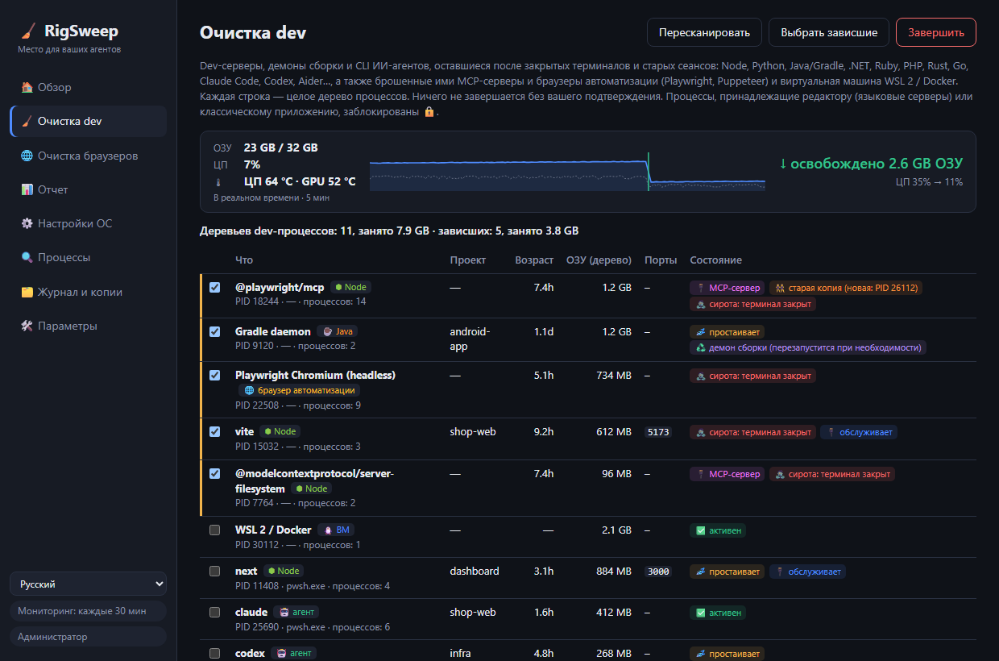

<div align="center">

# 🧹 RigSweep

**Место для ваших агентов.** Освобождает ОЗУ, ЦП и диск на компьютерах разработчиков с Windows, забитых сеансами ИИ-агентов.

**[🌐 Сайт](https://rigsweep.com)** · **[⬇️ Скачать](https://github.com/yobotn/rigsweep/releases/latest)** · **[📖 Антивирус: вопросы и ответы](#%EF%B8%8F-ложные-срабатывания-антивируса)**

[🇬🇧 English](README.md) · [🇩🇪 Deutsch](README.de.md) · [🇪🇸 Español](README.es.md) · [🇫🇷 Français](README.fr.md) · [🇮🇹 Italiano](README.it.md) · [🇧🇷 Português](README.pt-BR.md) · 🇷🇺 Русский · [🇯🇵 日本語](README.ja.md) · [🇰🇷 한국어](README.ko.md) · [🇨🇳 简体中文](README.zh-CN.md)




</div>

---

## 📖 Зачем я это сделал

В эпоху ИИ на моем ноутбуке работает уже не *что-то одно*. В обычный день у меня открыто несколько сеансов **Claude Code** в разных терминалах, dev-сервер на каждый проект, наблюдатели сборки и браузер, полный документации, превью и дашбордов. Каждый новый сеанс порождает новые процессы Node, и после закрытия терминала некоторые из них **просто продолжают работать в фоне**.

Появилось ощущение *захламленности*: вентиляторы шумят, ОЗУ почти всегда под завязку, и непонятно, что именно ее съедает. Диспетчер задач показывал лишь сплошную стену `node.exe` и `chrome.exe`, не сообщая, к какому сеансу и проекту они относятся и нужны ли еще.

Тогда я замерил свой компьютер (32 ГБ ОЗУ) в разгар рабочего дня:

| 🔎 Что я нашел | Количество | ОЗУ |
|---|---:|---:|
| 🌐 Процессы Chrome | 37 | **6,5 ГБ** |
| ⬢ Процессы Node + Claude (CLI агентов, dev-серверы, классическое приложение) | 14 | **2,5 ГБ** |
| 🧩 Запущенные службы Windows (телеметрия, Xbox, индексатор поиска…) | ~150 | — |

Ничего из этого не было «вирусом» или «мусором». Это **обычные остатки работы с ИИ-агентами** плюс фоновые компоненты Windows, которые машине разработчика не нужны. Существующие «ускорители ПК» либо делают пугающие необратимые вещи, либо ничего не знают о рабочих процессах разработчиков. Поэтому я написал инструмент, который хотел сам:

> **Видеть, что на самом деле занимает компьютер, убирать зависшее и иметь возможность отменить любое изменение.**

---

## ✨ Возможности

### 🧹 Очистка dev: зависшие dev-процессы в любом стеке
Находит **dev-серверы, демоны сборки и CLI ИИ-агентов** и группирует каждый из них с его **полным деревом процессов**, папкой проекта, временем работы, ОЗУ и прослушиваемыми портами.

| Стек | Что находит |
|---|---|
| ⬢ Node · Bun · Deno | dev-серверы (Vite, Astro, Next…), наблюдатели, esbuild |
| 🐍 Python | uvicorn, Flask, Django, Jupyter, Streamlit, Celery, процессы venv, MCP-серверы на Python |
| ☕ Java | демоны Gradle и Kotlin, Maven, Spring Boot, Quarkus |
| 🟣 .NET | `dotnet watch/run`, сервер компилятора Roslyn, оставшиеся узлы MSBuild |
| 💎 Ruby · 🐘 PHP · 🦀 Rust · 🐹 Go | `rails`/`ruby`, `php -S`/artisan, `cargo watch/run`, `go run` |
| 🤖 CLI агентов | Claude Code, Codex, Gemini CLI, opencode, Aider, Goose |
| 🔌 MCP-серверы | серверы, запущенные агентом (`@modelcontextprotocol/*`, `@playwright/mcp`, `mcp-server-*`, FastMCP…) и оставшиеся работать после его выхода, даже за оболочкой запуска `cmd /c npx` |
| 🌐 Браузеры автоматизации | Playwright / Puppeteer / Chrome и Edge с `--headless` вместе со всем деревом процессов отрисовки. Ваш собственный браузер в список никогда не попадает |
| 🐧 WSL 2 / Docker | виртуальная машина Linux (`vmmemWSL`), корректно завершается командой `wsl --shutdown`, никогда не выбирается заранее |

На Python и Java работают и обычные классические приложения, поэтому для них в список попадают только процессы с явными признаками разработки.

- 🧟 **Сирота**: терминал закрыт, а процесс продолжает работать. Выбирается заранее, даже если всё еще занимает порт (классический зомби `localhost:3000`).
- 🔌 **MCP-сервер**: такая метка стоит на каждой соответствующей строке, чтобы инструментальный сервер, брошенный агентом, легко было отличить от вашего dev-сервера.
- 👯 **Старая копия**: MCP-сервер, у которого запущена и более новая копия (например, в текущем сеансе агента), помечается, чтобы оставшийся экземпляр сразу бросался в глаза.
- 📈 **Счетчик в реальном времени**: пока RigSweep работает (в окне или в области уведомлений), ОЗУ и ЦП замеряются каждые 2 секунды. Сразу после очистки, ручной или автоматической, счетчик показывает, **сколько ОЗУ реально освободилось**, и загрузку ЦП «до → после» — это замер, а не оценка.
- 🌡️ **Отслеживание температуры**: температура ЦП и GPU отображается на вкладке «Обзор» в реальном времени, с графиком и пиком за 5 минут и с предупреждением, если компьютер долго остается выше 90 °C. Значение GPU берется из того же счетчика, что и в Диспетчере задач, значение ЦП — из тепловой зоны ACPI (драйвер не устанавливается, права администратора не нужны; на многих настольных ПК значение приблизительное). Щелкните плитку, чтобы переключиться между °C и °F.
- 💤 **Простаивает**: процесс долго не нагружает ЦП. Среды выполнения без открытых портов выбираются заранее. **Простаивающий сеанс агента в открытом терминале никогда не выбирается заранее**, потому что он просто ждет вас (к тому же `claude --resume` всё равно его вернет).
  Через сколько времени процесс считается простаивающим, задается в разделе **Параметры** (в минутах, по умолчанию 120, например 5).
- 🧹 **Автоочистка** (по умолчанию выключена, включается в разделе «Параметры»): каждую минуту RigSweep завершает зависшие dev-среды выполнения, которые, по его наблюдениям, не нагружали ЦП в течение всего периода простоя. CLI агентов, виртуальная машина WSL/Docker и процессы редакторов автоматически никогда не завершаются, а каждое завершенное дерево записывается в журнал.
- 🟠🔴 **Индикатор в области уведомлений**: на значке в области уведомлений (и на кнопке на панели задач, пока окно открыто) появляется оранжевая точка, когда зависшие dev-процессы занимают ≥ 1 ГБ, и красная — при ≥ 2 ГБ. Наведите указатель на значок, чтобы увидеть точный объем. Пороги задаются в разделе «Параметры», там же точку можно отключить.
- ♻️ **Демон сборки**: серверы Gradle, Kotlin и Roslyn задуманы так, чтобы оставаться в памяти. Завершать их безопасно — они перезапустятся при следующей сборке.
- 🔒 **Заблокировано**: процессы, принадлежащие **VS Code, Cursor, JetBrains, Visual Studio…** (ваши языковые серверы) или классическому приложению, отсюда завершить нельзя.
- ✅ Ничего не завершается без вашего подтверждения, а перед каждым завершением проверяется, не был ли PID переиспользован.

### 📊 Отчет об ускорении: реальные «до» и «после»
Никаких выдуманных «ваш ПК стал быстрее на 87 %». RigSweep **замеряет** компьютер и сравнивает два снимка: занятая и свободная ОЗУ, средняя загрузка ЦП, число процессов, запущенные службы, ОЗУ Chrome, ОЗУ Node и агентов.

- 📸 **Базовый замер** делается автоматически перед первой настройкой.
- 🔁 Пара замеров **«до/после»** делается при каждой очистке dev.
- 📋 **Копировать в Markdown**, чтобы поделиться результатом в issue, посте или этом README.

### 🌐 Помощник вкладок Chrome
Классическое приложение **не может** закрывать вкладки Chrome, поэтому в RigSweep входит крошечное расширение ([`chrome-extension/`](chrome-extension/)) без доступа к сети и только с разрешениями `tabs` / `storage` / `alarms`:
- 💤 **Усыпление неактивных вкладок**: освобождает их память, но вкладка остается на панели вкладок
- 🧹 **Закрытие дубликатов вкладок**
- 🎯 **Закрытие вкладок по шаблону**, например `localhost:*` или `*.vercel.app`
- ⏰ **Автоусыпление** каждые 10 минут (необязательно)

### ⚙️ Обратимые настройки Windows
Тщательно подобранный каталог ([`catalog/tweaks.json`](src-tauri/catalog/tweaks.json)): телеметрия, Xbox, индексатор поиска, фоновые приложения, исключения Defender для папок разработки, схема управления питанием и многое другое — у каждой настройки свой уровень риска:

| Уровень | Значение |
|---|---|
| 🟢 `safe` | Без заметных побочных эффектов (выбирается заранее) |
| 🟡 `moderate` | Небольшой компромисс, с пояснением |
| 🔴 `caution` | Отключает функцию; требуется подтверждение |


- 💾 **Каждое исходное значение сохраняется** в SQLite перед первым изменением. Можно восстановить одну настройку, категорию или всё сразу.
- 🛟 Перед первым применением создается **точка восстановления системы**.
- 🔁 **Мониторинг** снова применяет настройки, которые Центр обновления Windows незаметно отменил, и считает, как часто это происходит.
- 🚫 Никогда не затрагиваются: Центр обновления Windows, ядро Defender, RPC/DCOM/LSA и еще ~60 ключевых служб ([`PROTECTED_SERVICES`](src-tauri/src/catalog.rs)).

### 🔍 Анализатор процессов
ЦП / ОЗУ / диск по каждому процессу и **какие службы размещены в каждом `svchost.exe`**. Отключайте службу или завершайте процесс прямо из списка (ключевые элементы заблокированы 🔒).

### 🔄 Обновления на ваш выбор
В разделе **🛠️ Параметры → 🔄 Обновления** есть кнопка **Проверить сейчас** и необязательный флажок *Автоматически проверять обновления* (при запуске и затем раз в день), который **по умолчанию выключен**. Когда выходит новая версия, на боковой панели появляется кнопка с описанием выпуска. Ничего не устанавливается, пока вы не нажмете **Установить и перезапустить**, и только если загруженный файл подписан ключом RigSweep. Ваши настройки ОС, резервные копии и параметры сохраняются. Что именно происходит при проверке, описано в [политике конфиденциальности](#-политика-конфиденциальности).

### 🌍 10 языков
Интерфейс доступен на языках **English, Deutsch, Español, Français, Italiano, Português (Brasil), Русский, 日本語, 한국어 и 简体中文** (переключаются на боковой панели), как и установщик и расширение Chrome. Каждый перевод выполнен с официальной терминологией Windows для своего языка (Диспетчер задач, Службы, Планировщик заданий…), а не дословно. Заметили что-то неуклюжее? Откройте issue или PR для `ui/locales/<code>.js` (приложение), `docs/locales/<code>.js` (сайт) или `README.<code>.md`.

---

## 🏁 До и после на вашем компьютере

Установите программу, откройте **📊 Отчет → 📸 Замерить**, выполните очистку dev и примените безопасные настройки, перезагрузите компьютер, замерьте снова и нажмите **📋 Копировать в Markdown**. Будем рады вашим результатам в [Discussions](../../discussions)!

<!-- TODO(maintainer): paste your own "Copy as Markdown" result here once you've run it on your machine. -->

> ℹ️ Изменения служб полностью вступают в силу после перезагрузки. Результат очистки dev и усыпления вкладок Chrome виден сразу.

---

## 📦 Установка

1. Скачайте `RigSweep_x.y.z_x64-setup.exe` со страницы [**Releases**](../../releases).
2. Запустите его. Установщик запросит права администратора, потому что RigSweep управляет службами и политиками.
3. Установщик спросит, разрешить ли RigSweep в Microsoft Defender (см. ниже). Решать вам.
4. Следующие версии можно устанавливать через **🛠️ Параметры → 🔄 Обновления** (начиная с 0.5.0).

🌐 **Помощник Chrome:** в RigSweep откройте **🛠️ Параметры → 🌐 Помощник вкладок Chrome → Открыть папку расширения**, затем в Chrome: `chrome://extensions` → **Режим разработчика** → **Загрузить распакованное расширение** → выберите эту папку.

## 🛡️ Ложные срабатывания антивируса

RigSweep — программа с открытым исходным кодом, но **пока без цифровой подписи**. Инструменты, изменяющие службы и параметры Defender, для эвристики машинного обучения очень похожи на вредоносные программы, поэтому **Microsoft Defender может по ошибке удалить exe-файл**. Во время разработки это случилось с вердиктом `Trojan:Win32/Bearfoos.B!ml`, где `!ml` означает эвристическое предположение, а не сигнатуру известной вредоносной программы.

Что мы с этим делаем:
- ❓ **Вопрос установщика (по желанию):** «Разрешить RigSweep в Microsoft Defender?» Ответ «Да» исключает из проверки **только папку установки**, а программа удаления снова убирает это исключение. При тихой установке исключение никогда не добавляется.
- 🛠️ **Параметры → 🛡️ Доверие антивируса:** просмотр состояния, добавление или удаление исключения в любой момент.
- ✍️ **Подпись кода запланирована** через [SignPath Foundation](https://signpath.org) (бесплатно для проектов с открытым исходным кодом). Это и есть настоящее решение. См. [политику подписи кода](#-политика-подписи-кода).

Если файл уже удален: **Безопасность Windows → Защита от вирусов и угроз → Журнал защиты →** выберите запись RigSweep → **Действия → Восстановить**. Делайте это только для файла, скачанного со страницы Releases этого репозитория, или для собственной сборки. Вы также можете сами [сообщить Microsoft о ложном срабатывании](https://www.microsoft.com/wdsi/filesubmission).

---

## 🛠️ Сборка из исходного кода

```powershell
winget install Rustlang.Rustup        # + VS 2022 Build Tools (рабочая нагрузка C++)
npm install
npm run build                         # -> src-tauri/target/release/rigsweep.exe + bundle/nsis/*-setup.exe
```
Запуск для разработки: `npm run dev` (подтвердите запрос UAC; приложение само перезапустится с повышенными правами).

> 💡 Defender может помещать в карантин и ваши свежие локальные сборки. Добавьте папку клона в список *Папки разработки* в RigSweep (Параметры) и примените настройку **Defender exclusions for dev folders** или исключите `src-tauri\target` вручную.

### ⌨️ Командная строка
| Команда | Действие |
|---|---|
| `rigsweep.exe` | Графический интерфейс + область уведомлений |
| `rigsweep.exe --apply` | Без интерфейса: проверить профиль, снова применить отмененные настройки, выйти (используется заданием автозапуска) |
| `rigsweep.exe --apply --tray` | То же, затем остаться в области уведомлений с мониторингом |
| `rigsweep.exe --restore-all` | Вернуть всё к сохраненным исходным значениям |

### 🧪 Тесты
```powershell
cd src-tauri
cargo test                                          # корректность каталога, резервные копии, снимки, разбор команд
cargo test live_status   -- --ignored --nocapture   # только чтение: обнаруженное состояние каждой настройки
cargo test live_dev_scan -- --ignored --nocapture   # только чтение: что «Очистка dev» видит прямо сейчас
```

### ➕ Добавление настроек
Добавьте запись в [`catalog/tweaks.json`](src-tauri/catalog/tweaks.json). Типы действий: `service` (start: disabled|manual), `task` (path), `registry` (HKLM|HKCU, dword|string), `defender_exclusion` и `power_plan`. Элементы уровня `caution` должны содержать `warning`. `cargo test` отклоняет защищенные службы и некорректные записи.

## 🐳 docker-optimize (отдельный инструмент)
Не входит в приложение. [`docker-optimize/`](docker-optimize/) — самостоятельный обратимый скрипт однократного запуска, который ограничивает виртуальную машину WSL2 в Docker Desktop (память, ЦП, возврат ОЗУ, разреженный диск) и отключает ненужные дополнительные функции Docker Desktop. Он никогда не удаляет контейнеры, образы или тома. См. его [README](docker-optimize/README.md).

## 🗂️ Где что хранится
| Что | Где |
|---|---|
| База данных (резервные копии, журнал, снимки) | `%ProgramData%\RigSweep\rigsweep.db` (+ `.bak.1`–`.bak.5`) |
| Задание автозапуска | Планировщик заданий → `RigSweep-Reapply` |
| Экспортированные профили | `Documents\RigSweep-profile-*.json` |

Переходите с **aiBoost** (старое название)? База данных переносится автоматически при первом запуске, а старое задание автозапуска заменяется.

## 🔏 Политика подписи кода

Бесплатная подпись кода предоставлена [SignPath.io](https://about.signpath.io/), сертификат — [SignPath Foundation](https://signpath.org/).
*(Заявка на рассмотрении: выпуски до v0.3.0 включительно **пока не подписаны**.)*

- **Сборки:** установщики выпусков собираются из исходного кода с тегом с помощью [GitHub Actions](.github/workflows/release.yml) на runner-машинах, размещенных GitHub. На подпись будут отправляться только эти сборки.
- **Коммиттеры и рецензенты:** [@yobotn](https://github.com/yobotn)
- **Утверждающие:** [@yobotn](https://github.com/yobotn)

### 🔒 Политика конфиденциальности
Эта программа не передает никакую информацию в другие сетевые системы, если об этом специально не попросит пользователь либо лицо, устанавливающее программу или работающее с ней. В RigSweep нет телеметрии и аналитики, а расширение Chrome не выполняет сетевых запросов. Единственный сетевой запрос, который может выполнить RigSweep, — это **проверка обновлений**, и только когда вы сами ее запрашиваете: нажимаете *Проверить сейчас* в разделе «Параметры» или включаете *Автоматически проверять обновления* (по умолчанию выключено). При проверке загружается файл `latest.json` из GitHub Releases этого репозитория, и никакие сведения о вашем компьютере не отправляются; обновление устанавливается только после того, как вы нажмете *Установить*, и только если его подпись соответствует ключу подписи RigSweep. Всё, что программа хранит (резервные копии, журнал, замеры), остается в `%ProgramData%\RigSweep` на вашем компьютере.

## ⚠️ Отказ от ответственности

RigSweep изменяет службы Windows, запланированные задания, политики в реестре и параметры Microsoft Defender, а также может завершать запущенные процессы. Для каждой настройки создается резервная копия, и ее можно отменить, и ничего не происходит без вашего подтверждения, но **вы используете программу на свой страх и риск**. Она предоставляется **«как есть», без каких-либо гарантий** (см. [лицензию MIT](LICENSE)). Проверяйте каждое изменение перед применением, храните собственные резервные копии и не используйте программу на устройствах, которыми управляет организация или учебное заведение, без согласия ИТ-отдела.

RigSweep — независимый проект, **не связанный с** Microsoft, Google, Anthropic, OpenAI или любыми другими упомянутыми инструментами. Все товарные знаки принадлежат их владельцам.

## 🤝 Участие в разработке
Issues и PR приветствуются, особенно новые настройки (с понятным уровнем риска), поддержка новых стеков и CLI агентов в «Очистке dev», а также переводы.

## 📄 Лицензия
[MIT](LICENSE): бесплатно навсегда, делайте что хотите, без гарантий.
