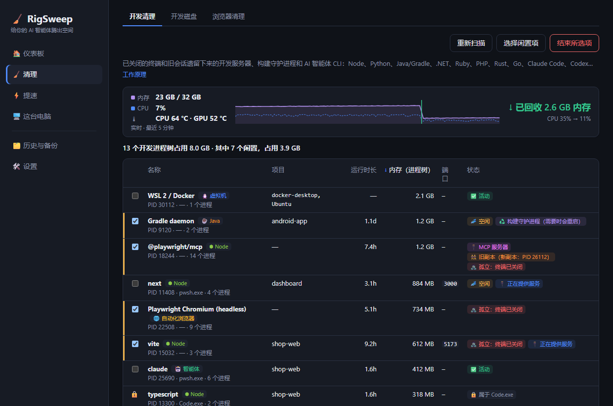

<div align="center">


# RigSweep

**给你的智能体腾出空间。** Windows 开发机被 AI 智能体会话占满？RigSweep 帮你释放内存、CPU 和磁盘空间。

**[🌐 主页](https://rigsweep.com)** · **[⬇️ 下载](https://github.com/yobotn/rigsweep/releases/latest)** · **[📖 防病毒常见问题](#防病毒软件误报)**

[🇬🇧 English](README.md) · [🇩🇪 Deutsch](README.de.md) · [🇪🇸 Español](README.es.md) · [🇫🇷 Français](README.fr.md) · [🇮🇹 Italiano](README.it.md) · [🇧🇷 Português](README.pt-BR.md) · [🇷🇺 Русский](README.ru.md) · [🇯🇵 日本語](README.ja.md) · [🇰🇷 한국어](README.ko.md) · 🇨🇳 简体中文 · [🇸🇦 العربية](README.ar.md)




</div>

---

## 我为什么要做这个工具

<!-- Generated from docs/locales (story.*, stat.*) by scripts/prerender-site.js. Edit it there. -->

在 AI 时代，开发用的笔记本电脑早已不只运行一个程序。平常的一天里，不同终端中开着好几个 Claude Code 会话，每个项目一个开发服务器，还有构建监视程序，以及开满文档和预览页面的浏览器。

每个会话都会启动更多进程，其中很多在你关闭终端后仍在运行。任务管理器只显示一长串 node.exe、python.exe 和 chrome.exe，看不出它们属于哪个会话或项目。

- 🌐 Chrome（37 个进程）: **6.5 GB**
- ⬢ Node + Claude（14 个进程）: **2.5 GB**
- 🧩 正在运行的 Windows 服务: **~150**
- 💾 Rust target 文件夹（3 个项目）: **~120 GB**

*在作者的 32 GB 笔记本电脑上于工作日中途测得。*

然后我看了看磁盘。我当时在同时开发三个 Rust 应用：RigSweep 本身、[KeepRun](https://github.com/yobotn/keeprun)（把 Node、.NET 和 Python 应用作为 Windows 服务持续运行）和 [Focuside](https://github.com/yobotn/focuside)（一款专注的 AI 编程智能体 IDE）。每个项目的 `target` 文件夹都涨到了约 **40 GB**，加起来 **约 120 GB**，全是 Cargo 从不自动清理的构建产物。**开发磁盘**标签页一次扫描就把这三个都找了出来。

这些都不是病毒，也不是垃圾，而是用 AI 智能体干活时正常留下的残留，再加上开发机根本用不着的 Windows 后台组件。现有的“电脑加速”软件要么做些吓人又不可撤消的操作，要么对开发工作流一无所知，所以我做了一个自己想要的工具。

> **RigSweep 让你看清到底是什么在占用电脑，清理闲置的进程，并且每项更改都可以撤消。**

---

## 功能

### 开发清理：清理任意技术栈中闲置的开发进程
找出**开发服务器、构建守护进程和 AI 智能体 CLI**，并将每一项与其**整个进程树**、项目文件夹、运行时长、内存和监听端口归为一组。

| 技术栈 | 能找到什么 |
|---|---|
| ⬢ Node · Bun · Deno | 开发服务器（Vite、Astro、Next…）、监视程序、esbuild |
| 🐍 Python | uvicorn、Flask、Django、Jupyter、Streamlit、Celery、venv 进程、Python MCP 服务器 |
| ☕ Java | Gradle 和 Kotlin 守护进程、Maven、Spring Boot、Quarkus |
| 🟣 .NET | `dotnet watch/run`、Roslyn 编译器服务器、遗留的 MSBuild 节点 |
| 💎 Ruby · 🐘 PHP · 🦀 Rust · 🐹 Go | `rails`/`ruby`、`php -S`/artisan、`cargo watch/run`、`go run` |
| 🤖 智能体 CLI | Claude Code、Codex、Gemini CLI、opencode、Aider、Goose |
| 🔌 MCP 服务器 | 由智能体启动、在智能体退出后仍在运行的服务器（`@modelcontextprotocol/*`、`@playwright/mcp`、`mcp-server-*`、FastMCP…），即使隐藏在 `cmd /c npx` 启动器后面也能找到 |
| 🌐 自动化浏览器 | Playwright / Puppeteer / `--headless` 模式的 Chrome 和 Edge，连同其整个渲染器进程树。你自己的浏览器绝不会被列出 |
| 🐧 WSL 2 / Docker | Linux 虚拟机（`vmmemWSL`），通过 `wsl --shutdown` 干净地关闭，绝不会被预先选中 |

Python 和 Java 也会运行普通的桌面应用，因此对于这两者，只会列出带有明确开发特征的进程。

- 🧟 **孤立**：终端已关闭，但进程仍在运行。即使它仍占用端口也会被预先选中（比如经典的僵尸 `localhost:3000`）。
- 🔌 **MCP 服务器**：每个 MCP 服务器所在的行都有标记，方便你区分智能体遗留的工具服务器和你自己的开发服务器。
- 👯 **旧副本**：如果某个 MCP 服务器还有一个较新的副本在运行（例如在你当前的智能体会话下），旧的那个会被标记出来，让你一眼就能发现遗留项。
- 📈 **实时指示器**：RigSweep 运行期间（窗口或通知区域），每 2 秒采样一次内存和 CPU。每次清理（无论是手动还是自动）结束后，它会立即显示**实际回收了多少内存**，以及 CPU 前后对比。这些都是实测值，而非估算。
- 🌡️ **温度跟踪**：仪表板上实时显示 CPU 和 GPU 温度，附带最近 5 分钟的趋势和峰值；电脑持续高于 90 °C 时会发出警告。GPU 温度与任务管理器使用同一计数器；CPU 温度来自 ACPI 热区（不安装驱动程序，无需管理员权限；在许多台式机上只是近似值）。单击该磁贴可在 °C 和 °F 之间切换。
- 💤 **空闲**：长时间没有 CPU 活动。没有打开端口的运行时会被预先选中。**打开的终端中的空闲智能体会话绝不会被预先选中**，因为它只是在等你（而且 `claude --resume` 也能把它恢复回来）。
  多长时间算空闲可以在**设置**中指定（以分钟为单位，默认 120，例如可设为 5）。
- 🧹 **自动清理**（默认关闭，在“设置”中开启）：RigSweep 每分钟会结束那些在整个空闲时长内一直被它观察到没有 CPU 活动的闲置开发运行时。智能体 CLI、WSL/Docker 虚拟机和编辑器所属的进程绝不会被自动结束，每个被结束的进程树都会记录在“历史与备份”中。
- 🟠🔴 **通知区域指示器**：当闲置的开发进程占用 ≥ 1 GB 内存时，通知区域图标（以及窗口打开时的任务栏按钮）会显示橙色圆点，≥ 2 GB 时显示红色圆点。将鼠标悬停在通知区域图标上可以查看具体占用量。阈值可在“设置”中调整，也可以在那里关闭圆点。
- ♻️ **构建守护进程**：Gradle、Kotlin 和 Roslyn 服务器本来就会常驻。结束它们没有坏处，下次构建时会重新启动。
- 🔒 **锁定**：属于 **VS Code、Cursor、JetBrains、Visual Studio…**（你的语言服务器）或桌面应用的进程，绝不能在这里结束。
- 🎯 **单个或批量**：勾选多行后单击**结束所选项**，或者直接使用某一行的**结束**按钮。两种方式都会显示同样的确认窗口，并列出将释放多少资源。
- ✅ 未经你确认，不会结束任何进程；每次结束进程前都会检查 PID 是否已被重用。

### 开发磁盘：node_modules、缓存和工作树
旧项目在你不再碰它们之后，仍然留着好几 GB 的 `node_modules`、`.next`、`target`、`bin/obj` 和 `.venv`，包缓存只会越来越大，AI 工具和智能体还会留下缓存和工作树。RigSweep 会把这些都找出来，删除你选中的内容。

- 🗂️ **项目**：Node、Rust、.NET、Java/Gradle/Maven 和 Python 的构建产物与依赖文件夹。只有旁边有项目文件（`package.json`、`Cargo.toml`、`*.csproj`、`pyvenv.cfg` 等）的文件夹才算数，所以随便一个 `build` 文件夹绝不会被动到。只会预先勾选 30 天（可调整）没人编辑过的项目，正被运行中的进程使用的项目会被锁定 🔒。
- 📦 **包缓存**：npm、npx、pnpm、Yarn、Bun、pip、uv、Cargo、Go、NuGet、Gradle、Maven、Playwright、Puppeteer、Hugging Face。uv 和 Go 用它们自己的命令清理（`uv cache prune`、`go clean`）；Playwright 和 Puppeteer 只删除旧版浏览器，保留最新版本。
- 🎮 **GPU 与机器学习**：NVIDIA、AMD、Intel 和 DirectX 着色器缓存、CUDA 计算缓存、PyTorch Hub 模型和编译好的扩展、Triton 内核缓存，以及没用到的 conda 包（通过 `conda clean --all` 清理）。Ollama 和 LM Studio 的模型只显示大小，绝不删除。
- 🤖 **AI 工具与编辑器**：Cursor、VS Code、Windsurf、Claude 桌面应用、Codex 和 ChatGPT 的应用缓存，应用开着时会跳过。Cursor 的状态备份和旧检查点也可以删除（绝不预先勾选）。聊天记录（Cursor 的聊天数据库、Claude Code 对话、Codex 会话）只显示大小，让你看清空间都去哪了。
- 🌿 **Git 工作树**：Claude Code、Cursor、Codex 或你自己创建的工作树，附带分支、仓库和闲置时长。通过 `git worktree remove` 移除，有未提交或未跟踪内容的工作树会被它拒绝；分支和提交都会保留。会被一起删掉的 git 忽略文件（如 `.env`）会先列出来，工作树也绝不预先勾选。 拿不准？**问问你的 AI** 会复制一段现成的提示词，让你自己的 AI 代理在删除前检查未推送的提交、stash 和无法重建的文件。
- 🖥️ **Windows 残留**：7 天没动过的用户临时文件和 Windows 临时文件、Windows 更新下载内容、传递优化文件、崩溃转储和错误报告、缩略图缓存以及回收站（绝不预先勾选）。Windows.old 只显示大小。
- 🐳 **Docker 和 WSL 虚拟磁盘**：Docker Desktop 和每个 WSL 发行版的 `.vhdx` 只会变大，不会自己缩小。**压缩**会把它缩到 Linux 实际用到的大小。压缩前会先退出 Docker Desktop 并关闭 WSL，磁盘里的内容一样都不删。
- 🎯 **自动选择**：直接在开发磁盘页设置项目闲置多久才算过期（3 到 365 天）、勾选哪些文件夹（构建产物、依赖、包缓存）以及最小体积。
- 🚫 **从不清理**：任何缓存都可以关掉。需要大量重新下载的那些（Playwright、Puppeteer、Hugging Face、Gradle、Maven、NuGet 包、Go 模块）默认就是关闭的。
- 🙈 **排除**：AppData、用户目录中的工具文件夹（`.cargo`、`.nvm`、`.vscode` 等）、`.git` 和 Windows 始终跳过。你可以在设置中添加自己的路径或文件夹名（`vendor`、`old-*`），也可以在项目上点击 **排除**。
- 💽 **磁盘空间条**：开发磁盘、浏览器清理和仪表板一打开就显示驱动器现在和清理后的可用空间（“可用 58 GB → 可用 81 GB”），外加一个大大的**释放 X GB**按钮。仪表板会把所有扫描找到的空间加在一起。
- 🔁 **自动清理**（设置 → 开发磁盘，默认关闭）：每周一次，也可以在 C: 盘可用空间低于你设定的大小时触发，RigSweep 只清空会自动重建的缓存。不碰项目、回收站，也不碰重新下载很慢的内容。
- ⏸️ 耗时较长的清理可以**暂停、继续或停止**，并有进度条显示。因重启而中断的清理可以从中断处继续。
- ✅ 默认扫描你的用户目录（桌面、文档、下载、OneDrive 等）。未经你确认不会删除任何东西，每个文件夹在删除前都会再检查一次。

### 硬件：一个页面代替四个工具
以前要打开 CPU-Z、GPU-Z、CrystalDiskInfo 和 CrystalDiskMark 才能看到的基本信息，现在直接从 Windows 读取。不安装任何驱动。

- 💽 **硬盘健康**：每块硬盘显示良好 / 磨损中 / 有问题，并附上剩余寿命、温度、通电时间和未纠正错误。硬盘出现故障迹象时，仪表板会发出警告。
- ⚡ **测速**：按分区测试顺序读写和 4K 随机读取。会写入一个 512 MB 的临时文件，测完即删除。
- 🧮 **CPU、显卡、内存**：型号、核心与线程、缓存、虚拟化（WSL 2 和 Docker 需要）、显存与驱动、内存类型、频率和空闲插槽。
- 🔋 **系统与电池**：主板、BIOS、Windows 版本号、开机时长，以及笔记本的电池损耗。


### GPU 与 AI：显卡和 NPU 上正在运行什么
每个应用在 GPU 和 NPU 上做了什么，数据来自任务管理器所用的同一组性能计数器。不安装任何东西，页面关闭时也不会读取任何数据。

- 🎮 **按适配器**：使用率、已用的专用内存和共享内存；在专业模式下，还会为每个正在工作的引擎（3D、Compute、Copy、Video 等）显示一个指示条。
- 📋 **按应用**：每个使用 GPU 的应用的 GPU 使用率、引擎和专用显存；专业模式下还显示共享内存。
- 🧠 **NPU**：神经网络处理单元（NPU）会和 GPU 一起列出，每个应用的 NPU 使用率显示在其 GPU 使用率旁边。
- 🤖 **AI 负载**：正在运行的本地 AI 运行时（Ollama、LM Studio、llama.cpp、Jan、LocalAI、KoboldCpp、ComfyUI、vLLM、使用 PyTorch 或 Transformers 的 Python 等）以及它们占用的显存。对于 Ollama，还会列出已加载的模型和每个模型占用的显存。


### 提速报告：真实的前后对比
没有“你的电脑快了 87%”这种虚假数字。RigSweep 会**测量**你的电脑并比较两个快照：已用/可用内存、平均 CPU、进程数、正在运行的服务、Chrome 内存、Node/智能体内存。

- 📸 首次应用优化前会自动记录**基线**。
- 🔁 每次开发清理前后都会记录一组**前后对比**数据。
- 📋 **复制为 Markdown**，即可在 issue、帖子或这个 README 中分享你的结果。

### Chrome 标签页助手
桌面应用**无法**关闭 Chrome 标签页，因此 RigSweep 附带了一个小巧的扩展程序（[`chrome-extension/`](chrome-extension/)），它没有网络访问权限，仅需 `tabs` / `storage` / `alarms` 权限：
- 💤 **让空闲标签页休眠**：释放其内存，但标签页仍保留在标签栏中
- 🧹 **关闭重复的标签页**
- 🎯 **按模式关闭标签页**，例如 `localhost:*` 或 `*.vercel.app`
- ⏰ 每 10 分钟**自动休眠**（可选）

### 可撤消的 Windows 优化
一份精选目录（[`catalog/tweaks.json`](src-tauri/catalog/tweaks.json)），涵盖遥测、Xbox、搜索索引器、后台应用、针对开发文件夹的 Defender 排除项、电源计划等，每项都标有风险等级：

| 等级 | 含义 |
|---|---|
| 🟢 `safe` | 无明显副作用（预先选中） |
| 🟡 `moderate` | 有少许取舍，附有说明 |
| 🔴 `caution` | 会使某项功能失效，需要你确认 |


- 💾 首次更改前，**每个原始值都会备份**到 SQLite 中。可以还原单项优化、整个类别或全部更改。
- 🛟 首次应用前会创建**系统还原点**。
- 🔁 **看门狗**会重新应用被 Windows 更新悄悄还原的优化，并统计这种情况发生的次数。
- 🧭 **不让 Edge 回来**：先在“设置”中卸载 Edge，再用一项优化阻止 Edge Update 和 Windows 更新重新安装它。其他应用需要的 WebView2 运行时不受影响。
- 🚫 绝不触碰：Windows 更新、Defender 引擎、RPC/DCOM/LSA 以及约 60 项其他核心服务（[`PROTECTED_SERVICES`](src-tauri/src/catalog.rs)）。

### 进程分析器
显示每个进程的 CPU / 内存 / 磁盘占用，以及**每个 `svchost.exe` 中托管了哪些服务**。可以直接在列表中禁用服务或结束进程（核心项已锁定 🔒）。每个应用都会显示自己的图标。

- ❓ **为什么？**：单击某个进程即可看到它是什么：CPU、内存、磁盘、线程、发布者、文件和命令行，是哪个程序启动了它，以及它又启动了哪些程序。对常见的 Windows 进程（Defender、Windows Search、Windows 更新、svchost、WMI 等），会用通俗的话解释它为什么忙。
- 🛡️ **Defender 正在扫描什么**：仪表板会在 CPU 占用较高的进程旁显示**查看原因**，对 Microsoft Defender 则会更早显示。对于 Defender，**记录扫描内容**会观察 20 秒，列出触发扫描的文件夹、文件类型和进程。如果大部分来自你的开发工作，它会引导你使用为开发文件夹添加 Defender 排除项的优化。


### 启动项：任务管理器不显示的内容
任务管理器的“启动应用”列表漏掉了大部分随 Windows 启动的内容。RigSweep 会全部列出，只排除 Windows 自带组件：

- 🧩 应用和驱动的**自动启动服务**（VPN 客户端、厂商工具、更新程序）。它们会改为“手动”：不再随开机启动，但打开应用时，应用仍可启动它们。
- ⏰ 在登录时、开机时或按计划运行的**计划任务**。
- 🚀 来自注册表和启动文件夹的**启动应用**，使用与任务管理器相同的开关关闭。
- 💾 每项更改都会备份并可还原；如果某个应用更新后又把自己打开，看门狗会再次关闭它。


### 控制台弹窗：刚才那个窗口是什么？
一个命令提示符或 PowerShell 窗口突然弹出来，转眼又关掉了，你永远不知道它运行了什么。**提速 → 🪟 控制台弹窗**会把每一次都记录下来：

- 🪟 一分钟内自己打开又关闭的每个控制台窗口都会列出来，并显示它**运行的确切命令**，哪怕它只开了几毫秒。
- 🔎 **是谁启动的**：计划任务（显示名称）、服务、应用或资源管理器，在“详情”里还能看到完整的父进程链。
- 📜 **里面运行了什么**：它启动的程序（例如一个调用 `curl` 和 `reg` 的 `.bat` 文件）以及退出代码。
- 🔁 同一来源的同一命令合并为一行并显示次数（×12），每小时触发一次的任务一眼就能认出来。
- ⏹ **关闭…**会禁用背后的第三方计划任务，有备份，也能像其他启动项更改一样在“启动项”或“优化”中撤消。
- 🙈 隐藏运行的命令不会列出，只列出你真正能看到的窗口。RigSweep 从 Windows 自带的内核事件流（ETW）读取进程启动信息，只看不改。可以在设置 → 外观和功能中关闭。

### 网络：哪个应用占用了哪个端口
- 📶 **按适配器**：下载和上传速度、链接速度，以及开机以来的流量。Windows 只向以管理员身份进行跟踪的工具提供按应用统计的字节数，所以流量按适配器显示，而不是按应用。
- 🔌 **按应用**：监听端口（TCP 和 UDP）、打开的连接数，以及每个应用通信的远程地址。
- 🔍 **谁在使用？**：输入一个端口，就能看到占用它的进程及其命令行；输入一个文件或文件夹，就能看到哪些应用打开了它或正在其中工作。这里只查看，不会结束任何东西。


### 查找：残留项和值得再看一眼的文件
看看空间都去哪了，外加三份待检查的列表。只会删除你选中的内容。

- 📊 **什么占了空间**：任意驱动器上最大的文件夹，一次看一层。单击某个文件夹即可深入查看；*显示*会在资源管理器中打开它。只读，不做任何更改。
- 🚚 **把缓存移出系统盘**：一键把 npm、pip、uv、Yarn、Bun、NuGet、Go、Gradle、Playwright、Hugging Face 和 PyTorch 的缓存移到其他驱动器或 Dev Drive。RigSweep 会为你的账户设置该工具自己的环境变量。
- 📦 **没有卸载程序的程序**：“已安装的应用”中卸载程序已经不存在的条目，以及 Program Files 中没有任何已安装程序、服务、快捷方式或任务在用的文件夹。每个条目在删除前都会先保存到备份文件，文件夹会移到回收站。
- 🕒 **旧文件**：“下载”“桌面”和“文档”中一年未修改、超过 50 MB 的文件，以及“下载”中超过 90 天的安装程序。它们会移到回收站；与 OneDrive 同步的文件会被标出，因为删除后所有设备上都会消失。
- 🛡️ **值得一看**：随 Windows 启动或从 AppData、Temp 运行的未签名程序，隐藏真实类型的文件名（`invoice.pdf.exe`、隐藏的从右到左字符），以及未签名的下载文件。出现在列表里并不代表有害：**用 Defender 扫描**会就这一个文件询问 Microsoft Defender。


### 模式
在 **🛠️ 设置 → 外观和功能** 中：

- 🧭 **模式**：**简单**模式只显示仪表板、各项清理和通俗的说明，并隐藏面向专家的页面（进程、网络）。**专业**模式显示全部内容，包括 GPU 引擎、连接和原始数值。新安装默认使用简单模式。
- 📡 **监视器**：可以分别关闭按进程的 GPU 和显存、AI 负载、网络、温度和磁盘健康警报。关闭的监视器从不采样，因此不占用 CPU。

### 给 AI 智能体和脚本用
- ⌨️ **无界面命令**，**无需管理员权限**：`rigsweep --disk-report --json`、`rigsweep --disk-clean --safe [--dry-run] --json` 和 `rigsweep --port 3000 --json`。
- 🔌 **MCP 服务器**：`rigsweep --mcp` 为 Claude Code、Cursor 或 Codex 提供 `drive_space`、`disk_report`、`free_disk_space`（除非另行指定，否则只做演练）和 `port_owner` 这几个工具。在 Claude Code 中：`claude mcp add rigsweep -- "C:\Program Files\RigSweep\rigsweep.exe" --mcp`。 Claude Desktop：从[最新版本](https://github.com/yobotn/rigsweep/releases/latest)安装 `rigsweep-<版本>.mcpb`。它也以 `io.github.yobotn/rigsweep` 收录在 [MCP Registry](https://registry.modelcontextprotocol.io/) 中。
- 📖 完整参考：[rigsweep.com/cli](https://rigsweep.com/cli/)。

### 更新由你决定
**🛠️ 设置 → 🔄 更新**中有一个**立即检查**按钮，以及一个可选的*自动检查更新*（启动时检查，之后每天一次），该选项**默认关闭**。有新版本时，侧边栏中会出现一个按钮，附带发行说明。在你单击**安装并重启**之前，不会安装任何内容，而且只有下载内容使用 RigSweep 的密钥签名时才会安装。你的优化、备份和设置都会保留。检查更新时具体会做什么，请参阅[隐私政策](#-隐私政策)。

### 11 种语言
界面提供 **English、Deutsch、Español、Français、Italiano、Português (Brasil)、Русский、日本語、한국어、简体中文 和 العربية**（可在侧边栏中切换），安装程序和 Chrome 扩展程序也是如此。每种语言都使用该语言的 Windows 官方术语（任务管理器、服务、任务计划程序…）进行本地化，而不是逐字翻译。发现哪里读着别扭？欢迎针对 `ui/locales/<code>.js`（应用）、`docs/locales/<code>.js`（主页）或 `README.<code>.md` 提交 issue 或 PR。

---

## 在你的电脑上对比前后效果

安装后打开 **📊 提速报告 → 📸 立即测量**，执行一次开发清理并应用安全的优化，重启，再测量一次，然后单击 **📋 复制为 Markdown**。欢迎在 [Discussions](../../discussions) 中分享你的结果！

<!-- TODO(maintainer): paste your own "Copy as Markdown" result here once you've run it on your machine. -->

> ℹ️ 服务类优化需要重启后才能完全生效。开发清理和 Chrome 标签页休眠的效果会立即显现。

---

## 安装

1. 从 [**Releases**](../../releases) 下载 `RigSweep_x.y.z_x64-setup.exe`。
2. 运行它。它会请求管理员权限，因为 RigSweep 需要管理服务和策略。
3. 安装程序会询问是否在 Microsoft Defender 中允许 RigSweep（见下文）。是否允许由你决定。
4. 之后的版本可以通过 **🛠️ 设置 → 🔄 更新**安装（从 0.5.0 开始）。

也可以用 [Scoop](https://scoop.sh) 安装：

```powershell
scoop bucket add yobotn https://github.com/yobotn/scoop-bucket
scoop install yobotn/rigsweep
```

🌐 **Chrome 助手**：在 RigSweep 中转到 **🛠️ 设置 → 🌐 Chrome 标签页助手 → 打开扩展程序文件夹**，然后在 Chrome 中：`chrome://extensions` → **开发者模式** → **加载已解压的扩展程序** → 选择该文件夹。

## 防病毒软件误报

RigSweep 是开源软件，但**目前尚未进行代码签名**。会更改服务和 Defender 设置的工具在机器学习启发式检测看来很像恶意软件，因此 **Microsoft Defender 可能会误删 exe 文件**。开发期间就曾发生过这种情况，检测名称为 `Trojan:Win32/Bearfoos.B!ml`，其中 `!ml` 表示启发式推测，而不是匹配已知恶意软件的特征码。

我们的应对措施：
- ❓ **安装程序提示（可选）**：“在 Microsoft Defender 中允许 RigSweep？”选择“是”将**仅排除安装文件夹**，卸载程序会再次删除该排除项。静默安装永远不会添加排除项。
- 🛠️ **设置 → 🛡️ 防病毒信任**：查看状态，并可随时添加或删除排除项。
- ✍️ **计划通过 [SignPath Foundation](https://signpath.org) 进行代码签名**（对开源项目免费）。这才是根本解决办法。请参阅[代码签名政策](#-代码签名政策)。

如果已经被删除：**Windows 安全中心 → 病毒和威胁防护 → 保护历史记录 →** 选择 RigSweep 条目 → **操作 → 还原**。仅当文件是从本仓库的 Releases 页面下载的，或是你自己构建的时，才应这样做。你也可以自行[向 Microsoft 报告误报](https://www.microsoft.com/wdsi/filesubmission)。

---

## 从源代码构建

```powershell
winget install Rustlang.Rustup        # + VS 2022 Build Tools (C++ workload)
npm install
npm run build                         # -> src-tauri/target/release/rigsweep.exe + bundle/nsis/*-setup.exe
```
开发运行：`npm run dev`（接受 UAC 提示；应用会以提升的权限重新启动自身）。

> 💡 Defender 也可能隔离你刚在本地构建的文件。请将你的克隆文件夹添加到 RigSweep 的*开发文件夹*列表（“设置”中），并应用 **Defender exclusions for dev folders** 优化，或者手动排除 `src-tauri\target`。

### CLI
| 命令 | 作用 |
|---|---|
| `rigsweep.exe` | 图形界面 + 通知区域 |
| `rigsweep.exe --apply` | 无界面运行：验证配置，重新应用被还原的优化，然后退出（由启动任务使用） |
| `rigsweep.exe --apply --tray` | 同上，然后带着看门狗留在通知区域 |
| `rigsweep.exe --restore-all` | 将所有更改还原为已备份的原始值 |

### 测试
```powershell
npm run check                                       # CI 运行的全部检查；加 -- --fast 跳过 Rust 测试
cd src-tauri
cargo test                                          # catalog validity, backups, snapshots, command parsing
cargo test live_status   -- --ignored --nocapture   # read-only: detected status of every tweak
cargo test live_dev_scan -- --ignored --nocapture   # read-only: what Dev Cleanup sees right now
```

### 添加优化
在 [`catalog/tweaks.json`](src-tauri/catalog/tweaks.json) 中添加一个条目。操作类型有 `service`（start: disabled|manual）、`task`（path）、`registry`（HKLM|HKCU, dword|string）、`defender_exclusion` 和 `power_plan`。`caution` 项必须包含 `warning`。`cargo test` 会拒绝受保护的服务和格式错误的条目。

## docker-optimize（独立工具）
不属于应用本身。[`docker-optimize/`](docker-optimize/) 是一个独立、可撤消的一次性脚本，用于限制 Docker Desktop 的 WSL2 虚拟机资源（内存、CPU、内存回收、稀疏磁盘），并关闭你用不着的 Docker Desktop 附加功能。它绝不会删除容器、镜像或卷。请参阅它的 [README](docker-optimize/README.md)。

## 文件存放位置
| 内容 | 位置 |
|---|---|
| 数据库（备份、历史记录、快照） | `%ProgramData%\RigSweep\rigsweep.db`（+ `.bak.1`–`.bak.5`） |
| 启动任务 | 任务计划程序 → `RigSweep-Reapply` |
| 导出的配置 | `Documents\RigSweep-profile-*.json` |

从 **aiBoost**（旧名称）升级而来？首次启动时会自动迁移你的数据库，并替换旧的启动任务。

## 代码签名政策

免费代码签名由 [SignPath.io](https://about.signpath.io/) 提供，证书由 [SignPath Foundation](https://signpath.org/) 颁发。
*（申请处理中：v0.3.0 及之前的版本**尚未签名**。）*

- **构建**：发布版安装程序由 [GitHub Actions](.github/workflows/release.yml) 在 GitHub 托管的运行器上基于带标签的源代码构建。只有这些构建会被提交签名。
- **提交者和审阅者**：[@yobotn](https://github.com/yobotn)
- **审批者**：[@yobotn](https://github.com/yobotn)

### 隐私政策
除非用户或安装、操作本程序的人员明确要求，否则本程序不会向其他联网系统传输任何信息。RigSweep 只会发出两类网络请求，而且都要在你选择之后。**检查更新**：在设置中点击*立即检查*，或开启*自动检查更新*（默认关闭）时。它只从本仓库的 GitHub Releases 下载 `latest.json`，不发送任何关于你电脑的信息；只有在你点击*安装*后、且签名与 RigSweep 的签名密钥一致时才会安装更新。**匿名使用统计**：第一次打开 RigSweep 时，会有对话框说明并询问你；在你回答之前不会发送任何内容，并且随时可以在*设置 → 匿名统计*中关闭，关闭时也会删除这台电脑发送过的数据。报告大约每小时发送一次，只包含：自上次报告以来清理的内容（时间、类型和释放量，每种类型一条）、占用最多的常见应用（如 Chrome 或 VS Code）、每天一次来自固定厂商列表（[discovery.json](server/discovery.json)：ASUS、Dell、HP、NVIDIA、Logitech…）的硬件和驱动软件及其是否在运行、占用多少、内存容量和核心数、RigSweep 版本和 Windows 版本号，以及一个随机安装 ID。它绝不包含文件路径、文件夹/项目名称、这两份列表之外的进程名称、用户名或电脑名、硬件 ID；IP 地址只用于判断国家，从不保存。*查看发送内容*会显示确切的报告。Chrome 扩展程序也会在弹窗中询问同样的问题，只有在你同意后才发送每小时计数（休眠和关闭的标签页、打开的标签页和窗口数量），绝不发送网址、标题或网站。RigSweep 存储的其他所有内容（备份、历史、测量数据）都保存在你电脑上的 `%ProgramData%\RigSweep` 中。完整政策：[rigsweep.com/privacy](https://rigsweep.com/privacy/)。

## 免责声明

RigSweep 会更改 Windows 服务、计划任务、注册表策略和 Microsoft Defender 设置，并可以结束正在运行的进程。每项优化都会先备份，随时可以还原；未经你确认，不会执行任何操作。但**使用风险由你自行承担**。本软件**按“原样”提供，不附带任何形式的担保**（请参阅 [MIT 许可证](LICENSE)）。应用每项更改前请仔细检查，自行做好备份；未经 IT 部门批准，请勿在工作单位或学校管理的设备上使用。

RigSweep 是独立项目，**与** Microsoft、Google、Anthropic、OpenAI 及文中提到的任何其他工具**均无关联**。所有商标归其各自所有者所有。

## 参与贡献
欢迎提交 issue 和 PR，尤其是新的优化（需标明清晰的风险等级）、开发清理支持的更多技术栈和智能体 CLI，以及翻译。

## 许可证
[MIT](LICENSE)：永久免费，随意使用，不提供任何担保。
