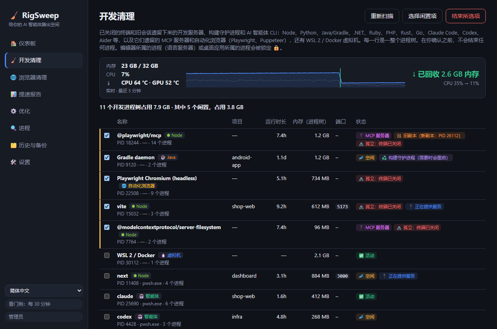

<div align="center">

# 🧹 RigSweep

**给你的智能体腾出空间。** Windows 开发机被 AI 智能体会话占满？RigSweep 帮你释放内存、CPU 和磁盘空间。

**[🌐 主页](https://rigsweep.com)** · **[⬇️ 下载](https://github.com/yobotn/rigsweep/releases/latest)** · **[📖 防病毒常见问题](#%EF%B8%8F-防病毒软件误报)**

[🇬🇧 English](README.md) · [🇩🇪 Deutsch](README.de.md) · [🇪🇸 Español](README.es.md) · [🇫🇷 Français](README.fr.md) · [🇮🇹 Italiano](README.it.md) · [🇧🇷 Português](README.pt-BR.md) · [🇷🇺 Русский](README.ru.md) · [🇯🇵 日本語](README.ja.md) · [🇰🇷 한국어](README.ko.md) · 🇨🇳 简体中文




</div>

---

## 📖 我为什么要做这个工具

在 AI 时代，我的笔记本电脑早已不只运行*一个*程序。平常的一天里，我会在不同终端中开着好几个 **Claude Code** 会话，每个项目一个开发服务器，还有构建监视程序，以及开满文档、预览页面和仪表板的浏览器。每个新会话都会启动更多 Node 进程，而关闭终端后，其中一些进程**仍在后台继续运行**。

电脑开始变得*臃肿*：风扇狂转，内存占用总是接近上限，却看不清到底是什么在吃内存。任务管理器只给我看一长串 `node.exe` 和 `chrome.exe`，不告诉我它们属于哪个会话、哪个项目，也不告诉我是否还有程序需要它们。

于是我在工作日中途测量了自己的电脑（32 GB 内存）：

| 🔎 我的发现 | 数量 | 内存 |
|---|---:|---:|
| 🌐 Chrome 进程 | 37 | **6.5 GB** |
| ⬢ Node + Claude 进程（智能体 CLI、开发服务器、桌面应用） | 14 | **2.5 GB** |
| 🧩 正在运行的 Windows 服务（遥测、Xbox、搜索索引器…） | ~150 | — |

这些都不是“病毒”或“垃圾”，而是**使用 AI 智能体工作时的正常遗留物**，再加上开发机用不着的 Windows 后台组件。现有的“电脑加速”应用要么会做一些吓人且不可逆的操作，要么对开发工作流一无所知。所以我做了一个自己想要的工具：

> **看清到底是什么在占用电脑，清理闲置的进程，并且每项更改都可以撤消。**

---

## ✨ 功能

### 🧹 开发清理：清理任意技术栈中闲置的开发进程
找出**开发服务器、构建守护进程和 AI 智能体 CLI**，并将每一项与其**整个进程树**、项目文件夹、运行时长、内存和监听端口归为一组。

| 技术栈 | 能找到什么 |
|---|---|
| ⬢ Node · Bun · Deno | 开发服务器（Vite、Astro、Next…）、监视程序、esbuild |
| 🐍 Python | uvicorn、Flask、Django、Jupyter、Streamlit、Celery、venv 进程、Python MCP 服务器 |
| ☕ Java | Gradle 和 Kotlin 守护进程、Maven、Spring Boot、Quarkus |
| 🟣 .NET | `dotnet watch/run`、Roslyn 编译器服务器、遗留的 MSBuild 节点 |
| 💎 Ruby · 🐘 PHP · 🦀 Rust · 🐹 Go | `rails`/`ruby`、`php -S`/artisan、`cargo watch/run`、`go run` |
| 🤖 智能体 CLI | Claude Code、Codex、Gemini CLI、opencode、Aider、Goose |
| 🔌 MCP 服务器 | 由智能体启动、在智能体退出后仍在运行的服务器（`@modelcontextprotocol/*`、`@playwright/mcp`、`mcp-server-*`、FastMCP…），即使隐藏在 `cmd /c npx` 启动器后面也能找到 |
| 🌐 自动化浏览器 | Playwright / Puppeteer / `--headless` 模式的 Chrome 和 Edge，连同其整个渲染器进程树。你自己的浏览器绝不会被列出 |
| 🐧 WSL 2 / Docker | Linux 虚拟机（`vmmemWSL`），通过 `wsl --shutdown` 干净地关闭，绝不会被预先选中 |

Python 和 Java 也会运行普通的桌面应用，因此对于这两者，只会列出带有明确开发特征的进程。

- 🧟 **孤立**：终端已关闭，但进程仍在运行。即使它仍占用端口也会被预先选中（比如经典的僵尸 `localhost:3000`）。
- 🔌 **MCP 服务器**：每个 MCP 服务器所在的行都有标记，方便你区分智能体遗留的工具服务器和你自己的开发服务器。
- 👯 **旧副本**：如果某个 MCP 服务器还有一个较新的副本在运行（例如在你当前的智能体会话下），旧的那个会被标记出来，让你一眼就能发现遗留项。
- 📈 **实时指示器**：RigSweep 运行期间（窗口或通知区域），每 2 秒采样一次内存和 CPU。每次清理（无论是手动还是自动）结束后，它会立即显示**实际回收了多少内存**，以及 CPU 前后对比。这些都是实测值，而非估算。
- 🌡️ **温度跟踪**：仪表板上实时显示 CPU 和 GPU 温度，附带最近 5 分钟的趋势和峰值；电脑持续高于 90 °C 时会发出警告。GPU 温度与任务管理器使用同一计数器；CPU 温度来自 ACPI 热区（不安装驱动程序，无需管理员权限；在许多台式机上只是近似值）。单击该磁贴可在 °C 和 °F 之间切换。
- 💤 **空闲**：长时间没有 CPU 活动。没有打开端口的运行时会被预先选中。**打开的终端中的空闲智能体会话绝不会被预先选中**，因为它只是在等你（而且 `claude --resume` 也能把它恢复回来）。
  多长时间算空闲可以在**设置**中指定（以分钟为单位，默认 120，例如可设为 5）。
- 🧹 **自动清理**（默认关闭，在“设置”中开启）：RigSweep 每分钟会结束那些在整个空闲时长内一直被它观察到没有 CPU 活动的闲置开发运行时。智能体 CLI、WSL/Docker 虚拟机和编辑器所属的进程绝不会被自动结束，每个被结束的进程树都会记录在“历史与备份”中。
- 🟠🔴 **通知区域指示器**：当闲置的开发进程占用 ≥ 1 GB 内存时，通知区域图标（以及窗口打开时的任务栏按钮）会显示橙色圆点，≥ 2 GB 时显示红色圆点。将鼠标悬停在通知区域图标上可以查看具体占用量。阈值可在“设置”中调整，也可以在那里关闭圆点。
- ♻️ **构建守护进程**：Gradle、Kotlin 和 Roslyn 服务器本来就会常驻。结束它们没有坏处，下次构建时会重新启动。
- 🔒 **锁定**：属于 **VS Code、Cursor、JetBrains、Visual Studio…**（你的语言服务器）或桌面应用的进程，绝不能在这里结束。
- ✅ 未经你确认，不会结束任何进程；每次结束进程前都会检查 PID 是否已被重用。

### 💾 开发磁盘：node_modules 和包缓存
旧项目在你不再碰它们之后，仍然留着好几 GB 的 `node_modules`、`.next`、`target`、`bin/obj` 和 `.venv`，而包缓存只会越来越大。RigSweep 会把这两类都找出来，删除你选中的内容。

- 🗂️ **项目**：Node、Rust、.NET、Java/Gradle/Maven 和 Python 的构建产物与依赖文件夹。只有旁边有项目文件（`package.json`、`Cargo.toml`、`*.csproj`、`pyvenv.cfg` 等）的文件夹才算数，所以随便一个 `build` 文件夹绝不会被动到。只会预先勾选 30 天（可调整）没人编辑过的项目，正被运行中的进程使用的项目会被锁定 🔒。
- 📦 **包缓存**：npm、npx、pnpm、Yarn、Bun、pip、uv、Cargo、Go、NuGet、Gradle、Maven、Playwright、Puppeteer、Hugging Face。pnpm、uv 和 Go 用它们自己的命令清理（`pnpm store prune` 等）；Playwright 和 Puppeteer 只删除旧版浏览器，保留最新版本。
- 🚫 **从不清理**：任何缓存都可以关掉。需要大量重新下载的那些（Playwright、Puppeteer、Hugging Face、Gradle、Maven、NuGet 包、Go 模块）默认就是关闭的。
- 🙈 **排除**：AppData、用户目录中的工具文件夹（`.cargo`、`.nvm`、`.vscode` 等）、`.git` 和 Windows 始终跳过。你可以在设置中添加自己的路径或文件夹名（`vendor`、`old-*`），也可以在项目上点击 **排除**。
- ✅ 默认扫描你的用户目录（桌面、文档、下载、OneDrive 等）。未经你确认不会删除任何东西，每个文件夹在删除前都会再检查一次。

### 📊 提速报告：真实的前后对比
没有“你的电脑快了 87%”这种虚假数字。RigSweep 会**测量**你的电脑并比较两个快照：已用/可用内存、平均 CPU、进程数、正在运行的服务、Chrome 内存、Node/智能体内存。

- 📸 首次应用优化前会自动记录**基线**。
- 🔁 每次开发清理前后都会记录一组**前后对比**数据。
- 📋 **复制为 Markdown**，即可在 issue、帖子或这个 README 中分享你的结果。

### 🌐 Chrome 标签页助手
桌面应用**无法**关闭 Chrome 标签页，因此 RigSweep 附带了一个小巧的扩展程序（[`chrome-extension/`](chrome-extension/)），它没有网络访问权限，仅需 `tabs` / `storage` / `alarms` 权限：
- 💤 **让空闲标签页休眠**：释放其内存，但标签页仍保留在标签栏中
- 🧹 **关闭重复的标签页**
- 🎯 **按模式关闭标签页**，例如 `localhost:*` 或 `*.vercel.app`
- ⏰ 每 10 分钟**自动休眠**（可选）

### ⚙️ 可撤消的 Windows 优化
一份精选目录（[`catalog/tweaks.json`](src-tauri/catalog/tweaks.json)），涵盖遥测、Xbox、搜索索引器、后台应用、针对开发文件夹的 Defender 排除项、电源计划等，每项都标有风险等级：

| 等级 | 含义 |
|---|---|
| 🟢 `safe` | 无明显副作用（预先选中） |
| 🟡 `moderate` | 有少许取舍，附有说明 |
| 🔴 `caution` | 会使某项功能失效，需要你确认 |


- 💾 首次更改前，**每个原始值都会备份**到 SQLite 中。可以还原单项优化、整个类别或全部更改。
- 🛟 首次应用前会创建**系统还原点**。
- 🔁 **看门狗**会重新应用被 Windows 更新悄悄还原的优化，并统计这种情况发生的次数。
- 🚫 绝不触碰：Windows 更新、Defender 引擎、RPC/DCOM/LSA 以及约 60 项其他核心服务（[`PROTECTED_SERVICES`](src-tauri/src/catalog.rs)）。

### 🔍 进程分析器
显示每个进程的 CPU / 内存 / 磁盘占用，以及**每个 `svchost.exe` 中托管了哪些服务**。可以直接在列表中禁用服务或结束进程（核心项已锁定 🔒）。

### 🔄 更新由你决定
**🛠️ 设置 → 🔄 更新**中有一个**立即检查**按钮，以及一个可选的*自动检查更新*（启动时检查，之后每天一次），该选项**默认关闭**。有新版本时，侧边栏中会出现一个按钮，附带发行说明。在你单击**安装并重启**之前，不会安装任何内容，而且只有下载内容使用 RigSweep 的密钥签名时才会安装。你的优化、备份和设置都会保留。检查更新时具体会做什么，请参阅[隐私政策](#-隐私政策)。

### 🌍 10 种语言
界面提供 **English、Deutsch、Español、Français、Italiano、Português (Brasil)、Русский、日本語、한국어 和简体中文**（可在侧边栏中切换），安装程序和 Chrome 扩展程序也是如此。每种语言都使用该语言的 Windows 官方术语（任务管理器、服务、任务计划程序…）进行本地化，而不是逐字翻译。发现哪里读着别扭？欢迎针对 `ui/locales/<code>.js`（应用）、`docs/locales/<code>.js`（主页）或 `README.<code>.md` 提交 issue 或 PR。

---

## 🏁 在你的电脑上对比前后效果

安装后打开 **📊 提速报告 → 📸 立即测量**，执行一次开发清理并应用安全的优化，重启，再测量一次，然后单击 **📋 复制为 Markdown**。欢迎在 [Discussions](../../discussions) 中分享你的结果！

<!-- TODO(maintainer): paste your own "Copy as Markdown" result here once you've run it on your machine. -->

> ℹ️ 服务类优化需要重启后才能完全生效。开发清理和 Chrome 标签页休眠的效果会立即显现。

---

## 📦 安装

1. 从 [**Releases**](../../releases) 下载 `RigSweep_x.y.z_x64-setup.exe`。
2. 运行它。它会请求管理员权限，因为 RigSweep 需要管理服务和策略。
3. 安装程序会询问是否在 Microsoft Defender 中允许 RigSweep（见下文）。是否允许由你决定。
4. 之后的版本可以通过 **🛠️ 设置 → 🔄 更新**安装（从 0.5.0 开始）。

🌐 **Chrome 助手**：在 RigSweep 中转到 **🛠️ 设置 → 🌐 Chrome 标签页助手 → 打开扩展程序文件夹**，然后在 Chrome 中：`chrome://extensions` → **开发者模式** → **加载已解压的扩展程序** → 选择该文件夹。

## 🛡️ 防病毒软件误报

RigSweep 是开源软件，但**目前尚未进行代码签名**。会更改服务和 Defender 设置的工具在机器学习启发式检测看来很像恶意软件，因此 **Microsoft Defender 可能会误删 exe 文件**。开发期间就曾发生过这种情况，检测名称为 `Trojan:Win32/Bearfoos.B!ml`，其中 `!ml` 表示启发式推测，而不是匹配已知恶意软件的特征码。

我们的应对措施：
- ❓ **安装程序提示（可选）**：“在 Microsoft Defender 中允许 RigSweep？”选择“是”将**仅排除安装文件夹**，卸载程序会再次删除该排除项。静默安装永远不会添加排除项。
- 🛠️ **设置 → 🛡️ 防病毒信任**：查看状态，并可随时添加或删除排除项。
- ✍️ **计划通过 [SignPath Foundation](https://signpath.org) 进行代码签名**（对开源项目免费）。这才是根本解决办法。请参阅[代码签名政策](#-代码签名政策)。

如果已经被删除：**Windows 安全中心 → 病毒和威胁防护 → 保护历史记录 →** 选择 RigSweep 条目 → **操作 → 还原**。仅当文件是从本仓库的 Releases 页面下载的，或是你自己构建的时，才应这样做。你也可以自行[向 Microsoft 报告误报](https://www.microsoft.com/wdsi/filesubmission)。

---

## 🛠️ 从源代码构建

```powershell
winget install Rustlang.Rustup        # + VS 2022 生成工具（C++ 工作负载）
npm install
npm run build                         # -> src-tauri/target/release/rigsweep.exe + bundle/nsis/*-setup.exe
```
开发运行：`npm run dev`（接受 UAC 提示；应用会以提升的权限重新启动自身）。

> 💡 Defender 也可能隔离你刚在本地构建的文件。请将你的克隆文件夹添加到 RigSweep 的*开发文件夹*列表（“设置”中），并应用 **Defender exclusions for dev folders** 优化，或者手动排除 `src-tauri\target`。

### ⌨️ CLI
| 命令 | 作用 |
|---|---|
| `rigsweep.exe` | 图形界面 + 通知区域 |
| `rigsweep.exe --apply` | 无界面运行：验证配置，重新应用被还原的优化，然后退出（由启动任务使用） |
| `rigsweep.exe --apply --tray` | 同上，然后带着看门狗留在通知区域 |
| `rigsweep.exe --restore-all` | 将所有更改还原为已备份的原始值 |

### 🧪 测试
```powershell
cd src-tauri
cargo test                                          # 目录有效性、备份、快照、命令解析
cargo test live_status   -- --ignored --nocapture   # 只读：每项优化的检测状态
cargo test live_dev_scan -- --ignored --nocapture   # 只读：开发清理当前看到的内容
```

### ➕ 添加优化
在 [`catalog/tweaks.json`](src-tauri/catalog/tweaks.json) 中添加一个条目。操作类型有 `service`（start: disabled|manual）、`task`（path）、`registry`（HKLM|HKCU, dword|string）、`defender_exclusion` 和 `power_plan`。`caution` 项必须包含 `warning`。`cargo test` 会拒绝受保护的服务和格式错误的条目。

## 🐳 docker-optimize（独立工具）
不属于应用本身。[`docker-optimize/`](docker-optimize/) 是一个独立、可撤消的一次性脚本，用于限制 Docker Desktop 的 WSL2 虚拟机资源（内存、CPU、内存回收、稀疏磁盘），并关闭你用不着的 Docker Desktop 附加功能。它绝不会删除容器、镜像或卷。请参阅它的 [README](docker-optimize/README.md)。

## 🗂️ 文件存放位置
| 内容 | 位置 |
|---|---|
| 数据库（备份、历史记录、快照） | `%ProgramData%\RigSweep\rigsweep.db`（+ `.bak.1`–`.bak.5`） |
| 启动任务 | 任务计划程序 → `RigSweep-Reapply` |
| 导出的配置 | `Documents\RigSweep-profile-*.json` |

从 **aiBoost**（旧名称）升级而来？首次启动时会自动迁移你的数据库，并替换旧的启动任务。

## 🔏 代码签名政策

免费代码签名由 [SignPath.io](https://about.signpath.io/) 提供，证书由 [SignPath Foundation](https://signpath.org/) 颁发。
*（申请处理中：v0.3.0 及之前的版本**尚未签名**。）*

- **构建**：发布版安装程序由 [GitHub Actions](.github/workflows/release.yml) 在 GitHub 托管的运行器上基于带标签的源代码构建。只有这些构建会被提交签名。
- **提交者和审阅者**：[@yobotn](https://github.com/yobotn)
- **审批者**：[@yobotn](https://github.com/yobotn)

### 🔒 隐私政策
除非用户或安装、操作本程序的人员明确要求，否则本程序不会向其他联网系统传输任何信息。RigSweep 没有遥测，也没有分析功能，Chrome 扩展程序不发出任何网络请求。RigSweep 唯一可能发出的网络请求是**更新检查**，而且仅在你要求时才会发出：在“设置”中单击*立即检查*，或开启*自动检查更新*（默认关闭）。它会从本仓库的 GitHub Releases 下载 `latest.json`，不会发送任何有关你电脑的信息；只有在你单击*安装并重启*之后才会安装更新，而且更新的签名必须与 RigSweep 的签名密钥匹配。它存储的所有内容（备份、历史记录、测量数据）都保存在你电脑上的 `%ProgramData%\RigSweep` 中。

## ⚠️ 免责声明

RigSweep 会更改 Windows 服务、计划任务、注册表策略和 Microsoft Defender 设置，并可以结束正在运行的进程。每项优化都会先备份，随时可以还原；未经你确认，不会执行任何操作。但**使用风险由你自行承担**。本软件**按“原样”提供，不附带任何形式的担保**（请参阅 [MIT 许可证](LICENSE)）。应用每项更改前请仔细检查，自行做好备份；未经 IT 部门批准，请勿在工作单位或学校管理的设备上使用。

RigSweep 是独立项目，**与** Microsoft、Google、Anthropic、OpenAI 及文中提到的任何其他工具**均无关联**。所有商标归其各自所有者所有。

## 🤝 参与贡献
欢迎提交 issue 和 PR，尤其是新的优化（需标明清晰的风险等级）、开发清理支持的更多技术栈和智能体 CLI，以及翻译。

## 📄 许可证
[MIT](LICENSE)：永久免费，随意使用，不提供任何担保。
