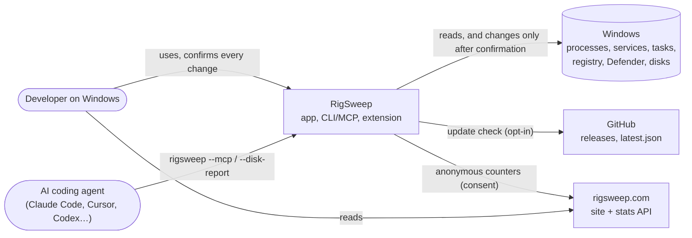
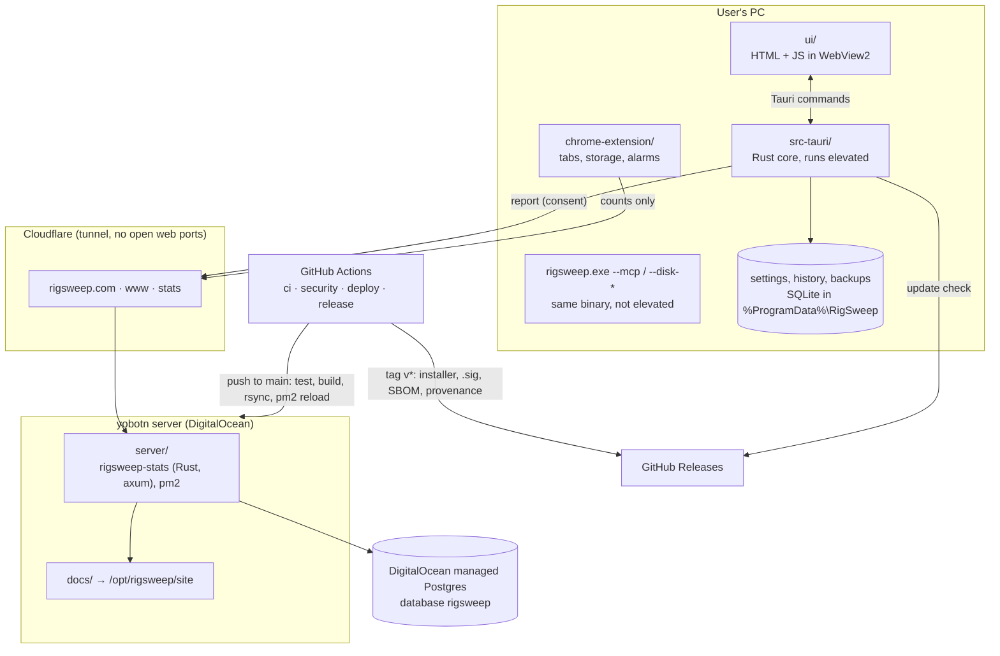

# Architecture

C4-style overview: the system in its context, then its containers. Details live next to the code
(`AGENTS.md` → Structure); the trust boundaries are in [threat-model.md](threat-model.md).

## Context

## Containers

